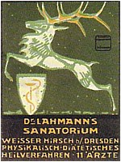
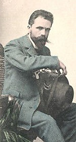
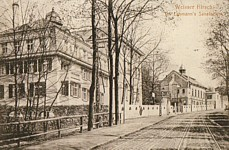
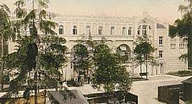
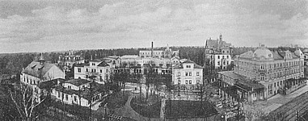
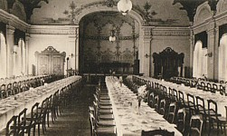
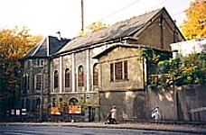

* * *

* * *

* * *

* * *

* * *

* * *

_Heinrich Lahmann_

_Verwaltungsgebäude_

_Eingang an der_

_Bautzner Landstraße_

_Warte- und Empfangssaal_

_Badesaal im Damenbad_

_Plastik "Sandalenbinderin"_

_im Innenhof_

_Herrenmassage_

_Küche_

_Blick in den Großen Speisesaal_

_Lahmann-Villa "Elbblick"_

_(Hermann-Prell-Str. 14)_

_Lahmann-Villa "Alke"_

_(Küntzelmannstraße 11)_

Frida-Bad:

Vorgänger des späteren Lahmann-Sanatoriums war das Frida-Bad des Loschwitzer Bauunternehmers Theodor Lehnert. Dieser hatte die Kureinrichtung 1866/67 erbaut und nach seiner Tochter benannt. Die Eröffnung der Sommerfrische erfolgte am 1. Juli 1867. Neben Gastronomie und Erholung bot Lehnert seinen Gästen auch Bademöglichkeiten mit Voll-, Halb- und Sitzbädern und verschiedenen Massageanwendungen an. Das Wasser für den Betrieb des Kurbades stammte aus einer Quelle in der Nähe des Fischhauses und wurde über eine ca. drei Kilometer lange hölzerne Röhrfahrt zum Bad geführt. Der eigentliche Kurkomplex bestand aus zwei zweigeschossigen Gebäuden, die durch eine halbkreisförmige Wandelhalle miteinander verbunden waren. Im Mittelbau befanden sich die Kasse und ein Empfangszimmer. Insgesamt standen 40 möblierte Gästezimmer und eine kleine Restauration zur Verfügung. Mit dem Frida-Bad begann der Aufstieg der kleinen Gutsgemeinde Weißer Hirsch zum Kurort vor den Toren Dresdens.

Trotz aller Bemühungen geriet das Unternehmen jedoch in wirtschaftliche Schwierigkeiten und musste 1883 Konkurs anmelden. Die Konkursverwaltung übernahm zunächst der Sanitätsrat Seifert, mit dem 1887 der junge Bremer Arzt Heinrich Lahmann Kontakt aufnahm. Dieser hatte während eines Urlaubs das Frida-Bad entdeckt und als geeignet für seine eigenen Pläne befunden. Ein Jahr später pachtete Lahmann am 16. Oktober 1888 das Bad und eröffnete hier wenige Wochen später sein "Physiatrisches Sanatorium".

Lahmann-Sanatorium:

Das Lahmann-Sanatorium wurde am 1. Januar 1888 offiziell als "Dr. Lahmanns physiatrisches Sanatorium Weißer Hirsch" gegründet. Im Mittelpunkt der Behandlung der Patienten stand die gesunde Ernährung, in enger Verbindung mit Wasseranwendungen, Bewegung an frischer Luft und regelmäßigen Luftbädern. Außerdem fanden bestimmte physio- und psychotherapeutische Maßnahmen statt, die das Gesamtbefinden der Kurgäste verbessern sollten. In einem eigenen chemisch-physiologischen Laboratorium befasste sich Lahmann auf naturwissenschaftlicher Grundlage mit Fragen des menschlichen Stoffwechsels und entwickelte eigene diätische Produkte und Nahrungsergänzungsmittel. 1897 weilte Maximilian Oskar Bircher-Brenner zu einem Studienaufenthalt am Weißen Hirsch. Er gilt als "Erfinder" des Müslis. Nach Lahmanns Tod wirkte ab 1909 der schwedische Ernährungsforscher Ragnar Berg für einige Jahre im Sanatorium und entwickelte hier eine bis heute gültige Lebensmitteltabelle zum Mineralstoffhaushalt. Zur Popularisierung seiner naturheilkundlichen Ideen veröffentlichte das Sanatorium im Eigenverlag auch verschiedene Bücher und Broschüren.

Lahmanns Konzept war ein voller Erfolg, das alljährlich zahlreiche Kurgäste anzog. Zwischen 1888 und 1913 wuchs deren Zahl von 385 auf über 7.400 an, darunter ca. ein Drittel aus dem Ausland. Bis zum Ersten Weltkrieg wurden deshalb neue Kurgebäude errichtet, Wasserleitungen und Dampfheizungsanlagen eingebaut und verschiedene Bade- und Gemeinschaftshäuser eingerichtet _(Foto: Herrenbad)_. Zur Versorgung seines Sanatoriums erwarb Lahmann 1894 das Gut Friedrichsthal bei Radeberg und ließ hier eine Musterwirtschaft anlegen. Um die Gäste unterbringen zu können, baute bzw. kaufte der Arzt außerdem insgesamt 15 Villen auf dem Weißen Hirsch, darunter die 1905 von Max Herfurt erbaute Villa Urvasi am Lahmannring. Lahmann selbst wohnte bis zu seinem Tod am 1. Juni 1905 in einem repräsentativen Gebäude unmittelbar auf dem Klinikgelände.

Bis zum Ersten Weltkrieg besuchten Gäste aus aller Welt den Kurort am Dresdner Nordrand, bevor der Kriegsausbruch vorerst ein abruptes Ende setzte. Zu den berühmten Kurpatienten gehörten neben wohlhabenden Kaufleuten und Militärs auch Mitglieder der Familie der Hohenzollern und der russischen Zarenfamilie, Könige und Fürsten aus Europa, Asien und Ägypten, aber auch Schauspieler, Sänger und Schriftsteller, unter ihnen Rainer Maria Rilke, Franz Kafka und Thomas Mann. Über 300 Angestellte sorgten sich um deren Wohl, nahmen medizinische Behandlungen vor und organisierten den Klinikbetrieb. 1907 stellte das Sanatorium mit Ernst von Düring erstmals einen Chefarzt ein. Ihm folgte 1911 der Mediziner Kraft. Leiter war von 1907 bis 1918 Carl Paira, der zuvor selbst als Kurgast zum Weißen Hirsch gekommen war.

Mit Beginn des Ersten Weltkriegs erlitt der Kurbetrieb massive Einbußen und kam weitgehend zum Erliegen. Zahlreiche Kurgäste sagten ihren Aufenthalt ab, zudem war ab 12. August 1914 der Kuraufenthalt von Gästen aus "Feindstaaten" untersagt. Stattdessen richtete das Deutsche Rote Kreuz ein bis 1918 bestehendes Vereinslazarett ein, in dem bis zu 150 Verwundete gleichzeitig betreut werden konnten.

Nach dem Krieg gelang es nur mühsam, wieder an frühere Besucherzahlen anzuknüpfen. Die Rechtsform änderte sich zur Aktiengesellschaft, der Betrieb blieb jedoch weiter in Familienbesitz. 1919 übernahm der Psychiater Johannes Heinrich Schultz die Funktion des Chefarztes und wissenschaftlichen Leiters. Er war Entwickler der Methode des Autogenen Trainings. 1921 wurden das Lahmann-Sanatorium und einige andere private Kureinrichtungen unter Verwaltung der Stadt Dresden zu einem Kurbezirk zusammengefasst.

**_Foto:_** _Gesamtansicht des Lahmann-Sanatoriums in den 1920er Jahren_

Bis zum Zweiten Weltkrieg blieb das Sanatorium modernstes und bekanntestes in der Dresdner Umgebung und wurde weiterhin von In- und Ausländern besucht. Als Kurgäste erwähnt werden sollen hier Prinzessin Irene von Preußen, der Flugzeugkonstrukteur Hugo Junkers, Reichsminister Dr. Albert Neuhaus, der Schriftsteller Kurt Tucholsky, die Sängerin Claire Waldoff, Operettenkomponist Paul Linke und die UFA-Stars Gustaf Gründgens, Heinrich George, Zarah Leander, Marika Rökk, Heinz Rühmann und Willy Birgel. Auch spätere Funktionäre des NS-Regimes wie Joseph Goebbels und Hermann Göring gehörten dazu, ebenso wie Reichswehrminister Werner von Blomberg, auf dessen Anregung der heutige Friedensblick an der Collenbuschstraße entstand. Als Chefärzte fungierten ab 1924 Louis Ratcliffe Grote, ab 1929 Hans Oeller und ab 1932 Alfred Störmer. Zum Ärzteteam gehörte ab 1930 auch Lahmanns jüngster Sohn Fritz. Der ältere Sohn Albert war ebenfalls bis zu Beginn des Zweiten Weltkrieg als Arzt tätig und praktizierte später noch bis zu seinem Tod 1955 am Weißen Hirsch. Zu den gravierenden Einschnitten in der Zeit des Nationalsozialismus gehörte die Auflage, jüdische Kurgäste nur noch in jüdischen Pensionen unterzubringen und ihnen zudem die Nutzung von Luftbad und Lesehalle verbot.

Wegen des hohen Standards und des internationalen Rufes war eine Kur bei Lahmann kein billiges Vergnügen. In der Regel dauerte der Aufenthalt 21 Tage und kostete 1933 zwischen 700 und 1100 Reichsmark. Empfangen wurden die Gäste in der an das Verwaltungsgebäude angeschlossenen großen Wartehalle, wo zunächst einige Formalitäten zu erfüllen waren. Nach einer Voruntersuchung wurden die Kurausweise ausgegeben und die festgelegte Kurtaxe bezahlt. Danach standen alle Einrichtungen des Sanatoriums zur Verfügung. Die Kur selbst war je nach Festlegung des behandelten Arztes eine Kombination aus "Arbeitstherapie" (Holzsägen), Aufenthalt an frischer Luft, Massagen und Wasserbehandlungen sowie ein strenger Diätplan. Ab 1930 gab es zudem Trinkkuren mit leicht mineralhaltigem Wasser aus der Paradiesquelle im Kurpark. Betreut wurden die Patienten von einer großen Zahl einheitlich gekleideter Zimmer-, Bade- und Wäschemädchen. In der Freizeit standen verschiedene Unterhaltungsmöglichkeiten zur Verfügung - von Freiluftkonzerten im Kurpark, Tennis und Reitsport bis hin zu organisierten Ausflugsfahrten in die Dresdner Umgebung.

1939 übernahm die Wehrmacht die Gebäude und richtete hier ein Reservelazarett mit Genesungsheim für Soldaten ein. Das von Zerstörungen verschont gebliebene Sanatorium wurde am 16. August 1945 in Stadtkrankenhaus Weißer Hirsch umbenannt und als Außenstelle an das Johannstädter Krankenhaus angegliedert. Die früheren Kurpensionen dienten als Flüchtlingsunterkunft. 1946 beschlagnahmte jedoch die Sowjetarmee den Komplex und enteignete die Familie Lahmann. Bis 1991 dienten die Gebäude als Militärkrankenhaus und Sanatorium der sowjetischen Streitkräfte. Obwohl keine grundlegenden Umbauten erfolgten, wurde die historische Bausubstanz in dieser Zeit schwer in Mitleidenschaft gezogen _(Foto 2002)_. 1991 verließ die Sowjetarmee das Areal in ruinösem Zustand. Alle Konzepte zur Reaktivierung, die u. a. die Einrichtung eines Seniorenstiftes der Stiftung "Collegium Augustinum" bzw. ein Europäisches Wellness- und Forschungszentrum vorsahen, scheiterten an den hohen Kosten und Auflagen des Denkmalschutzes.

2011 erwarb die Baywobau als Investor das frühere Sanatorium und ließ dieses unter weitgehender Erhaltung der vorhandenen Bebauung in den Folgejahren zu einem Wohnpark umgestalten ("Dr. Lahmann-Park"). Dafür wurden die meisten historischen Gebäude umfassend saniert und durch moderne Zutaten behutsam ergänzt. An den Entwürfen waren mehrere renommierte Architektenbüros beteiligt. Im Eckhaus zur Stechgrundstraße entstanden Arzt- und Therapiepraxen. Komplettiert wurde der Komplex durch eine Einfamilienhaussiedlung am Heiderand. Baubeginn war Mitte 2013, die Fertigstellung ist 2022 vorgesehen.

Einzelne Gebäude:

Verwaltungsgebäude: Das Eckhaus zur Stechgrundstraße (Bautzner Landstraße 5) entstand 1893 für den Gastwirt Carl Koppelt als Wohn- und Geschäftshaus. Im Erdgeschoss betrieb Koppelt eine Weinstube, später Weinrestaurant Kaiserkeller genannt. 1907 erwarb das angrenzende Lahmann-Sanatorium das Gebäude und ließ es bis 1909 zum Verwaltungsgebäude für den Kurbetrieb umbauen. Hier befanden sich verschiedene Büroräume sowie die Poststelle des Sanatoriums. Im früheren Hof diente ein 1908 von Theodor Richter entworfener großzügiger Wintergarten als Wartezimmer für neu angekommene Kurgäste. Ein Personenaufzug verband den Wartesaal mit den oberen Etagen. Das Foyer war mit dunklem Holz getäfelt und beherbergte die Rezeption. 2016 begann die Sanierung des Gebäudes, in dem sich heute Arztpraxen und Wohnungen befinden.

Villa Heinrichshof: Die Villa Stechgrundstraße 1 entstand 1897 als Wohnsitz des Sanatoriumsbesitzers Heinrich Lahmann. Architekt des im altdeutschen Landhausstils gestalteten Gebäudes war Paul Kayser (1850-1921). Erker, Loggien und Zierrat gliedern die Fassade. Auch nach dem Tod Lahmanns 1905 blieb das Haus bis zum Zweiten Weltkrieg Wohnsitz der Familie. Im Zuge der Sanierung ab 2011 entstanden hier Eigentumswohnungen, wobei das historische Erscheinungsbild weitgehend wiederhergestellt wurde und Teile der Innenausstattung erhalten blieben. Die Planung übernahmen die Architekten Strangmann & Schneider.

**_Fotos:_** _Die frühere Lahmann-Villa "Heinrichshof"_

Eingang und Wandelhalle: Der Haupteingang zum Sanatoriumskomplex befand sich an der Bautzner Landstraße und bestand ursprünglich aus einer einfachen Einfahrt mit Firmenschild. Rechts gab es eine pavillonartige Empfangshalle, die ursprünglich als Rezeption diente. 1912/13 entstand nach Plänen des Architekturbüros Schilling & Gräbner ein überdachter Wandelgang, der eine Verbindung vom Empfangs- und Verwaltungsgebäude zum Speisesaal und zur Bibliothek herstellte _(Foto)_. Im Zuge der Sanierung wurde die Wandelhalle 2018/19 verglast und denkmalgerecht restauriert.

Gesellschaftshaus und Speisesaal: Das Gesellschaftshaus an der Bautzner Landstraße war der kulturelle Mittelpunkt des Kurbetriebes. Ursprünglich beherbergte es Aufenthaltsräume und eine Bibliothek und wurde ab 1893 schrittweise erweitert. Hier befand sich der repräsentative große Speisesaal mit einer hölzernen Kassettendecke und einer Bühne. Eine Inschrift über der Bühnenwand benannte das Credo des Lahmann-Sanatoriums: "Treu der Natur widerfährt dem Menschen nichts Übles." Die Ausgestaltung erfolgte 1898/99 durch die Firma Arnold & Lahode. In diesem Saal konnten die Sanatoriumsgäste ihre Mahlzeiten einnehmen. Außerdem fanden abends Veranstaltungen und Konzerte statt. Später komplettierten der Neue Speisesaal und eine angeschlossene Glashalle den Komplex. Außerdem gab es einen kleinen Hof mit Pergola. Im hinteren Teil befanden sich modern ausgestattete Küchenräume. Eine nochmalige Modernisierung erfolgte 1924/25.

Das im wesentlichen unveränderte Gebäude wurde während der Sanierung renoviert und im Inneren unter Erhalt der wertvollen Kassettendecke und vieler architektonischer Details aufgeteilt. Während des Umbaus kam es 2019 fast zum Einsturz der straßenseitigen Fassade, die jedoch gestützt und gesichert werden konnte. Auch hier sind nach Abschluss der Arbeiten Wohn- und Gewerberäume geplant.

Damenbad: Das frühere Damenbad ist ältester Teil des Sanatoriums und geht im Kern noch auf das frühere Fridabad zurück. Um 1890 bestand der Komplex aus dem durch einen Wandelgang verbundenen "Doktorhaus" und dem "Hirschhaus". Im hinteren Teil befand sich das eigentliche Badehaus mit den nötigen Technikräumen. Lahmann ließ dieses 1893-96 für die Behandlung weiblicher Kurgäste umbauen. Während das erweiterte Doktorhaus für Arztpraxen und Trockenräume genutzt wurde, entstand im Hirschhaus ein Inhalatorium zur Behandlung von Atemwegserkrankungen. Ein weiterer Umbau der Gebäude erfolgte 1906/07 durch Paul Kayser. Neben verschiedenen Bade- und Behandlungsräumen gab es auf dem Dach ein Sonnenbad, in dem die Patientinnen in abgetrennten Liegekabinen Luftbäder nehmen konnten _(Foto rechts)_.

Im Zuge der Sanierung nach 2011 wurde das frühere Damenbad in acht Reihenhäuser mit Wintergärten und Dachterrassen aufgeteilt. Die Planungen stammen vom Architektenbüro Hoyer & Ille. Hirschhaus und Doktorhaus wurden saniert und ebenfalls zu Wohnzwecken umgebaut. Zwischen Damenbad und Herrenbad liegt ein gärtnerisch gestalteter Innenhof, darunter die im Zuge des Umbaus angelegte Tiefgarage für die Bewohner. Den Mittelpunkt der Anlage bildet eine 1883 geschaffene Plastik einer jungen Frau, die sich eine Sandale bindet und schon zu Lahmanns Zeiten im Sanatorium stand. Schöpfer der 2016 restaurierten Figur war der Bildhauer Ernst Paul.

Herrenbad: Das im Jugendstil gestaltete Herrenbad im hinteren Teil des Sanatoriumsgeländes wurde 1904-05 nach einem Entwurf von Theodor Richter errichtet. Hier befanden sich verschiedene Bade- und Behandlungsräume für männliche Sanatoriumsgäste mit Sitz- und Wannenbädern sowie Massageräumen. In einem angebauten Turm befand sich ein Zinkbehälter, der als Wasserspeicher diente. Das dafür benötigte Wasser wurde über eine Leitung aus dem Stechgrund gepumpt. Ursprünglich sollte dieser Hochbehälter nach den Vorstellungen Lahmanns den gesamten Ort mit Wasser versorgen, was jedoch nicht zustande kam. Das Obergeschoss mit dem großen Bogenfenster wurde als Winterluftbad genutzt.

Nach 1990 gehörte das Herrenbad zu den am stärksten beschädigten Sanatoriumsgebäuden, weshalb zeitweise sogar ein Abriss des Hauses geplant war. Letztlich entschied man sich jedoch für eine Sanierung. Nach Entwürfen des Büros rd Architekten und der Architektin Annien Röder wurde unter weitgehender Wahrung des äußeren Erscheinungsbildes im Inneren eine Zwischendecke eingezogen und die großen Bogenfenster geteilt. Außerdem erhielten die hier eingerichteten Eigentumswohnungen Balkons. Auch der ehemalige Wasserturm wurde zu Wohnungen umgebaut und dabei um einen modernen Anbau im rückwärtigen Teil ergänzt.

Dresdner Haus: Das heute nicht mehr vorhandene Dresdner Haus, im hinteren Teil des Grundstücks in Richtung Dresden gelegen, entstand 1892 nach einem Entwurf von Bruno Anders. Es bestand aus einem Küchentrakt und einem durch einen Verbindungsbau erreichbaren Speisesaal, in dem vegetarische Kost angeboten wurde. Das stark verfallene Gebäude konnte im Gegensatz zu den anderen historischen Sanatoriumsbauten nicht gerettet werden und wurde 2013 durch einen Neubau ersetzt.

Herrenturnhalle: Zum Sanatoriumsbetrieb gehörten von Beginn auch verschiedene Einrichtungen zur Bewegung und sportlichen Ertüchtigung. Um dabei witterungsunabhängig agieren zu können, entstand 1890 hinter dem Dresdner Haus ein separates Gebäude, welches als Herrenmassage benannt ist. Im Zuge der Erweiterung des Lahmann-Sanatoriums wurde der Massagebereich verlegt. 1912 errichtete man im westlichen Teil des Sanatoriums am "Hirschberg" einen weiteren Gebäudekomplex mit Maschinenhaus und Wirtschaftsgebäuden. In diesem Zusammenhang entstand auch eine neue Herrenturnhalle, wenig später eine Damenturnhalle. Beide waren mit verschiedenen Sportgeräten ähnlich wie ein modernes Fitnessstudio ausgestattet. Zudem gab es eine Kegelbahn.

Wirtschaftsgebäude: Bereits ab 1889 wurden die Gebäude des Lahmann-Sanatoriums über eine zentrale Warmwasser- und Heizanlage versorgt. Um den wachsenden Bedarf befriedigen zu können, entschied man sich 1912/13 für den Bau eines neuen Versorgungskomplexes mit Heizhaus, Wirtschaftsgebäude und Wohnungen für die Angestellten. Für die Umsetzung beauftragte man das Architektenbüro Schilling & Graebner, welches bereits den Eingangsbereich zum Areal neu gestaltet hatte. Zentrales Gebäude war das Heiz- und Maschinenhaus mit kohlebetriebenen Dampfkesseln, die das weitläufige Areal mit Heißwasser und Wärme versorgten. Der straßenseitige Anbau diente als Wirtschaftsgebäude und beherbergte u.a. die Wäscherei. Weitere Räume wurden als Werkstätten bzw. Wohnungen genutzt. Um sich auch optisch in das Sanatorium einzufügen, sind die Gebäude im Stil der Reformarchitektur mit Mansarddächern und einer kleinteilig gegliederten Fassade gestaltet.

Um die Kurgäste nicht zu beeinträchtigen verband ein unterirdisches Gangsystem die Gebäude, über das die gebügelte Wäsche zum Bestimmungsort gebracht wurde. Ein weiterer Tunnel führt unter der Bautzner Landstraße hindurch und leitete Strom, Wasser und Fernwärme in die auf der gegenüberliegenden Straßenseite gelegenen Lahmann-Villen. Ein noch erhaltenes kleines Häuschen unterhalb der Villa Urvasi diente als Verteilerstation.

Noch bis 1991 wurde das Heizhaus von der sowjetischen Armee genutzt und erst nach deren Auszug aufgegeben. Bei der Sanierung des früheren Sanatoriums erwarb eine Investorengruppe mit dem Architekten Gunter Hildebrandt dieses Gebäude. Unter weitgehender Wahrung des Äußeren sollen hier Gewerberäume, im Turm auf der rechten Seite Eigentumswohnungen entstehen. Zudem ist als Ergänzung ein moderner Neubau mit Pkw-Garagen und weiteren Wohnungen geplant.

Liegehallen: Zum medizinischen Konzept des Lahmann-Sanatoriums gehörte neben gesunder Ernährung und Kurbehandlungen auch der Aufenthalt an frischer Luft und Bewegung. Dafür entstanden in der Nähe des Herrenbades überdachte Liegehallen, in denen sich die Gäste auf Liegestühlen erholen konnten. Hier gab es zudem eine offene Speisehalle für die Einnahme der Mahlzeiten. Sogenannte "Lufthütten" mit Schlafräumen und verschiedene Sportgeräte sowie eine Kegelbahn ergänzten das Angebot. Mit Aufgabe des Kurbetriebs 1940 verschwanden die überwiegend hölzernen Bauten. Heute gehören diese Flächen zur neuen Einfamilienhaussiedlung.

Neubauten: Um den erhöhten denkmalpflegerischen Aufwand bei der Sanierung des Lahmann-Sanatoriums auszugleichen, erhielt der Investor Baywobau die Genehmigung, im hinteren Teil des Grundstücks mehrere Neubauten zu errichten. Zur Zeit des Sanatoriumsbetriebes befanden sich hier Wirtschaftsgebäude, Garagen und Lagerflächen. 2013 entstanden drei viergeschossige Stadthäuser nach Plänen der Architekten Böttcher & Zimmermann. Ergänzt wurde die kleine Wohnsiedlung, die unter der postalischen Bezeichnung Hermann-Hesse-Straße zusammengefasst wird, durch 14 Einfamilienhäuser, entworfen vom Architektenbüro Wörner & Partner. Zu den ersten Bewohnern des Komplexes gehörte u.a. der frühere sächsische Ministerpräsident Stanislaw Tillich.

Lahmann-Villen:

Da im eigentlichen Sanatoriumsgelände keine ausreichenden Unterbringungsmöglichkeiten zur Verfügung standen, mietete Heinrich Lahmann bereits kurz nach der Eröffnung seines Sanatoriums drei Villen zur Beherbergung der Gäste. Das Konzept dieser dezentralen individuellen Unterbringung bewährte sich, so dass Lahmann bis zu seinem Tod 1905 zehn weitere Villen kaufte bzw. errichten ließ. Zwei weitere Pensionen folgten nach dem Ersten Weltkrieg.

Villa Hertha

Collenbuschstraße 22

Villa Elbblick

Hermann-Prell-Straße 14

Villa Katharinenhof

Lahmannring 10

Haus Paira

Lahmannring 11

Villa Urvasi

Lahmannring 17

Villa Minna

Lehnertstraße 1

Villa Mathilde

Lehnertstraße 4

Villa Zu den Linden

Plattleite 62

Villa Luise

Küntzelmannstraße 6

Villa Elisabeth

Küntzelmannstraße 9

Villa Alke

Küntzelmannstraße 11

Villa Therese

Küntzelmannstraße 11b

Villa Luise

Wolfshügelstraße

Villa Regia

Wolfshügelstraße 2

* * *

 \[ [Home](../../../../index.html)\] \[ [Nord](../../../../nord/)\] \[ [Nordwest](../../../../nordwest/)\] \[ [Neustadt](../../../../neustadt/)\] \[ [Nordost](../../../../nordost/)\] \[ [West](../../../../west/)\] \[ [Zentrum](../../../../zentrum/)\] \[ [Südwest](../../../../sudwest/)\] \[ [Süd](../../../../sud/)\] \[ [Südost](../../../../sudost/)\] \[ [Ost](../../../../ost/)\] \[ [Register](../../../../Register/register.html)\] \[ [Kontakt](../../../../Kontakt/kontakt.html)\] \[ [Impressum](../../../../impressum/)\]
