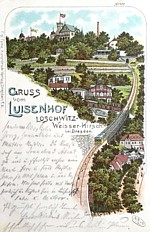
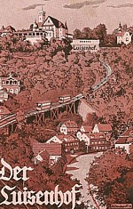
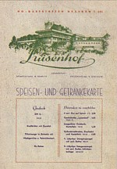
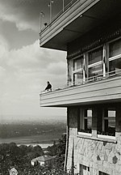
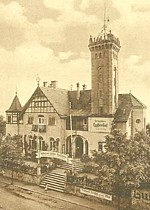
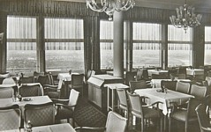
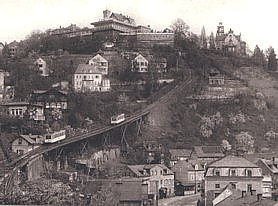
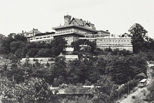
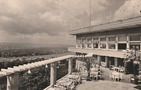
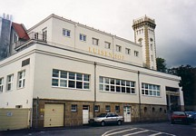

* * *

* * *

* * *

* * *

* * *

* * *

_Lithografie um 1900_

_Werbeprospekt_

_Speisekarte aus den 1950er Jahren_

_Terrasse (1930)_

_(Walter Hahn - SLUB/Fotothek)_

Der Luisenhof wurde 1894/95 unmittelbar an der Bergstation der im gleichen Jahr fertig gestellten [Standseilbahn](../../../../nordost/page10246/standseilbahn/) erbaut. Initiator war der Hofrat Prof. Paul Friedrich Reuter, der sich von diesem Standort wegen des herrlichen Blicks über das Elbtal einen großen Gästestrom erhoffte. Die Bauausführung und Bewirtschaftung übernahm die Firma Friebel & Großmann unter Leitung des Loschwitzer Bauunternehmers Ernst Heinrich Friebel. Als Namensgeber fungierte die damalige Kronprinzessin Luise von Toscana. Die am 18. August 1895 eröffnete Gaststätte entwickelte sich schnell zu einem der beliebtesten Dresdner Ausflugslokale und wurde auch als "Balkon Dresdens" bezeichnet. 1898 kaufte Friedrich August Reck das Lokal und ließ es umbauen und erweitern. So entstand 1907 ein Podium für Konzerte, 1912 ein überdachter Musikpavillon. Ab 1920 war der Gasthof bis nach dem Zweiten Weltkrieg im Besitz der Familie Voigt. 1928-30 erfolgte eine umfangreiche Erweiterung des Gebäudes.

In diesem Zusammenhang erhielt der Luisenhof mehrere neue Terrassen, Gasträume und eine Tiefgarage. Die heute nicht mehr geöffnete Garage war erste Katakombentiefgarage Europas und mit ihrem Autoaufzug ein Novum für die damalige Zeit. Nach Eröffnung des "Musiksaales", einer Weinstube und einer Bar bot der Luisenhof Platz für bis zu 700 Personen. Deutliche Umsatzsteigerungen verbuchte die Familie Vogt auch durch die Aufnahme ihres Restaurants in das Besichtigungsprogramm der Stadtrundfahrten. Der Küchentrakt entsprach modernsten Anforderungen und erhielt 1930 die erste elektrische Großkücheneinrichtung der Stadt. Hinzu kamen Kühlräume für Speisen und Getränke sowie ein separater Speisenaufzug für den internen Transport.

**_Fotos:_** _Blick vom Körnerplatz zum Luisenhof um 1930_

Auch während des Zweiten Weltkrieges und nach 1945 blieb der Luisenhof ein beliebtes Ziel der Bevölkerung und der Besucher der Stadt. Ab 1946 wurde das Lokal treuhänderisch von der Sächsischen Hotel- und Gaststätten GmbH verwaltet, 1949 jedoch von der HO übernommen. Bis 1952 nutzte zudem die sowjetische Militäradministration die obere Halle der Großgarage als Abstellplatz. Am 28. September 1956 kam es zu einem durch glimmende Zigarettenasche verursachten Brand, welcher das Gebäude schwer beschädigte. Die Tochter der Gastwirtsfamilie, die bekannte Schwimmsportlerin Helga Voigt, kam dabei ums Leben. Nach dem Wiederaufbau blieb der Luisenhof bis zur Schließung 1992 Tanzgaststätte mit Bar und Ausflugslokal. 1968 erfolgten einige Umbauarbeiten in den unteren Räumen. 1975 verkaufte Hansotto Voigt das Haus an die volkseigene Handelsorganisation HO.

Nach Klärung der Eigentumsverhältnisse und Rückgabe des Luisenhofs an die Familie Voigt wurde das Lokal 1993 an einen privaten Investor verkauft. Ein erneuter Eigentümerwechsel erfolgte 1996, woraufhin der neue Besitzer das traditionsreiche Gebäude ab 1997 komplett sanieren ließ. Unter Beachtung der Auflagen des Denkmalschutzes wurden die Innenräume im Anklang an den Bauhausstil modern gestaltet und die Gaststätte am 10. August 1999 wieder eröffnet. In einigen Nebenräumen und der früheren Garage entstanden Eigentumswohnungen. Leider musste der Luisenhof bereits zwei Jahre später Insolvenz anmelden. Nach einem erneuten Betreiberwechsel wurde das Traditionslokal ab 2002 bis zum Sommer 2015 vom früheren Küchenchef Armin Schumann geführt. Überhöhte Pachtforderungen des Eigentümers, der das Gebäude 2014 im Rahmen einer Zwangsversteigerung erworben hatte, führten letztlich zur Schließung am 30. Juni 2015.

In der Folgezeit stand der Luisenhof einige Jahre leer. Eine Wiedereröffnung durch die Familie Rühle erfolgte am 24. April 2018. In den im Vergleich zum früheren Lokal stark verkleinerten Gasträumen stehen heute 170 Plätze und 130 Plätze auf der Terrasse zur Verfügung.

* * *

 \[ [Home](../../../../index.html)\] \[ [Nord](../../../../nord/)\] \[ [Nordwest](../../../../nordwest/)\] \[ [Neustadt](../../../../neustadt/)\] \[ [Nordost](../../../../nordost/)\] \[ [West](../../../../west/)\] \[ [Zentrum](../../../../zentrum/)\] \[ [Südwest](../../../../sudwest/)\] \[ [Süd](../../../../sud/)\] \[ [Südost](../../../../sudost/)\] \[ [Ost](../../../../ost/)\] \[ [Register](../../../../Register/register.html)\] \[ [Kontakt](../../../../Kontakt/kontakt.html)\] \[ [Impressum](../../../../impressum/)\]
