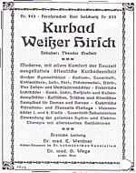
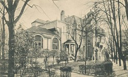
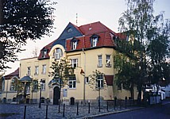

* * *

Das Kurbad Weißer Hirsch wurde 1906 im Zentrum des Kurortes am
Lahmannring 19 von Max Herfurt für den Kommerzienrat Bettenhausen erbaut. Zuvor befand sich hier ein Badehaus des aus der alten Gutswirtschaft hervorgegangenen [Kurhauses](../../../../nordost/page10246/strassen_weisser_hirsch/bautzner_landstrasse/gutshaus_weisser_hirsch/) “Weißer Hirsch”.
Bettenhausen verpachtete das Haus noch vor dem Ersten Weltkrieg an Theodor Crasselt, der hier ein privates Sanatorium einrichtete. Crasselt engagierte sich auch für den weiteren Ausbau des Kurortes und ließ u.a.
die Tennisplätze am [Kurpark](../../../../nordost/page10246/rathauspark/) anlegen. Außerdem bewirtschaftete er das Casino des Ortes und war Mitinitiator weiterer Sport- und
Erholungseinrichtungen. In den Dreißiger Jahren verzog er nach Zinnwald und übernahm dort das Café “Am Hochmoor”. Bereits 1922/23 hatte Theodor Crasselts Bruder Otto die Leitung des Kurbades übernommen.

Die Einrichtung war wegen der großen Auswahl verschiedenartiger
Behandlungsmöglichkeiten und den zahlreich angebotenen Freizeitvergnügungen neben dem [Lahmann-Sanatorium](../../../../nordost/page10246/strassen_weisser_hirsch/lahmann-sanatorium/) beliebtestes Kurbad am Weißen Hirsch und
wurde deshalb auch von Prominenten gern besucht. Zu den Gästen gehörte in den Dreißiger Jahren u.a. der Flugzeugbauer Hugo Junkers. Außerdem war das
Kurhaus zeitweise ein Treff der Dresdner Jockeyszene. Als Kurärzte wirkten hier Dr. Weidner und Dr. Wege, die später eigene Sanatorien eröffneten. Unterstützt
wurden sie von Dr. Reuter, drei Bademeistern und drei Masseusen sowie zwei Hilfskräften. Zur Ausstattung gehörten, wie damals üblich getrennt nach Damen
und Herren, zehn Wannenbäder, in denen die Patienten Kohlensäure-, Radium und Sauerstoffbäder erhielten. Aber
auch Licht-, Heißluft- und Kurzwellentherapien, Gymnastik und stationäre Fahrräder waren im Angebot. Im Gegensatz
zum Lahmann-Sanatorium bot Crasselt seinen Kurgästen jedoch keine Vollpension und Übernachtung an, so dass diese in den umliegenden Pensionen am Weißen Hirsch wohnten.

Das Kurbad Weißer Hirsch wurde ab 1939 von Otto Crasselt an seinen Nachfolger Herbert Zabel verpachtet und noch bis in die 1950er Jahre betrieben. Später zog die Poliklinik Weißer Hirsch ein. Heute befindet sich in dem
früheren Sanatoriumsgebäude ein Ärztehaus.

* * *

 \[ [Home](../../../../index.html)\] \[ [Nord](../../../../nord/)\] \[ [Nordwest](../../../../nordwest/)\] \[ [Neustadt](../../../../neustadt/)\] \[ [Nordost](../../../../nordost/)\] \[ [West](../../../../west/)\] \[ [Zentrum](../../../../zentrum/)\] \[ [Südwest](../../../../sudwest/)\] \[ [Süd](../../../../sud/)\] \[ [Südost](../../../../sudost/)\] \[ [Ost](../../../../ost/)\] \[ [Register](../../../../Register/register.html)\] \[ [Kontakt](../../../../Kontakt/kontakt.html)\] \[ [Impressum](../../../../impressum/)\]
