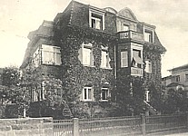
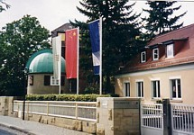

* * *

* * *

Die frühere Loschwitzer Straße bildet die Verbindung zum Nachbarort Loschwitz. Nach einem Flurnamen wurde diese Straße auch als Plattleithenweg bezeichnet. Hier lag ursprünglich der Kern der Gutsgemeinde
Weißer Hirsch, deren letzte Häusleranwesen erst 1972 einem Parkplatz an der Einmündung des Lahmannrings weichen mussten. Zu den ersten Landhäusern, die nach der Aufteilung der früheren Gutswirtschaft in Parzellen
errichtet wurden, gehören die 1878/80 vom Architekten Schaeffer erbauten Villen Plattleite Nr. 43 und 45. Leider lassen diese Häuser durch spätere Umbauten ihr ursprüngliches Bild kaum noch erkennen. Um 1905 folgten im
nördlichen Teil einige Wohn- und Geschäftshäuser. Entworfen wurde diese wie auch das Haus Plattleite 66 und zahlreiche Villen am Weißen Hirsch vom Architekten Max Herfurt.

1887 bezog der Maler und Zeichner Hermann Vogel das Haus Plattleite Nr. 6 und
wohnte hier bis zu seinem Tod 1922. An ihn erinnert ein Gedenkmedaillon an der Fassade. Auf der Plattleite 38 lebte nach 1945 der Jugendschriftsteller Ludwig
Renn, der der alten Dresdner Offiziersfamilie Vieth von Golßenau entstammt. Zu seinen bekanntesten Werken gehören das Kinderbuch “Der Neger Nobi” und “Adel
im Untergang”. Weitere Gebäude an der Plattleite beherbergten einst Sanatorien und Pensionen und werden heute zum Teil gewerblich genutzt. Das Foto zeigt die ehemalige Pension “Willkommen” (Nr. 60).

Nr. 18: Das ursprünglich als Weinbergshaus entstandene Gebäude befand sich ab 1828 im Besitz des sächsischen Konferenzministers Gottlob Adolf Ernst von Nostitz und Jänckendorf, der es als Sommerhaus nutzte. Nostitz gehörte ab 1785 dem Geheimen Finanzkollegium an und war ab 1809 Minister. Unter seiner Führung kam es zu zahlreichen sozialen Reformen. U.a. gründete er die Heilanstalt Sonnenstein in Pirna. 1830/31 war er maßgeblich an der Erarbeitung der sächsischen Landesverfassung beteiligt. Außerdem befasste er sich mit Kunst und Literatur und versammelte in seinem Sommerhaus die Künstlerfreunde des "Dresdner Liederkreises".

Das Haus besaß ursprünglich zwei größere Säle und mehrere Wohnräume. Außerdem gehörten ein Gewächshaus, Ställe und Remise sowie eine großzügige Gartenanlage zum Areal. 1832 erwarb Nostitz im Rahmen einer Lotterie das berühmte Gemälde von Caspar David Friedrich "Das Große Gehege", welches viele Jahre in seinem Loschwitzer Refugium hing. Seit 1909 gehört es zum Bestand der Gemäldegalerie "Neue Meister". Das Sommerhaus kam bereits 1838 in den Besitz des Papierhändlers Franz Rudolph Naumann. Am Eingangstor erinnert bis heute noch ein Monogramm an die Familie Nostitz.

Nr. 51: Das Eckhaus zur Bautzner Straße wurde 1891 erbaut und gehörte einst zum Lahmann-Sanatorium. Wie in zahlreichen Villen der Umgebung waren auch hier Kurgäste untergebracht, die die Kureinrichtungen auf der gegenüber liegenden Straßenseite nutzten. Nach 1945 wurde das Haus zum Wohnhaus. Eine umfassende Sanierung des denkmalgeschützen Gebäudes erfolgte 2013. Dabei erhielt das Gebäude auch seine markante Wetterfahne mit dem Motiv eines Drachens zurück. Im Inneren sind noch einige Deckenmalereien aus der Entstehungszeit erhalten.

Ardenne-Institut:

Die Einrichtung wurde 1955 von Baron Manfred von Ardenne (1907-1997) gegründet, nachdem dieser aus der
Sowjetunion nach Deutschland zurückkehren durfte. Ardenne hatte bereits 1928 in Berlin ein Laboratorium für Elektronenphysik eingerichtet und dort die Grundlagen des Fernsehens entwickelt. Zu den Erfindungen des jungen
Wissenschaftlers gehörten auch der Breitband-Oszillograph und das Rasterelektronenmikroskop. Ab 1942 befasste er
sich im Auftrag des Reichspostministeriums mit der Erforschung der Isotopentrennung. Da diese Forschungen als
Grundlage für die Entwicklung der Wasserstoffbombe dienten, wurde Ardennes Institut nach Kriegsende am 21. Mai
1945 nach Sinop an die sowjetische Schwarzmeerküste verlegt. Hier arbeitete er bis 1955 im Auftrag der sowjetischen Besatzungsmacht am sowjetischen Atomprogramm mit.

Mit seinen engsten Mitarbeitern baute Manfred von Ardenne auf der Plattleite und der benachbarten Zeppelinstraße das
einzige private Forschungsinstitut der DDR auf. Bis zu seinem Tod war der Wissenschaftler hier auf dem Gebiet der
Elektronenstrahl- und Plasmaphysik sowie der Biomedizin tätig. U.a. entwickelte er die Sauerstoff-Mehrschritt-Therapie
zur Krebsbekämpfung.  Zu den im Laufe der Zeit einbezogenen Gebäuden gehören die Häuser Plattleite 19, 25, 27 und
29 sowie Zeppelinstraße 1, 2, 7 und 8. Die Sternwarte des Institutes ist als Wahrzeichen der Einrichtung vor allem vom
Elbtal aus gut zu sehen. Heute wird die Tradition des Forschungsinstitutes von mehreren Nachfolgebetrieben wie der Ardenne Anlagentechnik GmbH, dem Institut für angewandte medizinische Forschung und der Ardenne tec GmbH
fortgesetzt. Das Grab des international hoch angesehenen Wissenschaftlers befindet sich auf dem [Waldfriedhof](../../../../nordost/page10246/waldfriedhof_weisser_hirsch/) Weißer
Hirsch.

**_Foto:_** _Eingang zum Ardenne-Institut an der Bergbahnstraße_

* * *

 \[ [Home](../../../../index.html)\] \[ [Nord](../../../../nord/)\] \[ [Nordwest](../../../../nordwest/)\] \[ [Neustadt](../../../../neustadt/)\] \[ [Nordost](../../../../nordost/)\] \[ [West](../../../../west/)\] \[ [Zentrum](../../../../zentrum/)\] \[ [Südwest](../../../../sudwest/)\] \[ [Süd](../../../../sud/)\] \[ [Südost](../../../../sudost/)\] \[ [Ost](../../../../ost/)\] \[ [Register](../../../../Register/register.html)\] \[ [Kontakt](../../../../Kontakt/kontakt.html)\] \[ [Impressum](../../../../impressum/)\]
