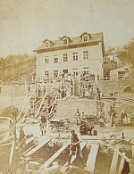
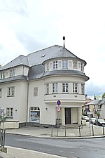
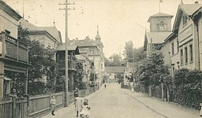
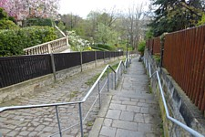
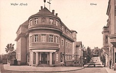
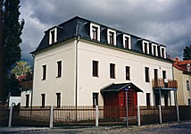
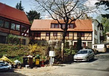
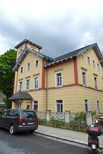
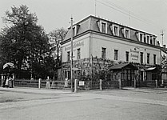

* * *

* * *

* * *

_Bauarbeiten am Rissweg um 1890_

_Rissweg 70 (2021)_

Der Name Rißweg geht auf einen alten Flurnamen zurück und verbindet den Weißen Hirsch mit dem Loschwitzgrund. Er beginnt im Loschwitzgrund (Grundstraße) und führt zunächst als steiler Fußweg nach oben _(Foto rechts)_, wo er die Grenze zum Stadtteil Weißer Hirsch bildet und dort Ende des 19. Jahrhunderts zur Fahrstraße ausgebaut wurde _(Foto links)_. 1872 ist er als "Auf dem Riß" erstmals erwähnt und bekam am 19. März 1877 amtlich den Namen Riß-Weg. Teilweise wurde er später auch Rißstraße genannt, so im Adressbuch von 1893.

Zu den bekanntesten Gaststätten am Weißen Hirsch gehörten die "Felsenburg" am Rißweg (Nr. 68) und die "Erholung" (Nr. 39), welche früher von vielen Prominenten besucht wurden. Architektonisch interessant ist das 1911 an der Ecke zur Steglichstraße errichtete Wohn- und Geschäftshaus Rißweg 70 mit einem turmartigen Runderker. Auf dem Grundstück Rißweg 8 / Lahmannring 18 befand sich um 1905 das Sanatorium für Lichtheilverfahren von Dr. med. Hans Wällnitz.

**_Fotos:_** _Das Eckhaus Rissweg 70 (links) und die_

_ehemalige Gaststätte “Erholung” nach dem Umbau zum Wohnhaus (rechts)_

Einzelne Gebäude:

Nr. 14: Das nach seinem Baustil und der Fassadenaufschrift "Norwegisches Haus" genannte Gebäude war im Sommer 1910 Aufenthalt der aus Russland stammenden Schwestern Marina und Anastasija Zwetajewa. Beide waren Töchter des Gründers des Puschkin Museums und kulturell sehr interessiert. Zum Erlernen der deutschen Sprache waren sie nach Dresden gekommen und wohnten hier bei der Pfarrersfamilie Bachmann. Marina Zwetajewa (1892-1941) wurde später als Dichterin bekannt und unterhielt enge briefliche Kontakte zu Rainer Maria Rilke. 2017 wurde zur Erinnerung an ihren Aufenthalt am Haus eine Gedenktafel angebracht.

Nr. 14b: In dieser Villa, "Glückauf" genannt, lebte bis zu seinem Tod 1939 der Maler Bildhauer Friedrich Brodauf, der ab 1905 auf dem Weißen Hirsch eine Mal- und Zeichenschule betrieb. Brodauf wurde 1918 zum Professor ernannt und schuf zahlreiche Porträtbüsten bekannter sächsischer Persönlichkeiten. Von Brodauf stammt auch das Gefallenendenkmal auf dem Waldfriedhof. In den Wintermonaten gestaltete er Eisplastiken für die auf den [Tennisplätze](../../../../nordost/page10246/rathauspark/) im Waldpark angelegte Eisbahn. 1939 verstarb er während einer USA-Reise.

Nr. 15: Das Fachwerkhaus gehört zu den letzten erhaltenen Winzerhäusern im Gebiet Loschwitz / Weißer Hirsch und entstand 1763 für den Loschwitzer Amtsrichter Johann Gottfried Baudisch. Heute wird es als Wohnhaus genutzt und in den letzten Jahren denkmalgerecht saniert _(Foto links)_.

Felsenburg: Das Restaurant und Hotel “Felsenburg” entstand um 1880 nach Plänen von Adolf Hietzig und gehörte zu den bekanntesten Pensionen am Weißen Hirsch. Zwischen 1916 und 1919 wohnte der Maler Oskar Kokoschka im Haus und versammelte hier eine kleine Künstlerkolonie um sich, zu der u. a. der Schriftsteller Walter Hasenclever, der Filmemacher Hans Janowitz und der Schauspieler Heinrich George gehörten. Regelmäßig waren auch Künstlerfreunde zu Gast. Als eines der Dresdner Zentren des Expressionismus war das Gebäude Motiv einiger Bilder Kokoschkas. Nach vorübergehender Schließung während des Zweiten Weltkriegs wurde das Hotel noch bis in die 1970er Jahre betrieben. 1998 erfolgte eine umfassende Sanierung des Gebäudes, welches dabei zum Wohnhaus umgebaut wurde _(Foto rechts)_.

Erholung: (Nr. 39) Die Gaststätte entstand Ende des 19. Jahrhunderts am Rißweg 39 und bot vor allem sächsische Hausmannskost an. Anfangs wurde es nach seinem Besitzer Hugo Kegel "Kegels Restaurant", ab ca. 1910 dann "Erholung" genannt. Am 21. Juni 1894 wurde hier von 25 Sängern der "Männergesangsverein Weißer Hirsch" gegründet. Zu den prominenten Gästen des Lokals gehörten Rainer Maria Rilke, Adele Sandrock, Theo Lingen, Marika Rökk und Heinz Rühmann, die als Kurgäste im Ort weilten. Nach 1945 wurde die Gaststätte geschlossen und erst 1988 wieder eröffnet. Bis 1996 bewirtschaftete die Familie Pattis die "Erholung" und erhielt für ihr Restaurant als einzige Gaststätte in Dresden einen Michelin-Stern. Heute dient das Gebäude als Wohnhaus _(Foto links: SLUB / Fotothek)_.

Nr. 49: Zu den zahlreichen Villen und Landhäusern am Rißweg gehört u.a. das 1910 als "Villa Liesbeth" im Adressbuch verzeichnete Haus Rißweg 49. Bis zu seinem Tod 1938 wohnte hier der Architekt Paul Alfred Michael (1865-1938), ein Schüler von Constantin Lipsius. Neben mehreren Wohnhäusern in Dresden gestaltete Michael u.a. zahlreiche temporäre Gebäude für die 1896 durchgeführte Ausstellung "Die alte Stadt", bei der am [Ausstellungsgelände](../../../../zentrum/pirnaische_vorstadt/ausstellungsgelande/) am Stübelplatz eine mittelalterliche Stadt nachgebaut wurde.

Nr. 61: Architektonisch interessant ist das 1904 fertiggestellte Wohn- und Geschäftshaus Rißweg 61 an der Einmündung zur Bautzner Landstraße. Mit Ecktürmchen und Erkern bildet es den repräsentativen Auftakt einer gründerzeitlichen Häuserzeile. Zum plastischen Schmuck gehört eine Kartusche mit Anker, geflügeltem Stab und den Initialien des Kolonialwarenhändlers Paul Schmidt, der hier sein Geschäft noch bis Anfang der 1950er Jahre betrieb.

* * *

 \[ [Home](../../../../index.html)\] \[ [Nord](../../../../nord/)\] \[ [Nordwest](../../../../nordwest/)\] \[ [Neustadt](../../../../neustadt/)\] \[ [Nordost](../../../../nordost/)\] \[ [West](../../../../west/)\] \[ [Zentrum](../../../../zentrum/)\] \[ [Südwest](../../../../sudwest/)\] \[ [Süd](../../../../sud/)\] \[ [Südost](../../../../sudost/)\] \[ [Ost](../../../../ost/)\] \[ [Register](../../../../Register/register.html)\] \[ [Kontakt](../../../../Kontakt/kontakt.html)\] \[ [Impressum](../../../../impressum/)\]
