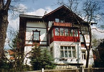

* * *

Das Sanatorium Steinkühler wurde 1914 im Haus Küntzelmannstraße Nr. 7 (Villa Bismarck) gegründet. Inhaber war der zuvor u.a. in Zittau und Abessinien (heutiges Äthiopien) tätige Augenarzt Dr. med. Max
Steinkühler, der ab 1912 in Bühlau wohnte. Behandelt wurden hier vor allem Stoffwechsel-, Augen- und Ohrenkrankheiten sowie rheumatische Erkrankungen. Nach modernsten diätischen Forschungen besaß das Haus eine weltweit
einzigartige “Dampfkochanstalt”, die das Garen von Obst und Gemüse bereits bei geringen Temparaturen ermöglichte und so wertvolle Vitamine unzerstört beließ.

Das in Familienbesitz befindliche Sanatorium wurde nach
Steinkühlers Tod am 24. Mai 1934 von seiner Frau als Pensionsbetrieb für ältere Damen weitergeführt und bestand bis nach 1945. In den Zwanziger Jahren hatte der Inhaber erfolglose Bohrungen nach Heilwasser vorgenommen,
um den Weißen Hirsch um Kurbad zu machen. Heute befinden sich in dem erhaltenen und nach 1990 sanierten Gebäude Büroräume.

**_Foto:_** _Das frühere Sanatorium Dr. Steinkühlers im heutigen Zustand_

* * *

 \[ [Home](../../../../index.html)\] \[ [Nord](../../../../nord/)\] \[ [Nordwest](../../../../nordwest/)\] \[ [Neustadt](../../../../neustadt/)\] \[ [Nordost](../../../../nordost/)\] \[ [West](../../../../west/)\] \[ [Zentrum](../../../../zentrum/)\] \[ [Südwest](../../../../sudwest/)\] \[ [Süd](../../../../sud/)\] \[ [Südost](../../../../sudost/)\] \[ [Ost](../../../../ost/)\] \[ [Register](../../../../Register/register.html)\] \[ [Kontakt](../../../../Kontakt/kontakt.html)\] \[ [Impressum](../../../../impressum/)\]
