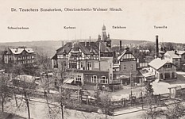
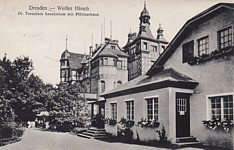
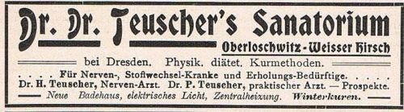
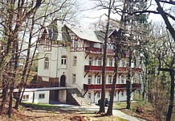

* * *

Das Teuschersche Sanatorium wurde 1897/98 auf der damaligen Thielaustraße (heute Chopinstraße) vom Nervenarzt Dr. Heinrich Teuscher (1862-1946) gegründet. Zuvor hatte hier bis zur Vernichtung durch einen
Großbrand 1873 der alte Gasthof “Weißer Adler” gestanden. Behandelt wurden vor allem Nerven-, Darm und Herzerkrankungen, wobei hier - dem Vorbild Lahmanns folgend - vorrangig Naturheilverfahren zur Anwendung kamen. Für
das Sanatorium entstanden auf dem Grundstück am Elbhang mehrere Gebäude, darunter ein Schweizerhaus, die Turmvilla, Kur- und Badehaus und ein Wohnhaus für die Ärzte. Zu den bekanntesten Kurgästen gehörte der Maler Oskar
Kokoschka, der 1916/17 im Schweizerhaus wohnte und auch zwei Zeichnungen des Sanatoriums schuf. Wenig später zog er in die Pension [“Felsenburg”](../../../../nordost/page10246/strassen_weisser_hirsch/) am Rißweg um. Die Familie Teuscher betrieb das Sanatorium bis 1938, verkaufte es dann, bevor es 1943 in ein Kriegslazarett umgewandelt wurde.

**_Fotos:_** _Das Teuschersche Sanatorium kurz nach dem Ersten Weltkrieg_

1945 übernahm zunächst die Sowjetarmee das Lazarett, übergab es jedoch bald
der Stadt Dresden. Zuerst als Verwaltungsgebäude genutzt, zog später ein Heim der Jugendhilfe des Stadtbezirks Dresden-Ost ein. Weitere Gebäude dienten als
Lehrlings- bzw. Ausländerwohnheim und seit 1985 als Kindergarten. 1985 wurde das frühere Verwaltungsgebäude für diesen Zweck komplett saniert. Nach 1990
kamen Pläne auf, auf dem Grundstück eine Wohnanlage zu schaffen. Aus diesem Grund wurden 1994 mit Ausnahme des denkmalgeschützten “Schweizerhauses” _(Foto)_
alle Gebäude abgerissen. Der Komplex wurde jedoch bislang nicht realisiert.

* * *

 \[ [Home](../../../../index.html)\] \[ [Nord](../../../../nord/)\] \[ [Nordwest](../../../../nordwest/)\] \[ [Neustadt](../../../../neustadt/)\] \[ [Nordost](../../../../nordost/)\] \[ [West](../../../../west/)\] \[ [Zentrum](../../../../zentrum/)\] \[ [Südwest](../../../../sudwest/)\] \[ [Süd](../../../../sud/)\] \[ [Südost](../../../../sudost/)\] \[ [Ost](../../../../ost/)\] \[ [Register](../../../../Register/register.html)\] \[ [Kontakt](../../../../Kontakt/kontakt.html)\] \[ [Impressum](../../../../impressum/)\]
