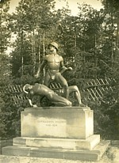
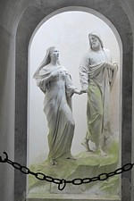
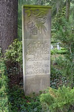
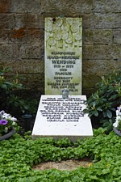
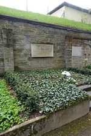
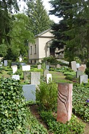
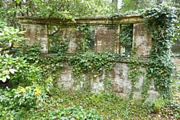
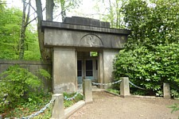
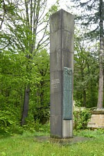

* * *

Waldfriedhof weißer hirsch am heiderand 8 01324 dresden tel. 0351/2684450

* * *

_Gedenkstein Brigade Graf Pfeil (Foto: Ursula Richter SLUB/Fotothek)_

_Mausoleum Familie Müller mit Grabplastik von Johannes Schilling_

_Grabmal_

_Adolf Spamer_

_Grabmal_

_Hans Hendrik Wehding_

_Grabmal_

_Manfred von Ardenne_

Der Waldfriedhof Weißer Hirsch wurde 1898 am Rande der Dresdner Heide angelegt, nachdem der Kurort am 1. April 1897 eine selbstständige Kirchgemeinde geworden war. Zuvor mussten die Verstorbenen auf dem Loschwitzer Friedhof beigesetzt werden. Für die Anlage erwarb die Gemeinde ca. 24.000 m² Waldfläche vom sächsischen Staatsforst. Die offizielle Einweihung erfolgte am 1. Juli 1898.

Da eine 1914 geplante Erweiterung des Friedhofs scheiterte, legte die Nachbargemeinde Loschwitz 1919 auf dem angrenzenden Grundstück einen zweiten Friedhof an, der bis 1931 durch ein Gitter vom Waldfriedhof getrennt war. Ursprünglich sollte hier sogar eine eigene Kirche für die Bewohner von Oberloschwitz errichtet werden. Nach Vereinigung der beiden Anlagen im Jahr 1933 wurde jedoch nur die kleine Friedhofskapelle vergrößert und umgebaut. Die ältesten Grabstätten befinden sich an den inneren Friedhofsmauern. Jüngeren Datums sind die terrassenförmigen Urnengrabfelder an der Südseite des Friedhofs.

Auf dem Waldfriedhof liegen einige prominente Bewohner des Weißen Hirschs begraben, darunter der Besitzer des Sanatoriums Dr. Heinrich Lahmann, der Gründer der ersten Säuglingsklinik der Welt Arthur Schloßmann _(Foto rechts)_, der Wissenschaftler Manfred von Ardenne und der frühere Kreuzkantor Martin Flämig. Eine bemerkenswerte Grabplastik ziert das Mausoleum des Industriellen Johann Carl Müller (1867-1944) an der Nordseite des Friedhofs. Diese wurde von Johannes Schilling geschaffen und stand ursprünglich auf dem Grab einer Tochter des sächsischen Generals Alfred von Fabrice. Später schmückte sie die Grufthalle auf Müllers Grundstück an der [Maillebahn](../../../nordost/pillnitz/strassen_pillnitz/) in Hosterwitz und wurde 1930 zum Waldfriedhof ungesetzt.

Einzelne Gräber:

Familiengruft Lahmann: Die wohl künstlerisch und historisch bedeutsamste Grabstelle ist die 1905 für die Familie Lahmann errichtete Familiengruft. Hier liegt der im Alter von nur 45 Jahren verstorbene Arzt und Sanatorioumsbesitzer Heinrich Lahmann. Weitere Särge beherbergen die sterblichen Überreste seiner Frau Luise (+ 1910) und seiner Kinder Hans Heinrich (+ 1938) und Dora Lahmann (+ 1920) sowie weitere sechs Urnen, 2019 saniert. Zur Gestaltung der Gruft hatte es einen künstlerischen Wettbewerb gegeben, den der Architekt Rudolf Kolbe gewann. Die Ausführung übernahm der Bildhauer Friedrich Moritz Brodauf. Die Gruft besteht aus einem kleinen Granitbau an der Außenmauer des Friedhofes mit Bänken und Gedenktafeln im Innenraum. Über dem Portal befindet sich das Familienwappen der Lahmanns, ein Anker. Er erinnert an den Beruf der aus Bremen stammenden Vorfahren, die dort als Reepschläger (Ankerseilhersteller) tätig waren.

Gefallenendenkmal: Vor dem Friedhofseingang steht seit 1926 eine Gedenkstele in Erinnerung an die im Ersten Weltkrieg gefallenen Bewohner des Kurortes. Das Denkmal wurde von Professor Friedrich Brodauf geschaffen und entkam 1946 dem geplanten Abriss, da es sich im Eigentum der Kirchgemeinde befand. Es besteht aus einer ca. zwei Meter hohen Granitsäule, die an den Seiten Bronzetafeln mit den Namen und Sterbedaten der 63 Gefallenen trägt. Eine weitere Gedenkstätte erinnert an einige Opfer der Bombennacht vom 13./14. Februar 1945.

Grabstelle Dr. Rudolf Friedrichs: 1947 fand der sozialdemokratische Politiker und Dresdner Ehrenbürger Dr. Rudolf Friedrichs auf dem Waldfriedhof Weißer Hirsch seine letzte Ruhestätte. Friedrichs war bereits bis zur Machtergreifung der Nazis 1933 in verschiedenen Funktionen politisch aktiv und wurde am 10. Mai 1945 erster Oberbürgermeister der Stadt nach dem Zweiten Weltkrieg. Im Dezember 1946 übernahm er das Amt des sächsischen Ministerpräsidenten. Auf Betreiben der SED-Führung erfolgte 1980 die Umbettung der sterblichen Überreste Rudolf Friedrichs in den Ehrenhain des Heidefriedhofes. Der Grabstein auf dem Waldfriedhof wurde 1989 entfernt, blieb jedoch erhalten und wurde im September 2014 als Gedenkstein wieder am alten Standort aufgestellt.

Gräber bedeutender Persönlichkeiten:

**_Grabstätte_**

**_Todesjahr_**

Dr. Heinrich Lahmann, Gründer des Lahmann-Sanatoriums

1905

Carl Ludwig Theodor Graff, Direktor der Kunstgewerbeschule, Grabplastik von Friedrich Hecht

1906

Karl Oskar Unruh, Arzt und Geheimer Hofrat

1907

Max Arnhold, Gründer des Bankhauses Arnhold

1908

Traugott Graf von Pfeil, sächs. Generalmajor

1929

Emil Bergmann, Gründer der Freitaler Bombastus-Werke

1931

Dr. Arthur Schloßmann, Kinderarzt, Begründer der ersten Säuglingsklinik

1932

Dr. Max Steinkühler, Besitzer von Steinkühlers Sanatorium

1934/1970

Johann Carl Müller, Unternehmer (Inhaber der Zigarettenmaschinenfabrik “Universelle”)

1944

Fred Voelkerling, Maler und Bildhauer

1945

Rudolf Friedrichs, Oberbürgermeister und Ministerpräsident (1980 umgebettet)

1947

Adolf Spamer, Professor für Volkskunde

1953

Josef Herrmann, Kammersänger

1960

Prof. Werner Gruner, Rektor der Technischen Hochschule

1960

Friedrich Wilhelm Neuffer, Bauingenieur, Professor an der TH

1960

Ruth Glowa, Opernsängerin

1971

Hans Löbel, Kammersänger

1971

Hans Hendrik Wehding, Komponist (“Der goldene Pavillon”)

1975

Elisa Stünzner, Kammersängerin, Mitglied der Staatsoper

1975

Antonia Dietrich, Schauspielerin

1975

Karl von Appen, Bühnenbildner und Manja von Appen-Behrens, Schauspielerin

1981 / 2003

Arno Schellenberg, Opernsänger

1983

Brünnhild Friedland, Opernsängerin

1986

Manfred Streubel, Dichter

1992

Walter Hartmann, Saxophonist, Mitglied der Dresdner Tanzsinfoniker

1992

Manfred von Ardenne, Wissenschaftler, Gründer des Ardenne-Institutes

1997

Helmut Köckeritz, Architekt

1998

Martin Flämig, Kreuzkantor

1998

Eva Ander, Pianistin

2004

John H. Noble, Besitzer der Kamerawerke Niedersedlitz

2007

Christiane Just, Malerin und Grafikerin

2011

Rolf Hoppe, Schauspieler

2018

* * *

 \[ [Nord](../../../nord/)\] \[ [Nordwest](../../../nordwest/)\] \[ [Neustadt](../../../neustadt/)\] \[ [Nordost](../../../nordost/)\]
 \[ [West](../../../west/)\] \[ [Zentrum](../../../zentrum/)\] \[ [Südwest](../../../sudwest/)\] \[ [Süd](../../../sud/)\] \[ [Südost](../../../sudost/)\] \[ [Ost](../../../ost/)\] \[ [Register](../../../Register/register.html)\] \[ [Kontakt](../../../Kontakt/kontakt.html)\] \[ [Impressum](../../../impressum/)\]
