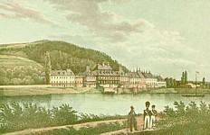
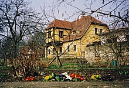
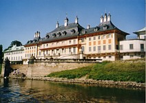
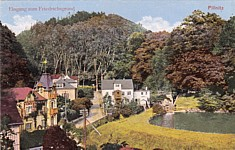
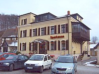
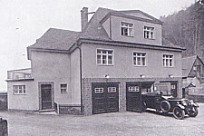
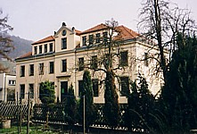
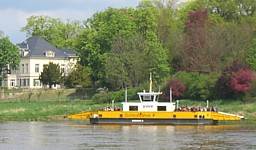
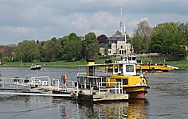

* * *

**Gemeindesiegel von Pillnitz**

Obwohl älteste Besiedlungsspuren bis in die jüngere Bronzezeit zurückreichen, begann die dauerhafte Besiedlung der Gegend um Pillnitz vermutlich erst in der zweiten Hälfte des 6. Jahrhunderts, als hier aus Böhmen eingewanderte Sorben Befestigungsanlagen errichteten. Diese befanden sich auf einem heute als “Kanapee” bezeichneten Felssporn oberhalb des [Friedrichsgrundes](../../nordost/pillnitz/meixgrund/) und am sogenannten “Schlossberg” in der Nähe der Straße nach Borsberg. Die Anlage am Kanapee wurde etwa zwischen 1000 und 1200 genutzt und bestand aus einem Abschnittswall mitca. 2 bis 3 Metern Höhe, der den Bergsporn abriegelte. Funde aus dieser Zeit wurden bei archäologischen Grabungen 1949 und 1956 gemacht. Im Zuge der deutschen Inbesitznahme entwickelte sich daraus ein Burgward als Mittelpunkt eines kleinen Verwaltungsbezirkes. Dieser existierte vermutlich bis zu Beginn des 11. Jahrhunderts und lag an Stelle der heutigen künstlichen Ruine. Als Verwalter wurden Vasallen der Burgherren zu Dohna eingesetzt.

Die erste urkundliche Erwähnung des Dorfes stammt aus dem Jahr 1335 (“Belenewitz”). Der slawische Ortsname weist vermutlich auf den Gründer der Siedlung hin (Dorf des Belan), könnte aber auch vom altslawischen Wort "pila" (Säge) bzw. "bely" (weiß) abgeleitet sein. Mit dem Zuzug deutscher Bauern entwickelte sich am heutigen Rathausplatz der Kern dieser Siedlung, in der größere Bauerngehöfte fehlten. Größtes Anwesen war ein Herrengut in der Nähe der Elbe, dort wo sich heute Schloss Pillnitz befindet. 1403 erhielt die Frau des Adligen Heinrich Karas Dorf und Vorwerk Pillnitz als Lehen. Spätere Besitzer der Grundherrschaft waren die Familien Ziegler (1486-1569), Loß (1569-1640) und Bünau (1643-1694). Vor allem die Herrschaft des Joachim von Loß wurde von den Bewohnern des Ortes als besonders bedrückend empfunden, da Loß als rücksichtsloser Gutsherr galt und mit harten Fronen und Strafen seine Untertanen unterdrückte. Der Legende nach soll er noch viele Jahre nach seinem Tod als schwarzer Hund in Pillnitz umgegangen sein.

Ursprünglich war Pillnitz ein Elbfischer- und Bauerndorf, von dem sich jedoch nur noch wenige Gebäude in der Nähe der Schiffsanlegestelle erhalten haben _(Foto)_.Außerdem nutzte man die Elbhänge für den 1403 erstmals urkundlich erwähnten Weinbau. 1476 wurde eine Mühle am Ausgang des [Meixgrundes](../../nordost/pillnitz/meixgrund/) erwähnt, um 1500 ein [Gasthof](../../nordost/pillnitz/gaststatten_pillnitz/) mit Schankrecht und Erbgerichtsbarkeit. Seit dem 16. Jahrhundert dehnten die Besitzer der Herrschaft Pillnitz ihre Fluren immer mehr auf Kosten des Bauernlandes aus, so dass im 18. Jahrhundert nur noch Häusler und Gärtner im Ort lebten. 1694 erwarb Kurfürst Johann Georg IV. im Tausch gegen die Herrschaft Lichtenwalde den Ort von der Familie Bünau. Dessen Bruder und Nachfolger August der Starke ließ das alte Schloss zum repräsentativen Sommersitz umbauen. Bis heute gehört [Schloss Pillnitz](../../nordost/pillnitz/schloss_pillnitz/) zu den bedeutendsten baukünstlerischen Schöpfungen der Barockzeit in Sachsen. Gegenüber liegt die [Pillnitzer Elbinsel](../../nordost/pillnitz/pillnitzer_elbinsel/), einzig verbliebene im Stadtgebiet.

Zur Bewirtschaftung des zum Schloss gehörigen Rittergutes entstanden verschiedene Nebengebäude, die später Sitz
des Kammergutes Pillnitz wurden. Die Fluren dieses Gutes wurden schon früh nach wissenschaftlichen Grundsätzen
bewirtschaftet, wodurch sich Pillnitz zu einem Zentrum des modernen Gartenbaus entwickelte. An den Hängen des
Ortes dominierte seit dem 18. Jahrhundert der Weinbau, welcher unter Regie der Wettiner großem Aufschwung nahm. Der “Große Berg Pillnitz” gehörte damals neben dem “Goldenen Wagen” in Radebeul und dem “Fürstenberg” in
Meißen zu den drei sächsischen Musterweinbergen. Zeitweise waren hier bis zu 600 Personen mit Pflege, Lese und
Verarbeitung des Weins beschäftigt. Erst die Reblauskatastrophe Ende des 19. Jahrhunderts führten zum Niedergang und 1905 schließlich zu Rodung aller Weinstöcke und Parzellierung der Weinberge.

Zu den in den Weinbergen entstandenen Gebäuden gehören das von Christian
Friedrich Schuricht entworfene alte Presshaus von 1827 (Bergweg 1) und die nach Abriss der Schlosskirche 1723/27 entstandene [Weinbergkirche](../../nordost/pillnitz/weinbergkirche_pillnitz/). Der
Komplex um das Lustschloss wurde nach der Zerstörung des alten Schlosses bei einem Brand 1818 in klassizistischen Formen verändert, wobei Schloss Pillnitz sein heutiges Aussehen erhielt _(Foto)_
. Bereits um 1790 waren einige Häusler vom Areal des heutigen Schlossparks ins Pillnitzer Erlicht ( [Wilhelm-Wolf-Straße](../../nordost/pillnitz/strassen_pillnitz/)) umgesiedelt worden.

Während Pillnitz in der Barockzeit vor allem Schauplatz von prunkvollen Hoffesten war, entwickelte sich der Ort im 19. Jahrhundert immer stärker zum Ausflugsziel auch für bürgerliche Schichten. Vor allem die Einrichtung einer
Dampferanlegestelle 1840 führte zum verstärkten Zuzug von Dresdner Bürgern. So wohnte ab 1832 Carl Gustav Carus in einem Landhaus in Pillnitz. Spätere
Bewohner des Ortes waren u. a. Ludwig von Hofmann und die Verlegerfamilie Brockhaus. Mitte des 19. Jahrhunderts folgten weitere Villenneubauten am Rande des Dorfkerns und an den Hängen des Elbtals. Ab 1927 entstand die
Landhaussiedlung am früheren Hausberg mit dem gleichnamigen Café. Zahlreiche [Ausflugsgaststätten](../../nordost/pillnitz/gaststatten_pillnitz/) lockten die Besucher an, die seit 1913 auch per [Straßenbahn](../../nordost/loschwitz/strassen_loschwitz/pillnitzer_landstrasse/) nach Pillnitz gelangen konnten.

Die Garten- und Weinbautradition des Ortes wurde ab 1922 von
der [Höheren Staatslehranstalt für Gartenbau](../../nordost/pillnitz/institut_fur_gartenbau/)
fortgeführt. Diese Einrichtung nutzte die Gebäude des früheren Marstalls und der Hofgärtnerei, welche nun als Versuchsgärtnerei diente. 1925 folgte eine landwirtschaftliche Versuchsanstalt, 1930 eine Staatliche
Viehhaltungsschule. Schloss und Park waren bereits 1924 durch die Fürstenabfindung in den Besitz des Staates gekommen und werden seitdem museal genutzt.

1945 war Schloss Pillnitz für einige Monate zentrales Sammeldepot für die geretteten Dresdner Kunstschätze, bevor diese nach Moskau abtransportiert wurden. Auch nach der Eingemeindung des Ortes
am 1. Juli 1950 blieb Pillnitz als Obstbaustandort von Bedeutung. Der nach 1900 zum Erliegen gekommene Weinbau lebte verstärkt seit den 1980er
Jahren wieder auf. Das frühere Kammergut diente bis 1971 als VEG Tierzucht bzw. als Institut für Obstbau. Heute
haben in Pillnitz verschiedene landwirtschaftliche Lehr- und Forschungseinrichtungen ihren Sitz. Außerdem gehört der Ort zu den beliebtesten Touristenzielen Dresdens.

Rathaus Pillnitz:

Das Gebäude des Pillnitzer Rathauses (Am Rathaus 1) wurde 1879 als Wohn- und Geschäftshaus erbaut und war zunächst im Privatbesitz. Im Erdgeschoss bezog das Kaiserliche Postamt seine Räume, bevor die Pillnitzer Post 1911 zur Orangeriestraße 20 verlegt wurde. Im Anschluss befand sich hier der Sitz einer Außenstelle der Verbandssparkasse Schönfeld und Umgebung.

Nachdem die Pillnitzer Gemeindeverwaltung ab 1839 ihre Sitzungen zunächst in den Wohnungen des jeweiligen Gemeindevorstands abgehalten hatte, bezog sie 1906 erstmals feste Räume im Wohnhaus des Vorstandes Friedrich Ernst Herr auf der Schönfelder Straße (heute Meixstraße 6). 1914 erfolgte nach einem Wechsel an der Spitze der Ortsverwaltung der Umzug zur Schönfelder Straße 13 (Meixstraße 3). Nach dem Ersten Weltkrieg vereinigte sich die Ortsgemeinde mit dem bisher selbständigen Kammergut, wodurch die Einwohnerzahl auf ca. 1.150 anstieg. Um die gewachsenen Aufgaben erledigen zu können, erwarb die Gemeinde Pillnitz 1924 das bisher von der Sparkasse genutzte Gebäude und ließ es zum Rathaus umbauen. Neben der Verwaltung fanden hier auch die Spar- und Girokasse, die Ortspolizei und weitere Dienststellen ihr Domizil. Mit Eingemeindung des Ortes nach Dresden am 1. Juli 1950 übernahm die Stadt- und Kreissparkasse Dresden das Haus und nutzt es bis heute als Filiale. 1993/94 wurde das Gebäude umfassend saniert.

Postwesen in Pillnitz:

Die erste Postdienststelle in Pillnitz entstand 1857. Nach Fertigstellung eines neuen Wohn- und Geschäftshauses am
Dorfplatz (heute Am Rathaus 1) bezog die Kaiserliche Reichspost 1879 die Erdgeschossräume. Hier befanden sich die Schalter-, Expeditions- und Verwaltungsräume sowie die Wohnung des Postverwalters. 1911 verlegte man das
Postamt zur Laubegaster Straße 20 (heute Orangeriestraße). Hier war es, zuletzt als Postamt 8057, bis nach 1990
untergebracht. Heute werden Postdienstleistungen in einem Schreibwarengeschäft auf der Pillnitzer Landstraße 313a angeboten.

Feuerwehr Pillnitz:

Ursprünglich oblagen Brand- und Katastrophenschutz in Pillnitz der Wachmannschaft des Schlosses, welche für diesen Zweck drei Spritzenwagen besaß. Nachdem es jedoch am 2. September 1878 zu einem Großbrand des Marstalls
gekommen war, beschlossen die Gemeindevertreter von Pillnitz, Oberpoyritz, Söbrigen und Hosterwitz die Bildung
eines gemeinsamen Feuerlöschverbandes, bestehend aus freiwilligen Männern der Orte. Die offizielle Verpflichung
erfolgte am 15. Dezember des Jahres. Zwei Jahre später konnte eine eigene Feuerspritze angeschafft werden. 1891 entstand zusätzlich eine Pflichtfeuerwehr, welche bis 1933 existierte.

Schrittweise verbesserte die Pillnitzer Feuerwehr ihre Ausstattung, u.a. durch
den Erwerb einer Schiebeleiter und eines Schlauchwagens. Hosterwitz und Söbrigen schieden noch vor dem Ersten Weltkrieg aus dem Verband aus und gründeten eigene Feuerwehren. Ab 1924 kam erstmals eine moderne
Motorspritze zum Einsatz. Zur besseren Unterbringung der Löschtechnik entschied sich der Ort 1931 zur Errichtung eines Gerätehauses am Friedrichsgrund mit drei Fahrzeughallen, einem Schlauchtrockenturm und drei
Wohnungen im Obergeschoss **_(Foto:_** _FFW Pillnitz)_. Während des Zweiten Weltkrieges wurde auch Freiwillige Feuerwehr Pillnitz in die militärisch
organisierte Struktur des NS-Staates einbezogen. Eingesetzt waren die Kameraden u.a. bei der Brandbekämpfung nach dem Luftangriff vom 13. Februar 1945.

Nach
Kriegsende wurde die Feuerwehr wieder der kommunalen Verwaltung, mit der Eingemeindung von Pillnitz ab 1950 der Stadt Dresden unterstellt. 1955 erhielt sie ein neues Einsatzfahrzeug, wodurch die alte Motorspritze außer
Dienst gestellt werden konnte. Zu den Aufgaben der Pillnitzer Feuerwehr gehörte ab 1961 auch die Absicherung der
Veranstaltungen in der Staatsoperette in Leuben, wofür abwechselnd Feuerwehrleute aus den östlichen Stadtteilen Dresdens herangezogen wurde. Seit 2006 bilden Pillnitz, Oberpoyritz und Niederpoyritz eine gemeinsame
Stadtteilfeuerwehr, welche in den vergangenen Jahren moderne Löschtechnik erhielt. 2006 wurde eine neue Feuerwache an der Dampfschiffstraße bezogen. Das alte Gerätehaus dient heute als Werkstatt des Schlosshotels und
als Wohnhaus.

Schulen in Pillnitz:

Nachdem sich Pillnitz, Borsberg, Oberpoyritz und Söbrigen 1836 zu einem
gemeinsamen Schulbezirk zusammen geschlossen hatten, erhielt der Ort 1841 am Schulweg sein erstes eigenes Schulhaus. Die feierliche Einweihung erfolgte am
31\. März 1842. Da diese Schule schon bald nicht mehr den Anforderungen genügte, wurde das Gebäude im Jahr 1876 erweitert. Um Platz für weitere Klassenräume zu schaffen, entschloss sich die Gemeinde zum Abriss des alten
Schulhauses und für einen modernen Neubau, welcher am 18. Juni 1901 eröffnet werden konnte. Im erhaltenen Anbau des Vorgängergebäudes wurden Wohnräume für den Hausmeister eingerichtet. Auf dem Schulhof erinnerte ab
1882 ein Denkmal an den Dichter Julius Hammer, der 1862 in Pillnitz verstarb und dem Dresdner Liederkreis
nahestand. Hammer gehörte zu den populärsten Autoren seiner Zeit und war Initiator der Deutschen Schillerstiftung zur
Unterstützung bedürftiger Schriftstellerfamilien. Leider fiel dieses Denkmal 1954 dem Abriss zum Opfer.

Ab 1920 bildete Pillnitz mit dem Nachbarort Hosterwitz einen Schulverband. 1969 wurde an der Dresdner Straße ein
moderner Schulneubau eingeweiht, der bis heute von der 88. Grund- und Mittelschule genutzt wird. Das alte Pillnitzer Schulhaus diente nun noch Wohn- und Gewerbezwecken und stand dann viele Jahre leer. 1998/94 wurde es
umfassend saniert und danach als Hotel und Vitalzentrum “Goldener Apfel” genutzt _(Foto)_. Im Haus befindet sich eine Ausstellung zum Thema “Klassische Naturheilkunde” mit einem Sonderteil “Apfel & Gesundheit”.

Kleingartenanlage Pillnitz:

1919 pachtete die Gemeinde Pillnitz eine Freifläche am Schlosspark, die sie für ärmere Bevölkerungsschichten als
sogenanntes “Grabeland” zum Anbau von Obst und Gemüse zur Verfügung stellte. Ziel war die bessere Versorgung der Bevölkerung mit Nahrungsmitteln in den schweren Nachkriegsjahren. Um einer Bebauung des Geländes zu
verhindern, konstituierte sich am 25. März 1938 im Gasthof “Goldener Löwe” ein Kleingartenverein, der die Anlage übernahm. Zum Leiter des Vereins wurde der Pillnitzer Bürgermeister Nestmann gewählt.

Bis 1942 entstand eine von der Staatslehranstalt für Gartenbau wissenschaftlich begleitete Musterkleingartenanlage mit
44 Parzellen, die bis heute existiert. Die Gestaltung erfolgte nach einheitlichen Vorgaben. Eine Pillnitzer Besonderheit
sind die fehlenden Zäune zwischen den einzelnen Parzellen und einige historische Lauben aus der Entstehungszeit.
Bedingt durch den Zweiten Weltkrieg konnten zunächst nur 17 einheitliche Holzlauben mit 9 m² Grundfläche errichtet werden. Weitere Bauten folgten nach 1945, weichen jedoch zum Teil erheblich vom ursprünglichen Bild ab.

Elbfähre:

Die Pillnitzer Elbfähre wurde 1721 als Wirtschaftsfähre, auch “fliegende
Fähre” genannt, im Zusammenhang mit dem Bau des Schlosses eingerichtet und diente zunächst vorrangig dem Transport von Baumaterial und anderen für das Schloss benötigten Gütern. Dafür kamen ein
Katamaran mit aufgesetzter Plattform, später zusätzlich drei Gondeln für den Personenverkehr zum Einsatz. Zunächst nur in den Sommermonaten betrieben, verkehrte sie ab 1765 regelmäßig, durfte jedoch nur von
Angehörigen des Hofes und Bediensteten genutzt werden. Der Betrieb erfolgte über ein langes, an der Spitze der Elbinsel verankertes Seil mit
mehreren Tragbooten, so dass das Fährschiff allein durch die Strömung auf die andere Flussseite getrieben wurde. Für
die Fährleute, bis 1911 ausschließlich Pontonniers der sächsischen Armee, gab es zunächst nur eine einfache Unterkunft in Hosterwitz sowie eine Wachhütte am Kleinzschachwitzer Ufer. Ab 1834 nutzte man die Räumlichkeiten
des ehemaligen Hegereiterhauses am [Kleinzschachwitzer Ufer](../../ost/kleinzschachwitz/strassen_kleinzschachwitz/kleinzschachwitzer_ufer/). 1860 entstand schließlich die noch heute erhaltene
burgartige [Pontonier-Kaserne](../../ost/leuben/strassen_leuben/berthold-haupt-strasse/).

Seit 1849 steht die Pillnitzer Fähre auch der Öffentlichkeit zur Verfügung und ist heute die am stärksten frequentierte Fähre in Dresden. 1911 übernahm die
Sächsische Dampfschiffahrtsgesellschaft den Fährbetrieb und setzte an Stelle der früheren “fliegenden” Gierseilfähre erstmals eine Motorfähre ein. Zwischen 1961 und 1994 kam wieder eine Gierseilwagenfähre zum Einsatz.
1994 wurde diese durch die moderne Schlossfähre mit zwei Jetmotoren ersetzt _(Foto),_ welche neben Fußgängern auch Autos über den Fluss transportieren kann. Hinzu kommt bei Bedarf eine im Jahr 2000 gebaute
moderne Personenfähre mit bis zu 120 Fahrgastplätzen

In den Zwanziger Jahren gab es zeitweise Pläne, an Stelle der Fähre eine Elbbrücke zu errichten. Geplant war zugleich,
die bestehende Straßenbahnlinie von Kleinzschachwitz bis nach Pillnitz zu verlängern und dort mit der Bahnstrecke
Loschwitz - Wachwitz - Pillnitz zu verbinden. Die Befürworter des Projektes rechneten dabei mit einer deutlichen
Verbesserung der Verkehrsverhältnisse in diesem Gebiet und einem wirtschaftlichen Aufschwung für die Umgebung von Pillnitz. Letztlich führten Gründe des Landschaftsschutzes zur Aufgabe des Vorhabens.

## [Pillnitzer Straßen](../../nordost/pillnitz/strassen_pillnitz/)

[_Weiterführende Literatur und Quellen_](../../impressum/quellenverzeichnis/)

 \[ [Home](../../index.html)\] \[ [Nord](../../nord/)\] \[ [Nordwest](../../nordwest/)\] \[ [Neustadt](../../neustadt/)\] \[ [Nordost](../../nordost/)\] \[ [West](../../west/)\] \[ [Zentrum](../../zentrum/)\] \[ [Südwest](../../sudwest/)\] \[ [Süd](../../sud/)\]
 \[ [Südost](../../sudost/)\] \[ [Ost](../../ost/)\] \[ [Register](../../Register/register.html)\] \[ [Kontakt](../../Kontakt/kontakt.html)\] \[ [Impressum](../../impressum/)\]
