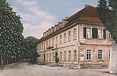
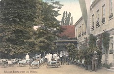
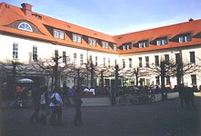
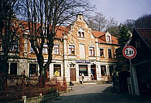
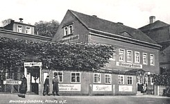
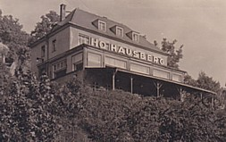
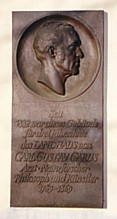
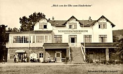
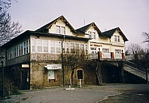
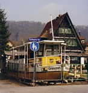

* * *

* * *

* * *

* * *

* * *

* * *

Goldener Löwe:

Der Gasthof “Goldener Löwe” war älteste Schankstätte in Pillnitz und bestand bereits im 16. Jahrhundert als Erbrichtergut mit Ausschank. 1608 wurde dieser alte
Gasthof erstmals erwähnt. Mehrfach erfolgten Umbauten und Erweiterungen der Schänke. Deren Besitzer war dem Rittergut Pillnitz abgabepflichtig und durfte in seinem Gut eine eigene Brauerei und Bäckerei betreiben. Ab 1824 setzte sich der Name “Goldener Löwe” für dieses Lokal durch. Ab 1835 befand sich der Gasthof in Privatbesitz und erhielt gegen Ende des 19. Jahrhunderts sein heutiges Aussehen _(Foto)_. Das beliebte Ausflugslokal wurde, zuletzt als HO-Lokal betrieben, 1993 geschlossen. Später betrieben die Besitzer im Erdgeschoss noch bis 2002 eine Fleischerei. In den 1970er Jahren erwarb der VEB Lufttechnische Anlagen das Gebäude, um hier ein Ferienheim einzurichten. Zuletzt wurde der frühere Gasthof als Wohnheim für vietnamesische Gastarbeiter genutzt. Nach jahrelangem Leerstand ist künftig der Umbau zu einer Wohnanlage mit Eigentumswohnungen geplant.

Schloßschänke:

Die Pillnitzer Schloßschänke entstand 1724 im Zusammenhang mit dem Ausbau des Kammergutes Pillnitz und war Wohnhaus und Dienstsitz des kurfürstlichen Hof-Traiteurs und Mundbäckers. 1818 wurde das Gebäude beim Schlossbrand schwer in Mitleidenschaft gezogen und daraufhin durch einen klassizistischen Neubau ersetzt, welchen man als Schloßbäckerei und ab 1876 auch als Apotheke nutzte. Ein grundlegender Umbau des Hauses erfolgte 1898/99. U.a. wurde dabei der Küchenanbau an der Hinterfront hinzugefügt und eine überdachte Veranda mit gusseisernen Säulen angebaut. Ab 1. Mai 1899 ist der aus Blasewitz stammende Albert Berthold Pächter der Gaststätte. Bis 1923 befand sich diese im Besitz der Wettiner und kam dann an den Freistaat Sachsen, der das Lokal an verschiedene Betreiber verpachtete.

Nach 1945 wurde die Schloßschänke zunächst weiter privat bewirtschaftet, bevor 1975 die HO das Haus übernahm. Wenig später wurde es baulich verändert und diente bis 1994 als Ausflugslokal für die Besucher des Schlosses Pillnitz. Neben dem Restaurant im Erdgeschoss gab es nun zusätzlich einen Selbstbedienungsbereich sowie einen Saal mit Bar im ersten Obergeschoss. Nach Klärung der Eigentumsfrage wurde das stark sanierungsbedürftige Gebäude 1998 bis auf zwei Außenwände abgetragen und nach historischem Vorbild wieder aufgebaut. 1999 eröffnete die Schloßschänke als öffentliche Gaststätte mit angeschlossenem Landhotel. Für die Gästezimmer entstand ein an die historische Substanz angepasster Neubau. In den Sommermonaten können die Gäste auch den Lindengarten nutzen, dessen Bäume traditionell kastenförmig verschnitten werden.

Café Pillnitz (Pillnitzer Mühle):

An Stelle des heutigen Gebäudes befand sich einst die Pillnitzer Mühle, die bereits um 1435 als eine von zwei Mühlen im Ort bestanden haben soll. Sie diente als Säge- und Mahlmühle und erhielt 1718 zugleich die Schankgerechtigkeit. Nach Einstellung des Mahlbetriebes um 1867 wurden die Räume von der Bäckerei Otto Wendisch genutzt. 1900 erfolgte der Abbruch der Mühlengebäude zugunsten eines neuen Wohn- und Geschäftshauses _(Foto)_. In diesem Haus entstand nun die Gaststätte “Zur Pillnitzer Mühle” mit Kegelbahn und Lindengarten. Das Lokal wurde 1948 geschlossen und die Gasträume später u.a. als Sparkassenfiliale, Mütterberatungsstelle und Apotheke genutzt, während die Bäckerei noch bis 1978 bestand. In den 1980er Jahren entstand in den Räumen der früheren Backwarenverkaufsstelle das “Café Pillnitz”. Nach 1990 zog hier das griechische Restaurant “Taverne bei Jannis”
ein.

Weinbergschänke:

Die Gaststätte “Weinbergschänke” (Am Rathaus 2) wurde ursprünglich als “Café Central” gegründet und von der Familie Uhlig bewirtschaftet. Außerdem gab es in einem kleinen Anbau die "Central-Drogerie". Später verpachteten die Besitzer ihr Lokal an verschiedene Wirtsleute. 1986 wurde die Weinbergschänke an neue Eigentümer verkauft und bis 2010 betrieben. Heute befindet sich hier eine kleine Tapas-Bar. Außerdem stehen einige Pensionszimmer zur Verfügung.

Café Hausberg:

Das Café entstand 1931 in einem Neubau auf dem Gelände des Hausberges, einem früheren Weinberg in Pillnitz _(Foto)_. Ab 1927 war hier mit dem Bau einer Landhaussiedlung begonnen worden. Das Gebäude
wurde nach einem Entwurf von Richard Merz im Bauhausstil errichtet und auch entsprechend modern eingerichtet. Haus und Inneneinrichtung stehen
deshalb unter Denkmalschutz. Merz arbeitete hauptberuflich als Architekt und betrieb das Café mit seiner Familie nur im
Nebenerwerb. Vor allem wegen der Fernsicht von der verglasten Veranda entwickelte sich das “Café Hausberg” zu einem der beliebtesten Ausflugslokale in Pillnitz.

Während des Zweiten Weltkrieges diente das Gebäude als Flüchtlingsunterkunft. Bereits im September 1945 konnte das
Café jedoch wieder eröffnet werden. 1951 übernahm die HO die Gaststätte, die allerdings nur in den Sommermonaten
geöffnet hatte. 1992 schloss das Café Hausberg vorerst seine Pforten und wurde nach erfolgter Renovierung 1997 wieder
eröffnet. Da die Umsatzzahlen jedoch nicht für einen wirtschaftlichen Betrieb ausreichten, entschlossen sich die Besitzer
2004 zum Umbau der ehemaligen Gasträume für Wohnzwecke. Das äußere Erscheinungsbild mit dem charakteristischen Schriftzug soll jedoch erhalten bleiben.

Parkcafé:

Das Gebäude an der Orangeriestraße 26 entstand Anfang des 19. Jahrhunderts. Zwischen 1832 und 1862 lebte hier der als Maler bekannt gewordene Leibarzt der sächsischen Könige Carl Gustav
Carus mit seiner Familie. Carus kam 1814 als Professor für Geburtshilfe und Leiter der Königlichen Hebammenschule nach Dresden und veröffentlichte 1820 das erste Lehrbuch der Gynäkologie in
Deutschland. Eine enge Freundschaft verband ihn mit dem Romantikerkreis um Ludwig Tieck und dem Maler Caspar David Friedrich. Am Haus erinnert eine Gedenktafel an ihn. Nach 1980 wurde
im Gebäude das Parkcafé Pillnitz eingerichtet.

**_Inschrift:_** _Seit 1832 war dieses Gebäude für drei Jahrzehnte das Landhaus von Carl Gustav Carus Arzt - Naturforscher - Philosoph und Künstler 1789 - 1869_

Pillnitzer Elbblick:

Die vor dem Zweiten Weltkrieg als “Dampfschiffrestaurant” bekannte Gaststätte befindet sich auf der Söbrigener Straße 2 in unmittelbarer Nachbarschaft der Anlegestelle der Weißen Flotte. Ab 1953 wurde das Haus als "Schifferkinderheim" genutzt. Betreiber war der VEB Deutsche Binnenreederei Berlin, der hier eine Unterkunft für die Kinder von Schifferfamilien einrichtete. Insgesamt konnten in der nach dem früheren KPD-Vorsitzenden "Ernst Thälmann" benannten Einrichtung bis zu 25 Kinder während der Abwesenheit ihrer Eltern betreut werden.

Nach dem Erwerb eines Nachbargrundstücks errichtete man dort eine zusätzliche Wohnbaracke für die Jungen, während die Mädchen im Haupthaus verblieben. Damit war nicht nur eine Erweiterung der Kapazität auf 50 Kinder, sondern auch die Möglichkeit zur Aufnahme von Kindern der Jugendhilfe verbunden. 1974 endete der Betrieb des Schifferkinderheims mit der Verlegung der Einrichtung nach Eisenhüttenstadt. Fortan diente die frühere Gaststätte als Ferienheim der Binnenreederei sowie als öffentliche Gaststätte. Seit 2007 wird diese unter dem Namen "Pillnitzer Elbblick" bewirtschaftet. Von der Terrasse bietet sich ein schöner Blick auf die Elblandschaft und zur Pillnitzer Elbinsel.

Ausspanne am Schloßpark:

Das Lokal an der Laubegaster Straße, an der Ortsgrenze zwischen Pillnitz und Hosterwitz gelegen, besitzt einen großen Gästegarten. Attraktion
war zeitweise die hier aufgestellte ehemalige Elbfähre “Dresden”. Das 1991 gebaute Fährschiff war bis zum Sommer 2002 in Johannstadt im Einsatz, wurde dann beim Hochwasser losgerissen und in Gohlis schwer
beschädigt an Land getrieben. Da eine Reparatur zu aufwendig gewesen wäre, verkauften die Verkehrsbetriebe das Schiff an den Pillnitzer Gastronomen. Ab 2003 bildete die in
“Rückenschwimmer” umgetaufte und als Freilichtbühne genutzte Fähre den Blickfang des Lokals . Seit 2007 ist das Schiff als privates Hausboot wieder auf der Elbe im Einsatz.

* * *

 \[ [Home](../../../index.html)\] \[ [Nord](../../../nord/)\] \[ [Nordwest](../../../nordwest/)\] \[ [Neustadt](../../../neustadt/)\] \[ [Nordost](../../../nordost/)\] \[ [West](../../../west/)\] \[ [Zentrum](../../../zentrum/)\] \[ [Südwest](../../../sudwest/)\] \[ [Süd](../../../sud/)\] \[ [Südost](../../../sudost/)\] \[ [Ost](../../../ost/)\] \[ [Register](../../../Register/register.html)\] \[ [Kontakt](../../../Kontakt/kontakt.html)\] \[ [Impressum](../../../impressum/)\]
