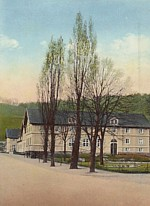

* * *

* * *

* * *

* * *

* * *

* * *

Das Pillnitzer Institut für Obstforschung und Gartenbau geht auf die 1913 gegründete Königliche Hofgärtnerei zurück, für deren Betrieb die seinerzeit größte Gewächshausanlage Europas entstand. Bereits zuvor war Pillnitz ein Zentrum des wissenschaftlichen Gartenbaus gewesen, der sich bis ins 18. Jahrhundert zurückverfolgen lässt. Charakteristisch für die neue Anlage war das 1913-15 gebaute “Pillnitzer Kreuz”, ein zentraler Verbindungsbau, von dem aus alle Gewächshäuser erreicht werden konnten. Die Entwürfe für die Anlage stammen vom Dresdner Stadtbaurat Hans Erlwein. Wichtigste Aufgabe war die Aufzucht von Zierpflanzen für den Bedarf der königlichen Hofhaltung in Pillnitz.

Nach dem Ende der Monarchie wurde 1922 die Höhere Staatslehranstalt für Gartenbau mit Sitz im früheren Marstall gegründet. Erster Direktor wurde der bekannte Pflanzenzüchter Prof. Dr. Otto Schindler (1876-1936), welcher 1925 die nach seiner Frau Margarethe benante Erdbeersorte “Mieze Schindler” züchtete. Das Grab das Paares befindet sich auf dem [Hosterwitzer Friedhof](../../../nordost/hosterwitz/maria_am_wasser/). Die Leitung der aus der früheren Königlichen Hofgärtnerei hervorgegangenen Lehr- und Beispielsgärtnerei oblag Dr. Alexander Steffen, nach dem das Verwaltungsgebäude des Institutes bis heute als “Steffenbau” benannt ist. 1936 wurden beide Einrichtungen vereinigt. Schindler und Steffen machte die Pillnitzer Lehranstalt zu einem wissenschaftlichen Zentrum des Gartenbaus, welches weit über die Grenzen Sachsens hinaus Bedeutung hatte. Bis zum Beginn des Zweiten Weltkrieges wurden hier Studierende aus zahlreichen Ländern Europas ausgebildet.

Die Pillnitzer Forschungseinrichtung setzte nach kriegsbedingter Unterbrechung ihre Arbeit bereits 1946 als Abteilung Zierpflanzenbau des Institutes für Gartenbau der Deutschen Akademie der Landwirtschaftswissenschaften
fort. In dieser Zeit lockten alljährliche Akazienschauen hunderte Besucher in die Gewächshäuser. Vorgestellt wurden auch gelungene Neuzüchtungen von Azaleen, Rhododendren, Gerbera und Usambaraveilchen. 1951 entstand für
die inzwischen in eine Fachschule für Landwirtschaft und Gartenbau umgewandelte Einrichtung ein neues Wohnheim hinter dem Schloss. Mehrfach umstrukturiert, arbeitete die Lehranstalt bis 1963 als Institut für
Obstforschung und Zierpflanzenzucht und wurde dann nach Nöthnitz verlegt. Die Lehrgebäude in Pillnitz dienten nun als Schulungseinrichtung des Instituts für Landwirtschaft beim Zentralkomitee der SED. Erhalten blieb das
Versuchsgut, welches bis 1989 als Außenstelle Pillnitz des Gutes Zierpflanzen Erfurt weiterbestand.

1990 erfolgte auf Beschluss des Dresdner Stadtrates eine Zusammenlegung des Nöthnitzer Institutes mit diesem Gut,
welches seitdem wieder in Pillnitz ansässig ist. Mitte der 90er Jahre gab es Pläne zur Auflösung der Einrichtung, die jedoch durch Proteste verhindert werden konnte. Seit 1994 haben in Pillnitz das Bundesinstitut für
Obstzüchtung, das Institut für Pflanzengenetik und Kulturpflanzenforschung mit seiner Sammlung wichtiger Obstarten und das 1990 gegründete Institut für Floristik ihren Sitz. Die Pillnitzer Einrichtungen bilden heute ein
in Deutschland einmaliges Forschungszentrum, für das 1997/99 einige Neubauten an der Lohmener Straße entstanden. Für das denkmalgerecht sanierte und umgebaute Hörsaalzentrum am Pillnitzer Platz erhielten die Architekten
1999 den Erlweinpreis der Stadt Dresden verliehen. Auch der historische Gewächshauskomplex “Pillnitzer Kreuz” wurde in den letzten Jahren saniert.

**_Foto:_** _Das Kammergut Pillnitz - Keimzelle der Gartenbautradition des Ortes_
