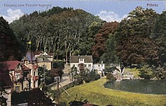
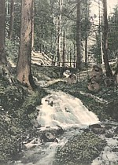
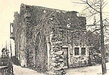
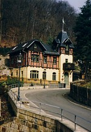
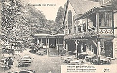
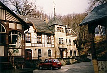
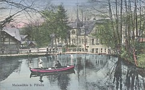
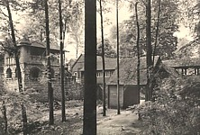
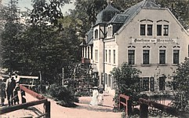

* * *

Der Meixgrund, auch Friedrichsgrund genannt, gehört zu den romantischen rechtselbischen Seitentälern zwischen Pillnitz und Loschwitz und wurde 1403 im Zusammenhang mit der Schenkung von Pillnitz an Euphemia von Karas erstmals als “Vallis Michcz” urkundlich erwähnt. Zu diesem Zeitpunkt befand sich das Tal gemeinsam mit dem Ort Pillnitz im Besitz der Familie Karas. Die bereits existierende Mühle erhielt schon früh das Schankrecht und diente als Ausspanne der Fuhrleute des Schönfelder Hochlandes auf ihrem Weg ins Elbtal.Später war sie auch zeitweiliger Jagdaufenthalt der Wettiner. Oberhalb des Meixgrundes befindet sich auf einem Bergsporn das sogenannte “Kanapee”, eine aus der Bronzezeit (um 1200 v. Chr.) stammende frühgeschichtliche Befestigungsanlage, die noch bis ins 10. Jahrhundert von der slawischen Bevölkerung als Fluchtburg genutzt wurde. Deutlich zu erkennen sind Reste des einst bis zu 10 Meter hohen Burgwalls und eines Hohlweges, der zum Burgplateau führt.

Ende des 18. Jahrhundert wurde der Meixgrund von Friedrich August III. als Ausflugsziel entdeckt und von dessen Kammerherrn Graf Marcolini als romantischer Landschaftspark gestaltet. 1780 erschloss man den Grund durch einen Fußweg. Außerdem entstanden Spazierwege und Brücken, ein künstlicher Wasserfall, steinerne Ruhebänke und weitere Denkmäler und Kleinbauten. Unmittelbar am Eingang des Grundes befand sich eine kleine, von einer Eiche und einer Linde eingerahmte Holzscheune, die die “Hütte von Philemon und Baucis” symbolisieren sollte. Das Motiv aus der griechischen Mythologie galt in der Romantik als Ideal für Liebe, Treue und Gastfreundschaft.

Unweit davon lagen die Ruinen eines antiken Tempels mit einem zerbrochenen Obelisken. Diese Szene erinnerte an die legendenumwobene “Irminsäule”, dem von Karl dem Großen zerstörten Nationalheiligtum der Sachsen. Für den benachbarten künstlichen Wasserfall ließ Friedrich August III. drei vom Meixbach gespeiste Wasserbecken anlegen, die bei Bedarf geöffnet werden konnten. In der Nähe befand sich mit “Amaliens Rosenhügel” ein romantisch gestalteter Platz zu Ehren der Gemahlin des Kurfürsten Maria Amalie Auguste.

Höhepunkt war die 1785 an Stelle einer frühgeschichtlichen Befestigungsanlage errichtete künstliche Ruine, die von Johann Daniel Schade entworfen wurde. Das kleine neogotische Bauwerk besaß im Inneren einen Speisesaal mit Kamin sowie Nebenräume für die Bewirtschaftung des Hauses. Ein ähnliches Bauwerk entstand fast zeitgleich auf dem nahegelegenen [Borsberg](../../../nordost/schonfeld-weissig/borsberg/). Friedrichsgrund und Borsberg waren fortan Schauplätze für Hoffeste und Belustigungen, aber auch ein Ort der inneren Einkehr für den naturverbundenen König. Seit dem 19. Jahrhundert waren die Baulichkeiten öffentlich zugänglich, blieben jedoch bis 1918 im Besitz der Wettiner. Reste der einstigen Gartengestaltung finden sich noch im Gelände.

Am 27. Juni 1850 richtete ein Wolkenbruch schwere Schäden im Meixgrund an. Auch nach Wiederherstellung des Talweges blieb der romantische Grund Ausflugsziel der Dresdner. 1886 besuchte August Bebel den Grund und leitete in der abgelegenen Meixmühle eine Landesdelegiertenkonferenz der durch das Sozialistengesetz verbotenen SPD. An dieses Ereignis erinnert heute eine Gedenktafel.

Der im Ortskern von Pillnitz gelegene Teil des Grundes wurde im 19. Jahrhundert befestigt und um 1900 zur Fahrstraße ausgebaut _(Foto)_. Bis 1950 trug diese nach dem benachbarten Ort den Namen Schönfelder Straße, wurde dann jedoch in Meixstraße umbenannt. Hier sind noch einige historische Gebäude des früheren Dorfes erhalten geblieben. Im Haus Meixstraße 6 hatte bis 1915 das Pillnitzer Gemeindeamt seinen Sitz. Weitere Gebäude dienten als
Geschäftsräume des Photographen Paul Köhne (Nr. 14) bzw. beherbergten Backstube und Verkaufsräume der Konditorei Heinke (Nr. 5). Die frühere [Pillnitzer Mühle](../../../nordost/pillnitz/gaststatten_pillnitz/) am Eingang zum Meixgrund musste 1901 dem Bau eines Wohn- und Geschäftshauses weichen.

Unweit davon befinden sich in der Nähe der Einmündung des Friedrichsgrundes die Überreste eines historischen Eiskellers. Die heute nicht mehr zugänglichen Kellerräume wurden um 1780 von Freiberger Bergleuten als Lagerraum geschaffen und zur Einlagerung von Kühleis für höfische Feste im Pillnitzer Schloss genutzt. Ein Lüftungsschacht verband diesen Keller mit der Bergspitze, wo er in einem gemauerten Schornstein endete. Während des Zweiten Weltkrieges dienten die Gewölbe als Treibstofflager, Luftschutzbunker und zur Einlagerung von Wertsachen. Hier überstand auch das demontierte Reiterstandbild des “Goldenen Reiters” die Kriegsjahre. Um 1960 war ein Ausbau des Bunkers für die DDR-Zivilverteidigung geplant. Unsachgemäße Sprengungen führten dabei zu einem teilweisen Einsturz, woraufhin der Eingang vermauert wurde. Heute leben hier einige seltene Fledermausarten.

Meixmühle:

Die Meixmühle wurde 1403 erstmals erwähnt, als sie gemeinsam mit dem Meixgrund und weiteren Ländereien als Schenkung des Markgrafen Wilhelm I. in den Besitz der Familie Karas kam.1649 ist sie erneut als Mahlmühle der Bauern des Schönfelder Hochlandes erwähnt. Zu diesem Zeitpunkt befand sie sich im Besitz von Hanß Ulbricht, der ein neues Mühlengebäude errichten ließ. Spätestens 1770 erhielt ihr damaliger Besitzer Johann Samuel Nacke das Schankrecht. Gern wurde die Mühle nun von Fuhrleuten, aber auch von Angehörigen höfischer Jagdgesellschaften besucht. Der Name soll der Sage nach auf den einst im Meixgrund hausenden Drachen Meix zurückgehen, der alljährlich eine Bauernmagd als Opfer verlangte. Erst ein Müllerbursche tötete das Ungeheuer und rettete so die Tochter des Müllers vor dem sicheren Tod.

Seit dem 19. Jahrhundert entwickelte sich die Mühle zum beliebten Ausflugsziel der Besucher des Grundes. Am 7. Juli 1895 wurde die alte Meixmühle bei einem Großbrand völlig zerstört. Doch bereits im Folgejahr ließ der Besitzer der Meixmühle Arthur Horn das Gebäude als Gasthaus wieder aufbauen und um die Jahrhundertwende um einige Nebengebäude ergänzen _(Foto)_. Die Pläne für den Neubau stammen von Otto Boeger. 1896 erwarb Horn den “Wendenhof” von der im gleichen Jahr veranstalteten Ausstellung “Die alte Stadt”. 1903 kam die Drachenburg hinzu, die an die Sage vom Drachen Meix erinnern sollte.

1931 kaufte der Landesverein Sächsischer Heimatschutz das Gelände um die Meixmühle und richtete hier eine Herberge ein. Nach 1945 diente die Meixmühle zeitweise als FDGB-Ferienheim und Kinderferienlager. 1992 konnte die seit 1991 unter Denkmalschutz stehende traditionsreiche Gaststätte nach umfangreicher Sanierung wieder eröffnet werden. Für Übernachtungsgäste gibt es außerdem einige Pensionszimmer.

**_Fotos:_** _Die Meixmühle um 1910 - in der Mitte die Drachenburg mit dem Wendenhof,_

_rechts das Hauptgebäude der Mühle_

* * *

 \[ [Nord](../../../nord/)\] \[ [Nordwest](../../../nordwest/)\] \[ [Neustadt](../../../neustadt/)\] \[ [Nordost](../../../nordost/)\]
 \[ [West](../../../west/)\] \[ [Zentrum](../../../zentrum/)\] \[ [Südwest](../../../sudwest/)\] \[ [Süd](../../../sud/)\] \[ [Südost](../../../sudost/)\] \[ [Ost](../../../ost/)\] \[ [Register](../../../Register/register.html)\] \[ [Kontakt](../../../Kontakt/kontakt.html)\] \[ [Impressum](../../../impressum/)\]
