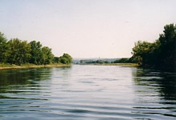
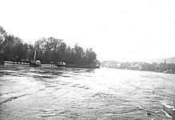
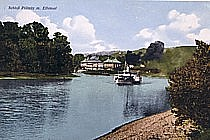

* * *

Die Pillnitzer Elbinsel ist zusammen mit der Insel bei Gauernitz letzte von einst 18
sächsischen Elbinseln und einzig verbliebene im Dresdner Stadtgebiet. Die Insel gegenüber dem Schloss umfasst ca. 10,5 Hektar und  ist ungefähr 970 m lang. Die
Vegetation besteht aus einem Weiden-Pappel-Auenwald mit großen Rasenflächen und ist letzter verbliebener Rest des ursprünglichen Waldes im Elbtal. Häufig
vorkommende Baumarten sind außerdem Stieleiche, Feld- und Flatterulme sowie Esche und Bergahorn. 1862 erfolgte zudem die Anpflanzung einiger Roß- und
Edelkastanien. Im Inneren befindet sich eine größere Wiesenfläche. Wegen ihrer Vegetation und der ruhigen, abgegrenten Lage ist die Pillnitzer Elbinsel ein wichtiges
Rückzugs- und Brutgebiet für zahlreiche Wasservögel und darf deshalb nicht betreten werden. Außerdem leben
verschiedene Kleinsäuger wie Wildkaninchen, Maulwürfe und Igel sowie zahlreiche Käferarten auf der Insel. Bei einer ausführlichen Untersuchung konnten um 1960 insgesamt 522 Tierarten nachgewiesen werden.

Schon im 15. Jahrhundert wurde die Pillnitzer Elbinsel erwähnt und diente damals als Fasanenzuchtgebiet für den kurfürstlichen Hof. Nach dem Bau des Schlosses
wurde sie in der Barockzeit in die Gestaltung von Hoffesten einbezogen. So fand hier während der Lustbarkeiten zur Hochzeit von Augusta Constantia, einer
Tochter August des Starken mit der Gräfin Cosel, im Juni 1725 ein militärisches “Manöver” statt. Ziel des Schauspiels war es, ein am Zschierener Ufer aufgebautes
“Bollwerk” türkischer Janitscharen zu erobern. Dafür wurde die Insel eigens durch eine Schiffbrücke mit dem Ufer verbunden und war außerdem Standort eines
Militärlagers für die Mitwirkenden. Für die Hofgesellschaft entstand eine Aussichtsplattform am südlichen Teil der Insel. Nach mehrtägigen “Seeschlachten” auf der Elbe gelang es den
sächsischen Grenadieren, die Türkenfestung zu stürmen und in die Luft zu jagen. Mit Ende der Feierlichkeiten erfolgte die Beseitigung aller baulichen Anlagen.

Anfang des 19. Jahrhunderts entstand auf der Insel ein heute nicht mehr vorhandenes Badehäuschen für die königliche
Familie. 1834 ließ sich der Luftschiffer Professor Reichardt mit seiner Tochter für einige Zeit auf der Pillnitzer Elbinsel
nieder. Außerdem wurden hier noch bis zum Ende des 19. Jahrhunderts Fasanen gehalten und gejagt. In den Jahren nach
dem Ersten Weltkrieg war sie zeitweise ein Domizil für die Anhänger der Freikörperkultur, bevor sie am 2. Januar 1924
unter Naturschutz gestellt wurde. Zuvor hatte die Verbreiterung des von den Elbschiffen genutzten Hauptarmes zwischen
1909 und 1913 zur Abtragung eines Teil des rechten Inselufers geführt. Da der Abraum für eine Verlängerung der Insel um fast 200 Meter genutzt wurde, erhielt sie in dieser Zeit ihre heutige Form.

**_Foto:_** _Schloss Pillnitz mit Elbinsel um 1910_

* * *

 \[ [Nord](../../../nord/)\] \[ [Nordwest](../../../nordwest/)\] \[ [Neustadt](../../../neustadt/)\] \[ [Nordost](../../../nordost/)\]
 \[ [West](../../../west/)\] \[ [Zentrum](../../../zentrum/)\] \[ [Südwest](../../../sudwest/)\] \[ [Süd](../../../sud/)\] \[ [Südost](../../../sudost/)\] \[ [Ost](../../../ost/)\] \[ [Register](../../../Register/register.html)\] \[ [Kontakt](../../../Kontakt/kontakt.html)\] \[ [Impressum](../../../impressum/)\]
