* * *

* * *

* * *

* * *

* * *

* * *

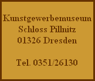

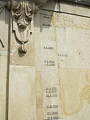

**Hochwassermarken am Wasserpalais**

* * *

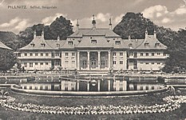Die Geschichte des Schlosses Pillnitz beginnt bereits im Mittelalter, als hier zwei Herrensitze bestanden. Vom älteren, auf einem Bergsporn über dem [Meixgrund](../../../nordost/pillnitz/meixgrund/) gelegen, sind kaum noch Spuren auffindbar. Die zweite Burg, mit Wall und Wassergraben umgeben, lag an Stelle des heutigen Neuen Schlosses. Diese 1403 erstmals erwähnte Wehranlage war Sitz der Lehnsherren von Pillnitz und wechselte mehrfach ihre Besitzer. 1569 erwarb die Familie von Loß die Grundherrschaft und ließ die vorhandene Burg zu einem Renaissanceschloss mit vier Flügeln erweitern. Die schlichte Anlage wurde später als “altes Schloss” bezeichnet, ging 1643 in den Besitz der Familie Bünau über und wurde 1694 vom Kurfürsten Johann Georg IV. im Tausch gegen die Herrschaft Lichtenwalde erworben. Der Bruder August des Starken schenkte Schloss Pillnitz seiner Geliebten Sybille von Neitschütz. Wenige Monate später starb Sybille an den Blattern, einige Tage darauf folgte ihr der Kurfürst. So wurde August der Starke als Nachfolger seines Bruders auf dem Thron auch Besitzer der Herrschaft Pillnitz.

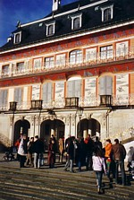1706 wurde Pillnitz erneut zum Geschenk für eine kurfürstlichen Mätresse, als August der Starke Schloss und Herrschaft der Gräfin Cosel vermachte. Auch nach deren Sturz 1715 blieb Pillnitz formal im Besitz der Gräfin und wurde erst nach einem komplizierten juristischen Verfahren am 14. April 1718 wieder an den Wettiner zurückgegeben. August der Starke beauftragte nun seinen Oberlandbaumeister Matthias Daniel Pöppelmann und Graf Wackerbarth mit den Planungen für eine Schlossanlage in Pillnitz. 1720 wurde mit der Umsetzung der großzügigen, aber nur in Ansätzen realisierten Pläne begonnen. Als erstes Gebäude entstand das Wasserpalais _(Foto rechts)_ im “indianischen” Stil, welches sich an asiatischen Vorbildern orientierte.

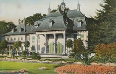1723 folgte das baugleiche Bergpalais, woraufhin der Innenhof als barocker Lustgarten gestaltet werden konnte. Das alte Renaissanceschloss wurde dabei in die Gestaltung eingezogen und bildete den östlichen Abschluss des Hofes. 1722 entstand noch der heute nicht mehr vorhandene “Venustempel” an Stelle der alten Schlosskapelle. Zwei Jahre später wurde in einem Seitengebäude eine katholische Schlosskapelle eingerichtet. Für die protestantische Bevölkerung des Ortes erbaute Pöppelmann zum gleichen Zeitpunkt die [Weinbergkirche](../../../nordost/pillnitz/weinbergkirche_pillnitz/). Im Zusammenhang mit dem Lustschloss Pillnitz wurde zugleich der erste Teil des Schlossparks angelegt und mit einer Orangerie und weiteren Kleinbauten für höfische Vergnügungen versehen.

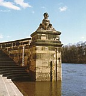Schloss Pillnitz war nun häufiger Ort für Feste, deren Auftakt die Hochzeit der Cosel-Tochter Augusta Constantia mit dem Oberfalkenmeister Heinrich Friedrich Graf von Friesen am 3. Juni 1725 bildete. In die Belustigungen wurden auch die [Pillnitzer Elbinsel](../../../nordost/pillnitz/pillnitzer_elbinsel/) und die von Zacharias Longuelune entworfene Freitreppe zur Elbe mit einbezogen, an der die Prunkgondeln anlegten, von denen eine noch im Schlosspark erhalten geblieben ist. Zwei steinerne Sphinxen bewachen diese Treppe, die zugleich zur Terrasse des Wasserpalais führt _(Foto)_. Hier sind auch einige Hochwassermarken zu sehen. Eine neue Rekordmarke erreichte die Elbe am 17. August 2002 mit 9,40 m, wobei die bisherige Höchstmarke von 1845 um ca. einen halben Meter übertroffen wurde.

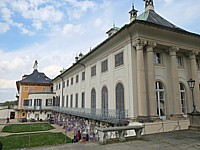Gegen Ende des 18. Jahrhunderts erlebte Schloss Pillnitz seine zweite Bauphase. Die bisherigen hölzernen Seitenflügel der beiden Palais wurden zugunsten von massiven Steinbauten abgetragen. 1788-92 erfolgten diese Arbeiten, die im Jahr 1795 durch den Bau von Verbindungsflügeln zwischen den Pavillons vollendet werden konnten. Die neuen Gebäude wurden von Christian Traugott Weinlig und Christian Friedrich Exner entworfen und im klassizistischen Stil gestaltet. Weinlig war auch für die zum Teil bis heute erhalten gebliebene Ausstattung der Innenräume des Schlosses verantwortlich. Kurz nach Fertigstellung der Neubauten erlebte Pillnitz ein Ereignis von weltpolitischer Bedeutung, als sich hier am 27. August 1791 Kaiser Leopold II., der preußische König Friedrich Wilhelm II. und der spätere französische König Ludwig XVIII. trafen, um über ihr weiteres Vorgehen gegen das revolutionäre Frankreich zu beraten. Die Unterzeichnung der “Pillnitzer Deklaration” war erster Schritt zu einem Bündnis zwischen den feudalen Mächten in Deutschland und Frankreich und trug später maßgeblich zum Aufstieg Napoleons bei.

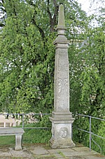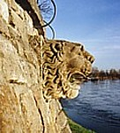Am 1. Mai 1818 brannte das alte Renaissanceschloss Pillnitz völlig nieder und wurde daraufhin abgetragen. Lediglich ein Sandsteinobelisk und ein steinerner Löwenkopf _(Fotos links und rechts))_ erinnern heute noch an diesen Bau. Unter Leitung von Christian Friedrich Schuricht wurde an gleicher Stelle ein Neubau errichtet, der geschickt die Bauformen der vorhandenen Palais\` übernahm. Im Inneren entstanden u. a. ein großer Festsaal und die neue Schlossküche. Der Raum zwischen den Flügeln des Neuen Schlosses wurde mit chinesischen Fliedersträuchern bepflanzt und wird seitdem als Fliederhof bezeichnet. Im Zusammenhang mit dem Neubau entstand 1824 auch die Schlosswache gegenüber dem Kapellenflügel.

Das baulich seitdem kaum noch veränderte Schloss blieb bis zum Ende des Ersten Weltkriegs Sommersitz der Wettiner. Seit 1910 standen die Innenräume auch der Öffentlichkeit zur Verfügung, die hier an Führungen durch die mit antiken Möbeln, Porzellan und Gemälden ausgestatteten Säle teilnehmen konnte. Die Maler Ludwig von Hofmann und Richard Dreher besaßen im Schloss ihre Wohnräume. Außerdem bestand eine Gobelin-Wirkerei. 1918 übernahm der Staat das Schloss, welches 1924 im Zuge der Fürstenabfindung endgültig in staatlichen Besitz überging.

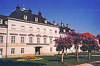Die 1945 unbeschädigte Anlage diente in den ersten Monaten nach Kriegsende als Sammeldepot für Kunstgüter, die von der Sowjetarmee aus den Auslagerungsorten geborgen worden war. In einer provisorischen Werkstatt wurden hier erste Restaurierungsversuche unternommen. 1948 öffnete in den Räumen von Schloss Pillnitz auf Weisung der Sowjetischen Militäradministration ein “Zentralmuseum des Bundeslandes Sachsen”, in dem verschiedene Kunstwerke aus sächsischen Sammlungen zu sehen war. Ein Großteil der geborgenen Schätze war jedoch bereits zuvor in die UdSSR verbracht worden und kehrte erst 1956 nach Dresden zurück. In den 1960er Jahren wurden die Palais des Schlosses Pillnitz Domizil des Museums für Kunsthandwerk (Kunstgewerbemuseum), in dem bis heute Möbel, Gobelins, Glas- und Porzellangefäße und weitere kunsthandwerkliche Gegenstände ausgestellt sind.

Seit den 1980er Jahren erfolgte eine umfassende Restaurierung der Gebäude mit dem Ziel, den Ursprungszustand wiederherzustellen. Einen Rückschlag erlitten diese Bemühungen durch das Elbehochwasser von 2002, welches auch Teile der Schlossanlage überflutete. Schwer in Mitleidenschaft gezogen wurden das Wasserpalais und der Fliederhof, während die Kunstschätze des Museums glücklicherweise alle gerettet werden konnten. Heute können sowohl das Bergpalais als auch das Wasserpalais wieder besichtigt werden. Sehenswert ist auch die seit einigen Jahren wieder zugängliche ehemalige Königliche Hofküche mit historischen Kochmaschinen und Gerätschaften des 19. Jahrhunderts.

Einzelne Gebäude:

Alte Schlosskirche: Bereits im alten Pillnitzer Schloss gab es eine von Christoph von Loß gestiftete Kirche, welche den Namen “Zum Heiligen Geist” trug und 1597 am Sonntag Jubilate vom Dresdner Hofprediger Polykarp Leyser geweiht wurde. Diese Weihepredigt wurde später mehrfach gedruckt und galt als “Musterpredigt” für die Weihe evangelischer Kirchen in Sachsen. 1648 erhielt die Kirche einen vom Dresdner Bildhauer Johann Georg Kretschmar geschaffenen Altar. Weitere Ausstattungsstücke stiftete die Familie Bünau als Besitzer der Pillnitzer Ritergutsherrschaft. 1723 musste die alte Schlosskirche für den Neubau des Schlosses abgerissen werden. An ihrer Stelle entstand der wegen seiner Wandbilder auch “Venustempel” genannte große Speisesaal. Teile der Ausstattung der Schlosskirche, u.a. der Altar und der Taufstein, kamen in die 1725 eingeweihte [Weinbergkirche](../../../nordost/pillnitz/weinbergkirche_pillnitz/), wo sie bis heute erhalten blieben.

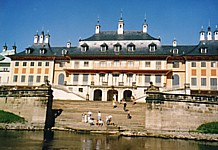Wasserpalais: Das Wasserpalais entstand als erstes Gebäude der barocken Schlossanlage 1720/21. Nach Plänen von Pöppelmann wurden drei zweistöckige Pavillons erbaut, die durch Galerien miteinander verbunden waren. Zur Gartenseite besitzt das Gebäude einen Portikus, während die Elbseite eine Terrasse erhielt, von der eine Freitreppe zum Elbufer führt. Diese Treppe wurde von Zacharias Longuelune entworfen und mit zwei Sphinxen verziert, die aus der Werkstatt Johann Christian Kirchners stammen. Die Treppe bildete den Hauptzugang zum Schloss und war Teil eines Projektes, welches die Elbe als “Canale Grande” der Dresdner Kulturlandschaft vorsah. Mit Prunkgondeln konnte die Hofgesellschaft auf dem Wasserweg Pillnitz erreichen. Ähnliche Gondelhäfen wurden auch am Japanischen Palais und am Schloss Übigau angelegt. Das Wasserpalais erhielt, ebenso wie die späteren Gebäude, geschweifte Dächer mit zahlreichen Aufbauten und wurde mit Chinoiserie-Malereien verziert. So sollte der Eindruck eines “indianischen Lustschlosses” entstehen. Die Innenräume der beiden Palais wurden von Leplat im gleichen Stil ausgestattet. Leider ist diese Ausstattung heute nur noch in geringen Resten erhalten. Die Einweihung des Gebäudes erfolgte am 3. August 1721 mit dem Stiftungsfest des Weißen Adlerordens.

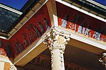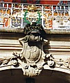

**_Fotos:_** _Details der Chinoiserien am Mittelbau des Bergpalais (links/rechts) und Wappenkartusche mit den Initialien August des Starken (AR = Augustus Rex) an der Elbseite des Wasserpalais_

1788/91 wurde das Wasserpalais baulich verändert. Die einstöckigen Verbindungsgänge zwischen den Gebäudeteilen wurden aufgestockt, so dass die Bauten heute eine Einheit bilden. An Stelle von hölzernen Gewächshäusern entstanden massive Seitenflügel, für die Christian Traugott Weinlig und Christian Friedrich Exner die Entwürfe lieferten. Unter Anpassung an die vorhandene Barockarchitektur wurden die neuen Gebäude im schlichten klassizistischen Stil gestaltet und dienten später als Wohnungen für die zahlreichen Hofbeamten. Heute befinden sich hier Ausstellungsräume des Kunstgewerbemuseums, in denen u.a. die Thronsessel der sächsischen Kurfürsten, historische Reisemöbel und weitere Gebrauchsgegenstände aus dem Besitz der Wettiner zu sehen sind.

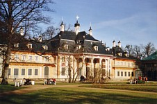Bergpalais: Das Bergpalais wurde baugleich zum Wasserpalais 1722/23 errichtet, wodurch ein großzügiger Innenhof entstand, der als Lustgarten diente. Den östlichen Abschluss bildete bis zur Zerstörung 1818 das alte Schloss mit dem Venustempel und der Schlosskapelle. Mit dem Bau des Bergpalais wurden die ursprünglichen Pläne Pöppelmanns aufgegeben, der in Pillnitz eine großzügige Schloss- und Parkanlage zwischen Fluss und Elbhang schaffen wollte. Auch das Bergpalais wurde 1788/95 baulich verändert und mit Anbauten im klassizistischen Stil erweitert. In einem Seitenflügel blieb bis heute die Innenraumgestaltung Weinligs erhalten, die zu den bemerkenswertesten Raumschöpfungen ihrer Zeit gehört. 1966-1971 wurden die Weinlig-Zimmer denkmalgerecht wiederhergestellt und mit passenden Möbeln und Leuchtern eingerichtet. Weitere Museumsräume bieten einen Überblick über die Geschichte des Kunstgewerbes vom Mittelalter bis zur Gegenwart.

Venustempel: Das Gebäude entstand zeitgleich mit dem Bau der beiden Palais und besaß einen prunkvollen Fest- und Speisesaal. In den Nebenräumen waren Bilder leichtbekleideter Frauen angebracht, die diesem “Tempel der Lust” seinen Namen gaben. Ursprünglich hatte an dieser Stelle die alte protestantische Schlosskapelle gestanden, die auf Weisung August des Starken abgetragen wurde. Stattdessen richtete man in einem Anbau eine katholische Kapelle ein. 1818 wurde der Venustempel beim Brand des alten Schlosses zerstört.

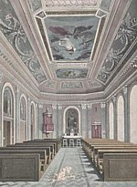Schlosskapelle:  Die katholische Schlosskapelle wurde 1725 in einem beim Neubau des “Venustempels” entstandenen Seitenflügels des alten Schlosses eingerichtet und war eine der ersten neu geschaffenen katholischen Kirchen in Sachsen nach der Reformation. Diese fiel 1818 dem Schlossbrand zum Opfer. Im daraufhin errichteten Neuen Palais wurde 1830 erneut eine Kapelle eingerichtet. Sie befindet sich im ersten Stock des zwischen 1824 und 1828 errichteten Nordflügels und wurde von Carl Vogel von Vogelstein ausgemalt. Der klassizistische Raumentwurf stammt von Christian Friedrich Schuricht. Bemerkenswert ist vor allem das große Deckengemälde mit Szenen aus dem Leben Marias. Geweiht wurde die Kapelle dem Patron der Pillnitzer Vikarie St. Petrus Canisius. Dieser trat als erster Deutscher der Gesellschaft Jesu bei und hatte großen Anteil an der Bekämpfung des Protestantismus im süddeutschen Raum.

Zum 1. Januar 2011 erfolgte die Auflösung der Pillnitzer Pfarrvikarie “St. Petrus Canisius” und deren Anschluss an die katholische [St.-Hubertus-Gemeinde](../../../nordost/page10246/hubertuskirche/) am Weißen Hirsch. 2015 wurden für die Schlosskapelle zwei neue Glocken gegossen. Die Bronzeglocken “Ignatius” und “Maria” sind mit Darstellungen des Dachreiters des Schlosses verziert und ersetzen das 1945 unter unklaren Umständen verloren gegangene alte Geläut. Die Orgel der Kapelle stammt von der Dresdner Orgelbaufirma Jehmlich.

Schlosstheater: Da Schloss Pillnitz von den Wettinern hauptsächlich als Sommersitz und Vergnügungsort genutzt wurde, richtete man hier im 18. Jahrhundert auch ein Schlosstheater ein. Dieses entstand vermutlich zwischen 1720 und 1725 in einem Flügel des alten Renaissanceschlosses und war zwischen 1764 und 1812 Aufführungsort für insgesamt 239 Opernaufführungen. Erst der Schlossbrand von 1818 beendete die Geschichte dieses Theaters. Nach Zerstörung der Räume wurde das Theater in das sogenannte Ringrennhaus, den heutigen Mittelteil der Orangerie, verlegt. Ursprünglich hatte man sogar den Bau eines richtigen Theatergebäudes erwogen, letztlich jedoch nicht realisiert.

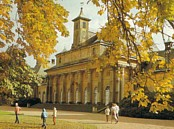Neues Palais:  Der heute als Neues Schloß bezeichnete Ostteil der Gesamtanlage entstand 1818-26, nachdem das alte Renaissanceschloss mit der Kapelle und dem Venustempel am 1. Mai 1818 einem Brand zum Opfer gefallen war. Bereits am Tag nach dem Feuer bewilligten die sächsischen Stände 50.000 Taler für den Wiederaufbau, so dass
Oberlandbaumeister Christian Friedrich Schuricht schon bald mit dem Bau beginnen konnte. In Anlehnung an die vorhandenen Gebäude entstand an der Ostseite ein klassizistischer Schlossbau mit zwei Seitenflügeln, die einen kleinen Hof bilden.

Im Inneren des Hauptgebäudes wurde ein großer Speise- und Festsaal eingerichtet, während die beiden Flügel als Küche und Schlosskapelle genutzt wurden. Die Innenräume wurden durch den Maler Carl Vogel von Vogelstein künstlerisch ausgestaltet, u. a. mit Porträts bekannter zeitgenössischer Künstler. Der kleine Innenhof wird heute als “Fliederhof” bezeichnet, da hier 1866 neunzig chinesische Fliederbäume angepflanzt wurden. Zu den jüngsten Attraktionen gehört die frühere Hofküche mit historischen Kochgeräten und -geschirr, die bis 1918 in Betrieb war und seit 2003 besichtigt werden kann.

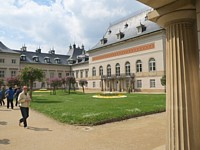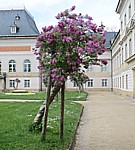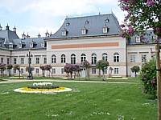

**_Fotos:_** _Neues Palais mit Fliederhof_

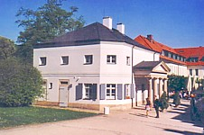Schlosswache: Der klassizistische Bau gegenüber dem Kapellenfügel wurde 1824 ebenfalls von Schuricht entworfen und diente als Unterkunft für das Wachpersonal. Heute befindet sich hier ein Souvenirshop _(Foto)_.

Alte Kaserne: Die alte Kaserne entstand 1852 als Unterkunft für die Wachmannschaft des Schlosses Pillnitz und wurde bis zur Abschaffung der Monarchie 1918 für diesen Zweck genutzt. 1922 bezog die Pillnitzer Lehranstalt für Gartenbau das Gebäude. Zuletzt befand sich dort der Laborbereich der Sächsischen Landesanstalt für Landwirtschaft. Nach abgeschlossener Sanierung hat hier seit 2008 das Landesamt für Umwelt, Landwirtschaft und Geologie seinen Sitz.

Marstall: Der Gebäudekomplex des früheren Marstalls wurde 1880 am Pillnitzer Platz errichtet, um hier die Pferde und notwendigen Gerätschaften für die Schlosswirtschaft unterzubringen. Nach Ende des Ersten Weltkrieges nutzte die 1922 gegründete Höhere Lehranstalt für Gartenbau auch dieses Gebäude. 1945 schwer beschädigt, erfolgte in den 1950er Jahren der Wiederaufbau für das Institut. Im Saal fanden zeitweise auch öffentliche Veranstaltungen und Filmvorführungen statt. 2007/08 wurde der Marstall saniert und dient heute unter dem Namen Schindlerbau als Domizil des sächsischen Landesamtes für Umwelt, Landwirtschaft und Geologie. Vor dem Bau fanden zwei Brunnen aus dem Dresdner Zwinger Aufstellung. Die zugehörige Gartenanlage entstand 1928 nach Entwürfen von Gustav Allinger.

Schloßpark:

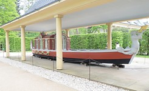Lustgarten: Ältester Teil der Pillnitzer Parkanlagen ist der Lustgarten zwischen Wasser- und Bergpalais, der bereits um 1722 mit geometrischen Rasenflächen und Rabatten im französischen Stil gestaltet wurde. Die zentrale Fontäne sowie die Wasserbecken wurden erst im 19. Jahrhundert hinzugefügt. Für barocke Vergnügungen legte man verschiedene Spielplätze an, um die damals üblichen Karussel- und Ringelrennen, Scheiben- und Bogenschießen und andere Spiele durchführen zu können. Im Anschluss an den Lustgarten wurden Weißbuchen angepflanzt, die regelmäßig verschnitten, die “Heckenquartiere” (Charmillen) bilden. Hier waren früher ebenfalls Schaukeln, Karussels und andere Spielgeräte aufgestellt. Später wurde auch dieser Teil des Parks gärtnerisch gestaltet und 1912 neu bepflanzt. Seit 1957 steht in einem dieser Heckenquartiere die letzte erhaltene Pillnitzer Tritonengondel _(Foto)_. Sie war eine von ursprünglich drei um 1800 für den Hofstaat gebauten Prunkgondeln und entstand in der Werkstatt des Hamburger Schiffszimmerermeister Johann Christoph Pätzold. Bis 1935 befand sie sich im Stallhof des Schlosses und wurde dann nach Pillnitz verbracht. Der dem Wetterschutz dienende Pavillon stammt aus den 1980er Jahren.

Großer Schlossgarten: Der “Große Schlossgarten” entstand nach Fertigstellung des Bergpalais 1732 und wurde einst auch als “Spiegel” bezeichnet. In diesem Teil verzichtete man auf eine aufwendige gärtnerische Gestaltung.Stattdessen wurde die ca. 125 m lange Fläche mit Baumreihen eingefasst und als Schieß- und Reitbahn genutzt. Dieser Teil des Parks blieb bis heute weitgehend im Ursprungszustand erhalten. Am Bergpalais stand früher das Schießhaus, am anderen Ende der Freifläche eine Grotte, die als Kugelfang diente. Im 19. Jahrhundert wurde das ehemalige Schießhaus als botanisches Kabinett genutzt und 1864 abgerissen.

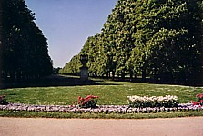Maillebahn: Die Maillebahn ist Teil der im 18. Jahrhundert angelegten ca. 750 m langen Pillnitz-Hosterwitzer Allee. Ursprünglich befand sich in diesem Teil des Parks das “Französische Dorf” zur Unterbringung der bei Hoffesten beschäftigten Komödianten, Musiker und Sänger. Ab 1766 wurde die Allee als Spielfläche für das Maille-Spiel, einem kricketähnlichen Ballspiel genutzt. Am Eingang steht eine steinerne Vase, die um 1785 von Thaddäus Wiskotschill geschaffen wurde. Heute trägt auch der mit einigen Villen und Landhäusern bebaute Teil der Allee außerhalb des Schloßparks den Namen [Maillebahn](../../../nordost/pillnitz/strassen_pillnitz/maillebahn/).

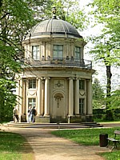Englischer Garten: Mit Veränderung des Zeitgeschmacks wandelte sich auch das Ideal der Gartengestaltung. Statt der streng geometrischen Formen des französischen Lustgartens stand nun das Ziel eines in die natürliche Umgebung einbezogenen Parks nach englischem Vorbild im Vordergrund. 1778 begann die Anlage des neuen Landschaftsparks nördlich der Heckenquartiere. Verschlungene Wege und Wasserläufe führen zu einem künstlich angelegten Teich mit einer Insel. Über eine Holzbrücke erreicht man eine Plastik, die die Göttin Juno darstellt.

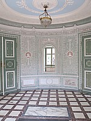In diesem Parkteil sind bis heute zahlreiche seltene Bäume und andere Gehölze zu finden. 1785 wurde der Park um den “Holländischen” und 1790 um den “Chinesischen” Garten erweitert. Im Holländischen Garten fanden Pflanzen aus der ehemaligen holländischen Kolonie in Südafrika ihren Platz. 1870 wurde eine Flora-Plastik Wolf von Hoyers aufgestellt.

Englischer Pavillon: Das Gebäude _(Fotos)_ entstand 1779 am Rande des Englischen Gartens nach Plänen von Christian Traugott Weinlig. Der kleine Rundbau im klassizistischen Stil besitzt im Inneren zwei Räume und wurde als Teepavillon genutzt. Wandmalereien zeigen u. a. verschiedene Tier- und Pflanzendarstellungen.

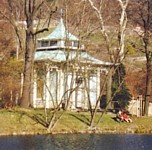Chinesischer Pavillon: Dieser kleine Bau befindet sich im 1790 geschaffenen nördlichen Parkteil unmittelbar an der Parkmauer und wurde 1804 erbaut. Das Bauwerk wurde von Christian Friedrich Schuricht entworfen und verbindet die chinesischen Formen der Palaisbauten mit romantischen Idealen der Zeit. Nach Originalvorlagen entwarf Schuricht eine Kopie eines ostasiatischen Pavillons, der auch im Inneren eine entsprechende Ausgestaltung erhielt. Die acht Wandbilder im Inneren malte Johann Ludwig Giesel. Um 1830 tagte in diesem Haus das vom späteren König Johann gegründete Dante-Komitee, dem u.a. Carl Gustav Carus und Ludwig Tieck angehörten.

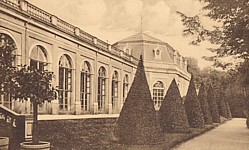Orangerie:  Erste Hinweise auf die Aufbewahrung exotischer Pflanzen in Pillnitz stammen aus dem Jahr 1609. Auch später tauchen immer wieder Nachweise für Feigenbäume, Granatäpfel, Pomeranzen und Lorbeerpflanzen in den Akten auf. Untergebracht waren diese in Gewächshäusern im Park. 1725 entstand nach einem Entwurf Pöppelmanns das heutige Orangeriegebäude als “Ringrennen-Hauߔ. Es wurde für verschiedene Reiterspiele sowie gelegentliche Theateraufführungen genutzt. Wegen der hier installierten Drehscheibe für Pferde und Wagen hieß es zeitweise auch “Carroussel-Gebäude”.

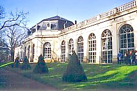Nachdem derartige höfische Lustbarkeiten aus der Mode gekommen waren, erfolgte 1799 der Umbau zur Orangerie. Nach der Zerstörung des alten Schlosstheaters beim Brand 1818 diente es zeitweise wieder als provisorisches Hoftheater, wobei alle für den Betrieb notwendigen Einrichtungen im Frühjahr ein- und im Herbst wieder ausgebaut wurden. 1879 erhielt das Haus mit dem Anbau der Seitenflügel sein heutiges Aussehen _(Foto)_. Ein Jahr später brachte man auch die verbliebenen Orangenbäumchen des Zwingerhofes nach Pillnitz, um sie hier unter besseren klimatischen Bedingungen vor Schäden zu schützen. Weitere Tropenpflanzen kamen erst nach 1945 in die Orangierie und stammten meist aus Gewächshäusern enteigneter sächsischer Schlösser und Herrenhäuser.

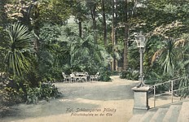Botanischer Garten: Der Grundstock für die bedeutende Botanische Sammlung in Pillnitz wurde von Friedrich August dem Gerechten gelegt, der bis 1827 regierte und ein interessierter Botaniker war. Zwischen 1785 und 1790 ließ der Fürst den Park erweitern und mit seltenen Gehölzen ausstatten. Für die Parkanlage mussten einige Gebäude des Dorfes abgetragen und die Pillnitzer Landstraße verlegt werden. Zu den beeindruckenden Bäumen in diesem Parkteil gehören Platanen, Buchen, Trompeten und Gingkobäume.

Für die wärmebedürftigen Pflanzen entstand 1859 das Palmenhaus, welches zum Zeitpunkt seiner Entstehung größtes auf dem europäischen Festland war. Dieses diente der Aufbewahrung kälteempfindlicher Pflanzen, vor allem aus dem südlichen Afrika. Das Gebäude war einer der ersten Gußeisenbauten in Sachsen und ist 93 Meter lang. Noch bis in die Nachkriegszeit fanden hier Blumenschauen statt, bevor das Gebäude 1969 wegen seines Bauzustandes gesperrt werden musste. Erst nach 1990 wurde es denkmalgerecht saniert. Hier sind heute exotische Gewächse aus Südafrika, Neuseeland und Australien zu sehen. Die Brunnenfigur “Stilles Wasser” im Haus stammt von der Bildhauerin Malgorzata Chodakowska.

Zwanzig Jahre nach dem Bau des Palmenhauses wurde auch die bereits um 1725 errichtete Orangerie erweitert. Im Winterhalbjahr werden hier bis heute die Orangenbäume untergebracht, die sonst den Lustgarten zieren. Außerdem dienen Palmenhaus
und Orangerie heute für verschiedene kulturelle Veranstaltungen. Die Freiflächen wurden zwischen 1874 und 1880 um den Koniferengarten erweitert, für den die Reste der barocken Spielplätze beseitigt werden mussten. Hier sind seltene Nadelbäume aus aller Welt zu sehen, darunter seit 1953 auch ein Urwelt- Mammutbaum.

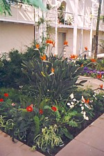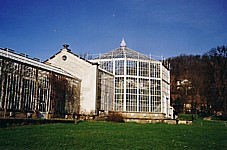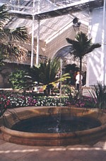

**_Fotos:_** _Das Palmenhaus im Pillnitzer Schlosspark_

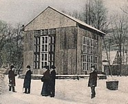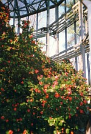Kamelienhaus: Die Pillnitzer Kamelie kam der Überlieferung nach um 1780 als eine von ursprünglich vier dieser Gewächse aus Japan nach Europa. Der schwedische Botaniker Thunberg ließ die Bäume im Schlosspark Schönbrunn bei Wien, im Herrenhäuser Garten bei Hannover, im Kew-Garten London und in Pillnitz anpflanzen. Nach dem Eingehen der übrigen Pflanzen ist das Pillnitzer Exemplar heute älteste japanische Kamelie in Europa. 1801 wurde sie vom Hofgärtner Terscheck an den heutigen Standort versetzt. In den Wintermonaten wird sie durch ein Gewächshaus geschützt. Der Baum überstand sowohl einen Brand dieses Winterhauses _(Foto rechts)_ 1905 als auch Frostperioden und Kriegsereignisse und ist heute vor allem zur Blütezeit eine Attraktion des Schlossparks Pillnitz. 1992 wurde ein neues transportables Kamelienhaus in Betrieb genommen,welches in der warmen Jahreszeit weggerollt werden kann. Das Haus ist 13,2 Meter hoch und wiegt insgesamt 54 Tonnen. Der Baum selbst hat mittlerweile eine Höhe von 8,60 Metern erreicht und trägt zwischen Februar und April ca. 35.000 Blüten.

Elbpavillon: Das kleine Gebäude an der Elbseite des Schlossparkes entstand Anfang des 19. Jahrhunderts als intimes
Rückzugsquartier der Königsfamilie. Das äußerlich in einem hellen blaugrauen Ton gestaltete Häuschen besitzt einen
kleinen Saal, welcher durch illusionistische Malereien mit Weinspalier und hellblauer Decke die Illusion einer Gartenlaube
vermittelt. Nach seiner Sanierung kann der Pavillon seit 2008 für kleine private Feiern gemietet werden.

[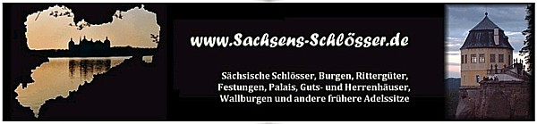](http://www.sachsens-schlösser.de)

* * *

 \[ [Home](../../../index.html)\] \[ [Nord](../../../nord/)\] \[ [Nordwest](../../../nordwest/)\] \[ [Neustadt](../../../neustadt/)\] \[ [Nordost](../../../nordost/)\] \[ [West](../../../west/)\] \[ [Zentrum](../../../zentrum/)\] \[ [Südwest](../../../sudwest/)\] \[ [Süd](../../../sud/)\] \[ [Südost](../../../sudost/)\] \[ [Ost](../../../ost/)\] \[ [Register](../../../Register/register.html)\] \[ [Kontakt](../../../Kontakt/kontakt.html)\] \[ [Impressum](../../../impressum/)\]
