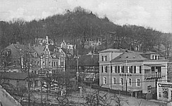
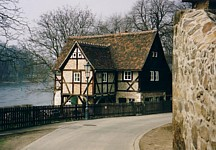
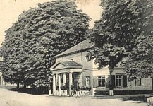
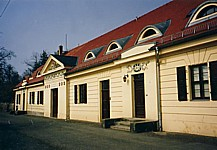
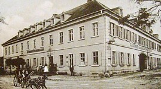
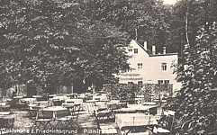
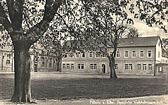

* * *

Der ursprünglich als Dorfplatz, später als Postplatz bezeichnete Platz _(Foto)_ erhielt 1925 seinen heutigen Namen Am Rathaus. In diesem Jahr bezog die Gemeindeverwaltung des damals noch selbständigen Ortes die Räume des ehemaligen Postamtes, welches ab 1911 von der Verbandssparkasse Schönfeld und Umgebung als Nebenstelle genutzt worden war _(im Bild rechts)_. Seit 1950 dient das frühere Pillnitzer [Rathaus](../../../nordost/pillnitz/) als Filiale der Dresdner Stadtsparkasse.

Brunnen: 2007 wurde auf der gegenüberliegenden Seite des Platzes ein Brunnen in Betrieb genommen, welcher symbolisch den Lauf des hier unterirdisch fließenden Meixbaches bzw. Friedrichgrundbaches darstellt. Der Brunnen besteht aus drei Sandsteinbecken und einem vergitterten Schacht, durch den man einen Blick auf das unterirdische Bachbett hat. Die Entwürfe stammen vom Planungsbüro Heidelmann und Klingbiel, die Gestaltung des Umfeldes mit Grünflächen und Ruhebänken übernahmen die Landschaftsarchitekten Lagotzki, Starke und Grütze.

Die kurze Straße An der Schäferei unmittelbar in der Nähe des Dorfplatzes (Am Rathaus) wurde nach der einst hier befindlichen Schäferei des Kammergutes Pillnitz benannt. Bis zur Eingemeindung des Ortes trug sie den Namen Mühlweg. Die amtliche Umbenennung erfolgte am 8. Februar 1956. Markantestes Gebäude ist das an der Nordseite stehende Wohn- und Geschäftshaus An der Schäferei 1. Ursprünglich befand sich an dieser Stelle die bereits 1435 erstmals erwähnte [Pillnitzer Mühle](../../../nordost/pillnitz/gaststatten_pillnitz/). Die Mühle diente als Säge- und Mahlmühle und erhielt 1718 zugleich die Schankgerechtigkeit. 1900 erfolgte der Abbruch der Mühlengebäude. In Erinnerung an die
Vergangenheit erhielt eine im Erdgeschoss des Neubaus untergebrachte Gaststätte den Namen “Zur Pillnitzer Mühle”. Später befand sich hier das “Café Pillnitz”, bevor nach 1990 das griechische Restaurant “Taverne bei Jannis” einzog.

 Die August-Böckstiegel-Straße, nach ihrer Lage in unmittelbarer Nähe des Schlosses Pillnitz bis 1953 Schloßstraße genannt, verdankt ihren Namen dem deutschen Maler Peter August Böckstiegel (1889-1951). Böckstiegel studierte ab 1913 an der Dresdner Kunstakademie und war Schüler von Oskar Zwintscher und Otto Gussmann. 1917 schloss er sich mit den Malern Conrad Felixmüller, Bernhard Kretzschmar und weiteren Expressionisten zur “Gruppe 1917” (später Dresdner Sezession) zusammen. Sein Atelier befand sich bis zur Zerstörung 1945 am Antonsplatz in der Innenstadt.

An der August-Böckstiegel-Straße haben sich bis heute zwei Wohnhäuser aus der Frühzeit des Ortes erhalten. Sie entstanden Anfang des 18. Jahrhunderts und weisen im Obergeschoss Fachwerk auf. Interessant ist ein an der Längsseite des Hauses angebrachter Vorbau, der früher dem trockenen Lagern von Fischereigerät diente. Die beiden Gebäude (Nr. 7 - _Foto_ und Nr. 8) wurden mehrfach saniert und stehen unter Denkmalschutz.

Der Gebäudekomplex August-Böckstiegel-Straße 1 beherbergte einst den Marstall des Kammergutes Pillnitz und gehörte zur Königlichen Hofgärtnerei. 1913 entwarf der Dresdner Stadtbaurat Hans Erlwein die heutigen Gebäude. Ab 1922 war hier die Höhere Staatslehranstalt für Gartenbau, ab 1930 eine Staatliche Viehhaltungsschule untergebracht. Die Gartenanlage des Komplexes stammt von 1928 und wurde von Gustav Allinger entworfen. Unweit davon befindet sich die 1999 zum Landhotel erweiterte Gaststätte [“Schlosschänke”](../../../nordost/pillnitz/gaststatten_pillnitz/) (Nr. 10). Weitere Gebäude dienten früher den Bedürfnissen von Angerstellten des sächsischen Hofes und wurden als Schlosswache (Nr. 2 - _Foto_) bzw. Kaserne (Nr. 3) genutzt. Außerdem gab es hier die Wohnhäuser des Fasanenwärters, das Hofjäger- und Oberstallmeisterhaus (Nr. 4) sowie das Hofgärtnerhaus (Nr. 9).

Der am Fuße der Weinberge an der Südseite des Borsbergs entlang führende Weg trug bis zur Eingemeindung von Pillnitz offiziell den Namen Weinbergsweg und wurde 1953 in Bergweg umbenannt. Ursprünglich nutzten diese Verbindung hauptsächlich die Winzer des Ortes als Zugang zu den Weinbergen. Sehenswert sind das von Christian Friedrich Schuricht entworfene alte Presshaus von 1827 (Bergweg 1) und die nach dem Abriss der Schlosskirche 1723/27 entstandene [Weinbergkirche](../../../nordost/pillnitz/weinbergkirche_pillnitz/).

**_Foto:_** _Preßhaus am Bergweg_

Der zur Erschließung einer kleinen Wohnsiedlung in der Nähe der Ortsgrenze zu Hosterwitz angelegte Bodemerweg verdankt seinen Namen dem Unternehmer und Wohltäter Jacob Georg Bodemer (1807-1888), der seine letzten Lebensjahre in Pillnitz verbrachte. Bodemer war durch den Besitz einer Fabrik im erzgebirgischen Zschopau zu erheblichem Wohlstand gekommen und setzte sich sehr stark für eine Verbesserung der sozialen Lage der Arbeiter ein. Neben verschiedenen Stiftungen in seiner Heimatstadt Zschopau finanzierte er auch die Ausstattung zahlreicher Volks- und Stadtbibliotheken und unterstützte Bildungs- und Wohltätigkeitsvereine. Ab 1872 lebte Bodemer in Dresden und verstarb am 27. November 1888 in Pilnitz.

Die Copitzer Straße verläuft am Pillnitzer Hausberg und erhielt ihren Namen nach dem nahegelegenen Ort Copitz, heute ein Stadtteil von Pirna. Ursprünglich diente der bis 1924 namenlose Weg der Erschließung des hier befindlichen Weinbergs. Danach wurde er in Stadtplänen und Adressbüchern als “Am Hausberg” bezeichnet. Zeitgleich entstanden nach Entwürfen des ortsansässigen Architekten Richard Merz einige neue Wohnhäuser. 1930 erfolgte die Umbenennung der Straße in Malschendorfer Straße. Da es in Rochwitz jedoch bereits eine gleichnamige Straße gab, machte sich nach der Eingemeindung von Pillnitz 1953 eine weitere Namensänderung erforderlich. Auf Beschluss des Stadtrates erfolgte diese am 30. September 1953 in Copitzer Straße.

Nr. 1: Bemerkenswert ist das um 1847 entstandene Landhaus Copitzer Straße 1, welches sich zunächst im Eigentum der Witwe des Gärtners und Weinbergsbesitzers Carl Friedrich Petermann befand. Um 1860 erwarb die aus dem Elsass stammende Kaufmannsfamilie Rumpff das Gebäude und nutzte es als Sommerhaus. 1903 kaufte der Kunstmaler August Ritter von Borrosini das Anwesen, lebte hier aber nur wenige Monate und verkaufte es 1910 weiter. Die neuen Besitzer ließen das vorhandene Gebäude teilweise abreißen und umbauen, wobei es sein heutiges Aussehen erhielt. Ab 1945 befand sich im Gartenhaus ein Kindergarten.

Nr. 2: Das 1927 errichtete villenartige Wohnhaus bildete den Auftakt zur Bebauung des Hausbergs und wurde, ebenso wie die benachbarte Nr. 4 von Richard Merz (1885-1970) entworfen. Merz hatte zuvor an der Kunstakademie in Dresden studiert und war Architekt des AOK-Gebäudes in Freital sowie der Kirche in Oelsa. 1931 ließ er als Bauherr die später von ihm betriebene Gastwirtschaft “Café Hausberg” erbauen.

Nr. 3: Das Nachbargrundstück Copitzer Straße 3 gehörte 1843 dem aus Söbrigen stammenden Gärtner Gottfried Häschel, der es an Moritz Brandt verpachtete. Die Familie nutzte das Gebäude im Schweizerstil als Sommerhaus und erwarb es 1863. Karl Christian Brandt ließ das Areal nach 1863 umgestalten und um einen Gartenpavillon mit Veranda und eine Balustrade unterhalb des Hanges erweitern. Die heutige Villa wurde zwischen 1903 und 1906 errichtet. Bauherr und Eigentümer war Bernhard Friedrich, der durch seine Hochzeit auch das Grundstück Dresdner Straße 155 erworben hatte.

Die Dampfschiffstraße verbindet die Lohmener Straße mit der Söbrigener Straße und erhielt ihren Namen nach der an ihrem südlichen Ende gelegenen Dampfschiffsanlegestelle. Markantestes Gebäude ist das früher als Gasthof "Goldener Löwe" genutzte Eckhaus am Abzweig Lohmener Straße. Weitere Gebäude dienten früher der Hofhaltung der Wettiner und beherbergten das Brauhaus (Nr. 2) und das Leibschützenhaus (Nr. 4) des Königlichen Kammergutes Pillnitz.

_**Foto:** der ehemalige Gasthof "Goldener Löwe" an der Ecke Lohmener / Dampfschiffstraße_

Die Hausbergstraße wurde 1927 auf ehemaligem Weinbergsgelände angelegt und zehn Jahre später nach diesem Weinberg benannt. In den Folgejahren entstand hier eine kleine Landhaussiedlung. Markantestes Gebäude ist das heute nur noch als Wohnhaus genutzte frühere [Café Hausberg](../../../nordost/pillnitz/gaststatten_pillnitz/) im Bauhausstil. Bis zur Schließung 2004 gehörte das Lokal, von dessen verglaster Veranda sich ein schöner Blick über die Umgebung bot, zu den beliebtesten Gaststätten in Pillnitz.

Der Leitenweg entstand Ende des 19. Jahrhunderts zur Erschließung der Pillnitzer Weinberge, vor allem des in kurfürstlichem
Besitz befindlichen “Großen Bergs Pillnitz”. Um 1800 hatte man die vorhandenen Weinberge etappenweise terrassiert und mit
Zugangswegen und Treppenanlagen erschlossen, wobei der Leitenweg die wichtigste Verbindung zwischen den einzelnen Abschnittne darstellte. Insgesamt wurden innerhalb weniger Jahre fast 3600 Sandsteinstufen verbaut.

Erst der Niedergang des sächsischen Weinbaus nach 1890 und die folgende Rodung der Weinberge um 1905 führten zu einer Veränderung des Landschaftsbildes. Nach jahrzehntelanger Bernachlässigung konnten die alten Weinterrassen ab 1980
wieder hergestellt werden und dienen seitdem wieder dem Rebenanbau. Vom Leitenweg bietet sich ein schöner Blick über Pillnitz und seine Umgebung.

Die Lohmener Straße beginnt im Pillnitzer Ortszentrum und führt von dort in östlicher Richtung nach Oberpoyritz und von dort
weiter über Graupa nach Pirna. Aus diesem Grund trug sie bis zur Eingemeindung den Namen Pirnaische Straße. Um Verwechslungen mit einer gleichnamigen Straße in der Innenstadt zu vermeiden, wurde sie 1950 nach dem kleinen Ort
Lohmen in der Sächsischen Schweiz umbenannt.

Zu den wenigen erhaltenen Gebäuden aus der dörflichen Vergangenheit von Pillnitz gehört das Fachwerkhaus Lohmener
Straße 5, welches unter Denkmalschutz steht. Unweit davon befindet sich an der Ecke zur Dampfschiffstraße der frühere Gasthof [“Goldener Löwe”](../../../nordost/pillnitz/gaststatten_pillnitz/). Weitere Bauten aus jüngerer Zeit werden vom sächsischen Landesamt für Umwelt, Geologie und
Landwirtschaft und verschiedenen Instituten genutzt.

Schöpsdamm: Als Schöpsdamm wird ein hochwasserfreier Damm zwischen Lohmener Straße und Bergweg bezeichnet.
Dieser diente früher bei Hochwassergefahr dem Treiben der Schöpse (= Schafe) von den Elbwiesen in höher gelegene Gebiete. Bemerkenswert sind mehrere mächtige Stieleichen, welche Mitte des 17. Jahrhunderts gepflanzt wurden und seit
1998 als Naturdenkmal eingetragen sind. Unweit der Baumgruppe ermöglicht eine Sandsteinfassung dem Graupaer Bach ein Durchfließen des Damms. Während seines Aufenthalts in Graupa war der Schöpsdamm ein beliebter Spazierweg für den
Komponisten Richard Wagner, der häufig von hier aus zu Fuß bis in Dresdner Innenstadt lief.

Die Meixstraße verbindet den Pillnitzer Ortskern mit dem [Meixgrund](../../../nordost/pillnitz/meixgrund/) und führt von dort weiter in Richtung Schönfelder Hochland. Der um 1900 zur Fahrstraße
ausgebaute Weg trug deshalb bis 1950 den Namen Schönfelder Straße. Hier sind noch einige historische Gebäude des früheren Dorfes erhalten geblieben. Im Haus
Meixstraße 6 hatte bis 1915 das Pillnitzer Gemeindeamt seinen Sitz. Weitere Gebäude dienten als Geschäftsräume des Fotographen  Paul Köhne (Nr. 14) bzw.
beherbergten Backstube und Verkaufsräume der Konditorei Heinke (Nr. 5). Im heute als Wohnhaus genutzten Gebäude Meixstraße 12 _(Foto)_ befand sich vor dem Zweiten Weltkrieg die Gaststätte “Zum Friedrichsgrund”.

Ursprünglich trug die heutige Orangeriestraße den Namen Laubegaster Straße, wobei die Namensgebung nach dem am
gegenüber liegenden Elbufer gelegenen Ort Laubegast erfolgte. Nach der Eingemeindung von Pillnitz machte sich, um Namensdoppelungen im Stadtgebiet zu vermeiden, eine Umbenennung erforderlich. Deshalb entschied sich die Stadt
Dresden, dieser Straße den Namen John-Schehr-Straße zu geben. John Schehr (1896-1934) gehörte seit den Zwanziger Jahren der KPD an und übernahm nach der Verhaftung Ernst Thälmanns 1933 als dessen Stellvertreter den Vorsitz der
Partei. Im November 1933 wurde jedoch auch Schehr verhaftet und am 1. Februar 1934 von der Gestapo unter ungeklärten Umständen “auf der Flucht” erschossen. Nach 1990 wurde diese Namensgebung wieder aufgehoben und die Straße in
Orangeriestraße umbenannt.

Der heute Pillnitzer Platz wurde vor dem Zweiten Weltkrieg Langemarckplatz genannt. Mit der Namensgebung sollte an den “Mythos von Langemarck” erinnert werden. In der Nähe des belgischen Ortes hatte am 10. November 1914 eine Schlacht des Ersten Weltkrieges stattgefunden, während der auf deutscher Seite hauptsächlich unerfahrene und junge Soldaten zum
Einsatz kamen. Trotz des letztlich kaum erfolgreichen Ausganges der Kämpfe wurden diese später als “Heldentat” der
deutschen Jugend glorifiziert und im nationalistischen Sinne missbraucht. Alljährlich fand an vielen Schulen am Jahrestag der
sogenannte “Langemarck-Tag” statt, welcher vor allem zur Nazizeit der militaristischen Beeinflussung der Jugend diente. Nach 1945 wurde der Langemarck-Platz deshalb in Pillnitzer Platz umbenannt.

Markantester Bau am Pillnitzer Platz ist die ehemalige Hofgärtnerei, deren 1913-15 errichtete Gewächshausbauten von Hans Erlwein stammen. Nach dem Ersten Weltkrieg nutzte die [Höhere Staatslehranstalt für Gartenbau](../../../nordost/pillnitz/institut_fur_gartenbau/) die Gebäude. Später
befanden sich hier verschiedene Institute für Landwirtschaft und Gartenbau. Das unter Denkmalschutz stehende Hauptgebäude am Pillnitzer Platz dient heute als Hörsaalzentrum und wurde 1999 mit dem Erlweinpreis der Stadt Dresden
ausgezeichnet.

Gegenüber steht der Gebäudekomplex des früheren [Marstalls](../../../nordost/pillnitz/schloss_pillnitz/). Dieser wurde 1880 errichtet, um hier die Pferde und
notwendigen Gerätschaften für die Schlosswirtschaft unterzubringen. Nach Ende des Ersten Weltkrieges nutzte die 1922
gegründete Höhere Lehranstalt für Gartenbau auch dieses Gebäude. 2007/08 wurde der Marstall saniert und dient heute unter dem Namen Schindlerbau als Domizil des sächsischen Landesamtes für Umwelt, Landwirtschaft und Geologie. Vor
dem Bau fanden zwei Brunnen aus dem Dresdner Zwinger Aufstellung.

Der Schulweg entstand im Zusammenhang mit der 1842 eröffneten Pillnitzer [Schule](../../../nordost/pillnitz/), welche von Kindern aus Pillnitz,
Borsberg, Oberpoyritz und Söbrigen besucht wurde. Heute dient das Gebäude als Hotel “Goldener Apfel”. 1851 erwarb der
Schriftsteller Julius Hammer ein Landhaus am Schulweg und nutzte dieses bis zu seinem Tod 1862 als Sommerhaus. Ein ihm zu Ehren aufgestelltes Denkmal auf dem Schulhof fiel 1954 dem Abbruch zum Opfer.

Die Söbrigener Straße verbindet Pillnitz mit dem benachbarten Ort Söbrigen und erhielt deshalb ihren Namen. Auf dem
Grundstück Söbrigener Straße 1, welches früher zum Kammergut Pillnitz gehörte, befindet sich der Stammsitz der Dresdner Traditionsbäckerei Wippler mit Backhaus und Café. In einem Nebengebäude entstand 2010 aus Anlass des 100.
Firmenjubiläums ein Bäckereimuseum mit zahlreichen historischen Gerätschaften dieses Handwerks.

Gegenüber liegt unmittelbar an der Anlegestelle der Elbdampfer die Ausflugsgaststätte “Pillnitzer Elbblick”, früher auch
Restaurant “Dampfschiff” genannt (Nr. 2). Ursprünglich waren in diesem Gebäude die Kinder der Elbschiffer untergebracht,
weshalb das Haus auch als “Schifferkinderheim” bekannt war. Interessant ist auch das ehemalige Gehilfenhaus des Kammergutes (Nr. 10). Nach seiner Sanierung 2011 beherbergt es heute Büro- und Konferenzräume des Sächsischen
Landesamtes für Umwelt, Geologie und Landwirtschaft.

**_Foto:_** _Das frühere Pillnitzer Kammergut in den Dreißiger Jahren_

Ursprünglich wurde die heutige Wilhelm-Wolf-Straße Dammweg genannt, da sie direkt zum Hochwasserschutzdamm führte. Dieser diente zugleich dem Treiben der Schafe zu den Elbwiesen und trug deshalb im Volksmund den Namen
“Schöpsdamm”. Später erfolgte die Umbenennung nach dem am 15. April 1904 in Pillnitz verstorbenen sächsischen König in König-Georg-Weg. Nach dem Zweiten Weltkrieg betrachtete man diese Namensgebung als nicht mehr zeitgemäß und
benannte den Weg in Wilhelm-Wolf-Straße um. Wilhelm Wolff (so die richtige Schreibweise) wurde 1809 in Tarnow geboren und engagierte sich in der revolutionären Bewegung des 19. Jahrhunderts. 1848/49 war er als Vertreter des Bundes
der Kommunisten in verschiedenen politischen Gremien tätig und gehörte dem Redaktionskollegium der “Neuen Rheinischen
Zeitung” an. 1851 emigrierte er nach England, wo er bis zu seinem Tod 1864 zum Kreis um Karl Marx und Friedrich Engels gehörte.

Die ersten Grundstücke an dieser Straße (heute Nr. 1-9) entstanden 1790/91, als einige Pillnitzer Häusler ihre Grundstücke
am Röhrteich (Chinesischer Teich) verlassen mussten. Daraufhin siedelten sie sich im sogenannten Erlicht an, einem Areal
zwischen der Allee nach Oberpoyritz und den von Weinbergen besetzten Elbhängen. 1841 wurde in diesem Gebiet auch das
erste Schulhaus des Ortes errichtet. Weitere Gebäude folgten im letzten Drittel des 19. Jahrhunderts. Neben Mietwohnungen
und Sommerquartieren gab es hier auch kleinere Gewerbebetriebe und einen Kolonialwarenladen. 1927/28 legte der Turnverein Pillnitz und Umgebung am Ende des Weges einen Sportplatz an, welcher auch als Festplatz des Ortes genutzt
wurde und seit 1955 dem Hockeysport dient.

Zu den ältesten Bauten der Straße gehörte das ehemalige “Wiesenschlösschen” (Nr. 9), welches im Kern auf einen kleinen
Dreiseithof zurückging. Im 19. Jahrhundert befand sich dieser im Besitz der Familie Augst. Friedrich Augst hatte in Tharandt
Forstwissenschaften studiert und nutzte den Pillnitzer Familienbesitz als Sommerwohnung. 1890 erfolgte ein Ausbau des
Gebäudes, welches fortan unter dem Namen “Wiesenschlösschen” bekannt war. 1910 wurde das Haus abgerissen. An seiner
Stelle entstand nach Plänen von Rudolf Kolbe ein Neubau im Jugendstil. Dieser diente ab 1936 bis in die 60er Jahre als Familienpension.

Die nach dem kleinen Ort Wünschendorf (Ortsteil von Dürrröhrsdorf-Dittersbach) benannte Wünschendorfer Straße trug bis
zur Eingemeindung 1950 den Namen Borsbergstraße, da sie Pillnitz mit Borsberg verbindet. 1852 wurde hier das erste Landhaus errichtet.

Villa Meurer:
Das erste Gebäude an der heutigen Wünschendorfer Straße entstand 1852 als Sommerhaus des Rittergutsbesitzers Amadeus Theodor Heinze. Dieses erwarb 1868 ein Dresdner Privatier, welcher es 1872 an den
Kunstmaler Hans Julius Grüder verkaufte. Grüder ließ das Gebäude als ständigen Wohnsitz erweitern und ein Atelier einbauen. Nach seinem Tod wurde die Villa 1892 an die Dresdner Fabrikantenfamilie Meurer verkauft und blieb bis zur
Gegenwart in Familienbesitz. Gottlob Siegfried Meurer war Inhaber der [Eisenwerke G. Meurer AG](../../../west/cossebaude/eisenwerke_meurer/), welche bis 1945 in
Cossebaude u.a. Gaskocher, Herde und Gasöfen herstellte.

1899 ließ Gottlob Siegfried Meurer das vorhandene Sommerhaus im italienischen Landhausstil umbauen und für seine
Bedürfnisse erweitern. Gleichzeitig wurde ein zweistöckiges Gartenhaus errichtet, welches als Orangerie und Gärtnerwohnung
diente. 1936 wurde das bisherige Sommerhaus zum Wohnhaus ausgebaut und erhielt dabei sein heutiges Aussehen. Die Gestaltung der Fassade mit einem Schmuckbild und Sinnsprüchen übernahm der Pillnitzer Dekorationsmaler Emil Henke.
Nach 1945 wurde die Villa der Familie Meurer als Mietshaus genutzt. Eine umfassende Sanierung des denkmalgeschützten
Gebäudes erfolgte 2009. An der Fassade erinnert ein Reliefmedaillon an den “Stammvater” der Familie, den Pfarrer Moritz Meurer (1806-1877).

[Pillnitz auf OpenStreetMap](https://www.openstreetmap.org/search?query=Dresden+Pillnitz)

* * *

 \[ [Home](../../../index.html)\] \[ [Nord](../../../nord/)\] \[ [Nordwest](../../../nordwest/)\] \[ [Neustadt](../../../neustadt/)\] \[ [Nordost](../../../nordost/)\] \[ [West](../../../west/)\] \[ [Zentrum](../../../zentrum/)\] \[ [Südwest](../../../sudwest/)\] \[ [Süd](../../../sud/)\] \[ [Südost](../../../sudost/)\] \[ [Ost](../../../ost/)\] \[ [Register](../../../Register/register.html)\] \[ [Kontakt](../../../Kontakt/kontakt.html)\] \[ [Impressum](../../../impressum/)\]
