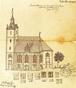
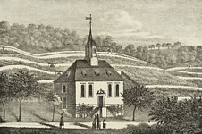
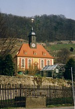
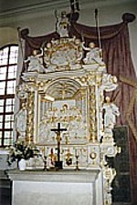

* * *

Weinbergkirche dresden-pillnitz bergweg 01326 dresden

[Homepage der weinbergkirche dresden-pillnitz](http://www.weinbergkirche.de)

Pillnitz gehörte bis 1539 zur Kirchfahrt Dohna und unterstand dann der [Kirche](../../../nordost/hosterwitz/maria_am_wasser/) des Nachbarortes Hosterwitz. 1593/96 wurde auf dem Gelände des alten Schlosses eine eigene Kirche eingerichtet, die bis 1722 dem protestantischen Gottesdienst diente. Stifter war der Pillnitzer Rittergutsbesitzer Christoph von Loß. 1648 erhielt sie einen vom Bildhauer Johann Georg Kretschmar geschaffenen Sandsteinaltar.

**_Bild:_** _Die alte Schlosskirche kurz vor dem Abbruch_

_(Zeichnung des Hosterwitzer Pfarrers Johann Christoph Rüdinger)_

Nachdem August der Starke, der 1697 zum katholischen Glauben übergetreten war, seine
Baupläne in Pillnitz umsetzte, musste diese Kapelle 1723 geschlossen und abgerissen werden. An gleicher Stelle entstand der [“Venustempel”](../../../nordost/pillnitz/schloss_pillnitz/), ein Lusthaus für barocke Feste. Außerdem wurde eine neue Kapelle für die katholischen Gottesdienste des Hofes eingerichtet, die zu den ersten nach der Reformation neu entstandenen katholischen Kirchen Sachsens gehörte. 1818 fiel diese Schlosskapelle dem Brand des Schlosses zum Opfer und wurde 1824/28 im Nordflügel des Neuen Palais wieder eingerichtet.

Um auch den Protestanten des Ortes eine Möglichkeit für ihre Gottesdienste zu geben, beauftragte August der Starke noch vor Schließung der alten Kirche seinen Hofarchitekten Pöppelmann mit der Errichtung eines Ersatzbaus. Diese neue Kirche entstand abseits des Ortes in den Weinbergen und wurde deshalb Weinbergkirche genannt. Die Grundsteinlegung für den von Hofbaumeister Christian Schumann realisierten Bau erfolgte am 24. Juni 1723. Das Portal über dem Haupteingang mit polnischem und sächsischem Wappen stammt aus der Werkstatt Benjamin Thomaes.

Nach Vollendung des Baus wurden Altar, Taufstein, Orgel und Glocken der alten Kirche
überführt. Auch die Gebeine der dort beigesetzten Personen sowie die historischen Grabdenkmale der Familien Loß und Bünau wurden in die Weinbergkirche umgebettet.Bereits am 11. November 1725 konnte die neue Kirche durch Superintendent Löscher als Kirche “Zum heiligen Geist” geweiht werden. Im Mittelpunkt steht der 1648 geschaffene Altar mit den Wappen der beiden Stifter, einem Abendmahl-Relief und den Statuen der Apostel Petrus und Paulus, bekrönt von einer Darstellung des auferstandenen Christus. Die Gottesdienste übernahm der Pfarrer der Hosterwitzer Kirche [Maria am Wasser](../../../nordost/hosterwitz/maria_am_wasser/).

Bis 1947 befand sich die Weinbergkirche in staatlichem Besitz und wurde erst dann in kirchliches Eigentum überführt. Noch bis 1976 wurde sie für Gottesdienste genutzt, musste dann jedoch wegen ihres schlechten baulichen Zustandes geschlossen werden. Da der Kirchgemeinde die finanziellen Mittel zum Erhalt fehlten, übergab sie 1983 das Gebäude an die Stadt Dresden, die die Weinbergkirche bis 1989 als Lagerraum nutzte. Erst durch die Bildung eines Fördervereins konnte 1990 mit der Restaurierung begonnen werden. Mit Hilfe von Konzerten und Spendensammlungen wurde in der Folgezeit ein Großteil der erforderlichen Mittel aufgebracht. Aus der Bewegung zur Rettung der Kirche ging 1991 auch das Elbhangfest hervor, welches seitdem regelmäßig am letzten Juniwochenende begangen wird.

1994 begann die Rekonstruktion des barocken Hochaltars _(Foto)_, 1997 erfolgte die Weihe der erneuerten Jehmlich-Orgel aus dem Jahr 1891. 2014 erhielt die Weinbergkirche einen Zelebrationsaltar. Dieser ersetzt einen in den 1960er Jahren erworbenen provisorischen Altar, der im Zuge der Liturgiereform nach dem Zweiten Vatikanischen Konzil angeschafft worden war. Schöpfer des neuen Alters, der sich gestalterisch an der Barockausstattung der Kirche orientiert, ist der Pirnaer Holzrestaurator Robert Zalesky. Heute wird die Weinbergkirche als Filialkirche der katholischen [Pfarrei St. Hubertus](../../../nordost/page10246/hubertuskirche/) genutzt.

Im Turm der Weinbergskirche hängen drei Glocken. Die älteste stammt aus dem Jahr 1596 und läutete bereits in der alten Schlosskapelle. Zwei weitere kamen im 19. Jahrhundert hinzu. Während die 1800 von August Weinholdt gegossene Glocke noch vorhanden ist, fiel die zweite von 1873 dem Rüstungswahn des Ersten Weltkriegs zum Opfer. Aus Anlass des 11. Elbhangfestes wurde 2002 eine neue Glocke angeschafft, die seitdem das Geläut der Kirche vervollständigt.

* * *

 \[ [Home](../../../index.html)\] \[ [Nord](../../../nord/)\] \[ [Nordwest](../../../nordwest/)\] \[ [Neustadt](../../../neustadt/)\] \[ [Nordost](../../../nordost/)\] \[ [West](../../../west/)\] \[ [Zentrum](../../../zentrum/)\] \[ [Südwest](../../../sudwest/)\] \[ [Süd](../../../sud/)\] \[ [Südost](../../../sudost/)\] \[ [Ost](../../../ost/)\] \[ [Register](../../../Register/register.html)\] \[ [Kontakt](../../../Kontakt/kontakt.html)\] \[ [Impressum](../../../impressum/)\]
