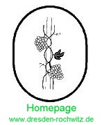
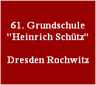
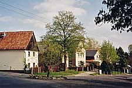
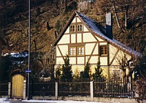
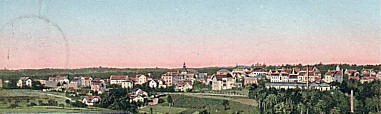
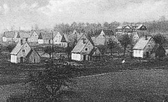
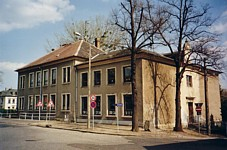

* * *

**Gemeindesiegel von Rochwitz**

* * *

* * *

**Stadtteilseite Rochwitz**

**Schulen in Rochwitz:**

Der Stadtteil Rochwitz, bestehend aus drei Ortsteilen auf der Hochfläche
zwischen Loschwitz- und Wachwitzgrund und an der Grundstraße, wurde 1378 als Rochewitz erstmals urkundlich erwähnt. Der Name geht vermutlich auf einen
slawischen Ortsgründer Roch zurück. Altrochwitz, später auch Oberrochwitz genannt, bildete ursprünglich ein Straßenangerdorf mit Blockstreifenflur in einer
Geländesenke und gehörte 1463 der Dresdner Bürgerfamilie Kundig. Die Gerichtsbarkeit oblag dem Rittergut Helfenberg. Im 16. Jahrhundert kam Rochwitz unter die Herrschaft der Familie Karras auf Schönfeld und unterstand
zwischen 1609 und 1839 dem Rittergut Gönnsdorf. Zur Rochwitzer Flur gehören auch das Rochwitzer Tännicht, welches 1832 dem Staatsforstrevier Pillnitz zugeordnet wurde, und die im Wachwitzgrund gelegene [Pappritzmühle](../../nordost/wachwitz/wachwitzgrund/). 1869 wurde ein Großteil des Ortes bei einem Dorfbrand zerstört, so dass nur noch acht Gehöfte erhalten blieben _(Foto)_.

Mitte des 16. Jahrhunderts bildete sich abseits vom Dorfkern die kleine
Häuslergemeinde Niederrochwitz an der Einmündung der heutigen Tännichtstraße in den [Loschwitzgrund](../../nordost/loschwitz/strassen_loschwitz/grundstrasse/) _(Foto: Grundstraße 153)_
. Hier befindet sich auch das zu den ältesten sächsischen Schankwirtschaften gehörende [Gasthaus “Zur Eule”](../../nordost/loschwitz/strassen_loschwitz/grundstrasse/zur_eule/).
1883 kam als dritter Ortsteil die Villensiedlung Neurochwitz hinzu, die von den Gebrüdern Karl und Gustav Pietzsch auf unbebautem Gebiet oberhalb des Loschwitzgrundes angelegt wurde. Wegen seiner abseitigen und schwer
erreichbaren Lage erhielten dieser Ortsteil und ein 1893 hier eröffnetes Gasthaus im Volksmund den Namen “Kamerun”. Erst einige Jahre nach Gründung der
Siedlung entstand eine Holzbrücke über den Loschwitzbach mit einer neuen Zufahrtsstraße, die die Verkehrsverhältnisse
in diesem Gebiet verbesserten. 1899 wechselte die kirchliche Zugehörigkeit von Rochwitz von der Schönfelder zur Bühlauer Kirche.

**_Foto:_** _Blick von Oberrochwitz nach Bühlau (historische Postkarte von 1908)_

Am 1. April 1921 wurde Rochwitz gemeinsam mit seinen Nachbarorten nach
Dresden eingemeindet. Nach dem Ausbau der Karpatenstraße entstanden Mitte der 1920er Jahre neue Wohnhäuser durch die Siedlervereinigung Dresden - Loschwitz - Rochwitz _(Foto)_. Durch den Verschönerungsverein
wurden außerdem Ruheplätze, Spazierwege und eine Bergrodelbahn geschaffen. Eine weitere Kleinhaussiedlung folgte 1937/38 an der Hutbergstraße. Im gleichen Jahr erhielt der Ort mit der Buslinie C Anschluss
an das öffentliche Nahverkehrsnetz. Nach 1945 wurde diese zunächst durch einen Pendelverkehr zur Bergstation der [Schwebebahn](../../nordost/loschwitz/schwebebahn/), 1950 durch die
Buslinie 84 ersetzt. Bis heute ist Rochwitz vor allem Wohnvorort geblieben. Einige Neubausiedlungen entstanden nach
1990 an der Karpaten- und der Herrenbergstraße. Auf Rochwitzer Flur liegt auch die Hedwigsquelle, deren Wasser
der Sage nach Jugend und Schönheit geben soll. Gleiches wird von der nahen Ziegengrundquelle an der Grundstraße behauptet.

Schulen in Rochwitz:

Rochwitz gehörte ursprünglich zur Schönfelder Kirche, weshalb die Kinder des Ortes zunächst die dortige Kirchschule, später die Schule im Nachbarort Bühlau besuchten. 1882 entstand für die Gemeinde Rochwitz ein eigenes Schulhaus an der Hutbergstraße 2. Mit der Eingemeindung wurde dieses 1921 als 61. Volksschule in das Dresdner Schulnetz eingegliedert. Bis 1934 erfolgten mehrere Erweiterungen, so dass schließlich sieben Klassenräume zur Verfügung standen. Zuletzt wurde das Gebäude von der 61. Grundschule “Heinrich Schütz” genutzt _(Foto)_. Da das Haus jedoch zu klein war und nicht mehr den Anforderungen genügte, erfolgte 2016 der Abriss. Bis 2018 soll es durch einen modernen Neubau ersetzt werden.

[_Weiterführende Literatur und Quellen_](../../impressum/quellenverzeichnis/)

Bueroservice24.de: Ihr persönliches Telefonsekretariat in Dresden & Umgebung. 

 \[ [Home](../../index.html)\] \[ [Nord](../../nord/)\] \[ [Nordwest](../../nordwest/)\] \[ [Neustadt](../../neustadt/)\] \[ [Nordost](../../nordost/)\] \[ [West](../../west/)\] \[ [Zentrum](../../zentrum/)\] \[ [Südwest](../../sudwest/)\] \[ [Süd](../../sud/)\]
 \[ [Südost](../../sudost/)\] \[ [Ost](../../ost/)\] \[ [Register](../../Register/register.html)\] \[ [Kontakt](../../Kontakt/kontakt.html)\] \[ [Impressum](../../impressum/)\]
