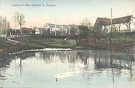
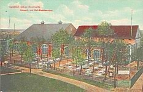
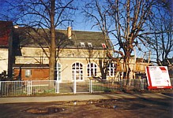
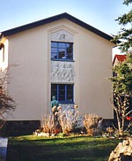
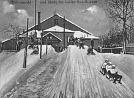
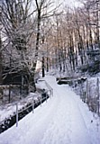
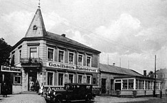
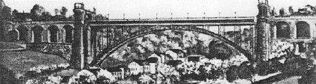

Als Altrochwitz wird seit 1926 der Dorfplatz des bis 1921 selbstständigen Ortes
Rochwitz bezeichnet. Einbezogen wurden in diese Benennung auch Teile der früheren Pappritzer und Wachwitzer Straße. Noch heute ist deutlich die Form des
Straßenangerdorfes zu erkennen. Slawische Siedler hatten hier in einer geschützten Wiesenmulde am Eingang des Wachwitzgrundes ihre Gehöfte errichtet. Im Mittelpunkt liegt ein kleiner künstlich geschaffener Teich, der früher die
Wasserversorgung des Ortes sicherte.  Die meisten Gebäude stammen aus der Zeit des Wiederaufbaus nach dem letzten großen Dorfbrand 1869. In einem Gehöft an der Südseite befand sich vor 1945 der Gasthof [“Zum Sächsischen Jäger”](../../../nordost/rochwitz/strassen_rochwitz/sachsischer_jager/). Das  Gehöft
Altwachwitz 20  war früher  Sitz der am 1. Juli 1958 gegründeten LPG "Neues Leben".

Die Straße Am Wachwitzer Höhenpark verläuft oberhalb des früheren [königlichen Weinbergs](../../../nordost/wachwitz/wachwitzer_weinberg/) und wurde deshalb zunächst
Am Königspark genannt. In den Zwanziger Jahren ist auch nur die Bezeichnung Königspark nachweisbar. Offiziell erfolgte am
6\. Juni 1937 die Umbenennung in Am Königspark. Da dieser Name nach 1945 als unzeitgemäß empfunden wurde, beschloss man am  1. Juli 1946 die bis heute gültige Namensgebung Am Wachwitzer Höhenpark.

Der Amselsteg geht auf einen Waldweg zurück, der den Rochwitzer Ortsteil Neurochwitz mit dem benachbarten Loschwitz
verbindet. Im Bebauungsplan von 1904 wurde der Weg als Straße G geführt und wenig später zur Fahrstraße ausgebaut. Nach der Errichtung einiger  Wohnhäuser erhielt diese 1911 den Namen Amselsteg. Hier befinden sich auch einige
Kleingärten.

Der Anzengruberweg entstand im Zusammenhang mit der Errichtung einer kleinen Wohnsiedlung am Rochwitzer Busch und
trug bis zur Eingemeindung den Namen Kletteweg. Danach wurde er 1937 nach dem österreichischen Schriftsteller Ludwig Anzengruber (1839-1889) benannt, der verschiedene sozialkritisch-realistische Werke schrieb.

Die Ende des 19. Jahrhunderts  in Oberrochwitz angelegte Straße wurde ursprünglich Prinzeß-Luisa-Straße genannt.
Namensgeber war die Kronprinzessin und Ehefrau des letzten sächsischen Königs Luise von Toscana. Nach dem Ersten Weltkrieg fiel die Bezeichnung „Prinzeߓ weg, so  dass ab 1922 nur noch der Name Luisastraße üblich war. Um
Verwechslungen mit gleichnamigen Straßen im Stadtgebiet zu vermeiden, wechselte der Straßenname 1926 nach dem benachbarten Ort Rockau in Rockauer Straße. Eine Namensdoppelung war auch der Anlass für die bislang letzte
Umbenennung am 30. September 1953 in Auf der Höhe.

Die Beskidenstraße wurde erst 2004 als Seitenstraße der Karpatenstraße angelegt und mit Einfamilienhäusern bebaut. Der
Name erinnert an einen Gebirgszug im Grenzgebiet zwischen Polen und Tschechien.

Der Straßenname Bühlauer Straße in Rochwitz ist erstmals im Adressbuch von 1907 verzeichnet. zuvor wurden die hier
gelegenen Grundstücke zur Mittelstraße gezählt. Die übrigen Häuser jenseits der Pappritzer Straße behielten den Namen Mittelstraße. Erst seit 1926 wird dieser Abschnitt Karpatenstraße genannt.

Die heutige Gönnsdorfer Straße in Rochwitz wurde erstmals 1895 in einem Bauplan erwähnt. Zunächst wurde sie nach dem
benachbarten Dorf Schönfeld als Schönfelder Straße bezeichnet. in Folge der Eingemeindung von Rochwitz erfolgte am 1.
Juni 1926 die Umbenennung in Gönnsdorfer Straße. Gönnsdorf ist ebenso wie Schönfeld seit 1999 Stadtteil von Dresden.

Die Hutbergstraße im Ortsteil Oberrochwitz verdankt ihren Namen dem [Hutberg](../../../nordost/schonfeld-weissig/weissig/), der mit 311 Metern zu den höchsten
Punkten des Schönfelder Hochlandes gehört und Schauplatz verschiedener historischer Ereignisse war. Die die Bewohner
von Rochwitz über diesen Weg die Schönfelder Kirche und den dortigen Friedhof erreichten, wurde er früher auch Leichen- oder Kirchweg genannt. 1937/38 entstand an der Hutbergstraße eine Klein
haussiedlung mit ca. 100 Wohnungen. Hier befindet sich auch das 1882 eröffnete Schulhaus des Ortes (heute 61. Grundschule).

Gasthof Oberrochwitz:
Der Gasthof entstand nach dem Dorfbrand 1869 an seiner heutigen Stelle und wurde Ende des 19. Jahrhunderts umgebaut. 1898 erhielt er einen Saalanbau, der mit über 700 Plätzen zu den größten Ballsälen der Umgebung
gehörte. Bis zum Ende des Zweiten Weltkrieges fanden hier Tanzveranstaltungen und Konzerte statt, die auch von Gästen aus dem nahen Dresden gern besucht wurden. Nach 1945 wurde der Saal zeitweise als Turnhalle und Lagerraum des
Kombinates “Fortschritt” genutzt. Die Gaststätte musste wegen baulicher Mängel 1987 schließen. Eine geplante Sanierung
des Gebäudes konnte erst nach 1990 erfolgen. Seitdem werden die Räume des Gasthofes gewerblich genutzt. Außerdem ist hier ein evangelischer Kindergarten des Diakonischen Werkes untergebracht.

**_Foto:_** _Der Gasthof Oberrochwitz um 1900 und im Jahr 2007_

Die Karpatenstraße verbindet den Ortsteil Altrochwitz mit dem Nachbarort Wachwitz. 1925
wurde der zuvor Mittelweg genannte alte Fahrweg zur Straße ausgebaut. Neben Wohnhäusern entstanden hier auch zwei Kinderheime. Das Gustav-Dittrich-Heim wurde 1911 für elternlose
Kinder eingerichtet. An der Fassade befindet sich plastischer Schmuck, welcher von Gustav Ludwig Bach geschaffen wurde. Von ihm stammen auch die Relieftafeln am Wohnhaus Nr. 12 (erbaut 1926 - _Foto_
), die den Morgen, den Mittag und den Abend darstellen. Ein zweites Heim (Nr. 18b) baute 1907 die jüdische Fraternitas-Loge und die “Marie-Ascher-Stiftung” und nutzte es bis zur Enteignung durch die Nazis 1938 als jüdisches [Kinderferienheim Oberrochwitz](../../../nordost/rochwitz/strassen_rochwitz/kindererholungsheim_rochwitz/) _._

Villa “Osangs Eck”:
das schlossartige Landhaus wurde 1905 als Sommersitz des Kartonagenfabrikanten Robert Osang (1862-1937) errichtet. Osang hatte zuvor den bereits im 19. Jahrhundert bestehenden Bauernhof  Kegel erworben und von
Baumeister Karl Hanke umbauen lassen. Neben der Villa, die sogar einen eigenen Wasserturm besaß, gab es mehrere Nebengebäude und einen Pavillon mit einer Karbidanlage zur Leuchtgaserzeugung.

Nach dem Ersten Weltkrieg verkaufte Osang seine Fabrik und übernahm die Gaststätte “Bergschlösschen” im Rochwitzer
Ortsteil Kamerun. Hier befindet sich heute ein Kindergarten. 1927 wurde das Villengrundstück teilweise veräußert und ein Nebengebäude zu Wohnzwecken umgebaut. Nach 1945 beherbergte auch die Villa mehrere Mietwohnungen, bevor das
Haus 2000 verkauft und komplett saniert wurde. Heute dient das Haus als Familienwohnsitz, im früheren “Ausgedinge” ist die Rhythmusschule “Trommelschloss” untergebracht.

Die Kottmarstraße entstand Ende des 19. Jahrhunderts im Ortsteil Neurochwitz und trug bis zur Eingemeindung den Namen  Niederwaldstraße.
1926 wurde sie in Breslauer Straße umbenannt. Hier befand sich bis Ende der Zwanziger Jahre die Gaststätte “Bergschlößchen”, welche später in einen Kindergarten umgewandelt wurde. 1967 beschloss die Stadt Dresden,
alle nach Städten in den ehemaligen deutschen Ostgebieten benannten Straßen im Raum Bühlau / Rochwitz umzubenennen. Die Breslauer Straße erhielt daraufhin den Namen Kottmarstraße. Am Kottmar, einem 383 Meter hohen, in der Nähe von
Ebersbach gelegenen Berg in der Oberlausitz, befindet sich eine der drei Spreequellen.

Die Lauschestraße wurde 1884 im Zusammenhang mit dem Bau der Villensiedlung Neurochwitz angelegt und zunächst
Forststraße genannt. Später erfolgte die Umbenennung in Götzingerstraße, 1967 in Lauschestraße. Namensgeber ist ein in der Nähe von Zittau gelegener Berg im Zittauer Gebirge Das Landhaus Lauschestraße 1 steht unter Denkmalschutz.

Die nach dem kleinen Ort Malschendorf im Schönfelder Hochland (seit 1999 Stadtteil von Dresden) benannte Malschendorfer Straße entstand 1936 im Zuge des Ausbaus der Arbeitersiedlung Oberrochwitz. Unter Regie der
Landessiedlungsgesellschaft Sachsen gGmbH  wurden hier bis zum Beginn des Zweiten Weltkriegs Einfamilienhäuser
errichtet. Die Siedlung besteht aus 43 Doppel- und 16 Einzelhäuser und ist - von einigen Umbauten abgesehen - noch weitgehend im Ursprungszustand erhalten.

Der Rodelweg geht auf einen alten Fußweg vom Rochwitzer Dorfkern zum Loschwitzgrund zurück und wurde in den
Zwanziger Jahren vom Verschönerungsverein Rochwitz als Rodelbahn ausgebaut. Ältestes Gebäude ist der 1898 entstandene frühere Tanzgasthof Oberrochwitz, der heute von einem Kindergarten genutzt wird. Unweit davon sind noch einige
zugewucherte Mauerreste der früheren Abfahrtsrampe der Bahn zu finden. Eine zweite Rodelbahn existierte früher im Ortsteil Neurochwitz an der Wachbergstraße.

**_Fotos:_** _Der Rodelweg am Gasthof Oberrochwitz (links) und in der Nähe der Grundstraße (rechts)_

Die Roseggerstraße wurde kurz nach Ende des Ersten Weltkriegs angelegt und auf Rochwitzer Flur mit Wohnhäusern bebaut.
Der Name erinnert an den österreichischen Schriftsteller Peter Rosegger (1843-1918), der vor allem humoristische  Romane und Erzählungen aus seiner steirischen Heimat schuf (“Als ich noch der Waldbauernbub war”).

Die Scharfensteinstraße geht auf einen ehemaligen Jagdweg im Rochwitzer Tännicht zurück und war in den Anfangsjahren
einziger Zugang zum Ortsteil Neurochwitz. 1883/84 begann hier der Bau einer Villensiedlung, die wegen ihrer abgelegenen Lage “im Busch” im Volksmund “Kamerun” genannt wurde. Zugleich sollte damit an die im gleichen Jahr in Besitz
genommene deutsche Kolonie in Afrika erinnert werden. Dieser Name ging nach dem in Eigeninitiative der Siedler erfolgten
Ausbau sowohl auf die Straße als auch ein nahegelegenes Gasthaus über. Nach der Eingemeindung von Rochwitz wurde die
Kamerunstraße in Kattowitzer Straße umbenannt. Seit 1967 trägt sie den Namen Scharfensteinstraße nach einem Berggipfel in der Sächsischen Schweiz.

Die Tännichtstraße führt entlang dem Neurochwitzer Grundbach und verbindet den älteren Ortsteil Oberrochwitz mit der
Mitte des 16. Jahrhundert entstandenen Häuslersiedlung an der Grundstraße. Der Name erinnert an das im 19. Jahrhundert
teilweise gerodete Rochwitzer Tännicht, welches ab 1832 zum Staatsforstrevier Pillnitz gehörte und einst  königliches
Jagdrevier war. Die ursprünglich nach einer hier gelegenen Lehmgrube Lehmweg genannte Straße trug nach ihrem Ausbau bis zur Eingemeindung den Namen Loschwitzer Straße.

Die Straße entstand 1884 im Zusammenhang mit dem Bau der Siedlung Neurochwitz. Da diese im Volksmund in den
Anfangsjahren  “Kamerun” genannt wurde, erhielt auch die in Richtung Loschwitzgrund führende Verbindung zunächst den
Namen Kamerunstraße. Später wurde diese Straße im unteren Teil in Kattowitzer (heute Scharfensteinstraße), im oberen Teil
in Königshütter Straße umbenannt . Ihren heutigen, seit 1967 verwendeten Namen, verdankt sie einem gleichnamigen Berg in der Oberlausitz. Das Wohnhaus Valtenbergstraße 1 im Landhausstil steht unter Denkmalschutz.

Die Wachbergstraße (ehemals Berg- bzw. Hauptstraße) wurde 1884 angelegt und bildet die Hauptstraße der im gleichen Jahr
entstandenen Villenkolonie Neurochwitz. Da das Gebiet zu diesem Zeitpunkt kaum erschlossen war und abseits der vorhandenen Besiedlung lag, nannte der Volksmund das Areal auch “Kamerun”.  Die Villa Wachbergstraße 2 steht unter
Denkmalschutz. Im Haus Nr. 1 wohnte zeitweise die bekannte Kammersängerin der Staatsoper Christel Goltz. _)_

Gasthaus “Kamerun”: Der Gasthof entstand 1893 in einem Wohnhaus an der heutigen Wachbergstraße und übernahm den bereits zuvor für den Ortsteil
Neurochwitz gebräuchlichen Namen “Kamerun”. Der Überlieferung nach geht die kuriose Namensgebung auf einen der ersten Siedler zurück, der nach Fertigstellung
seines Hauses die Kamerunflagge als Richtkrone aufsetzte und zugleich ein Schild “Station Kamerun” am Gartenzaun anbrachte. Damit sollte sowohl auf die
seinerzeit aktuelle Kolonialfrage als auch auf die abseitige und kaum durch Wege erschlossene Lage der neuen Siedlung angespielt werden. Der Gasthof existierte
noch bis um 1950. In den Räumen befindet sich heute ein Altenheim der Christengemeinschaft.

Auch die heutige Weißer-Hirsch-Straße geht auf die Gründungszeit von Neurochwitz zurück. Nachdem hier 1887 die ersten
Siedlungshäuser errichtet worden waren, entschlossen sich die Bewohner zur Befestigung der vorhandenen Holz- und Jagdwege und zur gärtnerischen Gestaltung des verbliebenen Tännichts. Aus diesem Grund erhielt die Straße um 1890 den
Namen Waldparkstraße. Um Verwechslungen zu vermeiden, wurde sie nach der Eingemeindung in Weißer-Hirsch-Straße umbenannt.

Vor dem Ersten Weltkrieg
wurde 1911 ein Projekt vorgelegt, die damalige Waldparkstraße bis zum Weißen Hirsch zu verlängern und dafür eine gewaltige Bogenbrücke über den Loschwitzgrund zu errichten. Das Bauwerk wurde vom
Rochwitzer Architekten Paul Markus entworfen und sollte 600.000 Reichsmark kosten. Diese hohen Kosten und der Ausbruch des Kriegs verhinderten letztlich die Realisierung.

_Foto: Brückenprojekt über den Loschwitzgrund (Grundstraße) von 1911_

Der Zweibrüderweg wurde 1882 zur Erschließung des Ortsteiles Neurochwitz angelegt. Die Bebauung dieses Gebietes geht
auf die Gebrüder Karl und Gustav Pietzsch zurück, die als Baumeister in Rochwitz tätig waren und im Juli 1881 hier für 1400
Reichsmark ein größeres Flurstück erworben hatten. 1883 entstand eine noch heute vorhandene Scheune, ein Jahr später
folgte das erste Wohnhaus.  Die zunächst Brüderstraße genannte Straße erhielt nach der Eingemeindung von Rochwitz den
Namen Zweibrüderweg, mit dem an die beiden ersten Siedler erinnert werden soll. Das Landhaus Nr. 3 steht unter Denkmalschutz.

[Rochwitz auf OpenStreetMap](https://www.openstreetmap.org/search?query=Dresden+Rochwitz)

* * *

 \[ [Home](../../../index.html)\] \[ [Nord](../../../nord/)\] \[ [Nordwest](../../../nordwest/)\] \[ [Neustadt](../../../neustadt/)\] \[ [Nordost](../../../nordost/)\] \[ [West](../../../west/)\] \[ [Zentrum](../../../zentrum/)\] \[ [Südwest](../../../sudwest/)\] \[ [Süd](../../../sud/)\] \[ [Südost](../../../sudost/)\] \[ [Ost](../../../ost/)\] \[ [Register](../../../Register/register.html)\] \[ [Kontakt](../../../Kontakt/kontakt.html)\] \[ [Impressum](../../../impressum/)\]
