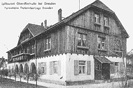
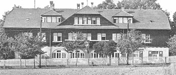

* * *

Initiator für den Bau des Heimes an der [Karpatenstraße](../../../../nordost/rochwitz/strassen_rochwitz/) 18b war der Fabrikant Julius Guttentag, der erhebliche finanzielle Mittel für den
Erholungsaufenthalt von Kindern zur Verfügung gestellt hatte. Nach Plänen des Architekten Johannes Lehnert entstand 1907 auf dem zuvor von der Fraternitas-Loge, einem 1843 gegründeten Ordensverband jüdischer Männer,
erworbenen Grundstück ein zweigeschossiges Gebäude. Im Erdgeschoss besaß das Heim zwei Speiseräume für Jungen und Mädchen. Im Obergeschoss waren die Schlafsäle untergebracht. Die feierliche Eröffnung
erfolgte am 4. Juli 1909. Wenige Tage später besuchte König Friedrich August III. das Haus.

In den Sommermonaten konnten nun bis zu 100 Kinder einen Erholungsaufenthalt in Rochwitz verbringen, wobei
deren Eltern lediglich die Verpflegungskosten aufbringen mussten. Für ärmere Familien gab es Freistellen. Obwohl das
Heim bevorzugt für jüdische Kinder gedacht war, durften auch zahlreiche Kinder aus christlichen Familien das Haus nutzen. 1924 erfolgte ein Ausbau des Dachgeschosses für zusätzliche Personalschlafzimmer.

Mit Machtübernahme der Nazis kam es auch in dieser jüdischen Einrichtung zu massiven Einschnitten. Ab Dezember
1933 fanden hier Lehrgänge für hauswirtschaftliche und gärtnerische Arbeiten sowie Sprach- und Schulungskurse für auswanderungswillige Juden statt. Dafür wurde das Haus 1934 umgebaut und im Inneren in Einzelschlafräume
aufgeteilt. In den Winterferien gab es jedoch auch weiterhin Erholungsmöglichkeiten für jüdische Kinder. Per Verordnung des Reichsstatthalters vom 7. Januar 1938 wurde das jüdische Erholungsheim vom Staat beschlagnahmt
und in den Besitz des Landes Sachsen überführt. Bereits ein Jahr zuvor hatten die Nazis die jüdische Fraternitas-Loge verboten. Ab 1940 nutzte die NS-Frauenschaft das Gebäude als Schulungsheim.

Das 1945 zunächst unter treuhänderische Verwaltung gestellte und zu
Wohnzwecken genutzte Haus wurde wenig später an die jüdische Gemeinde zurückgegeben. Diese verkaufte es 1949 an die Sächsische Landeskreditbank. Pläne sahen nun die Einrichtung einer Betriebsparteischule der Bau-Union
Dresden bzw. eines Kinderheimes vor, blieben jedoch unrealisiert. 1952 bezogen Studenten der Technischen Hochschule das Haus als Wohnheim. Mitte der 1960er Jahre ging es in den Besitz VEB Landmaschinen Fortschritt über
und wurde bis 1989 als Projektierungsbüro für Agroanlagen genutzt. In diesem Zusammenhang entstand im hinteren Teil des Grundstücks ein Bürohaus. Der
nach der Wende in eine eigenständige GmbH (Agroanlagen Dresden) umgewandelte Betrieb musste 2000 Insolvenz anmelden. Heute befindet sich das Haus in Privatbesitz. An Stelle des abgerissenen Bürogebäudes aus DDR-Zeiten
entstanden 2009 mehrere Einfamilienhäuser.

* * *

 \[ [Home](../../../../index.html)\] \[ [Nord](../../../../nord/)\] \[ [Nordwest](../../../../nordwest/)\] \[ [Neustadt](../../../../neustadt/)\] \[ [Nordost](../../../../nordost/)\] \[ [West](../../../../west/)\] \[ [Zentrum](../../../../zentrum/)\] \[ [Südwest](../../../../sudwest/)\] \[ [Süd](../../../../sud/)\] \[ [Südost](../../../../sudost/)\] \[ [Ost](../../../../ost/)\] \[ [Register](../../../../Register/register.html)\] \[ [Kontakt](../../../../Kontakt/kontakt.html)\] \[ [Impressum](../../../../impressum/)\]
