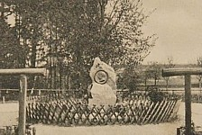
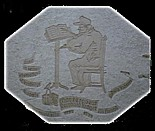

* * *

Die heutige Krügerstraße geht auf einen alten Verbindungsweg zwischen Oberloschwitz und Rochwitz zurück und wurde deshalb Rochwitzer Weg genannt. Nach dessen Ausbau 1893 erhielt dieser Weg den Namen Prinz- (später König-)Friedrich-August-Straße. 1898 ließ die Gemeinde Rochwitz an der Ecke Krüger-/ Tännichtstraße einen Gedenkstein mit Bronzemedaillon aufstellen, der an das 25. Regierungsjubiläum König Alberts erinnerte _(Foto)_. Dieser Stein ist bis heute erhalten geblieben, das Medaillon ging allerdings verloren und wurde erst 2015 durch eine Kopie ersetzt. Um Verwechslungen mit gleichnamigen Straßen in anderen Stadtteilen zu vermeiden, wurde die Friedrich-August-Straße nach der Eingemeindung von Loschwitz in Krügerstraße umbenannt.

Auf dem Grundstück Krügerstraße 22 besaß der als “Original” geltende Dresdner Münzgraveur Reinhard Krüger (1794-1879) einst ein Sommerhaus. Krüger schuf im 19.
Jahrhundert zahlreiche Entwürfe für Gedenkmünzen und Medaillen und gehörte zum Freundeskreis um Ludwig Richter. Nach ihm erhielt die Krügerstraße auch ihren heutigen Namen. Das baufällige Gartenhäuschen musste in den 1950er Jahren abgerissen werden. Ein Nachfolgebau wird heute von der Fraunhofer-Gesellschaft genutzt. Das Sgraffito-Bild an dessen Giebel entstand nach der Ludwig-Richter-Zeichnung “Der Einsiedler von Loschwitz”, welche den Graveur beim Geigenspiel zeigt _(Foto)_.

Bemerkenswert ist auch das 1962/63 gebaute Einfamilienhaus Krügerstraße 39. Das Gebäude gilt als einer der innovativsten und architektonisch interessantesten Privatbauten dieser Zeit und wurde nach 1990 unter Denkmalschutz gestellt. Bauherr und Architekt war Rolf Göpfert, der von 1956 bis 1968 als Professor für Gebäudelehre an der TU
Dresden wirkte. Göpfert entwarf sein Wohnhaus nach den Grundsätzen des seinerzeit modernen sachlichen Stils und gestaltete auch den zugehörigen Garten mit Terrassen und einem kleinen Wasserbecken. Unweit des Hauses lädt auf der gegenüberliegenden Straßenseite die Ausflugsgaststätte [“Schöne Aussicht”](../../../../nordost/loschwitz/strassen_loschwitz/loschwitzhohe/) zum Besuch ein.

* * *

 \[ [Home](../../../../index.html)\] \[ [Nord](../../../../nord/)\] \[ [Nordwest](../../../../nordwest/)\] \[ [Neustadt](../../../../neustadt/)\] \[ [Nordost](../../../../nordost/)\] \[ [West](../../../../west/)\] \[ [Zentrum](../../../../zentrum/)\] \[ [Südwest](../../../../sudwest/)\] \[ [Süd](../../../../sud/)\] \[ [Südost](../../../../sudost/)\] \[ [Ost](../../../../ost/)\] \[ [Register](../../../../Register/register.html)\] \[ [Kontakt](../../../../Kontakt/kontakt.html)\] \[ [Impressum](../../../../impressum/)\]
