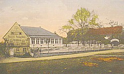

* * *

Das Gasthaus “Zum Sächsischen Jäger” entstand im letzten Drittel des 19.
Jahrhunderts neben dem sogenannten “Gierthschen Gut” im Ortskern von Altrochwitz. Die Gebäude wurden um 1804 errichtet und bildeten den größten Dreiseithof des Dorfes. Als eines von nur acht Gehöften überstand
das Anwesen den letzten großen Dorfbrand 1869. Wenig später  richtete Friedrich Wilhelm Gierth auf dem Nachbargrundstück eine Bäckerei und eine Restauration ein, welche den Namen “Zum Sächsischen Jäger” erhielt.
Neben der Gaststube besaß der Bau auch ein Gesellschafts- und Vereinszimmer sowie einen großen Gästegarten. Die Namensgebung geht
wahrscheinlich auf in der Nähe durchgeführte Manöverübungen der Jägerabteilung der sächsischen Armee zurück. Zu den Besuchern des Lokals soll einst auch König Friedrich August III. gehört haben.

Um die Nachbarn vor
Beeinträchtigungen durch den Wirtshausbetrieb zu schützen, ließ Gierth um 1880 eine Sicht- und Lärmschutzwand errichten, welche mit dem Wandbild “Die alte Stadt” bemalt war und eine zusätzliche
Attraktion darstellte. Bis zum Ersten Weltkrieg entwickelte sich der “Sächsische Jäger” zu einem beliebten Ausflugslokal. Mehrfach erfolgten bauliche Veränderungen, u.a. 1928 mit der Aufstockung des alten
Schlachthauses. Außerdem sind im Laufe der Zeit wechselnde Schreibweisen und Namensgebungen nachweisbar, u.a. “Sächsischer Jäger” und ”Sächsischer Reiter”. Während des Zweiten Weltkrieges befand sich im
Gasthof eine Fertigungsstätte für Zünder und feinmechanische Geräte.

Nach 1945 wurde der “Jäger” unter wechselnden Pächtern weiter als Gaststätte betrieben und erhielt den Namen
“Rochwitzer Höhe”.  1958 übernahm das Wirtsehepaar Müller das Lokal, gab es aus Altersgründen jedoch später an den VEB Agroanlagenbau als Betriebskantine ab. In den 1960er Jahren nutzte die LPG “Neues Leben” den
benachbarten Dreiseitenhof bis zu dessen Abriss 1975. Auch die Bausubstanz des früheren Gasthofs verfiel immer mehr, so dass der Küchentrakt 1986 aus hygienischen Gründen gesperrt werden musste.
Ein bereits begonnener Neubau blieb bedingt durch die politische Wende 1989 und die Abwicklung des Betriebes unvollendet. Die ruinösen
Reste wurden im Oktober 2012 abgerissen. Auf dem Gelände des Gierthschen Gutes und des “Sächsischen Jägers” sind nun Wohnhäuser geplant.

* * *

 \[ [Home](../../../../index.html)\] \[ [Nord](../../../../nord/)\] \[ [Nordwest](../../../../nordwest/)\] \[ [Neustadt](../../../../neustadt/)\] \[ [Nordost](../../../../nordost/)\] \[ [West](../../../../west/)\] \[ [Zentrum](../../../../zentrum/)\] \[ [Südwest](../../../../sudwest/)\] \[ [Süd](../../../../sud/)\] \[ [Südost](../../../../sudost/)\] \[ [Ost](../../../../ost/)\] \[ [Register](../../../../Register/register.html)\] \[ [Kontakt](../../../../Kontakt/kontakt.html)\] \[ [Impressum](../../../../impressum/)\]
