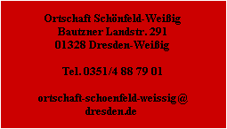

* * *

* * *

* * *

**Homepage von Siegmar Baumgärtel**

Das Schönfelder Hochland, früher auch als “Pillnitzer Elbgebirge” bezeichnet,
war bereits in der Bronzezeit besiedelt, worauf eine 1854 entdeckte Kultstätte hinweist. Unter Leitung des Archäologen Preusker wurden in der Nähe von
Weißig über 400 Fundstücke geborgen, die den Platz zu einer der größten bronzezeitlichen Ausgrabungsfelder in Sachsen machten. Die seit dem 6. Jahrhundert hier lebenden Slawen errichteten zum Schutz ihrer Dörfer einige
Befestigungsanlagen, so auf dem Hutberg und dem Borsberg. Nach Gründung der Burg Meißen im Jahr 929 begann die schrittweise Inbesitznahme des rechtselbischen Gebietes durch deutsche Bauern. Um 1150 entstanden so
weitere Dörfer rund um das Schloss Schönfeld, welches den Verwaltungsmittelpunkt des Gebietes bildete. Schönfeld,
Weißig und Eschdorf waren zugleich Kirchdörfer und sicherten die religiöse Betreuung der Bewohner. Von wirtschaftlicher Bedeutung war die Landwirtschaft, später teilweise auch der Obstanbau.

Das Gebiet um Schönfeld unterstand ab 1144 der Burggrafschaft Dohna und wurde von einem wichtigen Verkehrsweg
berührt. Über Ullersdorf verlief eine Kammstraße aus dem Elbtal nach Stolpen, die später auch als Alte Stolpische Poststraße bezeichnet wurde. Mehrfach wechselte der Verlauf dieser Straße, vor allem um die ungünstigen
Geländeverhältnisse auszugleichen. Erst 1815 wurde zwischen Weißig und Rossendorf eine neue Chaussee angelegt, die bis
heute von der Bundesstraße 6 genutzt wird. Der alte Verkehrsweg verlor damit seine Bedeutung und wird heute als Hornweg bezeichnet und als Wanderweg genutzt.
Die Lage in der Nähe dieser Fernstraße führte in Kriegszeiten immer wieder zum Durchzug fremder Truppen, die teilweise erhebliche Schäden in den Dörfern anrichteten. Besonders betroffen
war Weißig, welches sowohl im Siebenjährigen Krieg als auch in den Befreiungskriegen 1813 schwer umkämpft war.

Im 19. und zu Beginn des 20. Jahrhunderts gehörten die Hochlandorte zu den wichtigsten Lieferanten landwirtschaftlicher
Produkte nach Dresden. Von besonderer Bedeutung war die Vieh- und Milchwirtschaft, weshalb zwischen dem
Schönfelder Hochland und Dresden eine regelrechte “Milchstraße” existierte. Transportiert wurde die Fracht meist auf
Pferdewagen, teilweise kamen jedoch auch Hundegespanne zum Einsatz. Um eine ordnungsgemäße Versteuerung der
Waren und die Einhaltung von Qualitäts- und Hygienevorschriften zu gewährleisten, wurde an der Schillerstraße in der Nähe
der Mordgrundbrücke eine Hebestelle eingerichtet, an der ein für alle Händler obligatorischer Obulus entrichtet werden
musste. Kontrollen auf verbotene Streckung der Milch fanden meist an der Waldschlösschen-Brauerei statt, wo ein “Milchgericht” der städtischen Wohlfahrtspolizei eingerichtet wurde.

1908 erhielt das Schönfelder Hochland Eisenbahnanschluss durch den Bau der [Hochlandbahn](../../nordost/schonfeld-weissig/weissig/hochlandbahn/), die als Zweigbahn von
Dittersbach-Dürrröhrsdorf über Eschdorf bis nach Weißig führte. Mit dieser Bahn sollte die wirtschaftliche Entwicklung in
dem Gebiet vorangetrieben werden, was jedoch nur teilweise gelang. Die Strecke wurde 1952 stillgelegt und abgebaut.
Kurz zuvor war bereits der Straßenbahnverkehr nach Weißig eingestellt worden. Bis in jüngste Vergangenheit blieben die
Orte ländlich geprägt und von größeren Industrieansiedlungen verschont. Nach 1990 begann eine rege Bautätigkeit, die
1994 zum Zusammenschluss der Orte Borsberg, Cunnersdorf, Eschdorf, Gönnsdorf, Helfenberg, Malschendorf, Pappritz,
Reitzendorf, Rockau, Rossendorf, Schönfeld, Schullwitz, Weißig und Zaschendorf zur Großgemeinde Schönfeld-Weißig
führte. Während in Weißig ein großes Einkaufs- und Gewerbegebiet angelegt wurde, vergrößerten sich die übrigen Orte
vorrangig durch den Bau von Wohnsiedlungen mit Einfamilien- und Reihenhäusern. Bis 1998 stieg die Einwohnerzahl auf
über 10.000 an. Die zunehmende Zersiedlung des Hochlandes und der Zuzug vieler Dresdner in diese Region führte schließlich zur Eingemeindung des Ortes nach Dresden am 1. Januar 1999.

* * *

 \[ [Nord](../../nord/)\] \[ [Nordwest](../../nordwest/)\] \[ [Neustadt](../../neustadt/)\] \[ [Nordost](../../nordost/)\] \[ [West](../../west/)\] \[ [Zentrum](../../zentrum/)\] \[ [Südwest](../../sudwest/)\] \[ [Süd](../../sud/)\] \[ [Südost](../../sudost/)\]
 \[ [Ost](../../ost/)\] \[ [Register](../../Register/register.html)\] \[ [Kontakt](../../Kontakt/kontakt.html)\] \[ [Impressum](../../impressum/)\]
