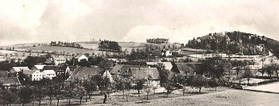
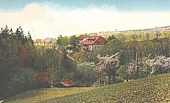
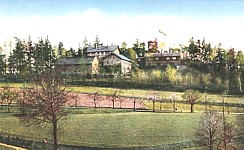
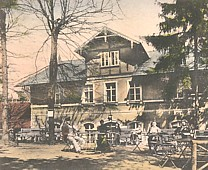
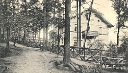
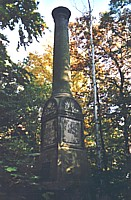

Borsberg wurde 1378 im Lehnsbuch Friedrich des Strengen erstmals urkundlich erwähnt Der vermutlich deutliche ältere Ort entstand als Platzdorf und wurde von slawischen Siedlern gegründet. Der Ortsname ist von einem Personennamen, möglicherweise einem Ortsgründer Bores, abgeleitet. Mehrfach wechselte die Schreibweise von Bornsberg über Bursenberge (1414) zu Borsperg (1465). Bis 1904 wurden Ort und Berg auch Porsberg genannt, bevor sich die heutige amtliche Schreibweise durchsetzte.

Die kleine Ansiedlung liegt auf einer Hochfläche zwischen Meix- und Friedrichsgrund am Fuße des gleichnamigen Berges und gehörte einst den Markgrafen zu Meißen. Kirchlich unterstand Borsberg der Schönfelder Parochie, wo sich bis zur Einweihung des Reitzendorfer Schulhauses auch die zuständige Schule befand. 1702 erwarb Heinrich von Bünau mehrere Bauerngüter, um hier ein Vorwerk einzurichten. Das zu diesem gehörende Wohnhaus wurde 1883 an den Staatsforst Pillnitz verkauft und diente bis 1918 als königliche Jagdhütte der Wettiner. Nach dem Ersten Weltkrieg zog eine Revierförsterei ein.

Der landschaftlich reizvoll gelegene Ort entwickelte sich seit dem 19. Jahrhundert zum Ziel für Ausflügler, was zu Bestrebungen führte, Borsberg zum Kurort auszubauen. Sogar eine Drahtseilbahn ins Elbtal war einst geplant. Letztlich scheiterten die Pläne jedoch an den hohen Kosten und dem Ausbruch des Ersten Weltkrieges. Lediglich einige Villen erinnern an dieses Projekt. Noch im März 1945 zerstörten amerikanische Bomber zahlreiche Gebäude des Dorfes, wobei 12 Menschen ums Leben kamen. Der Wiederaufbau erfolgte in der Nachkriegszeit weitgehend auf dem vorhandenen Grundriss, so dass dieses tragische Kapitel der Ortsgeschichte heute weitgehend in Vergessenheit geriet.

Nach 1945 entwickelte sich Borsberg zum Wohnvorort Dresdens. Die wenigen Bauern schlossen sich in den 1960er Jahren zur LPG “8. April” zusammen, welche später an die Weißiger Genossenschaft “20. Jahrestag der DDR” angeschlossen wurde. 1994 kam Borsberg zur Gemeinde Schönfeld-Weißig und wurde am 1. Januar 1999 Ortsteil von Dresden. In den vergangenen Jahren entstanden mehrere neue Einfamilien- und Doppelhäuser.

Gasthof “Zum Meix”: Das Gasthaus entstand im letzten Drittel des 19. Jahrhunderts und war einst Mittelpunkt des gesellschaftlichen Lebens im Ort. Benannt wurde das Lokal nach in der Nähe gelegenen Meixgrund und der damit verbundenen Sage um den Drachen “Meix”. 1894 entstand ein Tanzsaal für öffentliche Veranstaltungen. Nach 1945 richtete die Deutsche Post hier ein Kinderferienlager ein. Das seit vielen Jahren leer stehende Gebäude an der Meixstraße 60 wurde 2010 verkauft und im Anschluss zum Wohnhaus umgebaut.

Borsberg

Der 356 Meter hohe Borsberg gehört zu den schönsten Aussichtspunkten im oberen Elbtal und trug bis zum 18. Jahrhundert den Namen Golk (slawisch “kahle Kuppe”). Geologisch bildet er den äußersten Rand der Lausitzer Granitplatte und war bereits in der Bronzezeit besiedelt. Um 1400 v. Chr. gab es zwischen Friedrichs- und Vogelgrund eine Wallanlage, deren Reste noch erkennbar sind. Später bewohnten Sorben die Region und nutzten diese als Schutzburg.

Im Zusammenhang mit dem Ausbau des [Friedrichsgrundes](../../../nordost/pillnitz/meixgrund/) zum romantischen Landschaftspark durch Graf Marcolini wurde auch der Borsberg in die Gestaltung einbezogen. Auf dem Berg entstand 1780 eine Einsiedlergrotte mit einem hölzernen Aussichtsgerüst. Im Inneren der sogenannten “Eremitage” führte eine versteckte Treppe zur Aussichtsplattform. Darunter lag ein kleines als Speisesaal genutztes Kaminzimmer. Neben den Angehörigen des Hofes weilten hier auch Carl Maria von Weber, Alexander von Humboldt, Jean Paul und Theodor Körner. Humboldt sprach sogar nach seinem Besuch von einem der schönsten Aussichtspunkte Europas. Bereits 1768 hatte Friedrich August III. vom Borsberg mit einem Fernrohr 188 Berge, 274 Dörfer, 11 Städte, 5 Schlösser und eine Festung sowie 32 Vorwerke und Mühlen erkannt, die er auf einer Orientierungsscheibe aufzeichnen ließ.

In den Jahren 1825 bis 1827 ließen die Wettiner auf dem Gipfel eine Hofküche einrichten, welche zugleich auch Wanderer und Ausflugsgäste versorgte. Vermutlich gab es bereits zuvor ein festes Gebäude, worauf eine Inschrift im Türgewände mit der Jahreszahl "1819" hinweist. Trotz Zerstörungen bei einem Unwetter im Jahr 1850 blieb der Berg ein beliebtes Touristenziel. 1871/72 wurde die Bergwirtschaft zum Restaurant unnd Hotel umgebaut und verpachtet. 1897 übergaben die Wettiner die Baulichkeiten auf dem Borsberg an die Gastwirtsbesitzerin Bähr. Leider verfiel die Eremitage im Laufe der
Zeit und ist heute nur noch in ruinösem Zustand erhalten. Auch das einstige Gasthaus hat seit vielen Jahren geschlossen.

**_Foto:_** _Die Borsbergwirtschaft um 1920_

Neben der mehrfach erneuerten Aussichtsplattform wurde 1865 eine Säule aufgestellt, die zum Netz der mitteleuropäischen Gradmessung gehört _(Foto rechts)_. Unter Leitung des Geodäten Christian August Nagel (1821-1903) erfolgte zwischen 1862 und 1890 eine landesweite Vermessungsaktion, für die insgesamt 158 solcher Beobachtungspunkte errichtet wurden. Die meisten sind noch erhalten und stehen heute unter Denkmalschutz.

Die Säule am Borsberg ist 8,7 Meter hoch und bekam als Triangulationspunkt I. Ordnung die Seriennummer 7. 1874 fand zu ihren Füßen ein Treffen von Vermessungsingenieuren aus Anlass des 3. Deutschen Geodätentages statt. Seit dem 23. Oktober 2003, dem 100. Todestag Nagels, erinnert eine Gedenktafel an den bedeutenden Geodäten und Professor der Polytechnischen Schule in Dresden. Ein weiteres historisches Denkmal befindet sich mit einem mittelalterlichen Steinkreuz am Hang des Borsberges. Dieses entstand als Sühnemal für einen Mordfall.

Interessante Landschaftsformen weisen auch die Hänge des Borsberges auf. Hier beginnt das markante Kerbtal des “Tiefen Grundes” mit steilen Hängen und Zweiglimmergranodioritklippen. Mächtige Felsblöcke finden sich auch im Bett des hier zum Elbtal fließenden Baches. Unweit des Grundes prägen sogenannte Tilken, kleine wiesenbewachsene Hohlformen das Bild. Diese weisen wahrscheinlich auf frühgeschichtliche Hohlwege hin. Jüngeren Datums sind die im Umfeld des Berges angelegten Jagdwege, welche im 18. Jahrhundert für die Vegnügungen des sächsischen Hofes entstanden. Oberhalb Graupas überspannen die steinernen “Hohen Brücken” von 1789 einen Taleinschnitt.

 \[ [Home](../../../index.html)\] \[ [Nord](../../../nord/)\] \[ [Nordwest](../../../nordwest/)\] \[ [Neustadt](../../../neustadt/)\] \[ [Nordost](../../../nordost/)\] \[ [West](../../../west/)\] \[ [Zentrum](../../../zentrum/)\] \[ [Südwest](../../../sudwest/)\] \[ [Süd](../../../sud/)\] \[ [Südost](../../../sudost/)\] \[ [Ost](../../../ost/)\] \[ [Register](../../../Register/register.html)\] \[ [Kontakt](../../../Kontakt/kontakt.html)\] \[ [Impressum](../../../impressum/)\]
