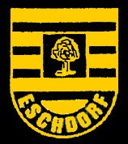
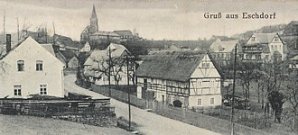
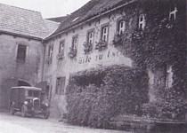
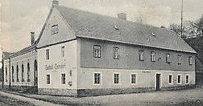

* * *

**Gemeindesiegel von Eschdorf**

Eschdorf entstand im 11./12. Jahrhundert im Zuge der deutschen Ostexpansion und wurde 1317 als Eschwinsdorf erstmals erwähnt. Der Orstname deutet vermutlich auf einen fränkischen Lokator Eschwin hin. Zuvor
lebten hier bereits slawische Siedler, die am Standort der heutigen [Kirche](../../../nordost/schonfeld-weissig/eschdorf/eschdorfer_kirche/) eine Kultstätte besaßen. 1350 gehörte das Dorf zum Distrikt Dresden. 1440 ist erstmals ein Freigut erwähnt, welches 1635 an seinen heutigen Platz im Ortskern verlegt wurde. Ab 1554 befand sich dieses Gut im Besitz des kurfürstlichen Kanzlers Hieronymus Kiesewetter. Einer seiner Nachkommen, Hanns Heinrich von Kiesewetter ließ 1664 den Einwohnern zusätzliche Fuhrdienste auferlegen, was zu einem Aufstand der Eschdorfer Bauern führte. Erst die Gefangennahme und Inhaftierung der Rädelsführer erzwangen 1665 das Ende der Auseinandersetzungen. Die Verwaltung des Freigutes erfolgte bis ins 17. Jahrhundert von [Rossendorf](../../../nordost/schonfeld-weissig/rossendorf/) aus, wo die Gutsherren ihren Wohnsitz besaßen.

**_Foto:_** _Ansicht von Eschdorf um 1920_

Schwer getroffen wurde der Ort in Kriegszeiten durch mehrfache Plünderungen, so während des Dreißigjährigen
Krieges 1632 und 1640-44.  Betroffen war Eschdorf auch vom Nordischen Krieg 1706, als schwedische Soldaten
das Dorf besetzten und über 7000 Taler Kontributionen erpressten. 1758 befand sich in Eschdorf das Hauptquartier der österreichischen Truppen unter General Daun. Auch 1813 war das Dorf von Kriegsereignissen betroffen.

Der Ort, der bis in die Gegenwart vor allem von der Landwirtschaft geprägt wird, besaß bereits im 18. Jahrhundert
zwei Wassermühlen. Angetrieben wurden diese durch den Schullwitzbach, dessen Wasser zu einem Mühlteich angestaut wurde. Die sogenannte Niedermühle besaß im 18. Jahrhundert zugleich die Backgerechtigkeit, wurde später jedoch nur noch als Sägemühle genutzt und 1918 stillgelegt.

Länger existierte die Obermühle. Diese Mühle gehörte der Familie Bienert, deren
Sohn Gottlieb Traugott Bienert am 21. Juli 1813 in Eschdorf geboren wurde. Bienert führte nach dem frühen Tod seines Vaters zunächst die Eschdorfer Mühle
gemeinsam mit seinem Bruder fort und brachte diese zu neuer Blüte. 1843 gründete er in Dresden-Plauen ein eigenes Unternehmen, welches später zu den bedeutendsten [Großmühlen](../../../sud/plauen/bienertmuhle/) im Dresdner Raum gehörte. Die Obermühle _(Foto)_ war noch bis 1989 als Schrotmühle in Betrieb und wurde 1994/97 unter Erhalt
der historischen Mühlentechnik rekonstruiert. Heute hat hier eine kleine Keramikwerkstatt ihr Domizil.

Im Ortskern von Eschdorf sind noch einige bemerkenswerte historische Gebäude zu sehen. Wichtigstes Baudenkmal
ist neben der Kirche der um 1825 errichtete letzte erhaltene Schmiedeschuppen Ostsachsens. Dieser gehörte zum
Areal der Eschdorfer Schmiede, welche ebenso wie die meisten Bauerngüter in Form eines Dreiseithofes gebaut ist
(Pirnaer Straße 52). Das mit einem Hufeisen über der Tür verzierte Fachwerkgebäude ist zugleich ältestes Wohnhaus
des Dorfes. Bemerkenswert ist auch der abseits der Straße gelegene Vierseitenhof Nr. 84. Ein zu diesem gehörendes Seitengebäude blieb als letztes Umgebindehaus von Eschdorf erhalten.

1908 erhielt Eschdorf [Eisenbahnanschluss](../../../nordost/schonfeld-weissig/weissig/hochlandbahn/) nach Weißig und Dürrröhrsdorf. Das frühere Bahnhofsgebäude wurde nach
Stillegung der Bahn 1951 gewerblich genutzt. Zwei Jahre später schlossen sich die ersten Bauern zur LPG “Otto Buchwitz” zusammen, welche sich in den 1960er Jahren erweiterte und 1973 zur “Kooperativen Abteilung
Pflanzenproduktion” Weißig kam. 1993 wurde Eschdorf Ortsteil der neu gebildeten Großgemeinde Schönfeld-Weißig und kam am 1. Januar 1999 als Stadtteil zu Dresden.

Quandtsches Freigut:

1440 ist in Eschdorf erstmals ein Freigut erwähnt. Dieses war eng mit dem Rittergut im benachbarten Rossendorf
verbunden und befand sich bis zum 17. Jahrhundert im Besitz der Familie von Kiesewetter. Das Gut wurde im Dreißigjährigen Krieg zerstört und daraufhin im Ortskern von Eschdorf wieder aufgebaut. Nach dem Verkauf der
Grundherrschaft 1685 an Alexander von Miltitz verlegten die neuen Besitzer des [Rossendorfer Rittergutes](../../../nordost/schonfeld-weissig/rossendorf/) ihren
Wohnsitz nach Eschdorf und ließen das Gut umbauen und erweitern. 1767 entstand das heute noch erhaltene Herrenhaus für den damaligen Eigentümer des Gutes, den sächsischen Oberstleutnant von Polenz.

Am 12. März 1832 erwarb Baron Johann Gottlob von Quandt das Anwesen. Als Kunstkenner und -sammler war er Vorsitzender des 1828 gegründeten Sächsischen Kunstvereins und lebte auf Schloss Dittersbach im Nachbarort von
Eschdorf. Quandt ließ das Gut erweitern und umbauen, wobei mit den Arbeiten am Stallgebäude Gottfried Semper beauftragt wurde. Neben diesem ist auch das Herrenhaus mit einem Wendelstein und zahlreichen architektonischen
Details bemerkenswert. Außerdem gehören ein klassizistisches Pächterhaus und ein bis 1915 als Brauerei genutztes
Gebäude zum Gutshof. Im früheren Gutspark finden sich zahlreiche botanisch interessante Laubmischgehölze sowie ein
kleiner Teich.. Bereits 1840 verlor das Eschdorfer Gut jedoch bereits wieder an Bedeutung, da Quandt seinen Wohnsitz in das neue Herrenhaus Rossendorf verlegte.

1946 erfolgte die Enteignung des Eschdorfer Freigutes, welches 1951 Teil des Volksgutes Dittersbach wurde. Die
Gebäude sind bis heute erhalten. Nach 1990 scheiterten Pläne zur Umgestaltung des Gutes in eine Wohnanlage bzw.
ein Umbau zum Hotel. 2007 übernahm ein privater Investor das Gut und begann mit der denkmalgerechten Sanierung zu Wohnzwecken.

Gasthof Eschdorf:

DieGeschichte des Gasthofes Eschdorf geht auf das bereits 1442 in einem Lehnsbrief erstmals erwähnte Erbrichtergut
zurück, welches zugleich die Schankgerechtigkeit besaß. Zum Gut gehörte auch eine Brauerei, so dass  wahrscheinlich
bereits im 15. und 16. Jahrhundert eine Schänke an dieser Stelle existierte. Erstmals urkundlich erwähnt wurde der
Gasthof am 8. September 1654. An diesem Tag zerstörte ein Großbrand Brauerei und Schankstätte. Bald darauf erfolgte jedoch der Wiederaufbau.

1838  ließen die neuen Besitzer des Freigutes, die Familie Quandt, das
Anwesen umbauen und erweitern. Im Erdgeschoss gab es fortan eine Fleischerei. Außerdem entstand ein Saal für verschiedene Veranstaltungen. Neben Tanzvergnügungen und Konzerten traten hier regelmäßig
Theatergruppen auf. Häufiger Gast war die Puppenbühne der "Witwe Magnus" aus dem nahegelegenen Dresden. 1858 kam noch eine Kegelbahn hinzu. Unter Regie der Familie Schubert, die den Gasthof um
die Jahrhundertwende übernommen hatte, entwickelte sich das Lokal zur beliebten Einkehrstätte für Wanderer und Tagesausflügler. Der Braubetrieb endete im Jahr 1914, als die vorhandenen
kupfernen Braukessel für Rüstungszwecke abgegeben werden mussten.

Nach 1945 wurde der bisherige Saal umgebaut und diente viele Jahre als Garage für die Linienbusse der Strecke
zwischen Pirna und Eschdorf. Als Ersatz wurde an die Gaststätte ein neuer Saal mit großen Rundbogenfenstern
angebaut, so dass diese auch weiterhin kulturelles und gesellschaftliches Zentrum des Ortes blieb. 1974 verkauften die
damaligen Besitzer Margarete und Alfred Sturm ihr Lokal an die Gemeinde Eschdorf. Diese ließ das Gebäude bis 1978 komplett modernisieren. Die früheren Stallungen im Nebengebäude wurden zu Sanitäranlagen umgebaut, im
Obergeschoss entstanden Wohnungen. Betreiber war ab 1979 die Gastwirtsfamilie  Hanta.

Ab 1981 fanden im rekonstruierten Saal wieder regelmäßig Tanzveranstaltungen statt, welche den Gasthof weit über
Eschdorf hinaus bekannt machten. Gelegentlich gab es auch Puppentheater- bzw. Kinovorführungen. 1990 erwarb die
bisherige Pächterfamilie Hanta das Lokal von der Gemeinde und ließ es erneut umbauen. Seit 1994 wird es offiziell als
“Gasthof Landei” bezeichnet. In der Nähe des Lokals erinnert ein mittelalterliches Steinkreuz in Malteserform an einen Mord- bzw. Unglücksfall.

Ortsteil Rosinendörfchen:

Der Eschdorfer Ortsteil Rosinendörfchen entstand um 1700, nachdem man das Flurstück der alten Niedermühle in einer Wiesenmulde nahe der Straße nach Dittersbach an vier Gärtner aufgeteilt
hatte. Aus diesem Grund ist die kleine Siedlung im Kirchenbuch von 1748 als die “Vierhäuser” erwähnt, obwohl bereits 1709 ein weiteres Häusleranwesen
hinzugekommen war. Erst im 19. Jahrhundert taucht der Name “Rosinendörfchen” für die Wohnsiedlung auf. Grund
war vermutlich ein Irrtum des Karthografen Peter Schenk, der auf seiner Karte von 1753 irrtümlich an dieser Stelle
“Roßindorff” (Rossendorf) eingetragen hatte. Später setzte sich der Name für den Eschdorfer Ortsteil auch amtlich durch.

Wüstung Deutzschen:

Unweit von Eschdorf liegen im Tiefen Grund nahe der Ortsgrenze zu Wünschendorf die Fluren des untergegangenen
Ortes Deutzschen. Über seine Geschichte ist wenig bekannt, allerdings taucht der Name mehrfach in alten Urkunden auf. So sind 1472 “das Holz und die Wiesen ym Deutzschen” genannt. Noch 1840 sollen im angrenzenden Wald
Spuren der früheren Ackerbeete zu sehen gewesen sein.
