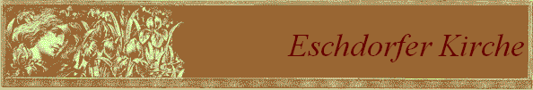
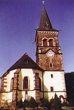
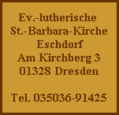
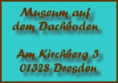
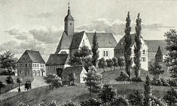

* * *

* * *

* * *

* * *

* * *

* * *

Die Eschdorfer Kirche _(Bild um 1840)_ entstand wahrscheinlich bereits um 1225 an Stelle einer früheren slawischen Kultstätte. 1348 erhielt sie einen der Heiligen Barbara geweihten Altar und wird seitdem St.- Barbara-Kirche
genannt. Stifter waren die Grundherren von Eschdorf sowie der Pfarrer des später in Stolpen aufgegangenen Ortes Jockgrim. Einst war sie ein wichtiger Wallfahrtsort und wurde 1539 mit der Reformation protestantisches
Gotteshaus des Dorfes. Auch die benachbarten Orte Rossendorf, Wünschendorf sowie das Rosinendörfchen gehören seitdem zur Eschdorfer Parochie. Aus der Frühzeit der Kirche stammen noch das Untergeschoss des
Turmes, die im 14. Jahrhundert ergänzte Sakristei und der 1524 erbaute spätgotische Chor. Sehenswert ist auch ein in gleichem Jahr entstandenes Sakramenthäuschen.

Unter Leitung des Architekten Christian Friedrich Arnold wurde die Eschdorfer Kirche 1886 in ihrer heutigen neoromanischen Form umgebaut und erhielt einen neuen Kirchturm. Die Finanzierung des Baus übernahm
teilweise der in Eschdorf geborene Gottlieb Traugott Bienert, Besitzer der [Bienertmühle](../../../../sud/plauen/bienertmuhle/) in Plauen, der so seiner Heimatgemeinde
Reverenz erweisen wollte. An Bienert erinnert eine Gedenktafel im Seitengang. Bemerkenswert sind in der Kirche eine
Sandsteintaufe von 1591 mit den Wappen der Adelsfamilien Kiesewetter und Nostitz sowie zwei historische Grabmäler aus dem 17. Jahrhundert. Altar und Kanzel stammen aus der jüngsten Umbauphase von 1886.

Die Orgel stammt aus der Werkstatt Christian Gottfried Herbrig und Sohn von 1838. Johann Gottlob von Quandt,
Besitzer des benachbarten Rittergutes Dittersbach,  hatte den Kontrakt mit den Orgelbauern abgeschlossen. Das
Instrument ist eine mechanische Schleifladenorgel mit einem Manual und Pedal und 11 Registern. Der Entwurf für den
neogotischen Orgelprospekt stammt von Gottfried Semper. 1987 wurde das kulturhistorisch bedeutsame Instrument restauriert.

Anläßlich des 650. Jubiläums der Kirche öffnete 1996 auf dem Dachboden ein originelles Heimatmuseum, welches über
die Geschichte des Ortes informiert und in zwei Abteilungen Dokumente, Fotos, Gebrauchsgegenstände und Möbel aus
Eschdorf und Umgebung zeigt. Zu sehen sind auch einige Bilder des bis zu seinem Tod 1980 in Eschdorf lebenden Landschaftsmalers Willy Tag,  der zahlreiche Gemälde und Zeichnungen der Umgebung schuf.

Unmittelbar an der Kirche liegt der Friedhof des Ortes, der zeitgleich mit dieser angelegt und 1888 erweitert wurde. Hier
sind an der Kirchenmauer noch einige historische Gräber erhalten geblieben. Ein mit einer Christusfigur verzierter Stein
erinnert an den früheren Eschdorfer Pfarrer Emil Julius Gräfe, der ab 1885 im Amt war und 1892 verstarb. Auch die
Grabstätte der Mühlenbesitzer Bienert ist noch vorhanden. Sohn Traugott Bienert ließ dieses Grabmal für seine Eltern
errichten. Mehrere Grabplatten der Herren zu Rossendorf sind im Inneren der Kirche zu finden. Das nahestehende Pfarrhaus stammt von 1820.

_Linktipp zur Orgelbauerfamilie Herbrig:_ [_**www.herbrig-orgeln.de**_](http://www.herbrig-orgeln.de)

* * *

 \[ [Home](../../../../index.html)\] \[ [Nord](../../../../nord/)\] \[ [Nordwest](../../../../nordwest/)\] \[ [Neustadt](../../../../neustadt/)\] \[ [Nordost](../../../../nordost/)\] \[ [West](../../../../west/)\] \[ [Zentrum](../../../../zentrum/)\] \[ [Südwest](../../../../sudwest/)\] \[ [Süd](../../../../sud/)\] \[ [Südost](../../../../sudost/)\] \[ [Ost](../../../../ost/)\] \[ [Register](../../../../Register/register.html)\] \[ [Kontakt](../../../../Kontakt/kontakt.html)\] \[ [Impressum](../../../../impressum/)\]
