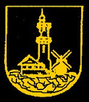
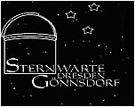
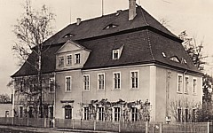
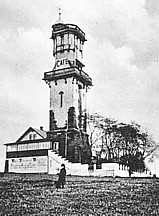

* * *

**Gemeindesiegel von Gönnsdorf**

* * *

* * *

Gönnsdorf entstand vermutlich im 11./12. Jahrhundert durch fränkische Siedler als Waldhufendorf. Erstmals erwähnt wurde der Ort 1378 als Gadelsdorf und gehörte zum castrum Dresden. Der Name weist vermutlich
auf einen Lokator namens Godwin bzw. Goden hin. Die kleine Siedlung an der Kreuzung alter Wege von Bühlau nach Schönfeld und von Weißig nach Pappritz bestand anfangs nur aus sechs Höfen, einer Windmühle und einem
Herrengut. Zunächst war dieses mit dem Rittergut [Helfenberg](../../../nordost/schonfeld-weissig/helfenberg/) verbunden, erhielt jedoch durch seinen Verkauf an Hans Alnpeck 1578 seine Eigenständigkeit. Spätere Besitzer waren u.a. der Dresdner Oberhofprediger Matthias Hoe von Hoenegg, Johanna Eleonora von Lüttichau und der sächsische Oberst Caspar von Seydlitz. 1764 erhielt das Rittergut die Altschriftsässigkeit verliehen, was seine Besitzer zur Teilnahme an den sächsischen Landtagen berechtigte. Kirchlich unterstand Gönnsdorf der [Weißiger Kirche](../../../nordost/schonfeld-weissig/weissig/weissiger_kirche/).

Das Gönnsdorfer Rittergutes gehörte zwischen 1721 und 1756 der Reichsgräfin Manteuffel, welche auch den
noch heute in Resten vorhandenen Gönnsdorfer Park anlegen ließ. Ab 1878 befand es sich im Besitz der Wettiner. Nach dem Ersten Weltkrieg wuchs der Ort über seine alten Grenzen hinaus und entwickelte sich zu einer
Arbeiterwohngemeinde, deren Einwohner meist im benachbarten Dresden beschäftigt waren. In diesem Zusammenhang entstanden ab 1920 einige neue Wohnsiedlungen.

1946 fiel auch das Gönnsdorfer Rittergut unter die
Bestimmungen der Bodenreform und wurde an Neubauern aufgeteilt. In diesem Zusammenhang entstanden weitere Gebäude. Das ehemalige Herrenhaus diente fortan als Gemeindeamt und zu Wohnzwecken. 1975 entstand am
Ortsrand eine Außenstelle der Technischen Universität Dresden, die hier bis 2006 einen Astrographen zur astronomischen Beobachtung betrieb. Heute wird das Observatorium
von einer kleinen Interessengemeinschaft betrieben und ist auch für private Interessenten geöffnet. 1994 schloss sich Gönnsdorf mit den anderen Hochlanddörfern zur Großgemeinde Schönfeld-Weißig zusammen und ist
seit 1999 Ortsteil von Dresden. In den letzten Jahren wurde am Zachengrund ein neues Wohngebiet mit Ein- und Zweifamilienhäusern errichtet.

Gönnsdorfer Park:

Der Landschaftspark wurde 1721 im Auftrag der Reichsgräfin Agnes von
Manteuffel angelegt. Diese hatte kurz zuvor gemeinsam mt ihrem Mann Ernst Christoph das Gönnsdorfer Rittergut erworben und dieses um einen kleinen
Barockpark erweitert. Vorheriger Besitzer war der sächsische Oberst Caspar von Seydlitz, der bereits 1709 das bis heute erhaltene Herrenhaus _(Foto)_
errichten ließ. Nachdem Seydlitz 1716 nach einer Intrige zu zehn Jahren Festungshaft verurteilt worden war, musste er seinen Gönnsdorfer Besitz 1720 verkaufen.

Agnes Charlotte von Manteuffel gehörte als Gemahlin des sächsischen Ministers Ernst Christoph von Manteuffel zu den
wohlhabendsten und einflussreichsten Familien in Sachsen, was ihr bei der Umsetzung ihrer Planungen half. Für die
Ausgestaltung des Barockparks kamen bedeutende Hofkünstler zum Einsatz, darunter der französische Bildhauer
Francois Coudray, der als zentralen Mittelpunkt der Anlage eine Brunnenschale mit Kelch schuf. Gespeist wurde der
Sandsteinbrunnen von einer Quelle im oberen Parkteil. Sogar August der Starke soll gelegentlich zu Gast gewesen sein.
1726 verkaufte die Gräfin ihren Besitz an den Minister Jacob Heinrich von Flemming. Leider fielen wesentliche Teile des Parks bereits nach 1750 fehlender Pflege sowie Kampfhandlungen im Siebenjährigen Krieg zum Opfer.

Nach mehrmaligem Besitzerwechsel übernahmen 1878 die Wettiner das Rittergut Gönnsdorf. Der Park wurde nun zum
englischen Garten, ohne jedoch seine barocke Grundstruktur völlig zu verlieren. 1933 bezog eine Führerschule der
Hitlerjugend das Herrenhaus und baute dieses für ihre Zwecke um. Die Anlage des Parks verwilderte während und nach
dem Zweiten Weltkrieg. Erst nach 1990 konnte mit der schrittweisen Sanierung des Gönnsdorfer Parks begonnen
werden. U. a. wurde 2003 mit Hilfe der Murmann-Stiftung der Brunnen rekonstruiert. Das ehemalige Herrenhaus dient seit 1945 Wohnzwecken.

Friedrich-August-Turm:

Unweit des Dorfkerns befand sich auf der 319 Meter hohen Gönnsdorfer Höhe einst eine 1636 erstmals erwähnte
Windmühle. Die ursprünglich wohl als Bockwindmühle konstruierte Mühle wurde um 1800 zur Holländerwindmühle
umgebaut. Im Oktober 1813 brannten österreichische Soldaten das Gebäude als Signalzeichen an ihre Verbündeten ab.
Wenig später entstand an dieser Stelle wieder eine Bockwindmühle mit zwei Mahlgängen. Diese Mühle blieb bis 1896 in Betrieb und verfiel um 1900 dem Abriss.

1896 wurde in unmittelbarer Nähe der Windmühle nach Entwürfen des Baumeisters Arno
Zschweigert ein Aussichtsturm errichtet, welcher zu Ehren des damaligen Kronprinzen und späteren sächsischen Königs Friedrich August III. den Namen Friedrich-August-Turm
erhielt. Mit  25 m Höhe bot er einen weiten Blick über die Hügellandschaft des Schönfelder Hochlandes und das Elbtal. Neben dem Turm befand sich ein Gasthaus, welches
gemeinsam mit dem Aussichtsturm bis 1945 beliebtes Ausflugsziel war.

Am 7. Mai 1945 wurde der Friedrich-August-Turm von abrückenden SS-Verbänden gesprengt.
Heute erinnert noch der Straßenname „Zum Turmberg“ an den Turm. Das frühere Gaststättengebäude dient jetzt Wohnzwecken. 1973 entstand auf der Gönnsdorfer Höhe, ungefähr am Standort der alten Windmühle, eine Sternwarte.
