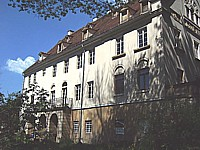
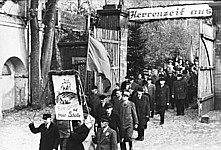
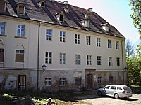

* * *

* * *

Die kleine Siedlung Helfenberg oberhalb des [Helfenberger Grundes](../../../nordost/schonfeld-weissig/helfenberg/helfenberger_grund/) bestand vermutlich bereits zu slawischer Zeit, wurde jedoch erst 1349 urkundlich erwähnt.
Einst war sie im Besitz der Burggrafen von Dohna. Im Helfenberger Grund befand sich seit ca. 1150 eine mittelalterliche Wehranlage, die seit dem 16. Jahrhundert
verfiel und heute nur noch in wenigen Resten vorhanden ist. Nach Aufgabe dieser Burg wurde der Sitz des Rittergutes in den Ortskern verlegt. Bereits 1460 ist dort
ein “forwergk Helffenberg” erwähnt, welches wohl als Wirtschaftshof der Burg diente. Beide befanden sich zeitweise im Besitz der Familie Ziegler, später der
Herren von Karras und gingen 1535 in die Hände der Familie von Carlowitz über. Aus dieser Zeit stammt auch das erste Herrenhaus als Mittelpunkt der kleinen Rittergutssiedlung _(Foto)_.

1543 belehnte Kurfürst Moritz seinen Oberforstmeister Hans von Dehn-Rothfelser mit der Herrschaft Helfenberg und
Schönfeld. Zum Helfenberger Gut gehörten 1627 neben dem Herrenhaus mehrere Scheunen, Ställe und Gärtnereien,
eine Ziegelei, ein Brauhaus, eine Schäferei, zwei Mühlen, 13 Fischteiche sowie mehrere zinspflichtige Dörfer. Unter
Regie von Ernst Abraham von Dehn-Rothfelser wurden zudem um 1600 Obstbaumalleen angelegt und der Weinbau an den Elbhängen forciert. 1628 entstand im Rittergut die noch bis in die Nachkriegszeit betriebene Helfenberger
Schlossbrauerei. Schwer getroffen wurden Ort und Gut im Jahr 1644 bei einem Überfall des schwedischen Generals Lennart von Torstenson, welcher das Dorf niederbrannte.

Neben Landwirtschaft betrieben die Helfenberger Rittergutsbesitzer auch Weinbau. Die
Weinberge lagen am Elbhang zwischen dem Ort und dem benachbarten Rockau. An diesem erinnert noch das Alte Presshaus südwestlich des Gutes, welches 1673 errichtet wurde.
1860 erhielt das unter Denkmalschutz stehende Gebäude nach einem Umbau sein heutiges Aussehen.

Eng verbunden war Helfenberg mit dem benachbarten Dorf Rockau, zu welchem der Ort
nach 1945 eingemeindet wurde. Das frühere Rittergut wurde nach der Bodenreform an Neubauern aufgeteilt und später Sitz einer LPG, die sich 1971 der Bühlauer LPG “Neues Leben” anschloss. Die Schlossbrauerei _(Foto rechts)_ stellte 1960 ihren Betrieb ein. 1994 wurde Helfenberg mit Rockau Teil der neugebildeten Gemeinde Schönfeld-Weißig und kam am 1. Januar 1999 als Stadtteil zu Dresden.

**_Foto:_** _Bodenreform in Helfenberg - Festzug am 27. Oktober 1945 (Foto von Ernst Höhne / Bundesarchiv)_

Herrenhaus:

Das Herrenhaus entstand im 16. Jahrhundert als Sitz des Helfenberger Rittergutes, wobei für
den Bau auch Abbruchmaterial der alten Burg Verwendung fand. Das heutige Gebäude stammt von 1775 und wurde um 1800 von Gottlob Friedrich Thormeyer klassizistisch umgestaltet.
Dabei verlängerte man die Hauptfront des Gebäudes um zwei Achsen und verlegte den Eingang zur Ostseite. Künstlerisch bemerkenswert ist die neu geschaffene Giebelseite zum
Park, welche vom Bildhauer Franz Pettrich mit einem Relieffries mit Szenen aus der griechischen Mythologie gestaltet wurde _(Foto rechts)_. Darunter führt eine Freitreppe in den Park.

Zwischen 1806 und 1811 entstand um das Gut ein kleiner Landschaftspark mit wertvollen Gehölzen. Das Helfenberger Herrenhaus befand sich zu diesem Zeitpunkt im Besitz des
englischen Lords Findlater, der es über seinen Privatsekretär Johann Georg Fischer erworben hatte. Nach Findlaters
Tod 1811 vermachte er die Gutswirtschaft an Fischer, der hier bis zu seinem Tod lebte. 1838 übernahm König Friedrich August II. das Gut und ließ es von wechselnden Pächtern bewirtschaften. Mitglieder der Wettiner kamen
jedoch nur selten nach Helfenberg. Unter König Albert von Sachsen wurde die zum Rittergut gehörige Weinpresse für
den Aufenthalt von Jagdgesellschaften umgebaut. Im früheren Winzerhaus wohnte der zuständige Revierförster, während das Herrenhaus selbst Wohnsitz der Gutspächter war.

Das bis 1918 in königlichem, danach in Privatbesitz von Ernst Heinrich von Sachsen
befindliche Helfenberger Rittergut wurde im Zuge der Bodenreform 1946 enteignet und ging in Volkseigentum über. Einige Gebäude des Gutshofes fielen daraufhin dem
Abbruch zum Opfer. Zuvor hatte hier am 27. Oktober 1945 eine der wichtigsten Kundgebungen zur Bodenreform in Sachsen stattgefunden. Im Beisein von Kurt
Fischer, dem Vorsitzenden der Landesbodenkommission und Vizepräsident der Landesverwaltung Sachsen, wurde eine “Landübergabefeier” an Neubauern zelebriert und die Aufteilung des Großgrundbesitzes als Maßnahme gegen
“jahrhundertealtes Unrecht” begründet.

1948 sollte auch das Schloss dem Bau von Neubauernhöfen weichen, was jedoch verhindert werden konnte. Das frühere Herrenhaus _(Foto: Hofseite)_
diente danach u. a. als Schule, Sitz einer LPG und Reparaturstützpunkt. Die erhaltenen Gebäude stehen unter Denkmalschutz. 2006 erwarb ein Künstlerehepaar das Schloss und begann mit dessen Restaurierung.

Zum Helfenberger Rittergut gehört auch ein kleiner Park, der in seinen Grundzügen auf den im englischen Stil
gestalteten Landschaftspark Findlaters zurückgeht. Botanisch Interessierte finden hier einige seltene Gehölze, u.a. einen
um 1806 gepflanzten Tulpenbaum und einige Hängebuchen sowie Scheinzypressen. Im Park befindet sich auch das Mundloch des durch das Areal fließenden Baches, welches in den Kriegsjahren als Luftschutzbunker genutzt wurde.
Der Legende nach soll es Rest eines Geheimganges zwischen Helfenberg und dem Schloss in Schönfeld sein. In der Zeit nach 1945 verlor der Park viel von seinem ursprünglichen Reiz, da Teile des Areals parzelliert und von
Kleinbauern genutzt wurden. Weitere Parkflächen verwilderten und konnten erst in jüngerer Vergangenheit wieder hergestellt werden. Leider sind der frühere Teich und einige wertvolle Gehölze nicht mehr erhalten.

 \[ [Home](../../../index.html)\] \[ [Nord](../../../nord/)\] \[ [Nordwest](../../../nordwest/)\] \[ [Neustadt](../../../neustadt/)\] \[ [Nordost](../../../nordost/)\] \[ [West](../../../west/)\] \[ [Zentrum](../../../zentrum/)\] \[ [Südwest](../../../sudwest/)\] \[ [Süd](../../../sud/)\] \[ [Südost](../../../sudost/)\] \[ [Ost](../../../ost/)\] \[ [Register](../../../Register/register.html)\] \[ [Kontakt](../../../Kontakt/kontakt.html)\] \[ [Impressum](../../../impressum/)\]
