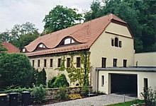
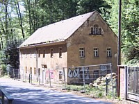
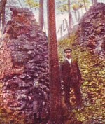
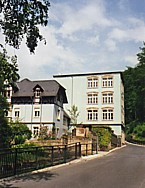
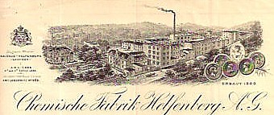
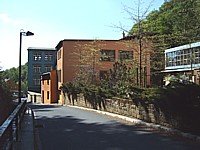

* * *

Der Helfenberger Grund gehört zu den rechtselbischen Seitentälern im Loschwitz -
Pillnitzer Raum und verbindet  Niederpoyritz mit dem kleinen Ort Helfenberg. Hier fließt der in der Nähe von Cunnersdorf entspringende Helfenberger Bach zu Tale,
welcher nach einer Länge von 3,4 km in Niederpoyritz in die Elbe mündet. Der Grund war einst Standort einer mittelalterlichen Wehranlage und zweier  Mühlen,
wobei aus der unteren Ende des 19. Jahrhunderts die Chemische Fabrik Helfenberg hervorging. Leider wurde das 1735 am Ausgang des Grundes entstandene [Herrenhaus](../../../../nordost/niederpoyritz/strassen_niederpoyritz/) des Niederpoyritzer Rittergutes, später umgebaut und als Schlossvilla
bezeichnet, 1984 abgerissen. Einige Nebengebäude werden heute gewerblich genutzt. In den Räumen der ehemaligen Brauerei befinden sich Wohnungen _(Foto)_.

Zu den weiteren Bauten im Helfenberger Grund gehört die auf  Helfenberger Flur
gelegene Gaststätte Hilfenburg, welche ihren Namen von der nahegelegenen Ruine der Hilfenburg (Burg Helfenberg) ableitet. Das kleine Gasthaus, zuletzt im Besitz des
Gastwirts Weißbach, war bis 1965 geöffnet und dient heute als Wohnhaus. Im oberen Teil des Grundes steht das sogenannte Aussiedlerhaus, ein früher als Gesindehaus des Rittergutes genutztes Gebäude _(Helfenberger Grund 11 - Foto)._ Unweit davon befindet sich ein Pumphaus mit Hochbehälter. Dieses wurde 1900 zur Wasserversorgung der Gemeinde Niederpoyritz gebaut.

Burg Helfenberg:

Um 1150 entstand auf einer Erhebung über dem Grund die Burg Helfenberg, auch Hilfenburg
bzw. Burg Helfenstein genannt. Die nur wenige 100 m² umfassende Wehranlage war Sitz einer kleinen Grundherrschaft und wurde 1349 erstmals als “castrum Helfenberg in districtu Dresden
situm” urkundlich erwähnt. Archäologischen Forschungen zufolge handelte es sich um eine frühdeutsche Warte, bestehend aus einem turmartigen Befestigungsbau, welcher von Gräben und
einem Wall umgeben war. Ab 1397 gehörte sie der Familie von Ziegler und wechselte später mehrfach ihren Besitzer. 1445 erwarb die Familie Kundige Burg und Herrschaft Helfenberg, die
1535 an die Familie Karas fiel. Zeitweise soll hier der Raubritter Barbaricy seinen Unterschlupf gehabt haben, um dessen grausame Taten sich eine Sage rankt.

Demnach soll dieser in der Zeit, als sein Bruder in den Krieg gezogen war, dessen Gemahlin bedrängt haben. Als die Frau
sich weigerte und ihrem Gatten die Treue bewahrte, ließ Barbaricy die Burg stürmen und niederbrennen. Die entführte
Burgfrau floh jedoch und stürzte sich von einem Felsen in die Tiefe. Als ihr Mann von seinen Kämpfen zurückkehrte, fand
er nur noch einen verwundeten alten Burgknappen in seinem zerstörten Besitz, der ihm die Geschichte erzählte. Daraufhin
entschied sich der Ritter, Schwert und Rüstung für immer niederzulegen und ging in ein Kloster, um dort für das Seelenheil
seiner treuen Gattin zu beten. Barbaricy und seine Männer wurden wenig später festgenommen und auf dem Rad gerichtet.

1547 verlegten die neuen Besitzer, die Familie Dehn-Rothfelser, ihren Wohnsitz in das Vorwerk Helfenberg, das spätere
Herrenhaus des Rittergutes. Die Burg bestand jedoch weiter und wurde 1631 erfolglos von den Kroaten angegriffen. Noch
um 1700 wird sie als “altes Schloss” erwähnt, jedoch kaum noch genutzt. Die Ruine diente später der Gewinnung von
Baumaterial für das Rittergut und wurde 1775 weitgehend abgetragen. 1878 erinnerte nur noch ein gotischer Torbogen an
die frühere Burg. Heute sind von dieser Wehranlage nur noch geringe Mauerreste und Teile des Walls erhalten.

Chemische Fabrik Helfenberg:

An Stelle der späteren Fabrik existierte bereits im Mittelalter eine Wassermühle, die zum Zubehör des Rittergutes Helfenberg gehörte und 1547 mit diesem von Hans von Dehn-
Rothfelser erworben wurde. Eine weitere Mühle lag ungefähr in der Mitte des Grundes und ist 1762 in einer Landkarte verzeichnet. Als Hofemühle kam sie im 19. Jahrhundert wieder in den
Besitz des Rittergutes und wurde um 1895 abgerissen. Ihr Standort war vermutlich dort, wo sich heute das Wohnhaus Helfenberger Grund 11 befindet.

Die Wassermühle im unteren Teil des Helfenberger Grundes wurde 1621 erstmals erwähnt und befand sich ab 1854 im Besitz von Johann Gottlob Zeibig. Das auch als Hofemühle bezeichnete
Unternehmen diente zuletzt als Papiermühle und wurde 1895 zugunsten einer Erweiterung der Chemischen Fabrik Helfenberg abgetragen.

Bereits 1869 hatte der aus Bayern stammende Eugen Dieterich diese Papierfabrik im Auftrag der Sächsischen Hypothekenversicherungsanstalt als Verwalter übernommen und stellte hier zunächst Pergamentpapier, Kunstdärme und
andere Spezialpapiere her. Nach Abwicklung der in Liquidation gegangenen Firma übernahm Dieterich 1872 das
Unternehmen selbst und baute es zu einer Fabrik für medizinische Produkte aus. Neben Heftpflaster wurden hier auch
verschiedene Tinkturen und Elixiere gefertigt, was zu Protesten etablierter Apotheker führte, die in der Firma eine unzulässige Konkurrenz sahen.

Eugen Dieterich entwickelte selbst zahlreiche neue Präparate und war zugleich Herausgeber einer eigenen Zeitschrift
“Helfenberger Annalen”. Regelmäßig nahm er an medizinisch-pharmazeutischen Fachkongressen teil und erwarb sich so
auch als Wissenschaftler einen anerkannten Ruf. Die Fabrik wurde ab 1885 von seinen Söhnen Hans und Karl geleitet und
nach mehrfacher Erweiterung 1898 in eine Aktiengesellschaft umgewandelt. Das nun Chemische Fabrik Helfenberg AG
genannte Unternehmen beschäftigte zeitweise über 250 Arbeiter und unterhielt Niederlassungen in London, Paris, New
York und Antwerpen. Zur Fabrik gehörten nach der Jahrhundertwende auch eine eigene Druckerei zur Herstellung der
Verpackungsmaterialien, Tischlerei, Wasser- und Elektrizitätswerk sowie eine Poststelle für den Versand der Artikel in alle Welt.

1951 wurde die Chemische Fabrik Helfenberg enteignet und in mehrere Teilbetriebe aufgegliedert. Ein Zweigbetrieb produzierte unter altem Namen in Wevelinghofen im
Rheinland weiter und kam später zur Chemischen Gesellschaft Rhenania. Der Dresdner Betrieb wurde zunächst als VEB Chemische Fabrik Helfenberg weitergeführt und ab
1955 als Montagestätte für Kameras von den Dresdner Kamerawerken (ab 1964 VEB Pentacon) genutzt. Die früheren Produktionsgebäude und die Villa Eugen Dieterichs, an
den auch ein Straßenname in Niederpoyritz erinnert, sind noch erhalten. 1999 entstand hier ein Kunst- und Wohnprojekt, in dem Designer, Werbegrafiker und ein
Designmöbelhandel untergebracht waren. Nach Konkurs dieses Unternehmens 2001 dient das Areal heute gewerblichen Zwecken.

* * *

 \[ [Nord](../../../../nord/)\] \[ [Nordwest](../../../../nordwest/)\] \[ [Neustadt](../../../../neustadt/)\] \[ [Nordost](../../../../nordost/)\] \[ [West](../../../../west/)\] \[ [Zentrum](../../../../zentrum/)\] \[ [Südwest](../../../../sudwest/)\]
 \[ [Süd](../../../../sud/)\] \[ [Südost](../../../../sudost/)\] \[ [Ost](../../../../ost/)\] \[ [Register](../../../../Register/register.html)\] \[ [Kontakt](../../../../Kontakt/kontakt.html)\] \[ [Impressum](../../../../impressum/)\]
