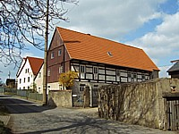
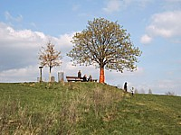

* * *

* * *

Malschendorf entstand im 11./12. Jahrhundert als Ansiedlung fränkischer Bauern,
die zu dieser Zeit das Schönfelder Hochland in Besitz nahmen. Angelegt wurde der Ort als typisches Platzdorf dieser Besiedlungsperiode mit Gewannstreifenflur. Die
erste urkundliche Erwähnung als “Marchschendorff” stammt aus dem Jahr 1414. Der Name ist wahrscheinlich von einem Personennamen abgeleitet. Ursprünglich
unterstand Malschendorf dem “castrum Dresden” und befand sich 1494 im Besitz der Familie Karras. Später kam der Ort zur Grundherrschaft Schönfeld, welche auch
die obere und nieder Gerichtsbarkeit ausübte. Auch kirchlich und schulisch war das Dorf dem benachbarten Schönfeld zugeordnet. Schwere Verwüstungen an Feldern und Gebäuden richteten 1643 schwedische Soldaten an.

Von Bedeutung war einst die Landwirtschaft sowie der Anbau von Obst und Beeren.
Noch im 19. Jahrhundert war die Bezeichnung “Beerendorf” für den Ort gebräuchlich. Bis zur Gegenwart prägen Streuobstwiesen und Obstbaumalleen das
Bild der Malschendorfer Umgebung. Diese führten zur Anlage noch heute gern begangener Wanderwege wie des Promenadenwegs, welcher im 19. Jahrhundert als
Ziel Dresdner Künstler auch “Poetengang” genannt wurde. Nach 1945 entwickelte sich das Dorf zudem zum Dresdner Wohnvorort. Die verbliebenen Bauern schlossen
sich 1960 zur LPG “Am Zuckerhut” zusammen, welche sich in den 70er Jahren der Weißiger LPG anschloss.  Im Ortskern blieben zahlreiche Gebäude der dörflichen Vergangenheit bis heute erhalten.

Eng verbunden war Malschendorf mit seiner Nachbargemeinde [Krieschendorf](../../../nordost/schonfeld-weissig/malschendorf/krieschendorf/), wobei beide Orte im Laufe der Zeit
baulich zusammenwuchsen. 1912 wurden die Dörfer auch politisch zu einer Landgemeinde vereinigt. Der Ort schloss sich am 1. März 1994, drei Monate nach deren Gründung, der Großgemeinde Schönfeld-Weißig an und gehört seit
dem 1. Januar 1999 zu Dresden.

Naturschänke Malschendorf:

Die Naturschänke Malschendorf geht auf eine Anfang des 20. Jahrhunderts entstandene kleine Schankwirtschaft am Ortsrand von Malschendorf zurück. Besitzer war der Gutsbesitzer Gustav Thiebel, der auf seinem Hof eine “Haltestelle für durstige Seelen” einrichtete und so die Besucher des Hochlandes anlockte. Vor allem an den Wochenenden war das reizvoll gelegene Ausflugslokal beliebtes Ziel für Wanderer. Der Name “Naturschänke” geht wahrscheinlich auf die landschaftlich reizvolle Lage des Lokals zurück, wird aber auch mit behördlichen Beschränkungen für den Ausschank von alkoholischen Getränken in Verbindung gebracht.

Bis 1963 blieb die Gaststätte in Familienbesitz, wurde dann jedoch mangels Nachfolger an die Gemeinde verkauft, welche einige Um- und Anbauten vornahm. Mehrfach wechselten nun die Betreiber des Lokals. Seit 1990 wird die Naturschänke wieder privat bewirtschaftet. Bauliche Gründe machten den Abriss großer Teile der Gebäude und den nachfolgenden Wiederaufbau als Ausflugsgaststätte mit moderner Küche, mehreren Gasträumen und einer Terrasse erforderlich. Heute gibt es neben der Gaststube und dem Kaminzimmer auch zwei Ferienwohnungen im Haus.

 \[ [Home](../../../index.html)\] \[ [Nord](../../../nord/)\] \[ [Nordwest](../../../nordwest/)\] \[ [Neustadt](../../../neustadt/)\] \[ [Nordost](../../../nordost/)\] \[ [West](../../../west/)\] \[ [Zentrum](../../../zentrum/)\] \[ [Südwest](../../../sudwest/)\] \[ [Süd](../../../sud/)\] \[ [Südost](../../../sudost/)\] \[ [Ost](../../../ost/)\] \[ [Register](../../../Register/register.html)\] \[ [Kontakt](../../../Kontakt/kontakt.html)\] \[ [Impressum](../../../impressum/)\]
