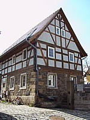

Älteste Spuren menschlicher Besiedlung finden sich auf Krieschendorfer Flur oberhalb des [Keppgrundes](../../../../nordost/hosterwitz/keppgrund/) am Todhübel und einem Bergsporn nördlich des Vogelgrundes, wo Spuren einer bronzezeitlichen Wohnanlage nachgewiesen wurden. Metallfunde und
Keramikscherben stammen aus einer zugehörigen größeren Siedlung dieser Zeit. Die Gründung des heutigen Dorfes liegt im Dunkel und könnte entweder durch slawische
Siedler oder im Zuge der fränkischen Besiedlung im 11./12. Jahrhundert erfolgt sein. 1378 wurde Krieschendorf erstmals urkundlich erwähnt, wobei die ursprüngliche Schreibweise
“Krywenstorf” von einem slawischen Personennamen abgeleitet ist.

1439 belehnte Herzog Friedrich die adligen Brüder Heinrich und Hans von Karras mit den
Fluren und dem Vorwerk Krieschendorf. Sitz der Familie war damals die Wasserburg in Pillnitz. Mit dieser Grundherrschaft und deren wechselnden Besitzern blieb der Ort bis ins 19. Jahrhundert
verbunden. Schulisch und kirchlich war Krieschendorf hingegen der [Schönfelder Kirche](../../../../nordost/schonfeld-weissig/schonfeld/schonfelder_kirche/)
zugeordnet.

Ebenso wie im Nachbardorf [Malschendorf](../../../../nordost/schonfeld-weissig/malschendorf/)
war auch in Krieschendorf neben der Landwirtschaft der Obstbau von Bedeutung, wovon noch heute zahlreiche Baumalleen zeugen. 1554 und 1700 wurden sogar landesherrliche
Verfügungen erlassen, um den Obstanbau in den Hochlanddörfern zu fördern. 1950 schloss sich Krieschendorf mit dem baulich eng verbundenen Nachbarort Malschendorf zu einer Gemeinde zusammen. Diese wurde 1994 Teil der
neu gebildeten Großgemeinde Schönfeld-Weißig und kam am 1. Januar 1999 zu Dresden.

 \[ [Home](../../../../index.html)\] \[ [Nord](../../../../nord/)\] \[ [Nordwest](../../../../nordwest/)\] \[ [Neustadt](../../../../neustadt/)\] \[ [Nordost](../../../../nordost/)\] \[ [West](../../../../west/)\] \[ [Zentrum](../../../../zentrum/)\] \[ [Südwest](../../../../sudwest/)\] \[ [Süd](../../../../sud/)\] \[ [Südost](../../../../sudost/)\] \[ [Ost](../../../../ost/)\] \[ [Register](../../../../Register/register.html)\] \[ [Kontakt](../../../../Kontakt/kontakt.html)\] \[ [Impressum](../../../../impressum/)\]
