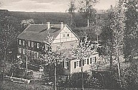
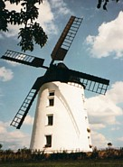
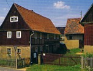

* * *

* * *

Reitzendorf wurde vermutlich um 1200 von fränkischen Siedlern gegründet und 1378 erstmals als “Richczendorf” urkundlich erwähnt. Wie bei vielen Hochlandorten wurde auch hier der Ortsname vom vermutlichen
Dorfgründer abgeleitet. Politisch unterstand der Ort ab 1486 der Grundherrschaft Schönfeld, dem Reitzendorf auch kirchlich zugeordnet war. An den einstigen Weg der Reitzendorfer und Zaschendorfer Einwohner zur Kirche
erinnert noch der Meßweg am Ortsrand. Neben den bäuerlichen Anwesen gab es im Ort ein Vorwerk mit umfangreichem Grundbesitz, Wieden, Teichen und einer Schäferei. Bis ins 18. Jahrhundert verringerte sich der bäuerliche
Landbesitz durch Ankauf von Feldflächen weiter, so dass Reitzendorf überwiegend ein Dorf von landarmen Kleinbauern blieb.

 Bis in jüngste Vergangenheit war Reitzendorf fast ausschließlich von der
Landwirtschaft geprägt. Außerdem gab es im Ort eine Wind- und eine Wassermühle. Letztere entstand um 1750 und diente später auch als Gastwirtschaft _(Foto)_
. 2009 wurde das alte Mühlengebäude zu Wohn- und Gewerbezwecken ausgebaut und saniert. Dabei verschwanden jedoch die Reste der alten Radstube. Die vom Schönfelder Dorfbach gespeiste
Teichanlage befindet sich oberhalb der Mühle.

1873 wurde außerhalb des Ortskerns am Verbindungsweg zur Meixmühle eine
Ziegelei gegründet, welche noch bis in die Zeit nach dem Zweiten Weltkrieg in Betrieb war. Jüngeren Datums ist eine
um 1970 von der örtlichen LPG “20. Jahrestag der DDR” errichtete Milchviehanlage. Das bereits 1961 nach Schönfeld
eingemeindete Dorf kam mit diesem 1994 zur Großgemeinde Schönfeld-Weißig und ist seit dem 1. Januar 1999 ein
Ortsteil von Dresden. In den letzten Jahren entstanden im Ort einige neue Wohnhäuser Außerdem ist Reitzendorf als Ausgangspunkt mehrerer Wander- und Radwege von touristischer Bedeutung.

Reitzendorfer Windmühle:

Die Reitzendorfer Windmühle entstand 1861 für den ortsansässigen Müllermeister Karl Gierth südöstlich des Dorfes und war bis 1919 als Getreidemühle in Betrieb. Zuvor waren die Bauern
des Ortes auf die Wassermühlen in Meix- und Keppgrund angewiesen. Nach Zerstörung der Mühlenflügel bei einem Unwetter am 31. Oktober 1919 wurde ein Dieselmotor eingebaut, der
noch bis 1927 zum Einsatz kam. Erst 1987 begann die Rekonstruktion der Windmühle, die heute zu den Wahrzeichen des Schönfelder Hochlandes gehört. Die bis 1990 zum Wohnhaus
umgebaute Mühle war zugleich Sitz einer Firma, die sich mit der Rekonstruktion historischer Windmühlen beschäftigte, steht derzeit jedoch wieder leer.

Kleinbauernmuseum:

Das Kleinbauernmuseum wurde am 3. Oktober 1992 in einem um 1825 erbauten Reitzendorfer Dreiseitenhof eingerichtet. Der Gebäudekomplex besteht aus einem
Wohnstallhaus, dem Auszugshaus und einer Scheune. Dieser war noch bis 1984 von einer Familie bewohnt, deren Nachlass den Grundstock der Sammlung bildet. Hinzu kamen die
private Sammlung des Heimatforschers Eberhard Pabst sowie zahlreiche Spenden der Bevölkerung. Zu sehen sind u.a. Möbel und Alltagsgegenstände, die Leben und
Wirtschaftsweise der Kleinbauern im Schönfelder Hochland dokumentieren. Hinzu kommen landwirtschaftliche Geräte und Maschinen. Geleitet wird das kleine Museum vom Heimatverein Schönfelder Hochland
e.V. Regelmäßig finden auch verschiedene Veranstaltungen und Sonderausstellungen statt.

