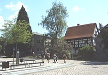
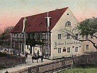
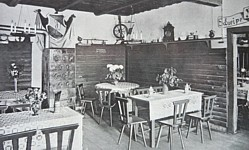
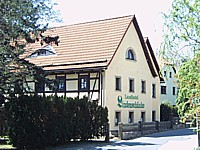
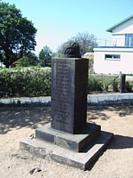
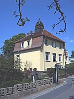
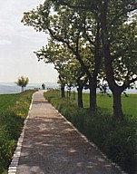

* * *

**Gemeindesiegel von Rockau**

* * *

* * *

**Bibliothek Rockau**

**Rockauer Ring 15**

**01328 Dresden**

Rockau entstand als slawischer Rundling auf einer Hochfläche zwischen
Helfenberger Grund und Keppgrund und wurde 1350 erstmals urkundlich erwähnt. Der ursprüngliche Ortsname “Rakowe” stammt aus dem Slawischen und weist auf einen Personennamen hin (“Dorf des Rak”). Ein hier befindliches
Vorwerk gehörte ursprünglich den Burggrafen von Dohna und wurde nach deren Entmachtung dem Amt Dresden unterstellt. Ab 1606 oblag die Grundherrschaft
über Rockau dem Rittergut im benachbarten Helfenberg. Kirchlich gehörte der Ort zur [Schönfelder Kirche](../../../nordost/schonfeld-weissig/schonfeld/schonfelder_kirche/). Die Geschicke des kleinen Dorfes wurden bis ins
19\. Jahrhundert größtenteils vom Helfenberger Rittergut aus bestimmt. Von wirtschaftlicher Bedeutung war neben der Landwirtschaft der Weinbau. Außerdem gehörten die [Keppmühle](../../../nordost/hosterwitz/keppgrund/) und einige Anwesen im Rockauer Grund zur Dorfflur.

Im 19. Jahrhundert entdeckten zunehmend die Dresdner die landschaftlich reizvolle Lage des Ortes. 1836 öffnete die
bis heute bestehende Gaststätte “Lindenschänke”, die durch ihre Sommerfeste Dresdner Gymnasiasten bekannt wurde.
1904/05 wohnte der Maler Otto Mueller für einige Monate in Rockau und traf sich hier mit Paula Modersohn-Becker.
Mueller hatte zuvor an der Dresdner Kunstakademie studiert und gehörte ab 1910 der Künstlergruppe “Brücke” an.
Während seines Aufenthalts entstanden auch einige Gemälde mit Darstellungen der Umgebung. Muellers Wohnhaus im
ehemaligen Café “Sonnenköpfel” (An der Kucksche 14) ist bis heute erhalten geblieben. Seit 2006 erinnert eine vom Dresdner Bildhauer Hans Kazzer geschaffene Bronzetafel an ihn.

**_Fotos:_** _Die “Lindenschänke” auf historischen Postkarten (links/Mitte) und im Jahr 2012 (rechts)_

Bereits vor dem Ersten Weltkrieg kamen die Ortsteile [Eichbusch](../../../nordost/schonfeld-weissig/rockau/eichbusch/) und [Helfenberg](../../../nordost/schonfeld-weissig/helfenberg/) zu Rockau.
In den Dreißiger Jahren entstanden im Anschluss an den alten Ortskern einige Siedlungen mit Ein- und Zweifamilienhäusern. Ihnen folgten nach 1945 weitere kleine Gehöfte und
Wohnhäuser. Dominierend blieb auch weiterhin die Landwirtschaft, welche zu DDR- Zeiten von der örtlichen LPG “Freie Scholle”, später von der Bühlauer LPG “Neues Leben”
organisiert wurde. Für diese wurde abseits des Ortes an der Straße nach Helfenberg eine Milchviehanlage errichtet. 1977 entstand auf einstigem Brachland die Kleingartensparte “Rockauer Höhe” mit 57 Parzellen.

Die Gemeinde Rockau schloss sich 1994 mit den anderen Hochlanddörfern zur Ortschaft Schönfeld-Weißig zusammen und wurde am 1. Januar 1999 nach Dresden eingemeindet.
1990/91 entstand am Dorfrand das neue Wohngebiet “Am Preßgrund”. Einige historische Gebäude sind rund um den Dorfplatz erhalten. Unweit davon erinnert ein von Edmund Schuchardt geschaffenes Denkmal an die Gefallenen des
Ersten Weltkriegs _(Foto)_. Hier steht auch die als Wahrzeichen des Ortes geltende Rockauer Linde. Die sogenannte Sängerlinde wurde 1959 vom Männerchor Rockau gepflanzt.

Rockauer Schule:

Nachdem die Kinder des Dorfes lange Zeit die Kirchschule im benachbarten Schönfeld besuchen mussten, entschloss sich die Gemeinde 1908 zum Bau eines eigenen Schulhauses
am heutigen Rockauer Ring 2. Nach dessen Schließung diente das Gebäude ab 1959 als “Erntekindergarten” zur Unterbringung der Kinder der in der Landwirtschaft tätigen
Einwohner. 1977 wurde eine ganzjährige Nutzung eingeführt, die bis zur Schließung der Einrichtung 1993 bestand. Seit 2000 befindet sich das markante Gebäude mit seinem Uhrtürmchen in Privatbesitz.

Rockauer Höhe:

Unweit des Dorfkerns liegt die Rockauer Höhe, von den Einheimischen auch “Sachsens Hiefel” genannt. Vom hier gelegenen Aussichtspunkt (259,5 m über NN) bietet sich ein
beeindruckender Blick über das Elbtal zwischen Meißen und der Grenze zu Böhmen. Seit 2001 erinnern zwei Eichen an den mit nur 43 Jahren verstorbenen Naturkundler Thomas
Göhlert (1956-2000). Vier Jahre später erfolgte eine Erneuerung des Zugangs zur Rockauer Höhe sowie die Aufstellung von Ruhebänken und einer Orientierungstafel.

 \[ [Home](../../../index.html)\] \[ [Nord](../../../nord/)\] \[ [Nordwest](../../../nordwest/)\] \[ [Neustadt](../../../neustadt/)\] \[ [Nordost](../../../nordost/)\] \[ [West](../../../west/)\] \[ [Zentrum](../../../zentrum/)\] \[ [Südwest](../../../sudwest/)\] \[ [Süd](../../../sud/)\] \[ [Südost](../../../sudost/)\] \[ [Ost](../../../ost/)\] \[ [Register](../../../Register/register.html)\] \[ [Kontakt](../../../Kontakt/kontakt.html)\] \[ [Impressum](../../../impressum/)\]
