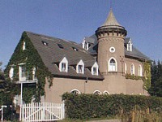
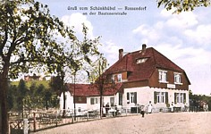
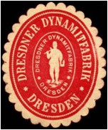

* * *

* * *

Rossendorf wurde vermutlich im 12. Jahrhundert von fränkischen Bauern gegründet,
ging jedoch bald wieder ein. Der Ort wurde 1349 als “wüst” bezeichnet und seine Fluren unter den umliegenden Orten aufgeteilt. Erst 1429 wird wieder ein Vorwerk
Rossendorf urkundlich erwähnt, welches vermutlich auf einer kleinen Anhöhe an der Alten Hornstraße lag. In diesem Jahr verkaufte Siegmund von Wartenberg für 2000
Schock Groschen “das forwerg und den Krezem” an einen neuen Eigentümer. 1554 wurde das Vorwerk an den kurfürstlichen Kanzler Kiesewetter veräußert. Die
Gebäude des Rossendorfer Rittergutes brannten während des Dreißigjährigen Krieges 1634 nieder, wurden jedoch bald wieder am neuen Standort in der Nähe des
Lockenborns aufgebaut. 1832 erwarb Johann Gottlieb Quandt das Gut und ließ es durch einen bis heute existierenden Neubau im Ortszentrum von [Eschdorf](../../../nordost/schonfeld-weissig/eschdorf/) ersetzen. Seit diesem Zeitpunkt gehörte Rossendorf als Beidorf zu Eschdorf.
Quandt entschied sich jedoch bereits acht Jahre später, das baufällige Rittergut abzutragen und an seiner Stelle einen neuen Gutshof  mit Herrenhaus im neogotischen Stil zu ersetzen _(Foto)_
. 1895 wechselte die Rittergutseigenschaft von Eschdorf wieder an Rossendorf.

1946 wurde das Rossendorfer Rittergut aufgelöst und seine Fluren an Neubauern verteilt. Für diese entstanden wenig
später fünf neue Wohnstallhäuser am Querweg bzw. im Anschluss an die bestehende Häuslersiedlung. Weitere Mehrfamilienhäuser folgten abseits des Ortskerns im Harthwald für die Beschäftigten des Kernforschungsinstitutes.

1956 wurde in der Nähe des Ortes das [Kernforschungszentrum](../../../nordost/schonfeld-weissig/rossendorf/kernforschungszentrum/) Rossendorf gegründet. Hier befand sich auch der für
Forschungszwecke genutzte erste Atomreaktor der DDR. Für das Forschungszentrum entstand ein umfangreicher Gebäudekomplex sowie ein Wasserhochbehälter, der zur Kühlung des Reaktorkreislaufes benötigt wurde. Auf dem
Gelände haben heute verschiedene Nachfolgebetriebe des 1991 aufgelösten Institutes ihren Sitz. U.a. werden hier
medizinische Forschungen zur Krebstherapie durchgeführt. Der nur aus wenigen Häusern bestehende Ort Rossendorf
kam 1994 gemeinsam mkt Eschdorf zur Gemeinde Schönfeld-Weißig und ist seit dem 1. Januar 1999 ein Ortsteil von Dresden.

Unweit des Dorfes  liegt in der Nähe des Schänkhübels der Rossendorfer Teich, in dem die [Prießnitz](../../../nordost/dresdner_heide/priessnitzgrund/) ihren Ursprung
hat. Auf der inmitten des Teiches gelegenen “Nixeninsel” soll sich der Sage nach einst eine frühchristliche Kapelle
befunden haben. Später lebten hier Nixen, welche sich gelegentlich nächtlichen Wanderern zeigten. Der Teich wird von
alters her für die Karpfenzucht genutzt. Nach 1945 folgte am südlichen Ufer eine Entenzuchtanlage. Im ausgedehnten Schilfgürtel brüten verschiedene Wasservogelarten.

Schänkhübel:

Die Anhöhe in der Nähe des Vorwerks Rossendorf erhielt 1684 den Namen Postberg, da hier die alte Poststraße nach Stolpen vorbeiführte. Diese Stelle gehörte seinerzeit zu den von Fuhrwerken am schwierigsten zu befahrenden Geländeabschnitten. Möglicherweise gab es deshalb bereits im Mittelalter an dieser Stelle eine Raststätte, da im Rahmes eines Kaufvertrages 1429 bereits ein Kretzscham Rossendorf erwähnt ist. 1802 entstand am höchsten Punkt des Anstiegs die noch heute bestehende Gaststätte “Schänkhübel”. Das heutige Gaststättengebäude wurde 1912 vom damaligen Besitzer des Rossendorfer Rittergutes Markus errichtet. 2012 übernahm nach längerem Leerstand ein neuer Betreiber das Lokal. Am 11. April 2016 wurde das Lokal bei einem Brand schwer beschädigt, soll jedoch wiederaufgebaut werden.

Dynamitfabrik:

1882 entstand im Waldgebiet der Harthe unweit von Rossendorf eine Fabrik zur Herstellung von Dynamit. Der Betrieb war neben der Dynamitfabrik zu Freiberg zweiter in Sachsen und
stellte auf dem abgelegenen Areal Nitroglyzerin her, welches dann mit Kieselgur zu Sprengstoff verarbeitet wurde. Für die Fabrik wurden mehrere Baracken, ein Kesselhaus mit
Dampfmaschine, ein Labor- und Werkstattgebäude sowie ein Arbeiterwohnhaus errichtet. Aus Sicherheitsgründen wurde das Gelände mit einem Erdwall umgeben. Das benötigte
Grundstück von ca. 7 Hektar hatte die sächsische Finanzverwaltung zuvor von den Bauern der umliegenden Orte erworben und für 23.000 Mark an die Investoren verkauft.

1883 besuchte der Dynamit-Erfinder Alfred Nobel persönlich das Rossendorfer Werk, um die geplante Gründung der vereinigten Dresdner Dynamitfabrik AG vorzubereiten. Wenig
später erwarb diese das Konkurrenzunternehmen in Freiberg, wo sich schon bald die Produktion konzentrierte. Die
produzierten Sprengstoffe fanden vor allem im Bergbau und beim Bau neuer Verkehrswege Verwendung. Bereits 1893
stellte der Rossendorfer Betrieb seine Produktion wieder ein. Teile der beweglichen Anlagen und einige Holzbauten
überführte man wenig später nach Freiberg. Da das Unternehmen seinen Stammsitz im Dresdner Zentrum behielt,
entschloss man sich, auch das Areal der stillgelegten Dynamitfabrik zu behalten. Zwischen 1923 und 1940 war dieses an
die Firma IBIS - Labor für biologisch-pharmazeutische Präparate verpachtet, welches hier Essenzen, Tinkturen und
Salben auf pflanzlicher Basis produzierte. Das Grundstück fiel danach zurück an die Forstverwaltung und wurde nach
1945 u.a. als Umsiedlerlager, ab 1956 vom Rossendorfer Kernforschungszentrum genutzt. 2010 erfolgte der Abriss der letzten erhaltenen Reste, so dass heute nur noch der Erdwall an die einstige Dynamitfabrik erinnert.

[_Weiterführende Literatur und Quellen_](../../../impressum/quellenverzeichnis/)

 \[ [Home](../../../index.html)\] \[ [Nord](../../../nord/)\] \[ [Nordwest](../../../nordwest/)\] \[ [Neustadt](../../../neustadt/)\] \[ [Nordost](../../../nordost/)\] \[ [West](../../../west/)\] \[ [Zentrum](../../../zentrum/)\] \[ [Südwest](../../../sudwest/)\] \[ [Süd](../../../sud/)\] \[ [Südost](../../../sudost/)\] \[ [Ost](../../../ost/)\] \[ [Register](../../../Register/register.html)\] \[ [Kontakt](../../../Kontakt/kontakt.html)\] \[ [Impressum](../../../impressum/)\]
