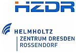
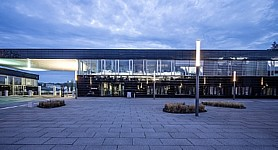
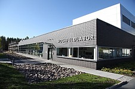
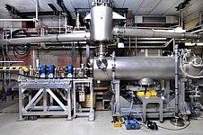
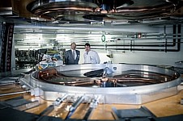

Nachdem 1955 führende deutsche Wissenschaftler aus der
Sowjetunion zurückgekehrt waren, beschloss die DDR-Führung  - mit Unterstützung der UdSSR - die Gründung eines eigenen Kernforschungszentrum. Als Standort wählte man ein Waldstück in der
Nähe von Rossendorf aus. Im Frühjahr 1956 wurde mit den Bauarbeiten begonnen. Neben Forschungslaboren und dem Reaktorgebäude wurde auch eine kleine Siedlung für die
Werksangehörigen angelegt. Am 14. Dezember 1957 konnte der Forschungsreaktor vom Typ WWR-S in Betrieb genommen werden.

Die Rossendorfer Einrichtung diente als “Zentralinstitut für Kernforschung” ausschließlich wissenschaftlichen Zwecken,
eine kommerzielle Energieerzeugung war nicht vorgesehen. Der Reaktor besaß in den Anfangsjahren eine Leistung von nur 2 MW, konnte jedoch in mehreren Ausbaustufen auf bis zu 10 MW Leistung erweitert werden. Neben dem
Reaktor entstanden in den 60er und 70er Jahren mehrere Teilchenbeschleuniger, zwei kleinere “Nullreaktoren” ohne eigene Energierzeugung sowie weitere Großgeräte. Unter der Leitung von Professor Heinz Barwich (bis 1964),
Professor Helmuth Faulstich (1964-1970) und Professor Günter Flach arbeiteten bis zu 900 Physiker, Chemiker,
Elektroniker und Techniker im Institut. Schwerpunkte der Forschungstätigkeit lagen auf dem Gebiet der Kernphysik,
der Radiochemie sowie der Entwicklung moderner Kernbrennstoffsysteme. In Rossendorf erzeugte Radio-Isotopen fanden in der Medizintechnik im In- und Ausland Verwendung. Auch mit Fragen der Materialveredlung und der
Anwendung der Kernphysik für die Mikoelektronik befassten sich die Mitarbeiter.

1987 wurde das gesamte Kernforschungszentrum umfassend modernisiert und modernen Erfordernissen angepasst. Mit der politischen Wende 1989 kamen
jedoch Sicherheitsbedenken auf, weshalb man sich 1990 zur Abschaltung des Reaktors entschloss. Das bis zur Wiedervereinigung der Akademie der
Wissenschaften der DDR unterstellte Zentralinstitut für Kernforschung wurde am 31. Dezember 1991 aufgelöst. Stattdessen siedelten sich auf dem Areal der
Verein für Kernverfahrenstechnik und Analytik (VKTA) Rossendorf e. V. und das Forschungszentrum Rossendorf e.V. an. In der Folgezeit entstand statt des
bisherigen Kernforschungsinstitutes ein modernes multidisziplinäres Forschungszentrum.

Während dem VKTA vorrangig der Abbau und die umweltgerechte Entsorgung
der kerntechnischen Anlagen obliegt, widmet sich das seit 2011 zur Helmholtz-Gemeinschaft gehörende Forschungszentrum (HZDR) heute der Radiopharmazie und Ionenstrahltechnik sowie der Energie- und
Materialforschung. Dafür werden modernste große Forschungsanlagen eingesetzt. Diese ermöglichen u.a. neue Einsichten in das Verhalten von Materie unter Extrembedingungen und intensiver Strahlung. Am Zentrum für
Hochleistungs-Strahlenquellen ELBE kann mit Hilfe des Elektronenstrahls und dem hochintensiven Lichtstrahl des DRACO-Lasers brillante Röntgenstrahlung erzeugt werden **_(Foto:_** _ELBE-Bescleuniger)_
. Außerdem sind Experimente mit Elektronen, Neutronen, Positronen sowie Gamma-, Infrarot- und Terahertz-Strahlung möglich. Im Ionenstrahlzentrum wurde u.a. 2005 die bei Nebra
entdeckte “Sternenscheibe”, eine archäologische Sensation, untersucht und altersmäßig bestimmt.

2007 nahm man in Rossendorf ein modernes Hochfeld-Magnetlabor in Betrieb,
in dem Experimente auf dem Gebiet der Festkörperphysik und des Elektromagnetismus vorgenommen werden können. Von Bedeutung sind auch
die TOPFLOW-Anlage zur Untersuchung komplexer Strömungsphänomene, das PET-Zentrum für Hochleistungs-Diagnostik in der Krebsforschung **_(Foto:_** _Teilchenbeschleuniger im Protonenstrahl-Therapiezentrum)_
sowie die Rossendorf Beamline am Europäischen Synchrotron im französischen Grenoble. Insgesamt beschäftigt das Forschungszentrum heute ca. 1.000 Mitarbeiter in
Dresden, Freiberg, Leipzig und Grenoble. Für auswärtige Wissenschaftler wurde Anfang 2012 ein modernes Gästehaus eingeweiht.

Fotos: Helmholtz-Zentrum Dresden-Rossendorf - Oliver Killig (oben links) / Frank Bierstedt (Mitte links)

Universitätsklinikum Dresden/Christoph Reichelt (unten rechts)

* * *

 \[ [Home](../../../../index.html)\] \[ [Nord](../../../../nord/)\] \[ [Nordwest](../../../../nordwest/)\] \[ [Neustadt](../../../../neustadt/)\] \[ [Nordost](../../../../nordost/)\] \[ [West](../../../../west/)\] \[ [Zentrum](../../../../zentrum/)\] \[ [Südwest](../../../../sudwest/)\] \[ [Süd](../../../../sud/)\] \[ [Südost](../../../../sudost/)\] \[ [Ost](../../../../ost/)\] \[ [Register](../../../../Register/register.html)\] \[ [Kontakt](../../../../Kontakt/kontakt.html)\] \[ [Impressum](../../../../impressum/)\]
