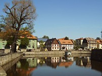
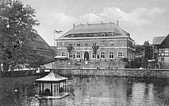
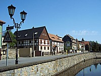
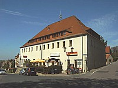
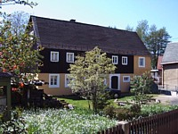

* * *

**Gemeindesiegel von Schönfeld**

**Schulen in Schönfeld:**

Als sich im 12. Jahrhundert fränkische Siedler im Hochland über dem Elbtal niederließen, entstand gemeinsam mit anderen Dörfern auch Schönfeld. Ursprünglich gehörte der Ort zu den Lehnsdörfern der Meißner Bischöfe und wurde 1315 erstmals als “Schoninvelt” urkundlich erwähnt. Zu diesem Zeitpunkt besaß Schönfeld bereits eine auch für die Nachbarorte zuständige [Kirche](../../../nordost/schonfeld-weissig/schonfeld/schonfelder_kirche/). Aus der unmittelbar benachbarten mittelalterlichen Wehranlage entwickelte sich das [Schloss](../../../nordost/schonfeld-weissig/schonfeld/schloss_schonfeld/), welches sein heutiges Aussehen im 16. Jahrhundert erhielt.

 1378 ist für Schönfeld erstmals ein Herrensitz historisch verbürgt. 1440 entstand ein Vorwerk, welches sich zum Verwaltungsmittelpunkt des gesamten Hochlandes entwickelte. Zu diesem gehörte neben dem Amtshaus das Erbgericht, eine Brauerei sowie ein Gasthof. Außerdem besaß Schönfeld das Marktrecht, was auf seine hervorgehobene Bedeutung hinweist. 1555 erwarb Hans von Dehn-Rothfelser die Herrschaft Schönfeld mit mehreren Orten und trug maßgeblich zur wirtschaftlichen Entwicklung des Dorfes und seines Umlandes bei. Nach mehrfachem Besitzerwechsel kam das Vorwerk 1831 in den Besitz der Wettiner, die es zum Kammergut umwandelten. Seit 1856 war der Ort zugleich Sitz eines königlichen Gerichtsamtes.

1908 erhielt Schönfeld durch den Bau der [Hochlandbahn](../../../nordost/schonfeld-weissig/weissig/hochlandbahn/) nach Dürrröhrsdorf und Weißig Eisenbahnanschluss, der bis 1952 bestand. In der Folge siedelten sich einige kleinere Handwerks- und Gewerbebetriebe an, darunter ein Sägewerk. Im Zuge der Bodenreform erfolgte 1946 die Auflösung des Kammergutes und dessen Aufteilung an landarme bzw. landlose Bauern. 1952 gründete sich die LPG “Vorwärts” als eine der ersten landwirtschaftlichen Genossenschaften des Landkreises Dresden, welche sich später gemeinsam mit der LPG “Drei Eichen” und der LPG Unterdorf der Weißiger LPG “Vereinte Kraft” anschloss. Für den landwirtschaftlichen Großbetrieb wurden in den 1960er und 70er Jahren Großställe und eine moderne Siloanlage am Ortsrand erbaut.

1961 wurde der Nachbarort [Reitzendorf](../../../nordost/schonfeld-weissig/reitzendorf/), 1965 auch [Zaschendorf](../../../nordost/schonfeld-weissig/zaschendorf/) nach Schönfeld eingemeindet. Gemeinsam mit Weißig und weiteren Hochlandgemeinden bildete Schönfeld ab 1994 die Großgemeinde Schönfeld-Weißig und erschloss neue Wohngebiete am westlichen Ortsrand. Seit dem 1. Januar 1999 gehört der Ort als Stadtteil zu Dresden.

Im Ortszentrum haben sich noch zahlreiche Gebäude aus der Vergangenheit des Ortes erhalten. Den Mittelpunkt bilden das Schloss und der Schlossteich sowie die benachbarte Kirche mit dem Pfarrhaus. Dieses entstand nach einem Brand im 17. Jahrhundert neu. Unmittelbar an der Schlossbrücke erinnert eine Luthereiche an den Reformator Martin Luther. Gegenüber dem Schloss befinden sich die Gebäude des früheren Kammergutes. Das ehemalige Verwalterhaus diente nach 1945 viele Jahre als Sitz der Gemeindeverwaltung, Sparkassenfiliale und als Dienststelle der Polizei. Bemerkenswert ist auch das Haus Markt 4 mit Treppengiebel. An der Einmündung der Mittelstraße steht das heute als Wohn- und Geschäftshaus genutzte markante Gebäude der früheren Brauerei _(Foto rechts)_. Die Nordseite des Schönfelder Marktes nehmen verschiedene Wohn- und Geschäftshäuser ein, darunter der frühere Gasthof “Zum Erbgericht”, welcher 2011 zu Wohnzwecken umgebaut wurde.

Sehenswert sind ferner einige Gebäude an der Mittelstraße. Unmittelbar an der Ecke zum Markt stand einst die Dorfmühle, eine zum Rittergut Schönfeld gehörende Wassermühle. Erster namentlich bekannter Pächter war der aus Loschwitz stammende Müller Johann Christoph Herrfurth, der den Mühlenbetrieb 1802 übernahm. Die Mühle besaß zwei Mahlgänge und wurde von einem oberschlächtigen Wasserrad angetrieben, wobei der Schlossteich zugleich als Mühlteich diente. Nach Einstellung des Betriebes diente das Gebäude gewerblichen Zwecken und war u.a. bis 1990 Sitz der örtlichen Postfiliale. 1994 entstand an seiner Stelle ein Wohn- und Geschäftshaus.

Auch im unteren Teil der Mittelstraße sind noch mehrere historisch interessante Wohnhäuser aus dem 18. und 19. Jahrhundert erhalten _(Foto rechts)_. In diesem Teil des Dorfes befand sich einst eine weitere Wassermühle (Mittelstraße 86),die jedoch bereits 1686 aufgegeben wurde. Später gab es unweit des Standortes eine Windmühle. An die um 1880 abgerissenen Mühle erinnert heute noch der Straßenname Mühlfeld.

Schule Schönfeld:

Traditionell war Schönfeld als Kirchdorf zugleich Schulort für seine Nachbargemeinden. Bis ins 19. Jahrhundert gehörten
auch Malschendorf, Krieschendorf, Cunnersdorf, Rockau mit Eichbusch, Reitzendorf und Schullwitz zum Schulbezirk.
Um die zahlreichen Kinder unterrichten zu können, waren diese in “Vor- und Nachmittagsschüler” eingeteilt und mussten
teilweise erhebliche Wege zum Unterricht zurücklegen. Diese Zustände führten 1837 zur Gründung von Filialschulen in
Reitzendorf und Schullwitz. Später schieden auch die meisten anderen Dörfer aus dem Schönfelder Schulverband aus.

Das heute genutzte Schulhaus an der Borsbergstraße entstand 1978 als Polytechnische Oberschule des Ortes und einiger
Nachbargemeinden. Zuvor befanden sich die Schulräume in einem Teil des Schönfelder Schlosses und dem seit 2011 als
Seniorenwohnanlage “Dr. Albert Schweitzer” genutzten alten Schulgebäude. 1990 wurde die bisherige POS zur Grund-
und Mittelschule Schönfeld umgewandelt. In diesem Zusammenhang erfolgte 1995/96 eine umfassende Sanierung. Nach
Schließung der Mittelschule im Jahr 2004 dient das Gebäude heute nur noch als Grundschule und wurde 2011/12 um einen modernen Anbau erweitert.

 \[ [Home](../../../index.html)\] \[ [Nord](../../../nord/)\] \[ [Nordwest](../../../nordwest/)\] \[ [Neustadt](../../../neustadt/)\] \[ [Nordost](../../../nordost/)\] \[ [West](../../../west/)\] \[ [Zentrum](../../../zentrum/)\] \[ [Südwest](../../../sudwest/)\] \[ [Süd](../../../sud/)\] \[ [Südost](../../../sudost/)\] \[ [Ost](../../../ost/)\] \[ [Register](../../../Register/register.html)\] \[ [Kontakt](../../../Kontakt/kontakt.html)\] \[ [Impressum](../../../impressum/)\]
