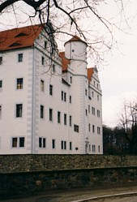
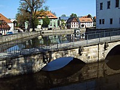
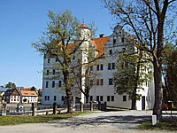

* * *

Schloss Schönfeld entstand im 16. Jahrhundert an Stelle einer mittelalterlichen Wasserburg, deren Grundstruktur in der Anlage noch erhalten ist. Ursprünglich handelte es sich wahrscheinlich um eine Turmhügelburg mit einem einfachen Wohngebäude, welche zu Verteidigungszwecken von einem Graben umgeben war. Diese 1315 erstmals genannte Burg bildete seit dem Mittelalter den politischen Mittelpunkt einer Grundherrschaft und wurde 1543 vom Hofbaumeister Hans von Dehn-Rothfelser erworben. Rothfelser trug stark zur wirtschaftlichen Entwicklung des Hochlandes bei und ließ die alte Burg zum Renaissanceschloss umbauen.

Seine Erben verkauften das Schloss 1568 an den kurfürstlichen Rat Georg von Cracow, der 1575 als Kalvinist verhaftet wurde und kurz darauf verstarb. Cracow setzte die Umbauarbeiten seines Vorgängers fort, wobei das Schloss sein heutiges Aussehen erhielt.Es besteht aus einem dreistöckigen Wohngebäude mit Zwerchgiebeln und einem sechseckigen Treppenturm im Mittelteil. Am Eingangsportal erinnern Wappen und Initialen an die Familie Cracow als Bauherren des Gebäudes. Im Inneren sind Teile der ursprünglichen Ausstattung, u.a. mehrere Kamine und Felderdecken erhalten. Weitere Raumgestaltungen stammen aus der Barockzeit.

Nach Cracows Tod wechselten häufig die Besitzer des Schlosses. So kam es u.a. in den Besitz des kurfürstlichen Kammermeisters Georg Schilling, danach in den der Familie von Loß und der Familie von Friesen. 1725 heiratete Heinrich Friedrich Graf von Friesen die Tochter August des Starken Auguste Constantia von Cosel, die drei Jahre später an den Blattern erkrankte und der Legende nach irrtümlich lebendig begraben worden sein soll. Bei einer späteren Öffnung des Sarges sollen sich Kratzspuren an der Innenseite des Sargdeckels befunden haben. Zu den Besitzern der Gutsherrschaft gehörten im 18. Jahrhundert die Familien von Callenberg und von Lüttichau.

1831 erwarben die Wettiner Schloss und Vorwerk Schönfeld und wandelten dieses zum Kammergut um. In den Schlossräumen wurde 1856 das Königliche Gerichtsamt Schönfeld eingerichtet, nachdem der Bau zuvor bereits einige Jahre als Gericht und Gefängnis gedient hatte. Nach einer Verwaltungsreform wurde dieses Amt 1871 aufgelöst, so dass das Gebäude nicht mehr benötigt und verkauft wurde. Ab 1917 war es im Besitz eines Fabrikanten, der Schloss Schönfeld 1939 an die Gemeinde verpachtete. 1945 hatte hier zeitweise die Redaktion der ersten Dresdner Nachkriegszeitung “Tageszeitung für die deutsche Bevölkerung” ihren Sitz. Später diente das Gebäude u. a. als Schule und Kindergarten des Ortes und beherbergte ein Kino und die Gemeindebücherei.

1991 begann eine umfassende Rekonstruktion des Gesamtkomplexes, der seitdem als Kulturzentrum des Ortes dient. Künftig ist noch die Einrichtung einer Gaststätte und eines für Hochzeitsfeiern nutzbaren Festsaals geplant. 2005 bezog der “Magische Zirkel Dresden”, ein Verein für Zauberkünstler, einige Räume des Schlosses und nutzt diese für seine Veranstaltungen und als Zaubermuseum. Zu sehen sind u.a. historische Requisiten und Utensilien berühmter Magier. 2012 kam eine neugestaltete historische Schwarzküche hinzu.

* * *

 \[ [Home](../../../../index.html)\] \[ [Nord](../../../../nord/)\] \[ [Nordwest](../../../../nordwest/)\] \[ [Neustadt](../../../../neustadt/)\] \[ [Nordost](../../../../nordost/)\] \[ [West](../../../../west/)\] \[ [Zentrum](../../../../zentrum/)\] \[ [Südwest](../../../../sudwest/)\] \[ [Süd](../../../../sud/)\] \[ [Südost](../../../../sudost/)\] \[ [Ost](../../../../ost/)\] \[ [Register](../../../../Register/register.html)\] \[ [Kontakt](../../../../Kontakt/kontakt.html)\] \[ [Impressum](../../../../impressum/)\]
