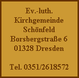
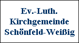
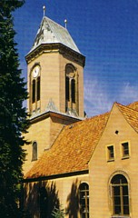
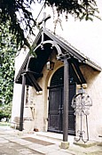

* * *

* * *

* * *

* * *

* * *

* * *

**zur Homepage der Kirchgemeinde:**

* * *

Die Schönfelder Kirche entstand vermutlich um 1300 gleichzeitig mit der Ortsgründung. Das
Gotteshaus bildete den kirchlichen Mittelpunkt des Schönfelder Hochlandes und war früher auch für die Dörfer Bühlau, Quohren und Rochwitz zuständig. Erst 1898 schieden die
letztgenannten Orte aus der Schönfelder Parochie aus und bilden seitdem eine selbständige Kirchgemeinde. Aus der romanischen und gotischen Frühzeit der Kirche sind noch einige
Mauerteile und eine mit Lilien und Kreuzen verzierte Stele im Vorraum erhalten. Diese stammt aus dem 12. Jahrhundert, war vermutlich ursprünglich Teil eines Grabsteins und
wurde später als Türeinfassung genutzt. 1902 kam sie an ihren heutigen Platz.

Mit der Reformation hielt 1539 auch in Schönfeld der evangelische Glauben Einzug. Im 17.
Jahrhundert erfolgten eine Reihe größerer Umbauarbeiten. Dabei erhielt die Kirche 1660  einen neuen Kirchturm mit einem einfachen Zeltdach. 16 Jahre später erweiterte man das
Kirchenschiff von 16 auf 25 Meter und fügte den Chorraum mit einer neuen Gruft hinzu. Mit der Anschaffung einiger neuer Ausstattungsstücke und dem Bau des Pfarrhauses 1691
konnten diese Arbeiten im Wesentlichen abgeschlossen werden.

Erst 1829 kam es erneut zu Veränderungen im Innenraum, dem nun die Emporen hinzugefügt wurden. Auch das Dach
wurde verändert und mit Dachgauben versehen. Den einschneidendsten Eingriff in die überkommene Bausubstanz brachte jedoch die Aufstockung des Kirchturms auf 54 Meter im Jahr 1895 durch Theodor Quentin. Wegen des
störenden Gesamtbildes entschloss sich die Gemeinde bereits 1935 zu einem Rückbau des Turmaufsatzes, welcher jedoch erst 1974 im Zusammenhang mit einer grundlegenden Rekonstruktion des Gebäudes vorgenommen werden
konnte. In diesem Zusammenhang verschwand auch die obere Empore und die einstige Patronatsloge. Weitere Restaurierungsarbeiten folgten in den 1990er Jahren. 2006 schlossen sich die Schönfelder und die [Weißiger Gemeinde](../../../../nordost/schonfeld-weissig/weissig/weissiger_kirche/) zu einer gemeinsamen Kirchgemeinde zusammen.

Die Schönfelder Kirche besitzt einige bemerkenswerte historische Ausstattungsstücke. Dazu gehören der 1658 von Christoph Abraham Walther geschaffene Altar mit einem Altarbild von Jonas Eywigk sowie die 1677 entstandene
Kanzel des Neugraupaer Bildhauers Peter Nacke. Auch der Taufstein stammt aus dessen Werkstatt. Jüngeren Datums sind die Jahn-Orgel sowie ein Glasbild König Alberts, die beide 1904 nach Schönfeld kamen. 1974 schuf der
Schullwitzer Kunstschmied Heini Ufer neue Kronleuchter sowie 1987 die Innengittertür im Kirchenschiff. Die drei Glocken stammen von 1850 und 1986, nachdem die Vorgänger im Ersten bzw. im Zweiten Weltkrieg zum
Einschmelzen abgegeben werden mussten.

Die 1904 gebaute Orgel stammt aus der Werkstatt von Johannes Jahn, Inhaber der Firma Jahn & Sohn aus Dresden.
Das neoromantische Orgelprospekt wurde vom Schönfelder Tischler Otto Bretschneider geschaffen. Die Orgel besitzt
27 Register, zwei Manuale und ein Pedal. Die ursprünglich spätromantische Orgel wurde bei einer Reparatur 1976
durch den Physiker und Laienorganisten Johannes Schubert teilweise verändert. Eine Restaurierung und Rückführung in den Ursprungszustand ist geplant.

In der Kirche befindet sich auch eine Reihe wertvoller Grabdenkmäler. Ältestes ist das des 1575 auf Schloss
Schönfeld verstorbenen kurfürstlichen Kanzlers Cracow in einer der Grüfte. Weitere historische Grabmale erinnern an
die Adelsfamilie Dehn-Rothfelser, die sich Verdienste um die Landwirtschaft und den Obstbau im Schönfelder Hochland erwarben. Ernst Albert von Dehn-Rothfelser verfasste 1629 das erste sächsische Buch über den Obst- und
Weinbau in diesem Gebiet. In der Großen Gruft unter dem 1678 angefügten Chorraum ruhen verschiedene Mitglieder
der Familie von Friesen, darunter Augusta Constantia von Friesen (+ 1728). Diese war als legitimes Kind von August dem Starken und der Gräfin Cosel anerkannt und heiratete später den Schönfelder Schlossherren.

* * *

Friedhof:

Der erste Schönfelder Friedhof befand sich unmittelbar an der Kirche und
entstand vermutlich bereits um 1300. Bis zum 18. Jahrhundert wurden hier die Toten aus den Dörfern zwischen Bühlau und Graupa beigesetzt. Als dieser Kirchhof zu klein geworden war, wurde 1790 der heutige Neue
Friedhof außerhalb des Ortskerns angelegt. Auf dem 1855 stillgelegten alten Kirchhof sind noch einige wenige historische Grabdenkmale erhalten geblieben. Die älteste Grabplatte stammt von
1523\. An der Straßenseite der Umfassungsmauer erinnert ein Denkmal an die Gefallenen des Ersten Weltkriegs. Der Entwurf des Mahnmals stammt von Waldo Wenzel, einem Wegbereiter der
Reformbewegung in der Friedhofsgestaltung. Ausgeführt wurde das Denkmal vom Loschwitzer Bildhauer Paul Jäckel.

Auf dem neuen Friedhof befinden sich einige Grüfte aus dem 18./19. Jahrhunert. Zu den hier beerdigten Personen gehört auch Johann Christoph Friedrich, der bis zu seinem Tod 1819 königlicher Forstzeichenschläger war. Die
Friedhofskapelle stammt von 1895.

* * *

 \[ [Home](../../../../index.html)\] \[ [Nord](../../../../nord/)\] \[ [Nordwest](../../../../nordwest/)\] \[ [Neustadt](../../../../neustadt/)\] \[ [Nordost](../../../../nordost/)\] \[ [West](../../../../west/)\] \[ [Zentrum](../../../../zentrum/)\] \[ [Südwest](../../../../sudwest/)\] \[ [Süd](../../../../sud/)\] \[ [Südost](../../../../sudost/)\] \[ [Ost](../../../../ost/)\] \[ [Register](../../../../Register/register.html)\] \[ [Kontakt](../../../../Kontakt/kontakt.html)\] \[ [Impressum](../../../../impressum/)\]
