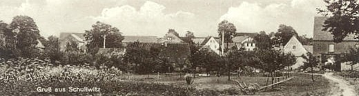

* * *

**Gemeindesiegel von Schullwitz**

* * *

Bibliothek schullwitz bühlauer str. 35 01328 dresden

Schullwitz entstand vermutlich im 12. Jahrhundert im Zusammenhang mit der Besiedlung der Schönfelder Hochlandes als Waldhufendorf. 1378 wurde der Ort in einem Zinsregister erstmals als “Schalewicz”
urkundlich erwähnt. Die Herkunft des Ortsnamens ist unklar, könnte jedoch von einem slawischen Personennamen bzw. vom Wort “saliti” = täuschen abgeleitet sein. Der Ort liegt in der Nähe der einst wichtigen Alten
Hornstraße von Dresden in die Oberlausitz, blieb jedoch trotzdem ein unbedeutendes Bauerndorf. Ab 1499 befand es sich im Besitz des Adligen Georg Karas und gehörte zum Amt Schönfeld. Außerdem mussten die Bewohner
Handdienste im Dresdner Ostravorwerk leisten. Erst im 18. Jahrhundert wechselte die Grundherrschaft zum Helfenberger Rittergut.  Kirchlich gehörte der Ort zur Parochie Schönfeld, wo sich auch die für Schullwitz
zuständige Schule befand.

1791 ist auf Schullwitzer Flur erstmals ein Steinbruch erwähnt. Abgebaut wurde hier vor allem Sandstein, wobei man im 19. Jahrhundert auch versteinerte Fossilien aus der Kreidezeit
entdeckte. Heute sind die meisten Steinbrüche verfüllt. 1808 entstand im Ort eine Wassermühle, an welche heute noch der Mühlteich erinnert. Erster Besitzer dieser Mühle war Johann Christian Walther. Später wurde sie
nach einem Besitzerwechsel auch Hilmsmühle genannt.

**_Foto:_** _Schullwitz um 1920_

1908 erhielt Schullwitz Anschluss an die [Hochlandbahn](../../../nordost/schonfeld-weissig/weissig/hochlandbahn/) Dürrröhrsdorf - Weißig, welche bis 1951 verkehrte. Trotzdem
blieb das Dorf auch weiterhin landwirtschaftlich geprägt. Im Zuge der Bodenreform entstanden drei Neubauernhöfe. In
den 1950er Jahren gründeten Schullwitzer Bauern drei Landwirtschaftliche Produktionsgenossenschaften, welche sich
1969 der Weißiger LPG “20. Jahrestag der DDR” anschlossen. 1972 errichtete diese am Ortsrand eine Siloanlage zur
Versorgung des Milchviehkombinates in Großerkmannsdorf. Heute ist Schullwitz Sitz eines Landgutes der Agrikultur
GmbH. 1994 schloss sich der Ort der Gemeinde Schönfeld-Weißig an und gehört seit dem 1. Januar 1999 zu Dresden. Nach 1990 entstand am südlichen Ortsausgang ein kleiner Wohnpark.

Am alten Verbindungsweg nach Eschdorf befand sich bis 2005 ein mittelalterliches Steinkreuz. Das über 1 Meter hohe
Kreuz wurde im 15./16. Jahrhundert vermutlich als Sühnekreuz bzw. als Erinnerung an einen Unglücksfall aufgestellt und
später in eine Feldsteinmauer einbezogen. 1860 wurde es vom Eschdorfer Pfarrer Seidemann erstmals beschrieben, geriet jedoch danach wieder in Vergessenheit. Erst 2005 konnte das historische Objekt geborgen,
restauriert und an einen neuen Platz an der Bühlauer Straße umgesetzt werden.

Schullwitzer Schule:

Nachdem die Kinder des Dorfes lange Zeit die Schule
in Schönfeld besuchen mussten, entschloss man sich 1837 zum Bau eines eigenen Schulhauses an der Bühlauer Straße 35. Der ein Jahr später eröffnete Neubau wurde teilweise von
dem aus dem benachbarten Eschdorf stammenden Mühlenbesitzer Gottlieb Traugott Bienert finanziert. Ein größeres Schulgebäude entstand 1878 und wurde bis 2004 von der Grundschule des Ortes genutzt. Ein Anbau machte sich
1968 wegen gestiegener Schülerzahlen erforderlich. Heute beherbergt das frühere Schulhaus eine Kindertagesstätte. In
der oberen Etage ist die Ortsbibliothek untergebracht. Weitere Räume werden von örtlichen Vereinen bzw. als Heimatstube genutzt.

Triebenberg:

Südlich des Ortes liegt der Triebenberg, der mit 383 m höchster Berg des Schönfelder Hochlandes ist. Der Berg war bereits vor 1945 Ausflugsziel für Wanderer und Flugbegeisterte. 1931 starteten hier erstmals die Segelflieger. Nach 1945 wurde der Berg von der Sowjetarmee besetzt, die auf dem Triebenberg bis zu ihrem Abzug am 12. Oktober 1992 eine Radarstation betrieb. Dafür entstanden einige 1998 abgerissene Wohn- und Wirtschaftsgebäude. 1999 wurde an gleicher Stelle eine Forschungseinrichtung der Technischen Universität erbaut, die hier hochempfindliche
Elektronenmikroskope installierte. 2007 kam eine am 18. Juli eröffnete Außenstelle des Lohrmann-Observatorium der TU für astronomische Beobachtungen hinzu. Herzstück war ein modernes Spiegelteleskop für die Erforschung von Asteroiden. Bereits zehn Jahre später wurde das Observatorium wieder geschlossen und die Technik demontiert.

 \[ [Home](../../../index.html)\] \[ [Nord](../../../nord/)\] \[ [Nordwest](../../../nordwest/)\] \[ [Neustadt](../../../neustadt/)\] \[ [Nordost](../../../nordost/)\] \[ [West](../../../west/)\] \[ [Zentrum](../../../zentrum/)\] \[ [Südwest](../../../sudwest/)\] \[ [Süd](../../../sud/)\] \[ [Südost](../../../sudost/)\] \[ [Ost](../../../ost/)\] \[ [Register](../../../Register/register.html)\] \[ [Kontakt](../../../Kontakt/kontakt.html)\] \[ [Impressum](../../../impressum/)\]
