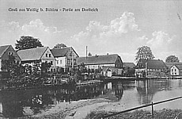
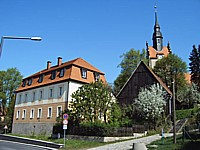
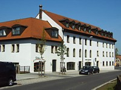
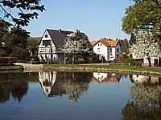
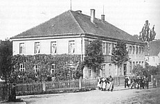
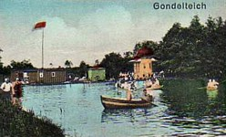
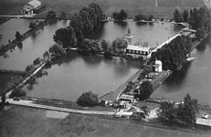

* * *

**Gemeindesiegel von Weißig**

* * *

* * *

**Bildungseinrichtungen**

**in Weißig:**

Auf dem Gebiet des heutigen Ortes Weißig lebten bereits bis zum Ende des 5.
Jahrhunderts germanische Stämme, worauf archäologische Funde hinweisen. Nach deren Wegzug siedelten sich hier Sorben an, die vermutlich auch das Dorf Weißig gründeten. Um 1200 wurden diese durch deutsche Kolonisten
verdrängt. Erstmals wurde der Name Weißig als “Wizoch” 1235 in einer Schenkungsurkunde des Dohnaer Burggrafen Otto I. an das Kloster Zelle erwähnt. Wahrscheinlich ist dieser vom slawischen “vysoki” = hoch abgeleitet,
was auf die Lage des Ortes hindeutet. Möglich ist jedoch auch die Ableitung vom fränkischen “wiz + ach” = Weißbach, falls man von einer deutschen
Gründung des Dorfes ausgeht. Noch heute ist im Ortskern die ursprüngliche Anlage mit Dreiseithöfen zu beiden Seiten des Dorfbaches zu erkennen, welche sich über Jahrhunderte hinweg kaum verändert hat _(Foto)_.

Weißig entwickelte sich seit dem Mittelalter zum typischen Waldhufendorf und
gehörte zunächst zum Besitz des Klosters Altzella, später nach einer kurzen Unterbrechung bis zur Reformation dem 1412 in Altendresden gegründeten
Augustinerkloster. 1429 zerstörten die Hussiten das Kloster und brannten in diesem Zusammenhang auch das Dorf Weißig nieder. Nach der Reformation wurde das
Augustinerkloster 1539 aufgelöst und Weißig dem Rittergut Schönfeld unterstellt. Ab 1543 gehörte dieses der Familie Dehn-Rothfelser, welche die wirtschaftliche
Entwicklung der Region förderten. Bereits zu diesem Zeitpunkt besaß der Ort eine [Dorfkirche](../../../nordost/schonfeld-weissig/weissig/weissiger_kirche/), die vermutlich um 1180 als Wehrkirche errichtet wurde. Die Bewohner
lebten vor allem vom Ackerbau. Nach Trockenlegung des größeren Dorfteiches um 1600 konnten zusätzliche Baustellen und Ackerflächen gewonnen werden, was zum Zuzug weiterer Einwohner führte.

Weißig war wegen seiner strategischen Lage in der Nähe der wichtigen Fernstraße nach Bautzen immer wieder Schauplatz kriegerischer Ereignisse. So zerstörten im Dreißigjährigen Krieg am 30. September 1631 die Soldaten
Wallensteins einen großen Teil des Dorfes mit Kirche, Pfarrhaus und Schenke. Wenige Jahre später wiederholten sich Leid und Zerstörungen durch schwedische Truppen.
Zuvor hatte eine Pestepedemie 1633 fast zwei Drittel der Bevölkerung ausgelöscht. Erst 1645 endete mit dem Waffenstillstand von Kötzschenbroda auch für Weißig der Krieg.

Der günstig gelegene [Hutberg](../../../nordost/schonfeld-weissig/weissig/hutberg/) am Ortsrand war im Siebenjährigen Krieg 1758 Standort eines Heerlagers Friedrich des
Großen. Dieser hatte bereits im Zweiten Schlesischen Krieg 1744 auf dem Weg nach Böhmen nahe Weißig kampiert.
Ein Jahr später plünderten seine Husaren den Ort und richteten große Verwüstungen an. Truppendurchzüge, Heerlager,
Zwangsrekrutierungen und Plünderungen sorgten zwischen 1756 und 1763 erneut für Not und Zerstörungen. Neben
Getreide und Heu mussten die Bewohner 1759 auch 600 Taler in Gold als “Entschädigung” dafür abliefern, dass eine erneute Rekrutierung wehrfähiger junger Männer am Mangel dafür geeigneter Einwohner scheiterte.

Auch im Mai 1813 wurde Weißig stark umkämpft und dadurch schwer in Mitleidenschaft gezogen. Russische und französische Soldaten plünderten die Höfe, zerstörten zahlreiche Gebäude und töteten 40 Einwohner. Außerdem
starben zwischen Oktober 1813 und März 1814 über 200 Dorfbewohner an Hungertyphus und anderen Krankheiten,
die materiellen Schäden wurden auf ca. 83.000 Taler geschätzt.  Der von Napoleon beim Rückzug aus der Oberlausitz
am 28. Juni 1813 als Beobachtungsposten genutzte 342 Meter hohe Buschberg östlich des Dorfkerns trägt seit dem Jahr 1900 den Namen Napoleonstein. 2010 wurde in Erinnerung an die Ereignisse ein Gedenkstein aufgestellt.

Die politischen Reformen im Sachsen des 19. Jahrhunderts brachten auch für Weißig wesentliche Veränderungen mit
sich. Mit Inkraftsetzung der Sächsischen Landgemeindeordnung konnte 1839 erstmals ein Gemeinderat gewählt werden. 1853 lösten die 120 Grundstücksbesitzer des Ortes alle noch bestehenden Abhängigkeiten vom Rittergut ab.
Zwei Jahre später endete auch die Patrimonialgerichtsbarkeit, was dem Gemeinderat weitreichendere Kompetenzen
brachte. Bis 1871 wuchs die Bevölkerungszahl auf über 1000 Personen an, die im Wesentlichen in der Landwirtschaft und den wenigen örtlichen Handwerksbetrieben bzw. in der Lohnwäscherei beschäftigt waren.

Erst nach 1900 begann auch in Weißig eine stärkere wirtschaftliche Entwicklung.
Maßgeblichen Anteil daran hatte der seit 1890 im Amt befindliche Gemeindevorstand Heinrich Lange, an den heute eine Straße erinnert. An Stelle des 1795 erbauten alten [Gasthofes](../../../nordost/schonfeld-weissig/weissig/gasthof_weissig/) entstand 1903 ein großzügiger Neubau mit Saal..
1909 schloss sich der Ort mit weiteren Gemeinden zum Zweckverband Beleuchtung zusammen und errichtete am Bahnhof ein eigenes Gaswerk. Bereits seit 1908 war Weißig Endpunkt einer [Eisenbahnstrecke](../../../nordost/schonfeld-weissig/weissig/hochlandbahn/) von Dittersbach-Dürrröhrsdorf. Gleichzeitig wurde eine Straßenbahnlinie von Bühlau nach Weißig eingerichtet, die
am 1. Juli 1908 ihren Betrieb aufnahm. Die von den Einwohnern liebevoll “Fitschl” genannte Bahn pendelte fortan zwischen dem [Ullersdorfer Platz](../../../nordost/buhlau/strassen_buhlau/ullersdorfer_platz/) und dem Weißiger Bahnhof. Trotz der recht hohen
Fahrgastzahlen scheiterte die geplante Verlegung eines zweiten Gleises, ebenso eine Verlängerung bis zum Gasthof. Mit Verbesserung der Verkehrsanbindung stieg die Einwohnerzahl bis zum Zweiten Weltkrieg auf ca. 2400 an.

1913 kamen erstmals Pläne auf, die Gemeinde Weißig nach Dresden einzugemeinden. Die durch den Ersten Weltkrieg
unterbrochenen Verhandlungen zogen sich bis 1931 hin, blieben jedoch letztlich ohne Erfolg. Daraufhin erstellte der Ort
einen neuen Bebauungsplan, um weitere Wohnsiedlungen errichten zu können. Zwischen 1934 und 1939 wurden die meisten Wege des Dorfes befestigt und ausgebaut.
Während des Zweiten Weltkrieges war Weißig Auslagerungsort verschiedener Dresdner Betriebe, u.a. der Gehe & Co. AG, welche im Saal des Gasthofes und in der Nähe des
Bahnhofes pharmazeutische Erzeugnisse lagerte. Am Rand der Dresdner Heide entstanden Baracken für Angestellte
einer Mineralölfirma. Trotz einiger Bombenabwürfe in den letzten Kriegswochen blieb Weißig von größeren Schäden verschont. Die bereits geplante Sprengung der Dorfkirche konnte von mutigen Einwohnern verhindert werden.

Nach 1945 entwickelte sich Weißig zur Zentralgemeinde des Schönfelder Hochlandes und war zeitweise Sitz des
“Rayons 2” im Landkreis Dresden. Die Straßenbahnlinie nach Bühlau wurde am 19. Februar 1949 stillgelegt und durch einen [O-Bus](../../../sudwest/lobtau/strassen_lobtau/ebertplatz/o-bus/) ersetzt, welcher bis 1971 verkehrte. Auch die Eisenbahn musste ihren Betrieb 1952 einstellen, da die
Gleise zur Erfüllung von Reparationsforderungen der UdSSR demontiert wurden. Weißig blieb jedoch auch weiterhin
Wohnvorort für Dresden. Im Zuge der Bodenreform 1946 und der folgenden Zwangskollektivierung bis 1960 wurden
die vorhandenen landwirtschaftlichen Nutzflächen der örtlichen LPG “Glückauf” zugeordnet und später an die LPG des
Nachbarortes Schullwitz angeschlossen. Für diese wurden in den 1970er Jahren mehrere große Stallanlagen errichtet.

Ab 1990 setzte im Schönfelder Hochland eine starke Bautätigkeit ein. Vor allem auf Weißiger Flur wurden mehrere große Wohn- und Gewerbegebiete angelegt. 1994
schlossen sich die Hochlandorte zur Großgemeinde Schönfeld- Weißig zusammen. Durch den Zuzug zahlreicher Dresdner Familien wuchs die Einwohnerzahl innerhalb
weniger Jahre auf über 5.500 an. Neben modernen Wohnsiedlungen entstand unter starker Einflussnahme des damaligen Dynamo- Präsidenten Rolf-Jürgen Otto auch
ein Sportkomplex mit Hotel. Wegen der zunehmenden Zersiedlung des Hochlandes geriet die Gemeinde in den 90er Jahren immer wieder in die Kritik von
Umweltverbänden und Städteplanern. Um eine weitere ungeplante Entwicklung des Ortes zu verhindern wurde Schönfeld-Weißig am 1. Januar 1999 nach Dresden eingemeindet. Trotz aller
Baumaßnahmen behielt der Ortskern mit Dorfteich, Kirche und einigen Bauerngütern bis heute sein typisches ländliches Bild.

Schulen in Weißig:

Die erste Schule in Weißig entstand bereits 1555, wobei die Unterrichtung der Kinder in Lesen, Schreiben, Rechnen und christlichem Katechismus zunächst dem Küster der Dorfkirche
oblag. 1579/80 wurde schließlich ein eigener Schulmeister eingestellt und eine Schulordnung erlassen. Der Unterricht fand zunächst in wechselnden Räumen statt,
bevor man eine eigene Schulstube einrichtete. Diese fiel 1631 den Zerstörungen des Dreißigjährigen Krieges zum Opfer
und wurde erst 1664 durch eine neue ersetzt. 1782 entstand in Weißig ein richtiges Schulhaus mit zwei Klassenräumen.
Bis 1832 besuchten auch die Kinder der Nachbarorte Pappritz und Ullersdorf diese Schule, bevor man sich zum Bau eigener Unterrichtsräume entschloss.

Nach Verabschiedung des sächsischen Volksschulgesetzes bildete sich in Weißig 1835 ein Schulförderungsverein, der
1859 gemeinsam mit dem Lehrer Eduard Stübler einen Schulneubau durchsetzen konnte. Dieser besaß neben zwei großen Schulzimmern auch zwei Lehrerwohnungen und gestattete die Einstellung eines Hilfslehrers für die ca. 180
Schüler des Ortes. Im Zuge des Bevölkerungswachstums machten sich 1880 Erweiterungsarbeiten an der Schule
erforderlich. 1893 kam noch ein Turnplatz für den Sportunterricht hinzu. Drei Jahre später wurde die Klassenzahl auf sieben, 1899 auf neun erhöht.

Das mehrfach erweiterte Gebäude _(Foto)_ diente während des Ersten und
Zweiten Weltkrieges zeitweise als Lazarett und Flüchtlingslager. Pläne für den Bau einer neuen Volksschule mit Turnhalle am Hutberg waren zuvor am
Ausbruch des Zweiten Weltkrieges gescheitert. 1949 griff die Gemeinde diese Vorkriegsplanungen erneut auf, letztlich jedoch ohne Erfolg. Um dem Platzmangel an der Schule zu begegnen, musste deshalb 1951 aus Teilen einer
Baracke der ehemaligen Mineralöl GmbH eine Behelfsschule mit zwei zusätzlichen Klassenräumen errichtet werden. Für den Sportunterricht diente ab 1951 der stillgelegte Weißiger Bahnhof, später ein Gebäude des
Rossendorfer Kernforschungsinstitutes.

Erst 1975 konnte schließlich am Gönnsdorfer Weg eine moderne Polytechnische Oberschule mit Turnhalle gebaut
werden. Die offizielle Einweihung erfolgte am 3. Oktober 1976. Im Folgejahr erhielt diese den Namen des von den
Nationalsozialisten ermordeten tschechischen Widerstandskämpfers Julius Fucik verliehen. Das alte Schulgebäude
wurde fortan als Schulhort, Gemeindebibliothek, Meldestelle und Polizeiposten genutzt. Seit 1996 befindet sich hier die
als Hutbergschule bezeichnete Grundschule des Ortes. Die neue Schule am Gönnsdorfer Weg wird als Oberschule für Weißig und einige Nachbarorte genutzt. 2013 begann für diese der Bau einer modernen Zweifeld-Sporthalle.

Gaswerk:

Am 12. September 1909 wurde am Weißiger Bahnhof der Grundstein zum Bau eines gemeindeeigenen Gaswerkes
gelegt. Kurz zuvor hatte sich der Ort mit weiteren Hochlandgemeinden zum Zweckverband Beleuchtung zusammen
geschlossen. Nachdem sich eine Mehrheit für den Bau eines Gas- statt eines Elektrizitätswerkes ausgesprochen hatte,
traten mehrere Orte jedoch wieder aus, so dass letztlich nur noch Weißig, Großerkmannsdorf und Ullersdorf im
Verband blieben. Vorsitzender war der Weißiger Gemeindevorstand Heinrich Lange. Die Erschließungsarbeiten für das
neue Gaswerk übernahm die Berlin-Anhaltinische Maschinenbau GmbH. In den Vertragsklauseln war u.a. ein Verbot
der Einführung von Elektrizität im Einzugsgebiet vorgesehen, um die erwartenden Gewinne aus dem Gasverkauf nicht zu gefährden.

Das Gaswerk wurde am 11. Mai 1910 eingeweiht und versorgte die ca. 160 Gebäude des Dorfes mit Gas. Gleichzeitig
konnte auch eine Straßenbeleuchtungsanlage in Betrieb genommen werden. Das Werk wurde mit Steinkohle betrieben,
welche zunächst per Fuhrwerk aus Zauckerode, nach Verlegung eines Anschlussgleises per Eisenbahn transportiert wurde.

Um die aus Sicht der Gemeinde ungünstigen Vertragsklauseln zu umgehen, versuchte man bereits Ende 1911, das Gaswerk an die Stadt Dresden zu verkaufen. Die komplizierten Verhandlungen wurden mit Beginn des Ersten
Weltkrieges ausgesetzt und erst 1919 wieder aufgenommen. Nach Fertigstellung einer Gasleitung von Bühlau schloss
Weißig 1922 mit Dresden einen Vertrag zur Lieferung von Stadtgas ab, der das Weißiger Gaswerk überflüssig machte. Im Oktober 1922 wurde dieses geschlossen und die Gebäude an die Tuchfabrik Simons GmbH Dresden-Weißer
Hirsch verkauft.  1926 erhielt der Ort schließlich auch elektrische Beleuchtung.  Das noch erhaltene Gaswerksgebäude wird heute von einer Pharmafirma genutzt.

Marienbäder:

Die Marienbäder wurde 1906 von Moritz Richard Scheere am Rand der
Dresdner Heide eröffnet. Scheere hatte 1898 das Gelände mit zwei bereits vorhandenen Teichen erworben und diese zur Gewinnung von Kühleis genutzt. Nach Erteilung der Genehmigung für den Badebetrieb richtete er
hier ein Luft- und Sonnenbad ein, verkaufte jedoch das Areal bereits 1908 wieder.

Unter seinen Nachfolgern entstand nun ab 1909 ein weiterer Badeteich und die Trennung des Bades in Herren- und Damenbereich.
Der dritte der von einer Quelle vom Westhang des Taubenbergs gespeisten Teiche diente in den Sommermonaten dem Gondelbetrieb _(Foto)_
. Außerdem entstanden die notwendigen sanitären Anlagen und Umkleidekabinen sowie eine kleine Badgaststätte. Ab 1912 wurde die Anlage offiziell als “Marienbäder Weißig” bezeichnet _(Luftbild)_.

1918 erwarb Gustav Friedrich Gierth das Bad und bewirtschaftete es bis zu
seinem Tod 1936. Danach übernahm seine Tochter Frieda Helbig gemeinsam mit ihrem Mann Johannes den Betrieb, welcher auch nach 1945 in Familienbesitz blieb. Erst 1965 mussten die privaten Besitzer aus Altersgründen
die Marienbäder aufgeben und überließen diese der Gemeinde Weißig. Mitte der 60er Jahre begannen Sanierungsarbeiten an den zunehmend verfallenden
Anlagen. Später folgte noch der Bau einer Bungalowsiedlung. Bis heute werden die Teiche als Bade- und Gondelteiche genutzt, seit 1999 unter Regie des Städtischen Bäderbetriebes.

[_Weiterführende Literatur und Quellen_](../../../impressum/quellenverzeichnis/)

 \[ [Home](../../../index.html)\] \[ [Nord](../../../nord/)\] \[ [Nordwest](../../../nordwest/)\] \[ [Neustadt](../../../neustadt/)\] \[ [Nordost](../../../nordost/)\] \[ [West](../../../west/)\] \[ [Zentrum](../../../zentrum/)\] \[ [Südwest](../../../sudwest/)\] \[ [Süd](../../../sud/)\] \[ [Südost](../../../sudost/)\] \[ [Ost](../../../ost/)\] \[ [Register](../../../Register/register.html)\] \[ [Kontakt](../../../Kontakt/kontakt.html)\] \[ [Impressum](../../../impressum/)\]
