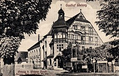
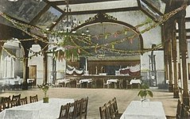

* * *

* * *

* * *

* * *

* * *

* * *

Der heutige Gasthof Weißig entstand als Brauschänke und Ausspanne und wurde früher vor allem von Fuhrleuten gern besucht, die die unmittelbar am Haus vorbeiführende Fernstraße in die Oberlausitz nutzten. Schon im 16. Jahrhundert ist diese Schankwirtschaft als Erbschänke urkundlich verbürgt. Im Dreißigjährigen Krieg wurde sie zerstört, jedoch bald wieder aufgebaut. Ab 1792 gehörte sie dem Weißiger Hufenbesitzer Samuel Großmann, der 1795 die Konzession für einen Gasthof mit Herberge erhielt. 1806 wurde hier eine Station der königlichen Hofpost eingerichtet, für welche ständig sechs Pferde im Stall bereitgehalten werden mussten.

Mehrfach wechselten nun die Pächter und Besitzer, bevor 1901 der Direktor der Dresdner Waldschlößchenbrauerei Albert Bier den Gasthof erwarb. Nach Erteilung der Baugenehmigung durch den Gemeinderat am 31. Juli 1902 konnte der alte Gasthof abgerissen und durch einen modernen Neubau ersetzt werden, der am 24. September 1903 eröffnet wurde. Neben Gast- und Wirtschaftsräumen erhielt der Bau einen 400 Personen fassenden Ballsaal _(Foto)_, der für vielfältige Veranstaltungen genutzt wurde. Ausgestattet in Jugendstilformen zeigte die Decke Darstellungen der in Weißig ansässigen Gewerke.

Neben Tanz- und Konzertabenden fanden hier auch die Versammlungen der örtlichen Vereine, Familienfeiern und Feste
für Ausflügler statt. 1919 übernahm Fritz Galle den Gasthof und führte ihn bis in die Nachkriegszeit. Während des Zweiten
Weltkrieges musste der Gaststättenbetrieb zeitweise eingeschränkt werden, da im Saal ab 1940 französische
Kriegsgefangene untergebracht waren. Zeitweise diente er auch als Behelfslazarett bzw. als Lagerraum für medizinische Produkte.

Im November 1959 entschloss sich der Wirt, seinen Gasthof aus Altersgründen an die Konsum-Genossenschaft zur
Bewirtschaftung zu übergeben. Auch unter der neuen Leitung durch die Familie Jannasch blieb der Weißiger Gasthof ein
beliebtes Ausflugslokal und Stätte für kulturelle Veranstaltungen. Bekannte Künstler der DDR, wie die “Vier Brummers”,
Eberhard Cohrs und O. F. Weidling waren hier zu Gast. Regelmäßig traf sich in den Räumen der Gemeinderat zu seinen
Sitzungen. Trotz schwieriger Rahmenbedingungen konnten Ballsaal und Gaststätte Ende der 1970er Jahre rekonstruiert werden. Allerdings fiel die historische Deckenbemalung diesen Arbeiten zum Opfer.

1992 wurde das Gebäude an die Erben der früheren Besitzer rückübertragen. Gemeinsam mit dem Pächter entschied man
sich für eine gründliche Sanierung des historischen Gebäudes. Bereits ein Jahr später wurde der Gasthof wieder eröffnet.
Heute finden hier wieder Betriebsvergnügen, Tanzveranstaltungen und private Feste statt. Höhepunkt sind die alljährlichen Veranstaltungen des Dresdner Carneval Clubs im Ballsaal. Außerdem gibt es einige Pensionszimmer.

* * *

 \[ [Home](../../../../index.html)\] \[ [Nord](../../../../nord/)\] \[ [Nordwest](../../../../nordwest/)\] \[ [Neustadt](../../../../neustadt/)\] \[ [Nordost](../../../../nordost/)\] \[ [West](../../../../west/)\] \[ [Zentrum](../../../../zentrum/)\] \[ [Südwest](../../../../sudwest/)\] \[ [Süd](../../../../sud/)\] \[ [Südost](../../../../sudost/)\] \[ [Ost](../../../../ost/)\] \[ [Register](../../../../Register/register.html)\] \[ [Kontakt](../../../../Kontakt/kontakt.html)\] \[ [Impressum](../../../../impressum/)\]
