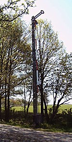
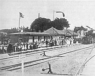
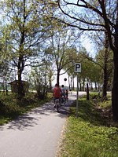

* * *

Erste Pläne zum Bau einer Eisenbahn zur besseren Erschließung des Schönfelder Hochlandes
kamen bereits um 1880 auf, als ein unter Vorsitz des Schönfelder Rittergutsbesitzers Kanitz gebildetes Eisenbahnkomitee den Bau einer Strecke vom Schlesischen Bahnhof (Bhf.
Dresden-Neustadt) über den Weißen Hirsch - Bühlau - Weißig nach Dürrröhrsdorf vorsah. Obwohl sich auch die Anliegergemeinden in entsprechenden Petitionen 1883 und 1890 für
den Bau der Bahn aussprachen, konnte dieses Vorhaben wegen der komplizierten Geländeverhältnisse und zu hoher Baukosten nicht realisiert werden.

Als Alternative sollte nun eine elektrische Straßenbahn nach Bühlau erbaut werden, wobei diese zugleich auch als Güterbahn geplant war. Am Endpunkt Bühlau war die Einrichtung
einer Übergangsstelle vorgesehen, an der die Güter auf Schmalspurbahnwagen umgeladen und dann mit Dampfbetrieb weiter bis zum Bahnhof Dürrröhrsdorf gebracht werden sollten.
Nach Eröffnung der Straßenbahnlinie Waldschlößchen - Bühlau am 22. August 1899 wurde mit den Vorarbeiten zum Bahnbau begonnen. U.a. erhielten die Gleise einen extra breiten
Abstand und wurden mit einer dritten Schiene versehen. Am 9. Mai 1900 befürwortete die sächsische Ständeversammlung eine Schmalspurbahn zwischen Bühlau und Dürrröhrsdorf.

Weitere Untersuchungen ergaben jedoch die Unrentabilität einer Schmalspurbahn. So
entschloss man sich 1904, eine regelspurige Stichbahn anzulegen, die am Bahnhof Dürrröhrsdorf begann und über Eschdorf und Schönfeld bis nach Weißig führte. Zwei
Jahre später, am 10. Mai 1906, wurde in Eschdorf in der Nähe der Kirche der erste Spatenstich vorgenommen. Um möglichst viele Orte an die Strecke anzuschließen,
verlief die neue Bahnlinie in mehreren Bögen und wurde am 30. Juni 1908 feierlich eröffnet _(Foto)_. Vorrangig diente sie dem regionalen Güterverkehr, vor allem dem
Transport von Kohle und landwirtschaftlichen Produkten. Für den Personenverkehr standen meist nur drei Wagen zur Verfügung. Mit Eröffnung der Hochlandbahn
wurde zugleich die Straßenbahnlinie 11 von Bühlau bis zum Weißiger Bahnhof verlängert.

Die Strecke hatte ihren Ausgangspunkt am Bahnhof Dürrröhrsdorf an der bereits seit 1877 verkehrenden Eisenbahnlinie
Pirna - Arnsdorf mit Abzweig nach Neustadt/Sachsen. Kurz hinter Dürrröhrsdorf wurde eine Straße auf einer großen
Brücke überquert. Weitere Stationen waren Porschendorf, Wünschendorf, Eschdorf, Schullwitz-Eschdorf, Schönfeld und Cunnersdorf, bevor der Zug nach 14,7 km den Bahnhof Weißig-Bühlau erreichte. Hier entstand ein kleines
Empfangsgebäude mit einem einfachen Güterschuppen, während an den Unterwegsstationen meist nur Wagenkästen
aufgestellt wurden. Außerdem gab es einige Wölbschleusen und kleinere Brücken. In Schönfeld blieb bis heute ein um 1910 errichtetes Bahnwärterwohnhaus (Am Sägewerk 18) erhalten.

Auch nach der Streckeneröffnung gab es immer wieder Pläne, die Bahnlinie zu verlängern und mit anderen Strecken zu
verbinden. Wegen des dann zu erwartenden höheren Verkehrsaufkommens hatte man die Trasse teilweise bereits für ein zweites Gleis ausgelegt. Projekte sahen u.a. eine Eisenbahnstrecke vom Bahnhof Weißig durch
den Prießnitzgrund nach Klotzsche bzw. nach Radeberg vor. Auch das Ursprungsvorhaben einer Direktverbindung zum Bahnhof Neustadt
lebte in den 1930er Jahren noch einmal auf, kam bedingt durch den Ausbruch des Zweiten Weltkrieges jedoch nicht zustande.

Am 23. April 1951 endete offiziell der Betrieb auf der Eisenbahnstrecke Weißig -
Dürrröhrsdorf. Neben ihrer geringen Verkehrsbedeutung waren Materialknappheit für den Erhalt und Reparationsforderungen der Sowjetunion Grund für die Stilllegung und den Abbau
der Gleise. Bereits am 19. Februar 1949 war der Straßenbahnverkehr zwischen Bühlau und Weißig eingestellt und durch eine O-Bus-Linie ersetzt worden. Trotz wiederholter
Forderungen der Anliegergemeinden zum Wiederaufbau erteilte die Reichsbahndirektion Dresden diesen 1958 eine endgültige Absage. Heute werden die Orte des Schönfelder
Hochlandes durch Buslinien erschlossen. Der frühere Bahndamm ist zum Großteil noch erhalten und dient heute streckenweise als Wander- und Radweg _(Foto),_ wobei an
verschiedenen Stellen eisenbahntypische Elemente wie Signale und Läutetafeln aufgestellt wurden. Im Weißiger Bahnhof befand sich später viele Jahre eine Schulturnhalle und das
Domizil der Fußballer der SG Weißig. An Stelle des 1992 abgerissenen Gebäudes steht heute ein Baumarkt.

* * *

 \[ [Home](../../../../index.html)\] \[ [Nord](../../../../nord/)\] \[ [Nordwest](../../../../nordwest/)\] \[ [Neustadt](../../../../neustadt/)\] \[ [Nordost](../../../../nordost/)\] \[ [West](../../../../west/)\] \[ [Zentrum](../../../../zentrum/)\] \[ [Südwest](../../../../sudwest/)\] \[ [Süd](../../../../sud/)\] \[ [Südost](../../../../sudost/)\] \[ [Ost](../../../../ost/)\] \[ [Register](../../../../Register/register.html)\] \[ [Kontakt](../../../../Kontakt/kontakt.html)\] \[ [Impressum](../../../../impressum/)\]
