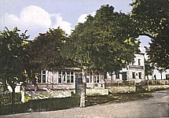
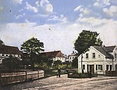
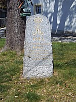
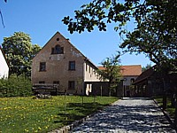
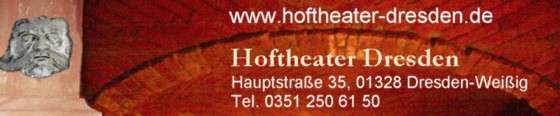
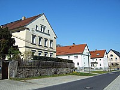
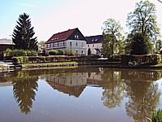
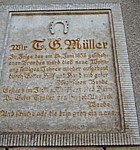

* * *

Die nördlich des Dorfkerns gelegene Straße Am Hutberg ist Teilstück eines schon im Mittelalter existierenden
Verbindungsweges, welcher von Pirna über Graupa, Zaschendorf und Pillnitz nach Weißig führte und hier auf die Straße in
Richtung Bautzen mündete. Benannt wurde sie nach dem hier gelegenen 311 Meter hohen Hutberg. In den Dreißiger Jahren war in diesem Gebiet der Bau einer neuen Volksschule für den Ort vorgesehen, welcher bedingt durch den Zweiten
Weltkrieg jedoch nicht zustande kam.

Der nach 1990 als Nebenstraße der Weißiger Talstraße angelegte Weg Am Nilgenborn erhielt seinen Namen nach dem
nahegelegenen Nilgenbornteich. Hier befindet sich die Quelle des Nilgenbornwassers, eines Zuflusses der [Prießnitz](../../../../nordost/dresdner_heide/priessnitzgrund/).

Die Straße Am Weißiger Bach entstand nach 1990 im Zusammenhang mit einem neuen Wohngebiet und erhielt ihren Namen
nach dem hier entlang fließenden Weißiger Dorfbach. Dieser entspringt südlich des Ortes, durchquert anschließend zwischen
Hauptstraße und Südstraße den alten Dorfkern und mündet schließlich in der Dresdner Heide in die Prießnitz. An der Einmündung der Straße in die Bautzner Landstraße befindet sich der Neubau des Ortsteilzentrums mit Sitz des
Ortschaftsrates, der Bibliothek und einer Filiale der Stadtsparkasse (Am Weißiger Bach 1).

Die nach 1990 angelegte Straße An der Prießnitzaue erschließt das zwischen 1991 und 1994 entstandene Gewerbegebiet
Weißig. Hier befindet sich auch das Hochland-Center Weißig, größtes Einkaufszentrum des Schönfelder Hochlandes. Am 3. Oktober 1998 wurde es eröffnet. Der Straßename erinnert an die Auenlandschaft der [Prießnitz](../../../../nordost/dresdner_heide/priessnitzgrund/), welche nördlich des Areals ihren Weg in Richtung Dresdner Heide nimmt.

Die in Stadtplänen unterschiedlich als Anton-Günther-Straße als auch -weg bezeichnete Straße befindet sich in einer kleinen
Siedlung in der Nähe der Marienbäder unmittelbar an der Ortsgrenze zu Bühlau. Benannt wurde sie nach dem erzgebirgischen Volksliederdichter Anton Günther (1876-1937). Günther schrieb über 200 Liedtexte über seine Heimat,
meist in erzgebirgischer Mundart.

Der Baudenweg enstand nach 1990 im Zusammenhang mit dem Ausbau eines Wohngebiet am Rande der Dresdner Heide. Der Name erinnert an die einstige Gaststätte Zwergbaude am Ende des Weges.

Als Bautzner Straße wurde seit 1908 der Abschnitt der Staatsstraße Dresden -
Bautzen (heute B 6) nördlich der Hauptstraße benannt, während der zwischen Bühlau und Dorfkern gelegene Abschnitt den Namen Dresdner Straße erhielt. Gleichzeitig
nahm die Straßenbahn ihren Betrieb auf, welche bis zur Stilllegung 1949 von Bühlau bis zum Weißiger Bahnhof verkehrte. Die bereits im Mittelalter wichtige
Verkehrsverbindung zwischen Elbtal und Oberlausitz wurde 1915 erstmals gepflastert und später mehrfach ausgebaut. Um Verwechslungen mit gleichnamigen Straßen in Dresden zu vermeiden, erhielten beide Abschnitte 2009 den Namen [Bautzner Landstraße](../../../../nordost/page10246/strassen_weisser_hirsch/bautzner_landstrasse/) und wurden in diesem Zusammenhang auch neu nummeriert.

Zu den Gebäuden der früheren Dresdner Straße gehören das ehemalige Wohnhaus des Gemeindevorstandes Heinrich Lange
(Nr. 7), der von den Einheimischen nach 1945  “Rotes Haus” genannte einstige Sitz der sowjetischen Ortskommandantur (Nr. 12b) sowie die Gaststätte “Schweizergarten” am früheren Bahnhof _(Foto)_
. Markantestes Bauwerk der Bautzner Straße ist der 1902 in heutiger Form entstandene [Dorfgasthof](../../../../nordost/schonfeld-weissig/weissig/gasthof_weissig/). Gegenüber befindet sich ein nach 1990 entstandene Neubau mit dem
Sitz der Ortschaftsverwaltung.

Die Bahnhofstraße erinnert an die einstige [Eisenbahnstrecke](../../../../nordost/schonfeld-weissig/weissig/hochlandbahn/) zwischen Weißig und Dürrröhrsdorf-Dittersbach, welche am
30\. Juni 1908 feierlich eingeweiht wurde. Die Bahnlinie brachte Weißig und seinen Nachbardörfern Anschluss an das Eisenbahnnetz und diente vorrangig dem Güterverkehr. Unmittelbar neben dem Bahnhof befand sich das 1922 stillgelegte
Gaswerk der Gemeinde. Außerdem bestand am Bahnhof die Möglichkeit zum Umstieg in die Straßenbahn nach Bühlau.

Mit Stilllegung der Bahnstrecke am 23.
April 1951 verlor das Bahnhofsgebäude seine Funktion und wurde fortan als Schulturnhalle und Vereinsheim der SG Weißig genutzt. 1992 wurde das Gebäude zugunsten eines Gartenmarktes
abgerissen. Gut erhalten blieb hingegen der frühere Bahndam, welcher heute als Rad- und Wanderweg dient. In Verlängerung der Bahnhofstraße trägt ein kurzer zur Fahrstraße ausgebaute Abschnitt den Namen Am alten Bahndamm.

Die erst nach 1990 angelegte Eduard-Stübler-Straße erinnert an den früheren Weißiger Lehrer und Schuldirektor Eduard Stübler (1809–1867)
. Stübler kam 1838 aus dem benachbarten Pappritz nach Weißig und übernahm hier den Schulunterricht. Zu seinen größten Verdiensten gehörte der Bau der 1859 eingeweihten neuen Schule des Ortes.

Der Erikaweg entstand in den 1990er Jahren beim Bau einer neuen Einfamilienhaussiedlung beiderseits der Hermann-Löns-
Straße. Die neuen Straßen erhielten dabei ihre Namen meist nach Pflanzenarten. Erika ist der botanische Name einer Pflanzengattung aus der Familie der Heidekrautgewächse.

Ebenso wie die benachbarten Straßen erhielt auch der Farnweg seinen Namen nach einer Waldpflanzenart. Angelegt wurde
er nach 1990 im Zusammenhang mit dem Bau einer Eigenheimsiedlung zu beiden Seiten der Hermann-Löns-Straße.

Die Forststraße nördlich des Dorfkerns wurde ursprünglich Viebigt (= Viehweg) genannt. Nach dem Entschluss des
Gemeinderates, alle Straßen des Ortes mit offiziellen Namen zu versehen, erhielt sie 1908 ihren heutigen Namen, da sie
direkt zur Dresdner Heide führte. Nach der Machtübernahme der Nationalsozialisten begann in Weißig der Ausbau des örtlichen Straßen- und Wegenetzes. In diesem Zusammenhang wurde 1934 auch die Forststraße befestigt.

Der heute Gönnsdorfer Weg genannte Abschnitt ist Teil der Verbindungsstraße zwischen Weißig und Gönnsdorf und wird
im weiteren Verlauf Weißiger Landstraße genannt. In der Nähe dieser Straße befand sich einst eine im Jahr 1800 erstmals erwähnte Bockwindmühle. Diese befand sich im Besitz des Weißiger Dorfsmüllers, welcher auch die Wassermühle im
Ortskern besaß. Anlass für den Bau der Windmühle waren häufig wechselnde Wasserstände, welche die Nutzung der Wassermühle erschwerten bzw. unmöglich machten. Heute sind von der Mühle keine Spuren mehr auffindbar. 1977
entstand am Gönnsdorfer Weg ein Schulneubau, welcher bis 1989 POS “Julius Fucik” genannt und heute von der Weißiger Mittelschule genutzt wird. Unweit davon befindet sich eine Kindertagesstätte.

Die Hauptstraße ist eine der beiden Dorfstraßen und liegt nördlich des Weißiger Dorfbaches. 1908 wurde sie offiziell von Dorf- in Hauptstraße umbenannt. Hier befinden sich die meisten der historischen Bauerngehöfte, deren Geschichte bis in die Frühzeit der Besiedlung um 1200 zurückreicht. Zu den ältesten Gebäuden gehört die frühere Brauschänke (Nr. 11), welche 1506 erstmals als Kretscham erwähnt wurde und im 16. Jahrhundert das Braurecht erhielt. Zwischen 1860 und 1870 wurde das Gebäude umgebaut und erweitert.

König-Albert-Gedenkstein: Der Gedenkstein in der Nähe der früheren Brauschänke wurde 1898 aus Anlass des 70. Geburtstages von König Albert aufgestellt. Die Finanzierung des Granitsteins übernahm der Weißiger Kaufmann Karl Angermann, welcher im Ort ein Materialwarengeschäft besaß. Die feierliche Einweihung erfolgte am 4. Dezember im Beisein mehrerer Vereine und zahlreicher Einwohner. Nach 1945 wurde das Denkmal entfernt und erst 1998 wieder an seinen ursprünglichen Platz gebracht _(Foto)_.

Nr. 15: 1910 richtete die damalige Verbandssparkasse Schönfeld auf der Hauptstraße 15 eine Filiale ein, welche nach 1945 zur Stadt- und Kreissparkasse Dresden, 1956 zur Kreissparkasse Dresden kam. Anfang der 1960er Jahre wurde diese ins Nachbarhaus Nr. 17 in die Räume der ehemaligen Gaststätte "Haases Restauration" verlegt. Heute befindet sich die seit 1999 zur Ostsächsischen Sparkasse gehörende Zweigstelle in einem Neubau (Am Weißiger Bach 1).

Dorfteich: Zwischen Haupt- und Südstraße befindet sich der Weißiger Dorfteich, welcher seine heutige Form erst 1937 erhielt. Zuvor waren Teile des deutlich größeren Gewässers zugeschüttet worden. In jüngster Vergangenheit wurde das Gelände um den Teich neu gestaltet. Künftig ist hier noch ein Spielplatz geplant

Hoftheater: Das Weißiger Hoftheater wurde 2002 in einem Dreiseitenhof auf der Hauptstraße 35 eingerichtet. Das zu den größten Weißiger Gehöften gehörende Bauerngut befand sich ab 1928 im Besitz von Viktor Wünschek, welcher sich stark für den weiteren Ausbau seines Heimatortes engagierte. Seit 1995 hat hier der Kultur- und Kunstverein Schönfelder Hochland seinen Sitz. Wenig später erwarb der Dresdner Schauspieler Rolf Hoppe die Gebäude und begann mit Hilfe des Vereins mit dem Ausbau des Hofes als Theater.

Kernstück des Hoftheaters ist die frühere Scheune, welche im Oktober 2002 als Kammertheater mit ca. 100 Plätzen eröffnet werden konnte. Im ehemaligen Kuhstall befindet sich eine kleine Gaststätte, die mit ihrer “Brettel-Bühne” auch für verschiedene musikalisch-literarische Veranstaltungen nutzbar ist. Außerdem gibt es einen großen Hof für Freilichtaufführungen, u.a. für das 1999 erstmals begangene Hoftheaterfest.

Die Heidestraße beginnt in der Nähe des alten Dorfkern und führt in Richtung Dresdner Heide. Ursprünglich war nur der südliche Teil benannt. Erst nach 1990 erfolgte im Zusammenhang mit einem Neubaugebiet eine Verlängerung der Straße.

Die Heinrich-Lange-Straße wurde im Zusammenhang mit dem Bau des Wohnparks Weißig als Ringstraße angelegt und 1993 nach dem früheren Gemeindevorstadt Heinrich Lange (1854-1928) benannt. Lange war Inhaber eines
Zimmereibetriebes in Weißig und an zahlreichen Bauvorhaben in der Gemeinde beteiligt. Ab 1890 übte er bis 1920 das Amt
des Gemeindevorstandes aus und setzte sich u.a. für den Bau der Eisenbahnstrecke nach Dürrröhrsdorf und den Ausbau des Straßennetzes im Ort ein.

Steinkreuz:
Das auch als “Mordkreuz” bezeichnete mittelalterliche Sühnekreuz befindet sich unter zwei Eichen an der Ecke Heinrich-Lange-/ Bautzner Landstraße. Das ca. 75 cm hohe Kreuz wurde vermutlich zwischen 1300 und 1500 geschaffen
und zeigt an der Vorderseite eine eingeritzte Armbrust. Der Grund seiner Aufstellung und sein ursprünglicher Standort sind
unbekannt. 1908 wurde es an die Endhaltestelle der Straßenbahn am Weißiger Bahnhof umgesetzt, dort jedoch 1921 wieder entfernt und an seinen heutigen Standort verbracht.

Sportpark Weißig:
Das Sport- und Freizeitzentrum “fun fun” wurde 1996 an der Heinrich-Lange-Straße eröffnet und besitzt u.a. mehrere Tennisplätze, eine Fußball- und Leichtathletikanlage, zwei Kunstrasenplätze und eine Skateranlage. Außerdem
gehört ein Sporthotel mit wettkampftauglicher Kegelbahn dazu. Zukünftig ist noch der Bau einer Sporthalle geplant, während die im Eingemeindungsvertrag vereinbarte Schwimmhalle nicht realisiert wurde.

Die Hermann-Löns-Straße entstand im Zusammenhang mit dem Bau einer kleinen Siedlung unmittelbar an der Ortsgrenze zu
Bühlau. Ihren Namen verdankt sie dem als “Dichter der Lüneburger Heide” bekannt gewordenen Schriftsteller Hermann
Löns (1866-1914), der zahlreiche Natur- und Tiergeschichten verfasste. Die Wege innerhalb der Siedlung sind meist nach Kräuter- und Blumennamen benannt (Chrysanthemenweg, Erikaweg, Dahlienweg usw.). Die Bezeichnung Baudenweg
erinnert hingegen an die einst beliebte Ausflugsgaststätte “Zwergbaude” an der [Ullersdorfer Straße](../../../../nordost/buhlau/strassen_buhlau/).

Die beim Bau einer neuen Wohnsiedlung angelegte und 2008 benannte Max-Kosler-Straße erinnert an den während der
NS-Zeit und in der Nachkriegszeit wegen seiner christlichen Gesinnung verfolgten und inhaftierten Weißiger Lehrer Max Kosler (1882-1966), der 1954 in den Westen floh.

Die Radeberger Straße verbindet die Bautzner mit der Ullersdorfer Landstraße und bildet die kürzeste Verbindung von
Weißig nach Radeberg. Im Zuge der offiziellen Namensgebung aller Straßen des Ortes erhielt sie deshalb 1908 den Namen
Radeberger Straße. Nach dem Ersten Weltkrieg entstanden hier einige Häuser, u.a. die 1927 als erstes größeres Geschäft
im Ort eingeweihte Markthalle Rüssel (Nr. 6). Aus wirtschaftlichen Gründen musste Alfred Rüssel seinen Laden jedoch bereits 1931 wieder aufgeben. 1994 erfolgte an der Radeberger Straße die Übergabe einer neuen Wohnsiedlung mit ca.
100 Genossenschaftswohnungen.

Die Richard-Mannschatz-Straße im Wohngebiet nördlich der Bautzner Straße wurde 2008 nach dem früheren Weißiger
Pfarrer Richard Mannschatz (1843-1931) benannt. Mannschatz hatte sich 1901 maßgeblich für den Umbau der Dorfkirche engagiert.

Die Südstraße bildet die zweite Dorfstraße im historischen Ortskern und liegt südlich des Dorfbachs. Deutlich ist an der Lage der Dreiseithöfe die Form des früheren
Waldhufendorfes erkennbar. Neben den Bauernhöfen stand hier auch die Dorfmühle, welche noch bis Anfang des 20. Jahrhunderts als Mühle und Bäckerei in Betrieb war.
Zwischen 1949 und 1971 befand sich an der Südstraße die Endstelle des [O-Busses](../../../../sudwest/lobtau/strassen_lobtau/ebertplatz/o-bus/).

Dorfmühle:
Die Geschichte der alten Wassermühle im Ortskern reicht vermutlich bis in die Entstehungszeit von Weißig zurück. Erstmals genannt ist sie im Türkensteuerregister von
1546\. Um auch bei geringen Wasserständen Mahlen zu können, veranlassten die Besitzer um 1800 den Bau einer Bockwindmühle am Ortsrand. 1848 brannte die Dorfmühle ab, wurde jedoch wenig später in
veränderter Form wieder aufgebaut. Letzter Besitzer war Johann Gottlob Trentzsch, mit dessen Tod die Geschichte der Mühle endete. 1922 entstand an deren Stelle das neue Gemeindeamt, zu dessen Finanzierung die Gemeinde zuvor das
Gebäude des nicht mehr benötigten Gaswerkes verkauft hatte (Südstraße 11).

Alte Schmiede: Bis zur Gegenwart erhalten blieb auch das Gebäude der alten Weißiger Dorfschmiede (Südstraße 1). Der
heutige Bau stammt aus dem Jahr 1858 und entstand nach einem Brand völlig neu. Eine Schrifttafel über dem Eingang mit der Darstellung eines Hufeisens erinnert noch an diese Zeit und die Tätigkeit des Hausbesitzers T. G. Müller.

**_Fotos:_** _Partie am Weißiger Dorfteich zwischen Südstraße und Hauptstraße_

_Schrifttafel an der alten Weißiger Schmiede Südstraße 1_

Die kleine Straße entstand in den Dreißiger Jahren im Zusammenhang mit dem Bau einer neuen Wohnsiedlung im Südosten
des Dorfes. Benannt wurde sie nach dem Landwirt Viktor Wünschek, der das Land für den Bau zur Verfügung gestellt hatte und auch alle Erschließungskosten übernahm. Wünschek besaß ab 1928 das Gehöft Hauptstraße 35 und gehörte zu den
wohlhabendsten und einflussreichsten Männern im Ort. In seinem Gut ist heute das Hoftheater Rolf Hoppes untergebracht.

Die Straße entstand in den 1990er Jahren im Zusammenhang mit der Anlage des neuen Weißiger Wohn- und Gewerbeparks
und wurde nach ihrer Lage nördlich des Hutbergs benannt. Hier befindet sich seit 1998 auch das weit über die Ortsgrenzen hinaus bekannte Hochlandcenter mit zahlreichen Einkaufsmöglichkeiten.

[Weißig auf OpenStreetMap](https://www.openstreetmap.org/search?query=Dresden+Wei%C3%9Fig)

* * *

 \[ [Home](../../../../index.html)\] \[ [Nord](../../../../nord/)\] \[ [Nordwest](../../../../nordwest/)\] \[ [Neustadt](../../../../neustadt/)\] \[ [Nordost](../../../../nordost/)\] \[ [West](../../../../west/)\] \[ [Zentrum](../../../../zentrum/)\] \[ [Südwest](../../../../sudwest/)\] \[ [Süd](../../../../sud/)\] \[ [Südost](../../../../sudost/)\] \[ [Ost](../../../../ost/)\] \[ [Register](../../../../Register/register.html)\] \[ [Kontakt](../../../../Kontakt/kontakt.html)\] \[ [Impressum](../../../../impressum/)\]
