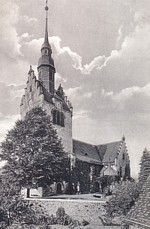
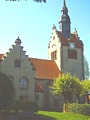
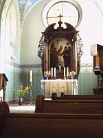
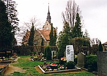

* * *

* * *

* * *

* * *

* * *

* * *

**zur Homepage der Kirchgemeinde:**

Die Dorfkirche von Weißig entstand vermutlich um bereits um 1180 als Wehrkirche. 1235 wurde sie erstmals erwähnt und gehörte zum Kirchenbezirk Radeberg des Archidiakonats Nisani. Unterstellt waren ihr neben Weißig auch die Orte Ullersdorf, Gönnsdorf, Pappritz und Teile von Bühlau. Aus der Frühzeit der Kirche ist bis heute noch der aus Feldsteinen gemauerte Kirchturm erhalten. Erster evangelischer Pfarrer wurde 1540 Johannes Richter, nachdem sein Vorgänger die Stelle im Zuge der Reformation aufgeben musste. Im Dreißigjährigen Krieg wurden Kirche und Pfarrhaus 1631 schwer beschädigt, jedoch schon bald wieder aufgebaut. 1670 erhielt die Weißiger Kirche ihre erste Orgel, die vom Schulmeister Johann Christian Feller selbst entworfen und gebaut wurde.

1744 bedrohten preußische Husaren Ort und Kirche und planten, diese in Brand zu stecken. Nur dem Mut des Pfarrers Nietzsche und der Zahlung eines größeren Geldbetrages ist die Rettung der Kirche zu verdanken. Ende des 18. Jahrhunderts machten sich größere Reparaturarbeiten an Turm und Kirchenschiff erforderlich, nachdem 1771 der Turmknauf bei einem Unwetter herabgestürzt war. Trotz dieser Baumaßnahmen behielt der Bau jedoch bis zum Ende des 19. Jahrhunderts im Wesentlichen sein überliefertes Aussehen. Eine Umgestaltung des Innenraumes erfolgte 1838 im klassizistischen Stil.

1901 begann eine komplette Erneuerung des historischen Kirchenbaus nach Entwürfen von Woldemar Kandler, welcher zuvor bereits für den Neubau der Kirche im benachbarten Bühlau verantwortlich zeichnete. Trotz einer Reihe von An- und Umbauten gelang es Kandler, das Bild der alten Dorfkirche zu bewahren und behutsam durch neue Architekturelemente zu ergänzen. Die Bauausführung oblag den heimischen Handwerksmeistern Heinrich Lange und Julius Böhmer. Der Innenraum wurde in Anlehnung an den Jugendstil im Neobarockstil gestaltet. Bereits sechs Monate nach Baubeginn konnte am 10. November 1901 die Weihepredigt gehalten werden. Das in diesem Zusammenhang installierte neue Geläut musste bereits 1917 zu Kriegszwecken abgegeben werden und wurde 1922 ersetzt.

Im Inneren der Kirche befinden sich einige Jugendstilmalereien und ein 1901 entstandenes Altarbild von Alfred Diethe “Der Gang nach Emmaus”. Die im gleichen Jahr eingebaute Orgel wurde von der Firma Jehmlich geschaffen. 1945 war die Sprengung der Kirche durch abrückende Wehrmachtsverbände geplant, die jedoch durch das Eingreifen des Pfarrers und mutiger Weißiger Bürger verhindert werden konnte. 1957/58 wurde das aus drei Glocken bestehende Geläut elektrifiziert und zugleich ein Gedenkraum für die Gefallenen des Zweiten Weltkriegs eingeweiht. 1963-1975 erfolgten unter Leitung von Fritz Steudtner Erneuerungsarbeiten im Innenraum und am Turm. Eine Verkleinerung der Kirchgemeinde gab es 1982 durch die Ausgliederung von Gönnsdorf, welches zur Bühlauer Kirche wechselte. Nach der Wende konnte schließlich die seit langem notwendige Komplettsanierung des Gotteshauses vorgenommen werden, welche mit einem Festgottesdienst am 4. November 2001 endete.

Neben der Kirche steht das sehenswerte Pfarrhaus von 1742 in barockem Stil. Das Gebäude entstand in seinen Grundzügen bereits 1728 und wurde 14 Jahre später umgebaut. Es besitzt zwei massive Geschosse und ein Mansarddach und dient bis heute seinem Zweck.  Ein einst auf dem Kirchhof aufgefundenes mittelaterliches Steinkreuz befindet sich heute in der Nähe des früheren Bahnhofes an der Bautzner Landstraße.

Friedhof:

Der Friedhof entstand kurz nach Entstehung der Kirche und wurde vermutlich
um 1235 angelegt. Über seine frühe Geschichte gibt es nur wenige Hinweise. Ursprünglich erstreckte er sich als Kirchhof unmittelbar um die Kirche und
wurde erst um 1920 erweitert. Bekannteste Persönlichkeit, die hier ihre letzte Ruhe fand, ist der sächsische General Hugo Senf von Pilsach, der 1903 verstarb.
Sehenswert sind auch einige historische Grabsteine Weißiger Bauernfamilien. 2010 wurde ein vom Bildhauer Joachim Zehme angefertigter Gedenkstein aufgestellt, welcher an die Opfer von Krieg und Gewaltherrschaft erinnert.

* * *

 \[ [Home](../../../../index.html)\] \[ [Nord](../../../../nord/)\] \[ [Nordwest](../../../../nordwest/)\] \[ [Neustadt](../../../../neustadt/)\] \[ [Nordost](../../../../nordost/)\] \[ [West](../../../../west/)\] \[ [Zentrum](../../../../zentrum/)\] \[ [Südwest](../../../../sudwest/)\] \[ [Süd](../../../../sud/)\] \[ [Südost](../../../../sudost/)\] \[ [Ost](../../../../ost/)\] \[ [Register](../../../../Register/register.html)\] \[ [Kontakt](../../../../Kontakt/kontakt.html)\] \[ [Impressum](../../../../impressum/)\]
