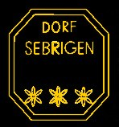
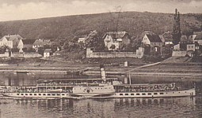
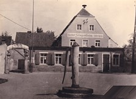

* * *

**Gemeindesiegel von Söbrigen**

* * *

Das kleine Elbdorf Söbrigen wurde vermutlich zwischen dem 6. und 7. Jahrhundert gegründet und 1378 erstmals als Cebegrin erwähnt. Der Name wurde vom slawischen Ortsgründer abgeleitet (Ort des Sebekury). Mehrfach wechselte die Schreibweise des Ortsnamens über Czebeberen und Sebiger, bevor sich ab 1759 der Name Söbrigen durchsetzte. Söbrigen gehört zu den kleinsten Dresdner Stadtteilen und besteht nur aus dem ehemaligen Rundweiler Altsöbrigen und einer kurzen Häuserzeile am Elbufer. Ursprünglich war das Dorf ein Wohnplatz von Elbfischern und -schiffern. An diesen Wirtschaftszweig erinnert noch eine Inschrift am Wohnhaus Altsöbrigen Nr. 31 von 1795. Später waren hier auch einige Kleinbauern und Häusler ansässig, die etwas Obst-, Garten- und Weinbau betrieben. Um sich ihren Lebensunterhalt zu verdienen, verdingten sich viele Frauen des Dorfes als Wäscherinnen. Noch um 1900 verkehrte regelmäßig ein “Wäscheschiff” zwischen Dresden und Söbrigen, mit welchem die Auftraggeber ihre Wäschepakete zum Reinigen schickten. Zur Söbrigener Flur gehört auch das Gebiet des vor 1438 wüst gefallenen Ortes Cloden.

_O Gott, thu die bewahren, die auf dem Wasser fahren_

_deine Hülfe thu ihn´ senden, daß wir uns zu ihn\` wenden_

_deinen Segen gieb uns güthiglich und wir dich preisen ewiglich_

JGB 1795

**Hausinschrift am Wohnhaus Altsöbrigen 31**

Söbrigen gehörte im Mittelalter zur benachbarten Siedlung Groß-Graupa und unterstand der Familie Karas auf Schloss Schönfeld. 1569 erwarb Christoph von Loß die Herrschaft Pillnitz, zehn Jahre später auch das Rittergut Großgraupa mit Söbrigen. Aus dieser Zeit stammt die enge Bindung des Ortes an das benachbarte [Pillnitz](../../nordost/pillnitz/). Kirchlich unterstand Söbrigen bis 1539 der Parochie Dohna, anschließend der [Hosterwitzer Kirche](../../nordost/hosterwitz/maria_am_wasser/). Im 18. Jahrhundert wurde der Ort in die Hofhaltung der Wettiner in Pillnitz einbezogen. 1727 bezog der kurfürstliche Hegereiter ein neu errichtetes Forsthaus am Elbweg 8 und erhielt für dieses zugleich die Schankkonzession sowie die Erlaubnis zum Betrieb einer Bäckerei und Schlachterei. Unter dem Namen "Kursächsisches Forsthaus" wude das Haus ab 1931 bis nach dem Zweiten Weltkrieg als Ausflugslokal betrieben. Ab 1765 wohnten Teile der Wachmannschaften des Pillnitzer Schlosses im Dorf. Zu den bekanntesten Bewohnern des Ortes gehörte David Samuel Roller, der seine Jugendjahre zwischen 1786 und 1795 in Söbrigen verbrachte und später Pfarrer der [Lausaer Kirche](../../nord/weixdorf/lausa/lausaer_kirche/) wurde. Roller war eng mit der Familie Kügelgen befreundet. Leider fiel sein Wohnhaus am Elbweg 6 1813 den Schanzarbeiten französischer Soldaten am Elbufer zum Opfer, wurde jedoch wenig später wieder aufgebaut.

Im 19. Jahrhundert entwickelte sich der Ort zum Ausflugsziel, nachdem hier 1896 eine Anlegestelle der Elbschiffahrtsgesellschaft eingerichtet worden war. Außerdem entstanden kleinere Handwerksbetriebe und einige Siedlungshäuser am Rande des Ortskerns. Aus dem früheren Dorfgasthof ging die beliebte, seit 1992 leider geschlossene Gaststätte “Sängerheim” hervor. Auch das einstige Café "Elbblick" am Elbeweg (Nr. 4) existiert heute nicht mehr. Zwischen 1722 und 1992 bestand auch Fährverbindung nach Zschieren. Den für die zunehmende Schiffahrt erforderlichen Ausbauarbeiten der Elbe fiel eine kleine Insel zwischen Söbrigen und Zschieren zum Opfer, die zuvor von den Bauern als Weideland genutzt worden war. Am 10. August 1950 wurde Söbrigen Ortsteil von Dresden. Zwischen 2005 und 2008 entstand am Rande des Dorfkerns eine neue Siedlung.

**_Foto:_** _Der Gasthof “Sängerheim” in den 50er Jahren_

Elbfähre Söbrigen - Zschieren

Die erste Erwähnung der Söbrigener Fährstelle stammt aus dem Jahr 1722, als der Fährmeister von Loschwitz eine
vom Söbrigener Schiffsmüller illegal betriebene “Schleiffähre” anzeigte. Diese existierte nur einige Jahre und wurde um
1740 durch eine ebenfalls nicht legal betriebene Fähre des Zschiereners Andreas Lehmann abgelöst. Ende des 18.
Jahrhunderts richtete die Gemeinde eine einfache Kahnfähre ein, die sowohl per Ruder als auch mit Segel fahren
konnte. Am 11. Februar 1821 unterzeichneten die Gemeinden Söbrigen und Zschieren schließlich einen offiziellen
Contract über die dauerhafte Einrichtung einer Fährstelle, die noch im gleichen Jahr zur Pacht ausgeschrieben wurde.

Noch bis nach dem Zweiten Weltkrieg übernahmen verschiedene Pächter den Fährbetrieb, bevor dieser 1950 an die Dresdner Verkehrsbetriebe übergeben wurde. Das dafür genutzte Motorfährschiff “Herbert” entstand 1926 auf der
Schiffswerft Zehren und wurde zunächst mit Benzin-, ab 1936 mit einem Dieselmotor betrieben. Wirtschaftliche Gründe führten am 15. April 1992 zur Stilllegung der Söbrigener Fähre.

Elbe-Staubecken:

In den Dreißiger Jahren war in der Umgebung von Söbrigen der Bau eines Elbe-Staubeckens geplant, welches dem
Ausbau der Elbe zu einer leistungsfähigen Wasserstraße für die Frachtschifffahrt dienen sollte. Geplant war die
Eindeichung einer Fläche von ca. 720 Hektar zwischen den Orten Copitz, Jessen, Graupa, Oberpoyritz, Söbrigen,
Pillnitz, Birkwitz und Pratzschwitz. Mit Hilfe des hier angestauten Wassers sollte auch bei längerer Trockenheit eine
Fahrwassertiefe von ca. 1,40 Meter gewährleistet werden. Zu Testzwecken entstand 1938 am bayrischen Walchensee ein Modell des Elbtales im Maßstab 1:100, mit welchem die von der Technischen Hochschule Dresden ermittelten
positiven Ergebnisse bestätigt wurden. Trotz einiger Vorbereitungsarbeiten kamen die Baumaßnahmen jedoch mit
Kriegsbeginn zum Erliegen und wurden auch später nicht wieder aufgenommen. Auf dem Areal des geplanten Stausees
entstanden nach 1970 mehrere Kiesgruben. Der geplante Neuaufschluss einer Grube östlich von Söbrigen wurde nach 1990 durch eine Bürgerinitiative verhindert.

[_Weiterführende Literatur und Quellen_](../../impressum/quellenverzeichnis/)

 \[ [Home](../../index.html)\] \[ [Nord](../../nord/)\] \[ [Nordwest](../../nordwest/)\] \[ [Neustadt](../../neustadt/)\] \[ [Nordost](../../nordost/)\] \[ [West](../../west/)\] \[ [Zentrum](../../zentrum/)\] \[ [Südwest](../../sudwest/)\] \[ [Süd](../../sud/)\]
 \[ [Südost](../../sudost/)\] \[ [Ost](../../ost/)\] \[ [Register](../../Register/register.html)\] \[ [Kontakt](../../Kontakt/kontakt.html)\] \[ [Impressum](../../impressum/)\]
