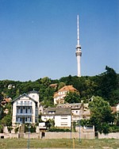
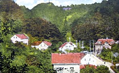
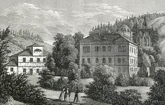
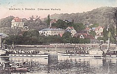
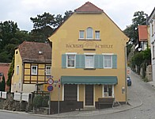
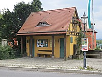
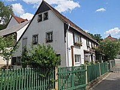
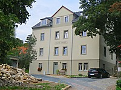
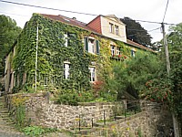
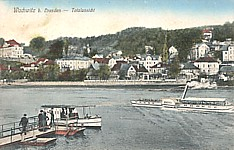

* * *

**Gemeindesiegel von Wachwitz**

* * *

* * *

**Wachwitzer Stadtteilseiten:**

Archäologische Funde im Bereich der Straße Am Steinberg weisen auf eine frühgeschichtliche
Besiedlung der Region bereits in der Eisenzeit hin. 1921 wurde beim Bau einer Villa Am Steinberg 5 ein Urnenfeld entdeckt, dessen Fundstücke der “Billendorfer Kultur” zugeordnet
werden. Obwohl weitere Siedlungsspuren fehlen, ist die zugehörige Siedlung im Bereich des Wachwitzer Weinbergs zu vermuten. Reste einstiger Hohlwege und eine in der Nähe des
Loschwitzer Friedhofes befindliche Elbfurt deuten zudem auf frühere Handels- und Botenwege hin.

Das heutige Dorf Wachwitz entstand vermutlich durch slawische Siedler im 11./12. Jahrhundert
an der Mündung des Wachwitzbaches in die Elbe. 1350 wurde der Ort im Lehnsbuch Friedrich des Strengen erstmals als “Wachwicz” erwähnt. Der Name wird entweder von einem
sorbischen Personennamen Vach oder von einer hier befindlichen Vachstätte (Fischfangstelle) abgeleitet.

1350 erhielt Conradus de Peschen das Dorf Wachwitz als Lehen. Der Dorfkern befand sich zunächst in unmittelbarer Elbnähe, dehnte sich später aber auch in den [Wachwitzgrund](../../nordost/wachwitz/wachwitzgrund/)_(Foto)_und an den Hängen entlang der
Pillnitzer Landstraße aus. Noch bis 1838 wurden beide Ortsteile getrennt in den Steuerregistern verzeichnet. Die Bewohner lebten vor allem vom Fischfang, da größere Ackerflächen fehlten. Später kamen noch Wein- und
Obstbau hinzu. 1514 erwarb der Besitzer des Rittergutes Pillnitz, Christoph von Ziegler, den Ort, der bis ins 17. Jahrhundert bei Pillnitz verblieb.

Bereits um 1600 wurde in Wachwitz ein selbstständiges Rittergut eingerichtes, welches ab 1645 mit dem Nachbarort
Niederpoyritz eine Einheit bildete und häufig seine Besitzer wechselte. Das Gut befand sich zunächst außerhalb des
Dorfes im Wachwitzgrund und war mit einer hohen Bruchsteinmauer umgeben. Im 18. Jahrhundert wechselte der Rittergutssitz nach Niederpoyritz, wo ein schlossartiger [Neubau](../../nordost/niederpoyritz/strassen_niederpoyritz/) errichtet wurde. Als besonders bedrückend wurde von
den Einwohnern die Herrschaft des Ritters Joachim von Loß empfunden, der wegen seiner Rücksichtslosigkeit und Härte
als “der böse Loߔ in die Geschichte eingegangen ist und 1609 in den Besitz von Wachwitz und Niederpoyritz gekommen
war. 1633 verstarb er und soll der Sage nach noch lange als schwarzer Hund im Pillnitzer Schloß umgegangen sein.

1824 erwarb der spätere sächsische König Friedrich August II. einige Weinberge im Ort, die er bis zu seinem Tod 1854 zu einem zusammenhängenden
Grundstück zusammenfaßte, welches fortan als [“Königs Weinberg”](../../nordost/wachwitz/wachwitzer_weinberg/) bezeichnet wurde _(Lithografie um 1850)_
. Zu diesem Areal gehörte ab 1827 auch das Rittergut mit seinen Besitzungen in Wachwitz und Niederpoyritz. 1844 wurde Wachwitz bei einem schweren [Unwetter](../../nordost/wachwitz/strassen_wachwitz/hochwasser-gedenkstein/) am 12. Mai stark getroffen und
teilweise zerstört. Nach erfolgtem Wiederaufbau entwickelte sich das einstige Fischer- und Winzerdorf zur beliebten Sommerfrische und zog Maler und Dichter
an. U. a. lebten hier zeitweise Wolf Heinrich Graf Baudissin und Woldemar Hottenroth. Aber auch Staatsbeamte, Fabrikanten und wohlhabende Pensionäre errichteten neue Häuser am Elbhang und
im Wachwitzgrund. Ihnen folgten bald mehrere Ausflugslokale und kleine Weinschänken. 1895 entstand die [Wasserkuranstalt](../../nordost/wachwitz/strassen_wachwitz/klenckescher_kurberg/) des Arztes Dr. Klenke, die später als “Ziegenalm” bekannt wurde. Bereits 1862 hatte Wachwitz eine
Anlegestelle der Elbschiffahrt erhalten, die jedoch seit 1980 nicht mehr exisitiert.

Für eine Verbesserung der Verkehrsverbindungen sorgte ab 1895 der Ausbau der [Pillnitzer Landstraße](../../nordost/loschwitz/strassen_loschwitz/pillnitzer_landstrasse/) und die 1903 eröffnete Straßenbahnlinie nach Pillnitz (1985 eingestellt). Kirchlich gehörte Wachwitz bereits seit 1706 zur Loschwitzer
Kirche, zuvor zur Dresdner Frauenkirche. 1886 erhielt der Ort Anschluss an das Loschwitzer Wasserwerk, wofür ein Wasserbehälter im Wachwitzgrund gebaut wurde. Von dort leiteten Rohre das Wasser bis zum Brunnenhaus auf
dem Dorfplatz, von wo aus es in die einzelnen Grundstücke verteilt wurde. 1900 folgte der Anschluss des Dorfes an das Elektrizitätsnetz, 1910 an die
Gasstraßenbeleuchtung.  In den Zwanziger Jahren entstanden auf der Hochfläche über dem Ort einige Eigenheime an der Hottenroth- und Waldmüllerstraße. Im gleichen Jahr eröffnete auch [Weidners Sanatorium](../../nordost/wachwitz/strassen_wachwitz/weidners_sanatorium/) am Wachwitzer Höhenpark. Am 15. Oktober 1930 wurde Wachwitz nach Dresden eingemeindet.

_Fotos: Impressionen im alten Wachwitzer Dorfkern_

Der Ort blieb im Zweiten Weltkrieg von größeren Schäden verschont und konnte deshalb sein historisches Bild
weitgehend bewahren. Das ehemalige Schloss der Wettiner wurde 1945/46 enteignet und noch bis nach 1990 als Schulungseinrichtung genutzt. Beliebte Ausflugsziele sind bis heute der 1970 entstandene Rhododendrongarten am
Wachwitzer Weinberg und der 1969 eingeweihte, seit 1991 leider für die Öffentlichkeit geschlossene [Fernsehturm](../../nordost/wachwitz/fernsehturm/).

Gemeindeamt:

Das Wachwitzer Gemeindeamt wurde 1901 am Dorfplatz (Altwachwitz 9) an Stelle eines kleinen Bauerngutes errichtet. Das neue Gebäude erhielt neben Büroräumen und
Dienstwohnungen der Gemeindeverwaltung auch Räume für das Ortsgericht, eine Volksbibliothek, die Verbandsspar- und Girokasse und das Einwohnermelde- und Wohnungsamt. Der
Sitzungssaal des Gemeinderates wurde auch nach der Eingemeindung 1930 noch für öffentliche Versammlungen genutzt. Außerdem befand sich im Gebäude bis 1991 die Wachwitzer Poststelle. Nach einer umfassenden
Sanierung 2012/13 dient das Gebäude als “Alte Post” heute Wohnzwecken.

Ortsfeuerwehr:

Die erste Feuerspritze des Dorfes wurde 1788 angeschafft. Zwanzig Jahre später entstand für diese ein Spritzenhaus am
Dorfplatz (Nr. 9a), welches zugleich als Arrestzelle für kleinere Vergehen diente. 1881 erwarb man moderneres Löschgerät und errichtete später einen hölzernen Schlauchturm
. Am 9. September 1898 gründete sich die Freiwillige Feuerwehr Wachwitz als eingetragener Verein, der auch im Kulturleben des Ortes eine wichtige Rolle spielte und bis 1935 existierte.

Postamt:

Bereits im 18./19. Jahrhundert verkehrte auf der Pillnitzer Landstraße täglich eine Botenpost, die Briefe und Pakete in die
Elbdörfer transportierte. Nach Einrichtung des Postamtes in Loschwitz verbesserte sich die postalische Versorgung. 1885
wurde schließlich in einem Wachwitzer Wohnhaus eine Posthilfsstelle eingerichtet. Diese wechselte mehrfach ihren
Standort und wurde 1914 durch ein eigenes Postamt im Gemeindeamt Altwachwitz 9 ersetzt. Zwischen 1918 und 1931
befand es sich auf der Pillnitzer Landstraße Nr. 134. Nach Rückverlegung ins Gemeindeamt blieb das Postamt bis 1991 erhalten, zuletzt als Außenstelle des Loschwitzer Amtes.

Schulen in Wachwitz:

Die Wachwitzer Schüler besuchten ursprünglich die Schule im Nachbarort Loschwitz, zu deren Finanzierung bis zum 19. Jahrhundert ein Schulgeld von jedem Haus bezahlt
werden musste. Erst am 22. Januar 1863 konnte nach mehrjährigen Bemühungen am Oberwachwitzer Weg (Nr. 6) ein eigenes Schulhaus mit zunächst nur einem
Klassenzimmer und der Lehrerwohnung eingeweiht werden. 1876 folgte ein Erweiterungsbau mit zwei weiteren Unterrichtsräumen. Die Bauausführung übernahm
der Wachwitzer Baumeister Kühn. Auf dem Schulhof wurde 1898 ein Gedenkstein aus Anlass des 25-jährigen Thronjubiläums König Alberts aufgestellt, der heute nicht mehr vorhanden ist.

Zur Verbesserung der Schulverhältnisse erwog die Gemeinde nach dem Ersten Weltkrieg einen Zusammenschluss mit der
Loschwitzer Schule, der jedoch nach der Eingemeindung von Loschwitz 1921 nicht mehr zustande kam. Stattdessen
bildete Wachwitz mit Niederpoyritz eine Schulgemeinde, für die 1921 ein kompletter Umbau des vorhandenen Gebäudes durch Rudolf Kolbe erfolgte. Auch nach der Eingemeindung 1930 blieb diese Schule erhalten und wurde 1947
Außenstelle der 62. Grundschule Dresden-Loschwitz. Zwischen 1955 und 1978 war sie Teil der 87. POS in Niederpoyritz. Nachdem dort ein moderner Schulneubau die Raumnot der letzten Jahre beendet hatte, schloss das
Wachwitzer Schulhaus im März 1978 seine Pforten. Heute dient es als Atelierhaus “Alte Wachwitzer Schule” _(Foto)_.

Elbfähre:

Erst seit 1839 besaß die Gemeinde Wachwitz die Fährgerechtigkeit, die zum
Betrieb einer Fähre nach Tolkewitz berechtigte. Die Fähre wurde gegen Entgelt an einheimische Familien verpachtet, die die Überfahrt auf eigene Rechnung
organisierten. Ab 1924 war eine Motorfähre im Einsatz. Zur Fähre gehörte auch ein kleines, 1856 von der Gemeinde errichtetes Fährhäuschen am Elbufer,
welches 1960 abgerissen wurde. Bereits drei Jahre zuvor, am 31. Dezember 1957, hatten die Verkehrsbetriebe den Fährbetrieb in Wachwitz eingestellt.

Elbebad Horey:

Das erste Elbebad des Ortes entstand bereits im 19. Jahrhundert und wurde um 1860 von einem Herrn Hottenrot
eingerichtet. Ab 1896 setzte das Elbebad Horey diese Tradition fort. Zur besseren Auslastung ihres Bades hatten die
Besitzer eine Vereinbarung mit der Laubegaster Schule geschlossen, die gegen eine jährliche Zahlung von 200 Mark den
regelmäßigen Schwimmunterricht der Schüler im Elbebad ermöglichte. Standort des Bades war zunächst am Wachwitzer
Ufer. Später wurde es auf die Tolkewitzer Seite, 200 Meter oberhalb des Landgrabens, verlegt. Betreiber waren die Familien Schäfer und Ludwig. Das Bad wurde noch vor dem Zweiten Weltkrieg geschlossen.

[_Weiterführende Literatur und Quellen_](../../impressum/quellenverzeichnis/)

 \[ [Home](../../index.html)\] \[ [Nord](../../nord/)\] \[ [Nordwest](../../nordwest/)\] \[ [Neustadt](../../neustadt/)\] \[ [Nordost](../../nordost/)\] \[ [West](../../west/)\] \[ [Zentrum](../../zentrum/)\] \[ [Südwest](../../sudwest/)\] \[ [Süd](../../sud/)\]
 \[ [Südost](../../sudost/)\] \[ [Ost](../../ost/)\] \[ [Register](../../Register/register.html)\] \[ [Kontakt](../../Kontakt/kontakt.html)\] \[ [Impressum](../../impressum/)\]
