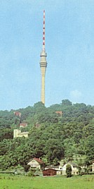
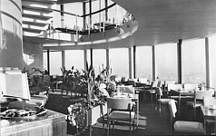

[Förderverein fernsehturm dresden c/o eberhard mittag  freiberger str. 8 01067 dresden tel. 0351/4954223](http://www.VereinFernsehturmDresden.de)

Der Dresdner Fernsehturm entstand zwischen 1964 und 1969 auf Wachwitzer Flur in 121 m Höhe über dem Elbtal (230 m NN). Architekt des Stahlbetonbaus war Kurt Nowotny, die Statik wurde von Dr. Hermann Rühle berechnet. Architektonisch orientierte sich der Turm an der Form eines Sektglases. 1963 begann mit Legung des Fundamentes der Bau. Auf einem Stahlbetonring von 21 Metern Durchmessern wurde zunächst der Turmschaft errichtet und in einem damals neuartigen Verfahren mit einer ballonartigen Dederonhülle versehen, um auch im Winter die Arbeiten fortsetzen zu können. Mit Erreichen der geplanten Höhe des Betonschafts von 167,15 Meter feierten die Bauleute am 15. Dezember 1965 das Richtfest. Anschließend wurde die Stahlkonstruktion für die Antenne aufgesetzt und der Innenausbau vorgenommen. Nach über fünfjähriger Bauzeit konnte der Turm am 7. Oktober 1969 offiziell eröffnet werden. Der eigentliche Sendebeginn hatte bereits am 18. September stattgefunden. Mit 252 m Höhe ist der Fernsehturm höchstes Bauwerk in Dresden. Im Inneren des “Kelches” befinden sich acht Etagen, in denen die technischen Anlagen des Turmes untergebracht sind. Zwei Schnellaufzüge führen zur Aussichtsplattform und dem ehemaligen Turmcafé _(Postkarte um 1970)_.

Obwohl der Fernsehturm hauptsächlich zur Verbesserung der Rundfunk- und Fernsehversorgung in Dresdner Raum gebaut worden war, entwickelte er sich schnell zur Touristenattraktion. Neben der Aussichtsplattform in 148 m Höhe wurde auch ein Turmcafé mit 150 Plätzen für die Besucher eingerichtet. Zusätzlich zur neu erbauten Zufahrtsstraße war ursprünglich noch der Bau einer Drahtseilbahn vom Elbtal zum Turm geplant, welche aus Kostengründen jedoch nicht realisiert wurde. Die hierfür bestimmten Ausrüstungsteile kamen
später in Thale/Harz zum Einsatz. Auch die geplante Großgaststätte zu Füßen des Turms kam nie zu Stande. Reste der bereits geschaffenen Fundamente sind noch in der Nähe des Turmes erkennbar. Trotz der unvollständigen Realisierung aller Planungen besuchten in Spitzenzeiten bis zu 200.000 Besucher im Jahr den Turm.

Nach Übernahme des Fernsehturms durch die Telekom im Jahr 1991 wurde der Turm für die Öffentlichkeit geschlossen. Alle Pläne für eine Wiedereröffnung scheiterten bislang an den hohen Investitions- und Betriebskosten. Lediglich die für die Übertragung der Rundfunk- und Fernsehsignale erforderliche Technik wurde in den letzten Jahren erneuert und um Anlagen für den Richt- und Mobilfunk erweitert. 1996 ließ die Stadt Dresden Pläne für einen Sport- und Freizeitkomplex am Fuße des Fernsehturms erarbeiten. Auch ein Hotelneubau war geplant, allerdings ohne Erfolg. Seit 2004 engagiert sich ein Verein für die Wiederbelebung des beliebten Ausflugsziels.
