Die Agneshöhe in der Siedlung am Wachberg erhielt als jüngste Straße dieses Wohnviertels ihren Namen am 20. März 1936
nach der Ehefrau des Malers Woldemar Hottenroth, der viele Jahre in Wachwitz lebte. Am Ende der Straße liegt ein gleichnamiger Aussichtspunkt, von dem sich ein schöner Rundblick über das Elbtal bietet.

Der Barfußweg wurde 1934 so benannt, da er von den Kurgästen der früheren [Kuranstalt Hermann Klenckes](../../../nordost/wachwitz/strassen_wachwitz/klenckescher_kurberg/) zum
Barfußlaufen genutzt worden war. Zuvor wurde er als Wohnweg 11 und Fußweg B (Stufenweg) bezeichnet. Bis 1923 gehörte er als Privatweg dem Besitzer des Grundstücks Ulrich. Ältestes Gebäude ist das Haus Nr. 4; die anderen
Wohnhäuser entstanden erst in den 1930er Jahren.

Der Eichendorffsteig verbindet den Wachwitzgrund mit dem auf der Höhe gelegenen Stadtteil Rochwitz. Seinen Namen erhielt
er 1907 auf Beschluss des Wachwitzer Gemeinderats nach dem romantischen Dichter Joseph Freiherr von Eichendorff (1788-1857). An dessen nicht verbürgten Aufenthalt in Wachwitz erinnert eine Gedenktafel an einem Felsen.

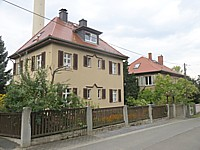
Die Siedlung an der Hottenrothstraße entstand ab 1928 durch die “Siedlervereinigung Wachwitz und Umgebung”. Initiatoren waren der Grafiker und Oberlehrer Albert Herold
und der Lehrer und Gemeindevertreter Georg Müller. Nach einem Bebauungsplan von Edmund Schuchardt wurden hier bis 1939 mehrere Einfamilien- und Doppelhäuser
errichtet. 1931 erhielt die Straße den Namen des Wachwitzer Malers Woldemar Hottenroth (1802-1894). Auch die benachbarte Waldmüllerstraße erinnert an einen
zeitweise in Wachwitz lebenden Künstler - den Dichter Robert Waldmüller. Weitere Straßen in diesem Gebiet wurden nach dem Schriftsteller Otto Ludwig und der Ehefrau Hottenroths benannt (Agneshöhe).

Der Name Josef-Herrmann-Straße erinnert an den bekannten Opernsänger Josef Herrmann (1903-1955), der ab 1939 an
der Dresdner Staatsoper engagiert war. Herrmann gehörte nach 1945 zu den Aktivisten des wiederentstehenden Kulturlebens
in der Stadt und stand u.a. am 22. September 1948 bei der Wiedereröfnung des Schauspielhauses auf der Bühne. Die Straße selbst wurde 1908 als Straße F angelegt und hieß ab 1911 Am Königsweinberg. 1946 wurde dieser Name in Am
Wachwitzer Weinberg geändert, bevor 1962 die bislang letzte Umbenennung folgte.

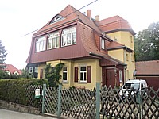Die Gebäude entstanden meist kurz nach der Jahrhundertwende und wurden teilweise von
Wachwitzer Künstlern bewohnt. So lebte im Haus Nr. 7 _(Foto)_ der Maler und Grafiker Woldemar Müller (1860-1923). Müller hatte von 1880 bis 1884 an der Dresdner [Kunstgewerbeschule](../../../zentrum/johannstadt/strassen_johannstadt/kunstgewerbeschule/) studiert und war später als Professor an dieser Einrichtung tätig.
1897 trat er dem Verein für Sächsische Volkskunde bei und gehörte zu den Unterstützern des Oskar-Seyffert-Museums (Museum für Volkskunde). Sein Wachwitzer Wohnhaus
ließ er sich nach eigenem Entwurf 1912 erbauen. Das Nachbarhaus Nr. 9 bewohnte viele Jahre der der Maler Oskar Starke.

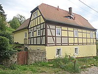Der Oberwachwitzer Weg wurde vor der Eingemeindung als Pappritzer Weg bzw.
Pappritzer Fußsteig bezeichnet, da er den Ort mit dem benachbarten Pappritz verband. Im unteren Teil hieß der steil ansteigende Weg Schlosserberg bzw. Schulberg. Die Gebäude
in diesem Bereich stammen noch aus der dörflichen Vergangenheit des Ortes. Das erste Haus (Nr. 2 - _Foto_), ein zweiflügliger Fachwerkbau wird bereits 1681 erwähnt und
gehörte damals Hannß Zeibig. Vor dem Gebäude befand sich ein zum Schutz mit einem Geländer umgebenes “Wasserfangloch”, wohl eine Art Zisterne. Die gegenüberliegende
Villa (Nr. 1) wurde 1883 als Sommerwohnung des Hofrates Bruno Stübel erbaut.

Sehenswert sind auch die Fachwerkhäuser Nr. 3, Nr. 5 und Nr. 10 aus dem 19. Jahrhundert. Um 1800 hatte die Gemeinde
diese Grundstücke an bauwillige Einwohner verkauft. Heute stehen die meisten Gebäude in diesem Abschnitt als Baudenkmale unter Schutz. Das Grundstück Oberwachwitzer Weg ist seit 1862 Standort der früheren Wachwitzer Schule.
Seit ihrer Schließung 1978 wird das Gebäude als Wohnhaus genutzt.

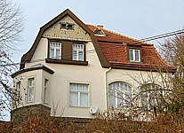Weitere Gebäude entstanden im 19. Jahrhundert als Wohn- und Sommerhäuser
wohlhabender “Zuzügler”. 1895 ließ sich der Unternehmer Moritz Hartung die Villa Oberwachwitzer Weg 7 errichten. Ab 1938 wohnte hier der Fabrikdirektor und Entomologe Manfred Koch. Haus Nr. 9 _(Foto)_
gehörte ab 1932 dem Kammervirtuos Max Scherzer. Zu den jüngeren Bauten zählt das 1935 erbaute Einfamilienhaus Nr. 5a. Hier wohnte viele Jahre der Soloklarinettist der Staatskapelle Karl Schütte (1891-1977).
Der Musiker war Professor an der Hochschule für Musik “Carl Maria von Weber” und wurde für seine Verdienste zum Ehrenmitglied der Staatskapelle ernannt. Ursprünglich
gehörte das Grundstück zum Bauerngut Leischke am Dorfplatz, wurde jedoch später in Parzellen aufgeteilt.

Eine weitere größere Villa wurde 1889 am Oberwachwitzer Weg 16 erbaut. Erste Besitzerin war die Baronin Louise von
Rhoeden, die ihr Haus “Villa Louisenheim” nannte. Hier zweigt der Königsweg ab, Rest eines früher von Pillnitz bis zum
Wachwitzer Weinberg durchgehenden Höhenweges. Zum Grundstück gehörte einst auch der kleine Aussichtspunkt “Louisens Lust”, der noch an einem Podest oberhalb Villa erkennbar ist.

Der Straßenname Ohlsche geht auf eine alte Flurbezeichnung zurück, deren Bedeutung unklar ist. Früher wurde diese
Verbindung auch als Rochwitzer Weg bezeichnet. Noch bis 1885 dominierten hier Weinberge, von denen einer zeitweise im Besitz von Ferdinand Avenarius war.

Die Otto-Ludwig-Straße in Oberwachwitz entstand 1935 nach Erweiterung einer Kleinhaussiedlung “Am Wachberg”.
Ursprünglich sollten die Gebäude bereits 1932 für die “Interessen- und Baugemeinschaft Wachwitz” errichtet werden.
Allerdings verzögerte die schwierige wirtschaftliche Lage und die 1932 erlassene Notverordnung den Baubeginn. Bis 1938
entstanden hier 13 Siedlungshäuser. Der Name der Straße erinnert an einen Besuch des Schriftstellers 1844 in Wachwitz.
Otto Ludwig (1813-1865) lebte ab 1849 ständig in Dresden und gehörte hier der “Montagsgesellschaft”, einem Kreis von
Dichtern, Komponisten und Malern, an. Seine Wohnungen in der Innenstadt fielen 1945 den Bomben zum Opfer, sein Grab befindet sich auf dem [Trinitatisfriedhof](../../../zentrum/johannstadt/trinitatisfriedhof/).

Die Pressgasse gehört zu den ältesten Wegen in Wachwitz und führte aus den Weinbergen des Rittergutes zur Presse an der
Pillnitzer Landstraße. Das frühere Winzerhaus wurde um 1940 abgerissen. Im oberen Teil der Straße ließ Konteradmiral
Wilhelm Korreng um 1930 eine Villa errichten (heute Josef-Herrmann-Straße). Architektonisch interessant ist das 1826 für Johann Gottlob Rosenkranz entstandene Wohnhaus Pressgasse 4, welches unter Denkmalschutz steht.

Die Schwenkstraße erhielt ihren Namen 1937 nach dem Maler Georg Schwenk und dessen Vater, dem Bildhauer Friedrich Wilhelm Schwenk. Das Wohnhaus Schwenkstraße 5 wurde vom Architekten Edmund Schuchardt erbaut.

Der Name Victor-Böhmert-Weg erinnert an den früheren Besitzer des Grundstücks Ohlsche 12, den Geheimen Regierungsrat Prof. Carl Victor Böhmert (1829-1918). Böhmert studierte in Leipzig Rechts- und Staatswissenschaften und
leitete zwischen 1856 und 1860 das “Bremer Handelsblatt”. Nach Lehrtätigkeit an der Universität Zürich ließ er sich 1875 in
Dresden nieder und war Direktor des Statistischen Büros und bis 1903 Professor an der Technischen Hochschule.  Die nach ihm benannte kurze Verbindungsstraße wurde 1925 angelegt.

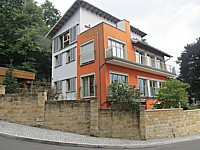Als erstes Gebäude in diesem Teil des Wachwitzer Elbhangs existierte seit 1896 der [Klenckesche Kurberg](../../../nordost/wachwitz/strassen_wachwitz/klenckescher_kurberg/), der später auch als “Ziegenalm” bekannt wurde. Erst nach der
Jahrhundertwende begann der Ausbau eines alten Wirtschaftsweges zur Fahrstraße. Da dieser Straßenbau zunächst privat finanziert worden war, hieß der untere Teil nach dem
Besitzer des hier liegenden Grundstücks zunächst Dr.-Weingart-Straße, der obere Abschnitt an der Einmündung des Oberwachwitzer Wegs Rußigsche Privatstraße. Otto
Rußig hatte diesen Abschnitt als Zufahrt zu seinem Anwesen “Bergnest” anlegen lassen. 1911 erfolgte die Umbenennung beider Straßenteile in Bergstraße. Mit der Eingemeindung
des Ortes wurde, um Verwechslungen mit der gleichnamigen Straße in der Südvorstadt zu vermeiden, der Zusatz beigefügt.

Ab 1910 wurden an der neu angelegten Straße die ersten Villen erbaut, denen nach dem Ersten Weltkrieg weitere
Wohnhäuser folgten. Interessanteste Bauten sind die 1912 errichtete Jugendstilvilla Nr. 16 und die von Oskar Grunewald
entworfene Villa Oberwachwitzer Bergstraße 42, die 1938 mit einem Ehrenpreis für vorbildliche baukünstlerische Ausführung
ausgezeichnet wurde. An gleicher Stelle war zuvor der Bau einer Kirche für den Ort geplant. Auf der Wachwitzer Bergstraße 20 wohnte ab 1945 bis zu seinem Tod der Maler und Grafiker Otto Schubert (1892-1970).

Nr. 5 / 7:  Beide Häuser wurden 1925 auf dem Gelände des früheren Kurberges erbaut, wobei man für die Villa (Nr. 5) und
das  zugehörige Torhaus (Nr. 7) wahrscheinlich die Fundamente des alten Kurhauses und des Speisesaales nutzte. Auch in
Stil und Größe orientiert sich die Villa am ehemaligen Kurhaus Hermann Klenckes. Besitzer war der Dresdner Konditor
Ehrhard Schmorl, Inhaber der bekannten Konditorei Schmorl auf der Wilsdruffer Straße. 1947 bezog der zuvor in der Villa Wachwitzer Bergstraße 8 untergebrachte Kindergarten das Haus.

Nr. 8:
Die Villa entstand kurz vor Beginn des Ersten Weltkrieges. Bauherr und erster Bewohner des Gebäudes war der Fabrikbesitzer Walter Geißler. 1941 erwarb der Kaufmann Franz Trunkel das Haus. Nach 1945 diente es kurzzeitig als
Kindergarten.

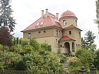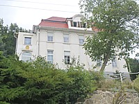

**_Fotos:_** _Villen an der Wachwitzer Bergstraße: Nr. 8 (links) und Nr. 16 (rechts)_

Nr. 14:
Diese Villa wurde 1912 für den Fabrikanten Siegfried Meurer erbaut. Später befand sich hier viele Jahre ein Heim für Ordensschwestern des Dresdner [St.-Joseph-Stifts](../../../zentrum/johannstadt/st__joseph-stift/).

Nr. 16: Zeitgleich mit dem Nachbarhaus entstand kurz vor dem Ersten Weltkrieg die Jugendstilvilla Wachwitzer Bergstraße
16\. Bis 1945 wohnte hier der Kunsthistoriker Professor Hans Wolfgang Singer (1867-1957). Singer war lange Zeit Kustos des Kupferstichkabinetts und veröffentlichte zahlreiche kunsthistorische Schriften.

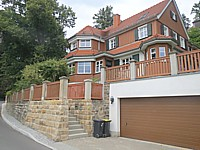Nr. 22: Eine wechselvolle Geschichte weist dieses Grundstück auf. Ursprünglich zum Plantagengut gehörend, standen hier um 1900 die Liegehallen der Kuranstalt Klenckes. Nach der Einstellung des Kurbetriebs wurde das Gelände in mehrere Parzellen aufgeteilt und an Bauwillige verkauft. Das heutige Wohnhaus ließ sich der Fabrikant Karl Zschoche errichten. Ab 1940 gehörte es dem Motorsportler und Unternehmer Gerhard Müller. Müller war Initiator der Internationalen Motorboot- Rennen in Dresden und Gewinner des “Großen Preises von Elbflorenz”. Nach einer Haftstrafe wegen angeblicher Wirtschaftsvergehen Ende der 1950er Jahre ging er nach Österreich. Das Haus wurde daraufhin von der Staatssicherheit beschlagnahmt und bis 1989 als konspirativer Treff des DDR-Geheimdienstes genutzt.

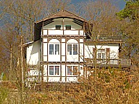“Bergnest” (Nr. 27): Das Grundstück wurde 1857 vom Schriftsteller Charles Edouard Duboc erworben, der später unter dem Pseudonym Robert Waldmüller seine Werke veröffentlichte. Auf seinem Besitz ließ er sich ein Sommerhaus errichten, welches er als “Bergnest” bezeichnete. Am Rande des Grundstück befand sich die “Klause”, in der ein Großteil seiner Werke entstand. Waldmüllers Wachwitzer Haus war im 19. Jahrhundert ein beliebter Treffpunkt der Künstler der Dresdner “Montagsgesellschaft”. Später wohnte hier Otto Rußig, der zur besseren Erschließung des Geländes den ersten Abschnitt der Wachwitzer Bergstraße auf eigene Kosten ausbauen ließ. Nach 1945 lebte im “Bergnest” die Kammersängerin Elisabeth Reichelt _(Foto: Wikipedia / Brücke-Osteuropa)._

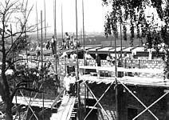Nr. 30: Das Haus wurde 1931 im Bauhausstil für den Hauptwachtmeister der Wohlfahrts-Polizei Otto Fleischer erbaut, der es bis 1946 bewohnte. In diesem Jahr erwarb es der Kunsthändler Horst Kempe. Im Zuge einer Enteignungswelle gegen Kunst- und Antiquitätenhändler in der DDR durch die Stasi-Abteilung "Kommerzielle Koordinierung" (KOKO) wurde der Eigentümer 1974 enteignet und nach zeitweiser Inhaftierung in den Westen abgeschoben. Die Familie zwang man im Folgejahr, ihr Haus an einen Mitarbeiter der DDR-Staatssicherheit zu verschenken, um so in die Bundesrepublik ausreisen zu dürfen. Geplant war, das gesamte Areal rund um die Villa Nr. 22, die als Gästehaus für hochrangige Staatsfunktionäre gedacht war, in den Besitz der Stasi zu bringen. Nachdem sich diese Planungen jedoch zerschlugen, verkaufte man das Haus an private Eigentümer. Heute befindet sich hier eine kleine Pension. Die historische Aufnahme zeigt den Bau des Hauses 1930/31.

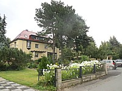Die Waldmüllerstraße wurde 1931 im Zusammenhang mit dem Bau der “Siedlung am
Wachberg” in Oberwachwitz angelegt und nach dem Dichter und Schriftsteller Charles Edouard Duboc (Pseudonym Robert Waldmüller) (1822-1910) benannt. Waldmüller wohnte ab 1857 im “Bergnest” in Wachwitz und war Mitglied der Dresdner
“Montagsgesellschaft” sowie Präsident der “Deutschen Schiller-Stiftung”. Zur Versorgung der Bevölkerung des neuen Wohngebietes entstand Mitte der 1930er Jahre im Haus
Waldmüllerstraße 20 die Getränke- und Lebensmittelhandlung Sieber. 1947 übernahm der Konsum das Geschäft und führte es bis 1992.

Die Wollnerstraße entstand 1927 durch Ausbau eines schmalen Privatweges und wurde nach dem Besitzer des angrenzenden
Grundstücks, dem Fabrikbesitzer Robert Wollner, benannt. Wollner gehörte auch dem Wachwitzer Gemeinderat an und hatte
1898 das Areal aus dem Besitz von Justus Friedrich Güntz erworben und 1908 mit einer Villa bebauen lassen (Am Steinberg
14). Kurzzeitig hieß die Straße auch Parkstraße. 1931 errichtete der Baumeister Max Riedrich eine Villa im Bauhausstil (Wollnerstraße 3), der in den Dreißiger Jahren weitere Wohnhäuser folgten.

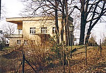

**_Foto:_** _Die Villa Wollnerstraße 3_

[Wachwitz auf OpenStreetMap](https://www.openstreetmap.org/search?query=Dresden+Wachwitz)

* * *

 \[ [Home](../../../index.html)\] \[ [Nord](../../../nord/)\] \[ [Nordwest](../../../nordwest/)\] \[ [Neustadt](../../../neustadt/)\] \[ [Nordost](../../../nordost/)\] \[ [West](../../../west/)\] \[ [Zentrum](../../../zentrum/)\] \[ [Südwest](../../../sudwest/)\] \[ [Süd](../../../sud/)\] \[ [Südost](../../../sudost/)\] \[ [Ost](../../../ost/)\] \[ [Register](../../../Register/register.html)\] \[ [Kontakt](../../../Kontakt/kontakt.html)\] \[ [Impressum](../../../impressum/)\]
