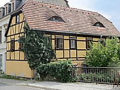
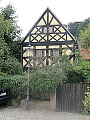
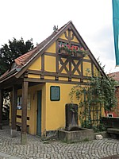
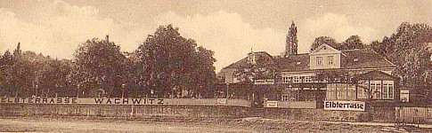
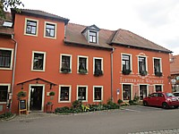
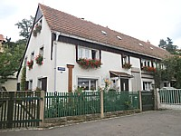
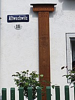

* * *

Der frühere Dorfplatz von Wachwitz wird seit 1931 nach der Eingemeindung Altwachwitz genannt. Hier befindet sich der Kern des als slawischer Rundling gegründeten Ortes mit zahlreichen Fachwerkhäusern. Die ursprüngliche Form des slawischen Rundlings ist durch bauliche Veränderungen und den Ausbau der [Pillnitzer Landstraße](../../../../nordost/loschwitz/strassen_loschwitz/pillnitzer_landstrasse/) kaum noch zu erkennen. In der Mitte des Platzes stand früher der Dorfbrunnen mit der Linde. Seit dem 19. Jahrhundert wurden in den früheren Häusleranwesen teilweise kleine Geschäfte und Gewerbebetriebe eingerichtet.

Bemerkenswert sind die Häuser Altwachwitz Nr. 1 (Bäckerei), Nr. 3 (ehem.
Dorfschmiede) und Nr. 4 _(Foto links)_. An letzterem weist ein Schlussstein von 1824 mit einem Fisch auf das Gewerbe der früheren Besitzer hin. Später befanden sich hier
eine Schuhmacherwerkstatt, ein Lebensmittel- und Kramwarenlädchen und eine Materialwarenhandlung. Die heutigen Besitzer des Fachwerkhauses unmittelbar am
Ufer des Wachwitzer Baches betreiben in den Sommermonaten eine kleine Besenwirtschaft. Das Gebäude Nr. 5, vermutlich um 1700 erbaut, ist eines von zwei
Umgebindehäusern im Ort, welche eigentlich nur in der Oberlausitz verbreitet sind _(Foto rechts)_. Weitere Gebäude mussten dem Straßenausbau und der späteren
Neubebauung einiger Grundstücke weichen. Erhalten blieben die Fachwerkhäuser an der Zufahrt zur “Elbterrasse” (Nr. 10 und 12), die zu den malerischsten Ensembles des Ortes gehören.

Im Zusammenhang mit dem Straßenausbau der heutigen Pillnitzer Landstraße kam es auch zu
Eingriffen in die Bausubstanz des alten Dorfkerns. So mussten bereits 1882 zwei kleine Häuschen dem Neubau des Wohn- und Geschäftshauses Altwachwitz 2 weichen. Da sich hier
von Beginn an wechselnde Läden befanden, wurde das Gebäude im Volksmund “Kaufhaus” genannt. So gab es bis 1912 die Kolonialwarenhandlung Fickler, später die Delikatessen- und
Drogenhandlung Rusche & Ahnert, einen Lebensmittelladen und ab 1946 die “Elbe-Drogerie”. 1972 verzog diese, inzwischen unter Regie des “Konsum” nach Altwachwitz 7.

Im 1901 an Stelle von Leischkes Hof errichteten Gebäude Altwachwitz 9 befand sich viele Jahre die Gemeindeverwaltung und die Poststelle des Ortes. Außerdem waren hier die
Gerätschaften der Freiwilligen Feuerwehr untergebracht. Das benachbarte Ausgedingehaus (Nr. 9a), im Volkmund “Arresthaus” genannt, diente viele Jahre als Dienstsitz und Wohnhaus des Ortspolizisten.

Brunnenhaus:
Das kleine Gebäude entstand um 1900 an Stelle des früheren Dorfbrunnens, nachdem der Ort Wasseranschluss erhalten hatte. Hier befanden sich eine Verteilerstation für
die Leitungen der einzelnen Grundstücke und eine öffentliche Tränke mit Sandsteintrog und einem Wasserspeier in Form eines Delphins. Die Quelle wird von den Wachwitzern auch
“Elefantenbrunnen” genannt, da hier 1916 zwei als Zugtiere eingesetzte Elefanten des Zirkus Sarrasani getränkt wurden. Zugleich diente der kleine Bau als Straßenbahnwartehalle.

Um 1925 entstand im Gebäude eine Schaltstelle des Telegraphenamtes. 1988 wurde unmittelbar neben dem Brunnenhäuschen ein [Hochwassergedenkstein](../../../../nordost/wachwitz/strassen_wachwitz/hochwasser-gedenkstein/) aufgestellt, der sich
zuvor an der Brücke über den Wachwitzbach befunden hatte. Der Stein erinnert an die Verwüstung des Ortes bei einem Unwetter 1844.

Gaststätte Elbterrasse:
Das Gebäude (Altwachwitz 14) bildet den südlichen Abschluss des Dorfplatzes in Richtung Elbe. 1870 wurde hier die Gaststätte “Elbterrasse”
eingerichtet, welche sich damals im Besitz der Familie Reißig befand. Als zusätzliche Attraktion für die Besucher des Lokals ließ Besitzer Heinrich August Reißig um die
Jahrhundertwende im Garten eine Windmühle, die sogenannte “Weibermühle” errichten. Ein nahegelegener Gedenkstein mit der Aufschrift “Hier liegen Moreaus Beine nicht” spielte auf das auf der Räcknitzhöhe befindliche [Moreaudenkmal](../../../../sud/racknitz/schlacht_bei_dresden/) an. Zwischen 1980 und 1991 bewirtschaftete der Konsum das Lokal. Nach einer
längeren Schließzeit wurde die Gaststätte im August 1996 wieder eröffnet. Neben verschiedenen Gasträumen und einem Biergarten am Elbufer gibt es auch einige Pensionszimmer.

Am Nachbarhaus (Nr. 16) sind mehrere Hochwassermarken zu sehen, welche an frühere Elbefluten erinnern. Der schmale Weg zum Elbufer führte früher zum 1960 abgerissenen Fährhäuschen, an dem die heute eingestellte [Fähre](../../../../nordost/wachwitz/) nach Tolkewitz abfuhr.

_Fotos: Altwachwitz Nr. 16 mit Hochwassermarken_

* * *

 \[ [Home](../../../../index.html)\] \[ [Nord](../../../../nord/)\] \[ [Nordwest](../../../../nordwest/)\] \[ [Neustadt](../../../../neustadt/)\] \[ [Nordost](../../../../nordost/)\] \[ [West](../../../../west/)\] \[ [Zentrum](../../../../zentrum/)\] \[ [Südwest](../../../../sudwest/)\] \[ [Süd](../../../../sud/)\] \[ [Südost](../../../../sudost/)\] \[ [Ost](../../../../ost/)\] \[ [Register](../../../../Register/register.html)\] \[ [Kontakt](../../../../Kontakt/kontakt.html)\] \[ [Impressum](../../../../impressum/)\]
