* * *

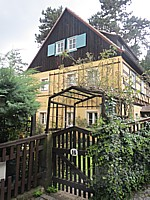Die Straße Am Steinberg führt vom Dorfkern am Elbufer zur Josef-Herrmann-Straße und von dort als Teil des alten Wachwitzer Kirchweges weiter in Richtung Loschwitz. Benannt wurde sie 1902 nach dem hier an die Oberfläche der Heidesandterrasse tretenden Schotter und Granitgestein. Zuvor war auch der Name Oberer Steinbergweg geläufig. Einst gab es hier Weinberge, die wegen ihrer Zugehörigkeit zum Wachwitzer Rittergut als Herrenberge bezeichnet wurden. Im unteren Teil stehen noch einige Fachwerkhäuser (Nr. 16 und 18) aus dem 18. Jahrhundert _(Foto: Am Steinberg 16)_. Ältestes Gebäude ist das Winzerhaus Am Steinberg 9, welches im 19. Jahrhundert zum Sommersitz des sächsischen Ministers Dr. Conrad Wilhelm Rüger umgebaut wurde. Bis heute sind noch Teile der parkähnlichen Anlage und der Innenausstattung erhalten geblieben. Weitere Grundstücke befanden sich im Besitz wohlhabender Dresdner Unternehmer und Künstler.

Einzelne Gebäude:

Nr. 1: Das 1907 für den Kaufmann Arthur Münch errichtete Gebäude wird auch als Landhaus Eichenhof bezeichnet und steht unter Denkmalschutz.

Nr. 2: Das Gebäude wurde 1908-10 als Wohn- und Atelierhaus für den Maler Osmar Schindler (1867-1927) erbaut. Architekt war Richard Schleinitz. Osmar Schindler schuf vor allem Historien- und Wandbilder sowie Porträts und war ab 1900 zugleich Lehrer an der Dresdner Kunstakademie.

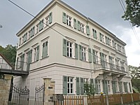Nr. 3 (Villa Baudissin): Das Haus entstand Anfang des 19. Jahrhunderts auf einem Wachwitzer Weinbergsgrundstück. 1840 erwarb die aus der wohlhabenden Bankiersfamilie Kaskel stammende Pianistin Sophie von Baudissin das Areal und bewohnte es bis 1878 gemeinsam mit ihrem Mann, dem Schriftsteller und Übersetzer Wolf Heinrich Graf von Baudissin. Hier entstanden einige seiner bedeutendsten Übersetzungen, u.a. der Dramen Shakespeares und des Gesamtwerkes von Molière. Regelmäßig traf sich das Paar in seinem Wachwitzer Sommersitz mit befreundeten Künstlern, u.a. mit Gustav Freytag, Karl Gutzkow und Woldemar Hottenroth..

Das Gebäude besaß ursprünglich nur zwei Stockwerke, wurde jedoch um 1860 aufgestockt und erhielt dabei sein heutiges Äußeres. Um 1900 teilten die Besitzer die Villa in Mietwohnungen auf ließen ein zusätzliches Treppenhaus an der Rückseite anbauen. 2009 wurde das Haus unter Wahrung der denkmalgeschützten Fassade und vieler Architekturdetails saniert.

Nr. 4: Die Anfang des 20. Jahrhunderts für Dr. Hugo Kratz erbaute Villa war viele Jahre Wohnsitz des Kammersängers Fred Teschler (1926-1997). Teschler, der von Beruf eigentlich Journalist war, absolvierte nach dem Zweiten Weltkrieg eine Gesangsausbildung und gehörte ab 1955 dem Ensemble der Dresdner Staatsoper an.

Nr. 5 (Lippoldsche Villa): Das nach seinem ersten Besitzer benannte Haus entstand 1921. Ab 1930 wohnte hier der Unternehmer Dr. Franz Josef Koch, welcher 1904 mit einem Geschäftspartner die Elektromaschinenfabrik [Koch & Sterzel](../../../../nordwest/ubigau/strassen_ubigau/koch___sterzel/) gegründet hatte. Beim Bau der Villa wurde ein Urnengräberfeld der “Billendorfer Kultur” aus der Eisenzeit entdeckt, welches auf eine frühgeschichtliche Besiedlung der Gegend hinweist. Nach der Enteigung Kochs 1946 diente die Villa viele Jahre als Kinderheim.

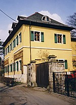Nr. 9: Das frühere Winzerhaus ist ältestes Gebäude der Straße und stammt in seinen Grundzügen wahrscheinlich aus dem 17. Jahrhundert. Ende des 19. Jahrhunderts kam es in den Besitz des Dresdner Bürgermeisters und sächsischen Ministers Dr. Conrad Wilhelm Rüger, der es jedoch nur in den Sommermonaten nutzte. Ab 1890 ließ Rüger das Grundstück parkartig gestalten. U.a. gab es einen Ziehbrunnen, einen kleinen Tempel und ein Gärtnerhaus. Die Wasserversorgung erfolgte über eine Quelle am Fußweg nach Rochwitz. Ursprünglich gab es noch einen zweiten Zugang, an den noch zwei Torsäulen an der Einmündung der Wollnerstraße erinnern. Im Inneren des Gebäudes sind noch Teile der barocken Ausstattung erhalten.

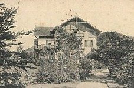Nr. 11 (Villa Asta): Dieses Haus, Villa “Asta” genannt, befand sich ab 1862 im Besitz des Verlegers und Stifters Justus Friedrich Güntz. Das Grundstück wurde zuvor als Weinberg genutzt und gehörte zum Areal Wachwitzgrund 17. Nachdem Tod von Güntz ging es 1881 in den Besitz des Unternehmener Julius Robert Spies über. 1898 übernahm es sein Sohn Albert. Seit 1906 ist das Grundstück mit der gegenüber liegenden Villa Wollner durch eine Brücke verbunden. Diese ermöglichte den Familien Spies und Wollner (Robert Wollner war der Schwiegersohn von Julius Robert Spies) einen ungehinderten Zugang zu den Nachbarn. Hier wohnte auch viele Jahre der Maler, Grafiker und Bildhauer Robert Spies (1886-1914). Nach einer künstlerischen Ausbildung, u.a. bei Sascha Schneider, und mehrere großen Reisen besaß er ein Atelier im Loschwitzer [Künstlerhaus](../../../../nordost/loschwitz/strassen_loschwitz/pillnitzer_landstrasse/kunstlerhaus/) und wohnte ab 1899 im elterlichen Haus Am Steinberg 11 bzw. 14.

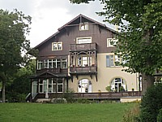Nach dem Ersten Weltkrieg wechselten mehrmals die Besitzer des Gebäudes. Ab 1941 lebte hier der Schriftsteller Josef Johann Horschik (1874-1955). Er gehörte er in den 1920er Jahren dem geistig-künstlerischen Kreis um Ida und Erwin Bienert an und verfasste neben lyrischen Werken mehrere Novellen sowie den Roman "Johannes Lister". Sein Grab befindet sich auf dem Loschwitzer Friedhof. Seit 1951 dient die Villa als Kinderheim.

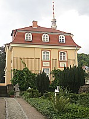Nr. 13: (Villa Hottenroth): Das Gebäude entstand 1904/05 für den Major a. D. Johannes Hottenroth, Sohn des Malers Woldemar Hottenroth, dem zeitweise die Leitung des Kriegsarchivs Dresden oblag. Die Bauplanung übernahm der Architekt Wilhelm Kreis, der sich für eine Gestaltung im Neobarockstil entschied. Die Fassade wird durch verschiedene Ornamentfelder, kleine Balkone und eine altanartige Veranda gegliedert. Mit diesen Elementen sollten dem Haus Anklänge an ländliche sächsische Barocktraditionen verliehen werden. Zeitgenössische Architekturkritiker bezeichnen den Bau als “festlich und heiter einladend” und sprechen von einem Haus, “das etwas von einem Schmuckstücke zu haben scheint”.

Um 1925 lebte hier der Verlagsbuchhändler Ernst Schobloch, der mit seinem Verlag “Wittig & Schobloch” als Herausgeber der “Dresdner Wanderbücher” bekannt wurde. Später betrieb er gemeinsam mit seinem Berufskollegen und Nachbarn (Nr. 11) Georg von Kommerstädt den Verlag “Von Kommerstädt und Schobloch”. Bekanntestes Werk des kleinen Verlages sind die “Jugenderinnerungen eines alten Wachwitzers” von Edmund Hottenroth.

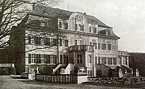Nr. 14 (Villa Wollner): Das Gebäude geht in seinen Grundzügen auf das 18. Jahrhundert zurück und gehört zu den größten am Wachwitzer Elbhang. Der frühere Weinberg gehörte ursprünglich der alteingesessenen Familie Ehlich, die das Areal 1844 an Johannes Hinck verkaufte. 1861 erwarb der Herausgeber des “Dresdner Anzeigers” Justus Friedrich Güntz den Hinckeschen Weinberg und ließ sich 1875 das bestehende Wohnhaus zur Villa umbauen. Außerdem entstand eine Gärtnerei zur Zucht von Ananaspflanzen mit Wasserturm. Der zugleich als Aussichtsturm dienende Bau wurde 1959 gesprengt. Weitere Gebäude dienten als Kutscherhaus (Nr. 12), Gärtnerhaus (Nr. 10) und Geflügelhaus (Wollnerstraße 14). Für den Bau der Villa musste 1875 das alte Wachwitzer Armenhaus abgerissen werden. Dieses war eine einfache, aus Lehmziegeln gebaute und mit einem Strohdach gedeckte Behausung für die ärmsten Bewohner des Ortes. Als Ersatz ließ die Gemeinde 1873 ein neues Armenhaus im [Wachwitzgrund](../../../../nordost/wachwitz/wachwitzgrund/) (Nr. 74) errichten.

1881 kam das Grundstück in den Besitz des Großindustriellen Julius Robert Spies. Dessen Schwiegersohn, der Fabrikbesitzer Robert Wollner, beauftragte 1908 Wilhelm Kreis, die Villa im Neobarockstil zu erweitern. Das schlossartige Anwesen erhielt eine neue Zufahrt, großzügige Treppen- und Terrassenanlagen und einen Park mit Plastiken und einem Teepavillon. Als Verbindung zur benachbarten Villa “Asta” wurde eine Brücke errichtet. In den Neubau wurden die Kellerräume und ein als Musikzimmer genutzter Raum mit Stuckelementen integriert. Der plastische Schmuck am Haus stammt von Karl Weinberger, einige Putten und Vasen schufen Georg Wrba und Rudolf Born.

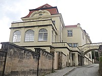Nach Wollners Tod wechselte das Haus mehrfach seinen Besitzer und diente seit 1930 als Heilerziehungsheim der Sächsischen Erholungsfürsorge. Hier wurden jugendliche Bettnässer untergebracht und behandelt. Nach Verlegung der Einrichtung nach Moritzburg bezog kurzzeitig der Reichsarbeitsdienst das Gebäude, bevor es im Oktober 1933 vom SS-Sonderkommando "Sachsen" übernommen wurde. Unter Leitung des später als KZ-Kommandanten berüchtigten Karl Otto Koch (1897-1945 war hier eine Spezialeinheit der SS stationiert. Dabei kam es auch zu einer Umgestaltung der Innenräume. Im Untergeschoss der Violla befanden sich neben dem Heizungskeller die Küche, im Erdgeschoss waren Tages- und Schulungsräume sowie der Speisesaal untergebracht. Das Ober- und das Dachgeschoss dienten als Unterkunft der ca. 50-60 Personen.

Nachdem im April 1934 das SS-Kommando in die Gebäude des ehemaligen [Maria-Anna-Kinderhospitals](../../../../nordwest/trachenberge/trachenberge_-_sozialeinrichtu/) in Trachenberge umgezogen war, übernahm eine SS-Sportschule die ehemalige Wollner-Villa, die hier u.a. die Sportausbildung für lokale SS-Einheiten durchführte. Erster Leiter war Walter Vogt, mehrfacher sächsischer Gaumeister im Skisport. Nach 1945 diente die Villa bis 1990 als Wohnheim der Pädagogischen Hochschule. Heute befinden sich hier Wohnungen.

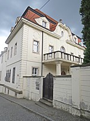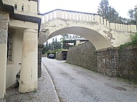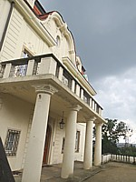

**_Fotos:_** _Die Wollner-Villa (Am Steinberg 14) - Fassadendetails und Brücke_

Nr. 15:
Dieses Gebäude befand sich ab 1856 im Besitz des Malers Woldemar Hottenroth (1802-1894), der hier mit seiner Familie die Sommermonate verbrachte. Das Haus war ursprünglich 1845 von Johann Gottlieb Ehlich als
Weinbergshaus gebaut worden. Hottenroth ließ das bestehende Gebäude umbauen und um ein Atelier über dem früheren Stall erweitern. 1905 entstand auf dem Nachbargrundstück (Nr. 13) nach Plänen von Wilhelm Kreis eine Villa
für Hottenroths Sohn.

* * *

 \[ [Home](../../../../index.html)\] \[ [Nord](../../../../nord/)\] \[ [Nordwest](../../../../nordwest/)\] \[ [Neustadt](../../../../neustadt/)\] \[ [Nordost](../../../../nordost/)\] \[ [West](../../../../west/)\] \[ [Zentrum](../../../../zentrum/)\] \[ [Südwest](../../../../sudwest/)\] \[ [Süd](../../../../sud/)\] \[ [Südost](../../../../sudost/)\] \[ [Ost](../../../../ost/)\] \[ [Register](../../../../Register/register.html)\] \[ [Kontakt](../../../../Kontakt/kontakt.html)\] \[ [Impressum](../../../../impressum/)\]
