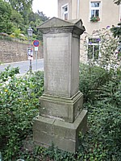

* * *

* * *

* * *

* * *

* * *

* * *

**_Gedenkstein in Altwachwitz_**

Zu den einschneidendsten Ereignissen in der Geschichte des Ortes
gehörte ein Unwetter im Jahr 1844, welches schwere Schäden im Ort anrichtete. Nach einem Wolkenbruch in den Nachmittagsstunden des 12. Mai 1844 wurde der schmale Gönnsdorfer Bach, der den [Wachwitzgrund](../../../../nordost/wachwitz/wachwitzgrund/) durchfließt, zum reißenden Gewässer. Die Wassermassen überfluteten die angrenzenden Grundstücke und lösten
dabei Erdrutsche aus. Die Befestigungsmauern des Baches konnten keinen Widerstand entgegensetzen und stürzten ein. Neun Gebäude wurden schwer beschädigt, vier Häuser völlig zerstört. Auch die mittlere
Mühle wurde bei der Flut weggerissen. Zwei Wachwitzer Einwohner kamen bei diesem Unwetter ums Leben.

In Erinnerung an dieses Ereignis ließ die Gemeinde 1894 am Dorfplatz
einen Gedenkstein aufstellen. Ursprünglich befand sich dieser unmittelbar an der Brücke am Haus Altwachwitz 7.  1927 wurde er durch den Landesverein Sächsischer Heimatschutz restauriert. Um das
Denkmal vor Schäden zu bewahren, wurde der Stein 1988 an das Brunnenhäuschen umgesetzt.

_Rechts: Inschrift des Gedenksteines von 1894_

* * *

 \[ [Home](../../../../index.html)\] \[ [Nord](../../../../nord/)\] \[ [Nordwest](../../../../nordwest/)\] \[ [Neustadt](../../../../neustadt/)\] \[ [Nordost](../../../../nordost/)\] \[ [West](../../../../west/)\] \[ [Zentrum](../../../../zentrum/)\] \[ [Südwest](../../../../sudwest/)\] \[ [Süd](../../../../sud/)\] \[ [Südost](../../../../sudost/)\] \[ [Ost](../../../../ost/)\] \[ [Register](../../../../Register/register.html)\] \[ [Kontakt](../../../../Kontakt/kontakt.html)\] \[ [Impressum](../../../../impressum/)\]
